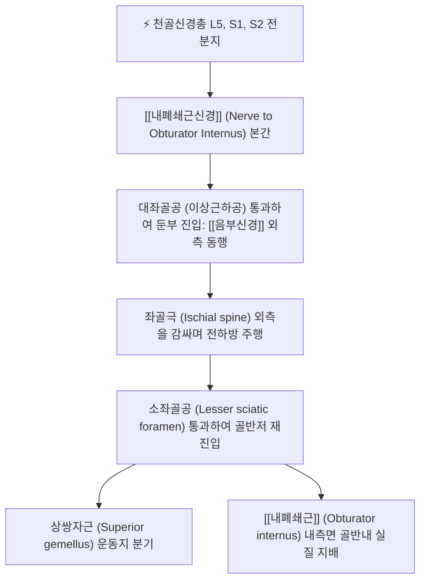

# 내폐쇄근신경 (Nerve to Obturator Internus, 속폐쇄근신경)

> [!NOTE]
> 천골신경총(L5-S2) 앞가지의 전분지에서 기원하여 대좌골공을 나온 뒤 좌골극을 돌아 다시 소좌골공으로 진입하는 특이한 U자형 주행 경로를 가지며, [[내폐쇄근]]과 상쌍자근을 운동 지배하는 순수 운동신경으로 **심부 둔부 증후군(Deep Gluteal Syndrome)**의 핵심 구성 신경입니다.

---

## 1. 신경 기원 & 해부학적 분지 경로 (Anatomy & Course)

* **신경 기원 (Spinal Segments)**:
  * 천골신경총(Sacral plexus) **제5 요추신경부터 제2 천추신경(L5, S1, S2)** 앞가지의 **전분지(Anterior divisions)**에서 기원합니다.
* **특이 주행 경로 (Looping Course)**:
  1. 골반강을 나와 [[이상근]](Piriformis) 하방의 **대좌골공(Greater sciatic foramen, 이상근하공)**을 통해 둔부로 진입합니다. 이때 [[음부신경]](Pudendal nerve)의 바로 외측에 밀착되어 주행합니다.
  2. 좌골극(Ischial spine)의 외측연과 천극인대(Sacrospinous ligament) 표면을 돌아 상쌍자근에 작은 운동지를 냅니다.
  3. 다시 **소좌골공(Lesser sciatic foramen)**을 통해 진골반(골반저) 내부로 재진입합니다.
  4. 진골반 내부에서 [[내폐쇄근]](Obturator internus)의 골반면(Pelvic surface)을 따라 전방으로 주행하며 근복 심부로 분지합니다.

---

## 2. 신경 지배 맵 & 기능 네트워크 (Innervation Map)

* **운동 신경 지배 (Pure Motor)**:
  * **상쌍자근 (Superior gemellus)**: 좌골극 부근에서 갈라져 나오는 작은 신경지가 지배합니다.
  * **[[내폐쇄근]] (Obturator internus)**: 소좌골공을 통과한 본간이 내폐쇄근의 심부 실질을 전담 운동 지배합니다.
* **생체역학적 기능**:
  * 고관절 신전 상태에서 강력한 **고관절 외회전(External rotation)**을 유도합니다.
  * 고관절 90도 굴곡 상태(좌위)에서는 대퇴골두를 비구(Acetabulum)에 안정적으로 밀착시키는 **고관절 수평 외전 및 관절 안정화(Dynamic stabilizer)** 역할을 수행합니다.
* **골반저 지지 네트워크**:
  * 내폐쇄근 근막(Obturator fascia)은 골반저 근육인 항문거근(Levator ani)의 건궁(Arcus tendineus)과 연결되어 골반강 압력 및 비뇨생식기 안정성을 조절합니다.

---

## 3. 호발 포착 부위 & 터널 증후군 병태생리

* **1차 호발 포착점: 대좌골공 이상근하 공간**:
  * [[이상근]]의 비후, 연축 또는 해부학적 변이로 인해 대좌골공을 빠져나오는 부위에서 [[좌골신경]], [[음부신경]]과 함께 복합 압박을 받습니다.
* **2차 호발 포착점: 좌골극 및 천극인대 부위 (Ischial Spine)**:
  * 좌골극을 U자형으로 감싸고 도는 모퉁이에서 천골 결절인대와 천극인대의 섬유성 비후, 골반 아탈구에 의해 기계적 마찰과 견인을 받습니다.
* **심부 둔부 증후군 (Deep Gluteal Syndrome, DGS)**:
  * 이상근, 상·하쌍자근, 내폐쇄근 복합체의 만성 경결로 인해 둔부 심부 통증과 좌골신경 자극 증상이 동반됩니다.

---

## 4. 손상 레벨별 임상 증상 & 신경학적 결손

* **둔부 심부의 묵직한 통증**:
  * 엉덩이 깊은 곳(좌골 결절과 대전자 사이)이 뻐근하게 쑤시고 조이는 듯한 심부 둔통.
  * 딱딱한 의자에 앉아 있을 때 좌골극 부위 압박으로 통증이 심화되어 엉덩이를 들썩이게 됩니다.
* **고관절 내회전 시 당김 및 외회전 약화**:
  * 고관절을 수동적으로 내회전(Internal rotation)시킬 때 내폐쇄근이 신장되며 심한 둔부 통증이 유발됩니다.
  * 고관절 외회전 근력 약화로 인해 보행 시 추진력이 불안정해집니다.

---

## 5. 관련 이학적 검사 & 신경 감별 매트릭스

* **페어 검사 (FAIR Test / Flexion-Adduction-Internal Rotation)**:
  * 고관절을 90도 굴곡, 내전, 내회전시킬 때 내폐쇄근 및 쌍자근군이 최대로 신장되며 둔부 심부 통증이 유발되는지 확인합니다.
* **페이스 검사 (Pace's Sign)**:
  * 좌위에서 양 무릎을 바깥쪽으로 벌리도록 저항을 줄 때(고관절 외전·외회전 수축) 둔부 심부에 통증이 유발되는지 평가합니다.
* **신경 감별 매트릭스**:
  | 구분 | [[내폐쇄근신경]] 병변 | [[이상근 증후군]] | [[음부신경]]통 |
  | :--- | :--- | :--- | :--- |
  | **주요 통증 부위** | 둔부 심부 (좌골극 외측) | 둔부 중앙 + 대퇴 후면 방사 | 회음부, 항문, 생식기 작열통 |
  | **압통점** | 좌골극 및 소좌골공 | 이상근 근복 중앙 (환도혈) | 좌골결절 내측 (알콕관) |
  | **신경 성격** | 순수 운동신경 (통증은 근막성) | 혼합신경 압박 (하지 방사통) | 감각·운동 혼합 (배뇨통 동반) |

---

## 6. 한의 신경 치료 프로토콜 (약침·침도·신경수기)

* **질변(BL54) 및 환도(GB30) 심부 약침술**:
  * 복와위에서 좌골극 투영 부위인 질변혈 및 환도혈에서 75~90mm 장침을 이용하여 대둔근을 지나 내폐쇄근 및 쌍자근 심부 건궁에 도달하도록 자침합니다.
  * [[신바로약침]] 1.0cc를 주입하여 국소 무균성 신경염과 골반 심부 근막 유착을 해소합니다.
* **좌골극 주변 침도 박리술**:
  * 초음파 유도하 또는 해부학적 지표(좌골극 외측연)를 확인하여 소침도로 천극인대와 내폐쇄근 사이의 섬유성 유착띠를 안전하게 미세 감압합니다.
* **심부 외회전근 이완 추나 (Deep Rotator Release)**:
  * 고관절 굴곡·외회전 상태에서 좌골결절과 대전자 사이 공간을 촉지하고 허혈성 압박 및 PNF 스트레칭을 적용하여 내폐쇄근을 이완시킵니다.

---

## 7. 💡 사용자 진료실 핵심 필기 & 임상 팁 (원문 보존)

* **원문 필기 내용**:
  * `천골신경총 L5-S2 기원, 대좌골공을 나와 좌골극을 돌아 소좌골공으로 진입하는 특이 주행`
  * `내폐쇄근, 상쌍자근 지배 및 심부 둔부 증후군(DGS)의 주요 원인`
* **진료실 임상 고도화 팁**:
  * 환도혈을 아무리 치료해도 엉덩이 깊숙한 곳의 조이는 통증이 낫지 않는 환자는 이상근 아래에 위치한 내폐쇄근과 상쌍자근의 구축을 치료해야 합니다.
  * 질변혈 부위에서 좌골극 외측연을 향해 심자하여 내폐쇄근 건을 직접 자극하면, 수년간 지속된 둔부 심부통이 빠르게 호전됩니다.

---

## 8. 출처 및 학술 참고 문헌 (References)

* Palmieri, B., & Ryals, B. (2026). "Unilateral Conjoint Tendon Formation of the Piriformis, Superior Gemellus, and Tendonized Obturator Internus: A Rare Cadaveric Variation of the Deep Gluteal Region." *Cureus*, 18(6), e85231. [PMID: 42535162](https://pubmed.ncbi.nlm.nih.gov/42535162/)
  - [연구 요약]: 심부 둔부 영역에서 내폐쇄근, 상쌍자근, 이상근 건의 해부학적 융합 변이와 내폐쇄근신경 및 좌골신경 포착 기전 분석.
* Moore, K. L., Dalley, A. F., & Agur, A. M. (2018). *Clinically Oriented Anatomy* (8th ed.). Wolters Kluwer.
  - [연구 요약]: 내폐쇄근신경의 대좌골공 및 소좌골공 통과 주행 해부학 수록.
* 전국한의과대학 침구경혈학교실 (2020). *침구의학*. 집문당.
  - [연구 요약]: 둔통 및 심부 둔부 근육 치료를 위한 환도, 질변 취혈 지침.
