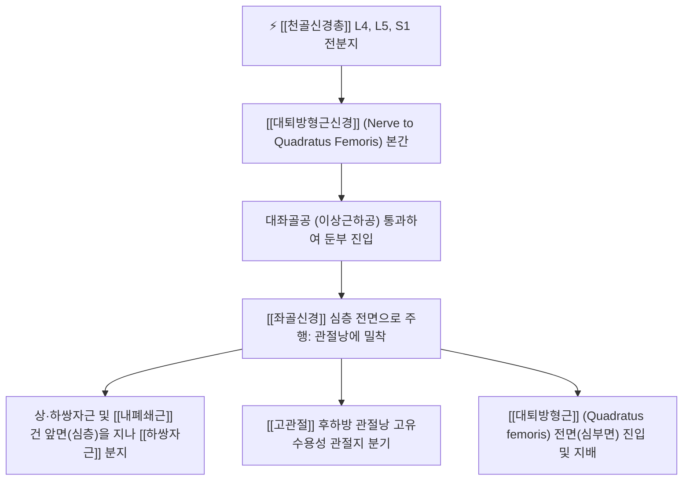

# 대퇴방형근신경 (Nerve to Quadratus Femoris, 넙다리네모근신경)

> [!NOTE]
> [[천골신경총]](L4-S1) 앞가지의 전분지에서 기원하여 대좌골공을 빠져나온 후 심부 외회전근군의 앞면(심층)을 따라 수직으로 하행하여 [[대퇴방형근]]과 [[하쌍자근]]을 운동 지배하고 [[고관절]] 후하방 관절낭 감각을 담당하며, **좌골대퇴 충돌증후군(Ischiofemoral Impingement)**과 연관된 핵심 신경입니다.

---

## 1. 신경 기원 & 해부학적 분지 경로 (Anatomy & Course)

* **신경 기원 (Spinal Segments)**:
  * [[천골신경총]](Sacral plexus) **제4, 5 요추신경 및 제1 천추신경(L4, L5, S1)** 앞가지의 **전분지(Anterior divisions)**에서 기원합니다.
* **둔부 심부면 주행 경로**:
  * 골반강을 빠져나와 [[이상근]](Piriformis) 하방의 **대좌골공(Greater sciatic foramen)**을 통과합니다.
  * [[좌골신경]](Sciatic nerve)의 심층(전방), 즉 비구(Acetabulum)와 [[고관절]] 관절낭의 바로 후면에 밀착되어 수직 하행합니다.
  * [[상쌍자근]], [[내폐쇄근]] 건, [[하쌍자근]]의 앞면(골성 표면 사이)을 지나며 하쌍자근에 운동지를 제공합니다.
  * 대퇴골 전자간능(Intertrochanteric crest)과 [[좌골결절]](Ischial tuberosity) 사이 공간을 지나 [[대퇴방형근]](Quadratus femoris)의 전면(심부면)으로 진입하여 종말 분지합니다.

---

## 2. 신경 지배 맵 & 기능 네트워크 (Innervation Map)

* **운동 신경 지배 (Motor Innervation)**:
  * **[[하쌍자근]] (Inferior gemellus)**: [[고관절]] 외회전 보조.
  * **[[대퇴방형근]] (Quadratus femoris)**: [[좌골결절]] 외측연에서 대퇴골 전자간능으로 이어지는 사각형 근육으로, 가장 강력한 고관절 외회전(External rotation) 및 내전 보조 근력을 제공합니다.
* **관절 감각 신경 지배 (Articular Sensory)**:
  * **고관절낭 후하방 관절지(Articular branch to hip joint)**: [[고관절]] 관절낭의 후면 및 하부 부착부에 고유수용성 감각 신경지를 공급하여 만성 고관절 통증의 주요 신경 전도로로 작용합니다.
* **고관절 동적 안정화 기능**:
  * 대퇴골두를 비구 관절와에 강하게 밀착시키는 동적 안정화 역할을 수행하며, 보행 시 골반이 전방으로 밀리지 않도록 잡아줍니다.

---

## 3. 호발 포착 부위 & 터널 증후군 병태생리

* **좌골대퇴 공간 협착 (Ischiofemoral Space Narrowing)**:
  * [[좌골결절]](Ischial tuberosity)과 대퇴골 [[소전자]](Lesser trochanter) 사이의 해부학적 간격(정상 20±5mm)이 여성 골반 변위, 고관절 신전-외회전 과다, 낙상 외상 등으로 좁아질 때 대퇴방형근과 신경이 직접 압박됩니다.
* **좌골대퇴 충돌증후군 (Ischiofemoral Impingement, IFI)**:
  * 좌골대퇴 공간의 협소로 인해 대퇴방형근 부종, 근위축, 점액낭염이 발생하며 대퇴방형근신경과 [[좌골신경]]이 동시에 포착됩니다.
* **비구 후면 및 관절낭 유착**:
  * [[고관절]]염, 고관절 충돌증후군(FAI), 고관절 치환술 후 비구 후면 반흔에 의해 신경이 유착됩니다.

---

## 4. 손상 레벨별 임상 증상 & 신경학적 결손

* **서혜부 및 둔부 후하방의 만성 통증**:
  * [[좌골결절]] 부위(앉을 때 닿는 뼈)와 대퇴골 [[대전자]] 뒤쪽으로 뻐근하게 조여드는 둔통.
  * 보행 시 보폭을 크게 하여 다리를 뒤로 뻗을 때([[고관절]] 신전 및 내전) 좌골대퇴 공간이 좁아지며 날카로운 통증이 유발됩니다.
* **좌위 시 압박 통증**:
  * 딱딱한 의자에 앉아 체중이 [[좌골결절]]에 실릴 때 둔부 심부와 서혜부 깊숙한 곳으로 방사통이 나타납니다.

---

## 5. 관련 이학적 검사 & 신경 감별 매트릭스

* **좌골대퇴 충돌 검사 (Ischiofemoral Impingement Test)**:
  * 환자를 측와위로 눕히고 검사자가 [[고관절]]을 수동적으로 신전, 내전, 외회전시킬 때 좌골결절과 소전자 사이에서 통증이 재현되면 양성입니다.
* **장보폭 보행 검사 (Long-Stride Walking Test)**:
  * 환자에게 보폭을 평소보다 넓게 하여 걷게 할 때, 환측 다리가 뒤로 신전되는 순간 통증이 발생하고 보폭을 줄이면 통증이 사라지는지 확인합니다.
* **신경 감별 매트릭스**:
  | 구분 | [[대퇴방형근신경]] 포착 (IFI) | [[햄스트링]] 기시부 건병증 | [[이상근 증후군]] |
  | :--- | :--- | :--- | :--- |
  | **통증 유발 동작** | 고관절 과신전 및 내전 | 고관절 굴곡 + 무릎 신전 스트레칭 | 고관절 굴곡, 내전, 내회전 (FAIR) |
  | **주요 압통점** | 좌골결절과 소전자 사이 공간 | 좌골결절 하면 햄스트링 기시부 | 둔부 중앙 이상근 근복 (환도혈) |
  | **방사통 특징** | 서혜부 심부 및 둔부 후하방 | 허벅지 뒤쪽을 타고 내려감 | 종아리 및 발끝까지 방사 가능 |

---

## 6. 한의 신경 치료 프로토콜 (약침·침도·신경수기)

* **좌골대퇴 간극 초음파 유도하 침도 감압술**:
  * 앙와위 또는 측와위에서 [[좌골결절]]과 [[대전자]] 사이의 대퇴방형근 공간을 촉지하고, 0.4×60mm 소침도를 대퇴골 후면을 향해 자입하여 비후된 심부 외회전근막 및 좌골대퇴 인대 유착을 미세 박리합니다.
* **환도(GB30) 및 승부(BL36) 약침 치료**:
  * 대퇴방형근신경이 주행하는 심부 공간에 [[신바로약침]] 또는 자하거약침 1.0cc를 심자 주입하여 고관절낭 후하방의 무균성 염증과 신경 부종을 치료합니다.
* **골반 비틀림 및 고관절 정렬 추나**:
  * 장골의 외번 변형과 고관절 외회전 변위를 교정하여 좌골대퇴 공간의 해부학적 용적을 확보하는 [[추나치료]]를 병행합니다.

---

## 7. 💡 사용자 진료실 핵심 필기 & 임상 팁 (원문 보존)

* **원문 필기 내용**:
  * `천골신경총 L4-S1 기원, 대좌골공을 나와 심부 외회전근의 심층을 주행`
  * `대퇴방형근 및 하쌍자근 지배, 고관절낭 관절지 공급, 좌골대퇴 충돌증후군(IFI)의 핵심 표적`
* **진료실 임상 고도화 팁**:
  * 보행 시 다리를 뒤로 젖힐 때 엉덩이 아래쪽 뼈가 걸리듯 아프고 오래 앉아 있지 못하는 환자는 디스크나 [[햄스트링]] 손상이 아니라 좌골대퇴 충돌증후군(대퇴방형근신경 포착)입니다.
  * [[승부]]혈 외측 1.5촌, [[좌골결절]]과 [[대전자]] 사이 공간을 깊게 촉지하여 침도 요법과 [[신바로약침]]을 시술하면 좁아진 공간이 이완되며 보행 시 통증이 극적으로 소실됩니다.

---

## 8. 출처 및 학술 참고 문헌 (References)

* Petroni, G. M., & Sanapo, A. (2026). "Hip chronic pain: ultrasound-guided ablation of the articular branches of the nerve to quadratus femoris. Upgrade of the technique." *Minerva Anestesiologica*, 92(5), 415-422. [PMID: 41757844](https://pubmed.ncbi.nlm.nih.gov/41757844/)
  - [연구 요약]: 만성 고관절 통증 환자에서 대퇴방형근신경의 관절 감각지 주행 해부학 및 초음파 유도하 표적 신경 감압 시술 성적 규명.
* Moore, K. L., Dalley, A. F., & Agur, A. M. (2018). *Clinically Oriented Anatomy* (8th ed.). Wolters Kluwer.
  - [연구 요약]: 대퇴방형근신경의 천골신경총 기원 및 심부 둔부 주행 경로 기술.
* 전국한의과대학 침구경혈학교실 (2020). *침구의학*. 집문당.
  - [연구 요약]: 둔부 후하방 통증에 대한 승부, 환도 취혈 지침.
