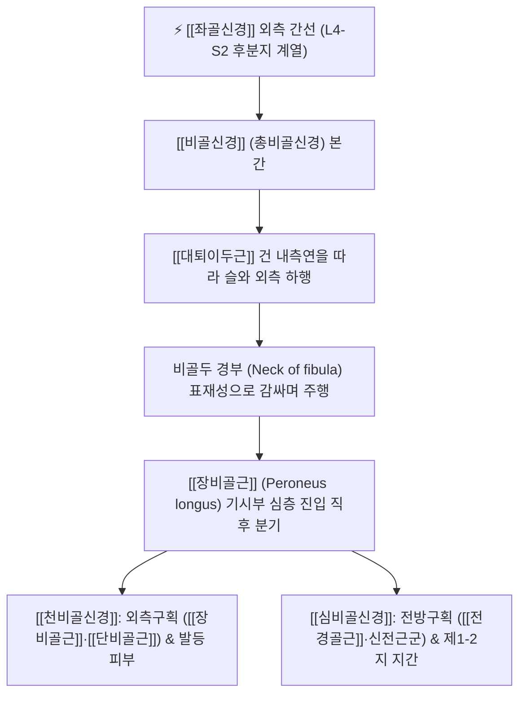

# 비골신경 (Common Peroneal Nerve / Fibular Nerve, 총비골신경)

> [!NOTE]
> [[좌골신경]]의 외측 주요 줄기로 천골신경총(L4-S2) 앞가지의 후분지에서 기원하며, 비골두(Fibular head) 경부를 감싸고 돌며 천비골신경과 심비골신경으로 나뉘어 하지 전외측의 족배굴곡 및 외번 운동과 발등 감각을 지배하며 **족하수(Foot Drop)**를 유발하는 대표적인 말초신경입니다.

---

## 1. 신경 기원 & 해부학적 분지 경로 (Anatomy & Course)

* **신경 기원 (Spinal Segments)**:
  * 천골신경총(Sacral plexus) **제4 요추신경부터 제2 천추신경(L4, L5, S1, S2)** 앞가지의 **후분지(Posterior divisions)**에서 기원합니다.
* **슬와 외측 및 비골두 주행 경로**:
  * 슬와 상각에서 경골신경과 분리되어 [[대퇴이두근]](Biceps femoris) 건의 내측연을 따라 비스듬히 외하방으로 주행합니다.
  * 비골두 하방의 **비골 경부(Neck of fibula)**를 후방에서 전방으로 감싸고 돌며 매우 표재성으로 뼈 바로 위를 지나갑니다.
* **장비골근 통과 및 종말 분기**:
  * [[장비골근]](Peroneus longus) 기시부의 섬유성 터널(비골 터널)을 뚫고 들어가자마자 **[[천비골신경]]**(Superficial fibular nerve)과 **[[심비골신경]]**(Deep fibular nerve)의 2대 종말 가지로 갈라집니다.

---

## 2. 신경 지배 맵 & 기능 네트워크 (Innervation Map)

* **운동 신경 지배 (Motor Innervation)**:
  * **[[천비골신경]] 계열 (외측 구획)**:
    * [[장비골근]](Peroneus longus): 족관절 외번(Eversion) 및 제1 중족골 기저부 안정화.
    * [[단비골근]](Peroneus brevis): 족관절 강력 외번 및 보행 보조.
  * **[[심비골신경]] 계열 (전방 구획)**:
    * [[전경골근]](Tibialis anterior): 족관절 족배굴곡(Dorsiflexion) 및 내번.
    * 장무지신전근(Extensor hallucis longus): 엄지발가락 신전 및 족배굴곡.
    * 장지신전근(Extensor digitorum longus): 제2~5족지 신전.
    * 제3비골근(Peroneus tertius): 보조 족배굴곡.
    * 단지신전근(Extensor digitorum brevis): 족배부 내재 신전근.
* **감각 신경 지배 (Sensory Innervation)**:
  * **외측비복피부신경**: 종아리 상외측면 피부.
  * **천비골신경 종말지**: 하퇴 하외측면 및 발등(족배부) 대부분의 피부 감각.
  * **심비골신경 종말지**: 제1족지와 제2족지 사이(엄지-검지 발가락 사이 족배면) 웹 공간 피부 감각.
* **보행 주기에서의 필수 기능**:
  * 유각기(Swing phase)에서 발끝이 지면에 끌리지 않도록 들어 올려주고, 초기 접지기(Heel strike)에서 발바닥이 털썩 떨어지지 않도록 편심성 감속을 담당합니다.

---

## 3. 호발 포착 부위 & 터널 증후군 병태생리

* **비골두 경부 섬유성 터널 (Neck of Fibula)**:
  * 비골 경부에서 피부 및 뼈와 바로 맞닿아 주행하므로 외부 압박에 인체 말초신경 중 가장 취약합니다.
  * 다리를 꼬고 앉는 습관, 꽉 끼는 깁스나 보조기 착용, 장시간 쪼그려 앉아서 일하는 자세, 수술 중 측와위 압박 등에 의해 급성 마비가 발생합니다.
* **체중 감량 및 영양 결핍 (Slimmer's Palsy)**:
  * 단기간의 급격한 다이어트나 만성 소모성 질환으로 비골두 주변의 보호 지방패드가 소실되면서 경미한 외부 압박에도 신경 허혈이 초래됩니다.
* **족관절 내번 염좌 (Inversion Ankle Sprain)**:
  * 발목을 심하게 접지를 때 비골두 주변에서 비골신경이 순간적으로 강하게 신장(Traction)되어 신경 손상이 유발됩니다.

---

## 4. 손상 레벨별 임상 증상 & 신경학적 결손

* **족하수 (Foot Drop / 발목 마비)**:
  * 발목을 위로 들어 올리는 족배굴곡(Dorsiflexion) 및 발가락 신전 근력이 완전히 마비됩니다.
  * 걸을 때 발끝이 바닥에 끌리므로 발을 높이 들어 올렸다가 털썩 내려놓는 **계주 보행(Steppage gait / 닭걸음)**을 보입니다.
* **발등 및 발가락 감각 결손**:
  * 발등 전체 및 엄지-둘째 발가락 사이의 감각이 둔마되거나 먹먹해지며, 찌릿찌릿한 저림이 동반됩니다.
* **외번 근력 마비**:
  * 발목을 바깥쪽으로 젖히는 외번(Eversion)이 불가능하여 발이 안쪽으로 꺾여 반복적인 발목 염좌 위험이 증가합니다.

---

## 5. 관련 이학적 검사 & 신경 감별 매트릭스

* **비골두 틴넬 징후 (Tinel's Sign at Fibular Neck)**:
  * 비골두 바로 아래 경부를 가볍게 두드릴 때 발등이나 엄지발가락 쪽으로 찌릿한 전기가 통하면 양성입니다.
* **족배굴곡 도수근력검사 (Dorsiflexion MMT)**:
  * 전경골근 근력을 평가하여 족하수 발생 여부를 확인합니다.
* **신경 감별 매트릭스**:
  | 구분 | [[비골신경]] 마비 (총비골신경) | 요추 5번(L5) 신경근증 | [[경골신경]] 마비 |
  | :--- | :--- | :--- | :--- |
  | **족하수 (발목 들기)** | 심각한 족하수 (족배굴곡 불가) | 족배굴곡 약화 가능 | 없음 (족척굴곡이 불능) |
  | **발목 내번 (안쪽 들기)** | 보존됨 ([[후경골근]]은 경골신경 지배) | 약화됨 (L5 신경근 지배) | 불가능 (후경골근 마비) |
  | **하지직거상(SLR)** | 정상 (음성) | 양성 (방사통 재현) | 음성 |
  | **감각 결손 부위** | 발등 및 하지 외측 국한 | 둔부 + 대퇴 외측 + 종아리 + 발등 | 발바닥 전체 및 종아리 뒤 |

---

## 6. 한의 신경 치료 프로토콜 (약침·침도·신경수기)

* **양릉천(GB34) 비골두 침도 감압술**:
  * 측와위 또는 앙와위에서 비골두 전하방 양릉천혈 부위, 장비골근 기시부 섬유성 건궁을 촉지합니다.
  * 0.4×40mm 소침도를 신경 주행과 평행하게 자입하여 비골두를 감싸는 비후된 건막과 섬유띠를 미세 절개·박리하여 신경을 감압합니다.
* **족삼리(ST36) 및 현종(GB39) 전침 요법**:
  * 전경골근과 장지신전근 근복(족삼리, 상거허)에 전침을 자침하고 2~4Hz 저주파 단속파를 통전하여 마비된 근육의 위축을 방지하고 신경 재생을 유도합니다.
* **신바로약침 치료**:
  * 비골두 경부 신경 압박점에 [[신바로약침]] 0.5~1.0cc를 주입하여 신경막 부종을 신속히 가라앉힙니다.
* **비골두 관절 가동 추나 (Tibiofibular Mobilization)**:
  * 근위 경비관절의 후하방 아탈구를 교정하여 비골두 주변의 기계적 긴장을 해소합니다.

---

## 7. 💡 사용자 진료실 핵심 필기 & 임상 팁 (원문 보존)

* **원문 필기 내용**:
  * `좌골신경 외측 분지, L4-S2 기원`
  * `비골두 경부를 돌아 천비골신경과 심비골신경으로 분기`
  * `족하수(Foot drop) 및 발등 감각 이상 유발, 양릉천·족삼리 취혈 핵심 표적`
* **진료실 임상 고도화 팁**:
  * "갑자기 발목이 안 올라가서 걸을 때 발끝이 바닥에 끌린다"며 내원한 환자에서 가장 먼저 확인할 것은 L5 디스크인지 비골신경 마비인지 감별하는 것입니다.
  * **발목을 안쪽으로 젖히는 내번(Inversion) 근력이 살아있다면 디스크가 아니라 비골두 압박으로 인한 비골신경 마비**입니다.
  * 다리를 꼬는 습관을 금지시키고 양릉천혈 침도 감압과 족삼리 전침 치료를 2~3주간 집중 시행하면 마비되었던 족배굴곡 근력이 신속하게 회복됩니다.

---

## 8. 출처 및 학술 참고 문헌 (References)

* Zhang, Z., & Li, H. (2026). "Common peroneal nerve entrapment in an adolescent during a growth spurt: a case report and hypothesis on growth-related vulnerability." *Frontiers in Pediatrics*, 14, 1421092. [PMID: 42920732](https://pubmed.ncbi.nlm.nih.gov/42920732/)
  - [연구 요약]: 성장기 비골두 주변 총비골신경의 해부학적 포착 기전, 족하수 발생 증례 및 조기 신경 감압의 유용성 보고.
* Moore, K. L., Dalley, A. F., & Agur, A. M. (2018). *Clinically Oriented Anatomy* (8th ed.). Wolters Kluwer.
  - [연구 요약]: 총비골신경의 비골 경부 주행 해부학 및 손상 시 계주 보행(Steppage gait) 기전 수록.
* 전국한의과대학 침구경혈학교실 (2020). *침구의학*. 집문당.
  - [연구 요약]: 족하수 및 위증에 대한 양릉천, 족삼리, 현종 취혈의 임상 지침.
