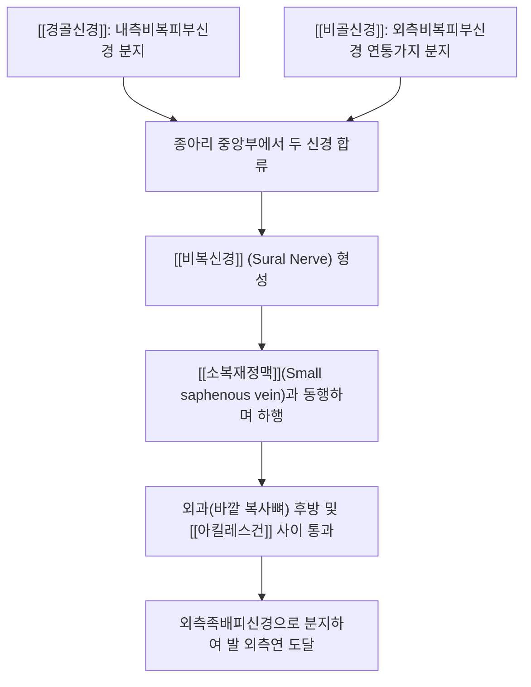

# 비복신경 (Sural Nerve, 장딴지신경)

> [!NOTE]
> [[경골신경]]의 내측비복피부신경과 [[비골신경]]의 외측비복피부신경 연통가지가 합류하여 형성되는 순수 표재 감각신경으로, [[소복재정맥]]과 동행하여 종아리 후외측, 외과(바깥 복사뼈) 후방 및 발 외측연의 감각을 지배하며 발목 수술 및 외상 후 통증을 유발하는 말초신경입니다.

---

## 1. 신경 기원 & 해부학적 분지 경로 (Anatomy & Course)

* **신경 기원 (Spinal Segments)**:
  * [[천골신경총]] **제1, 2 천추신경(S1, S2)** 분절에서 기원합니다.
  * 운동 신경 섬유가 전혀 없는 **100% 순수 체감각 신경(Pure sensory nerve)**입니다.
* **해부학적 합류 과정**:
  * 슬와 내부에서 [[경골신경]]으로부터 분지한 **내측비복피부신경**(Medial sural cutaneous nerve)이 [[비복근]] 양 두 사이 고랑을 따라 하행합니다.
  * [[총비골신경]]에서 갈라져 나온 **외측비복피부신경의 연통가지**(Sural communicating branch)와 종아리 하부 1/3 지점에서 합류하여 단일한 비복신경 본간을 완성합니다.
* **원위부 주행 경로**:
  * 심부 근막을 뚫고 표재층으로 나와 **[[소복재정맥]]**(Small saphenous vein)과 나란히 주행합니다.
  * [[아킬레스건]] 외측연과 외과(Lateral malleolus) 후방 사이의 좁은 고랑을 통과하여 [[족관절]] 외측으로 내려갑니다.
  * 족부 외측연에서 외측족배피신경(Lateral dorsal cutaneous nerve)으로 이어져 제5 중족골 기저부를 지나 새끼발가락 외측 끝까지 감각지를 공급합니다.

---

## 2. 신경 지배 맵 & 기능 네트워크 (Innervation Map)

* **순수 감각 신경 지배 (Pure Sensory)**:
  * 종아리 하부 후외측면 피부.
  * 외과(바깥 복사뼈) 후방 및 종골 외측면 피부.
  * 발등 외측면 및 제5족지(새끼발가락) 외측 가장자리 피부 전반.
* **운동 기능 결손 부재**:
  * 운동 신경 섬유가 전혀 없으므로 신경이 손상되거나 생검을 위해 절제되어도 발목이나 발가락의 운동 마비는 전혀 발생하지 않습니다 (신경 생검 및 자가 신경 이식편 채취 부위로 다용).
* **족부 외측 균형 감각**:
  * 보행 시 발의 외측 모서리가 지면에 닿을 때 체중 부하 및 관절 위치 감각을 뇌로 전달하는 고유수용성 감각에 기여합니다.

---

## 3. 호발 포착 부위 & 터널 증후군 병태생리

* **종아리 심부근막 관통부 포착**:
  * 종아리 하부 1/3 지점에서 [[비복근]] 근막을 뚫고 피하로 나오는 부위에서 [[비복근]] 및 [[가자미근]]의 만성 과긴장으로 인해 조여집니다.
* **외과 후방 및 아킬레스건 사이 마찰**:
  * 꽉 끼는 스키 부츠, 등산화, 군화 착용으로 인한 외부 압박.
  * 발목의 반복적인 [[발목 염좌]](내번 염좌) 시 신경이 과도하게 신장되거나 종비인대(CFL) 부근에서 마찰을 받습니다.
* **의원성 수술 손상 (Iatrogenic Injury)**:
  * [[아킬레스건]] 파열 봉합술, 종골 골절 수술, 하지정맥류 수술([[소복재정맥]] 발거술) 후 수술 반흔 조직에 유착되어 만성 신경병증성 동통을 유발합니다.

---

## 4. 손상 레벨별 임상 증상 & 신경학적 결손

* **비복신경통 (Sural Neuralgia)의 전형 증상**:
  * 종아리 바깥쪽 뒤부터 복사뼈 바깥쪽 뒤, 발 외측 날을 따라 찌릿찌릿 뻗치는 방사통과 화끈거림.
  * 신발 뒤축이 닿을 때마다 전기가 통하듯 깜짝 놀라는 이질통(Allodynia).
* **발목 염좌 후 만성 통증**:
  * 발목 인대 손상이 다 나았음에도 불구하고 발목 외측 뒤쪽이 지속적으로 저리고 시린 만성 신경통.

---

## 5. 관련 이학적 검사 & 신경 감별 매트릭스

* **외과 후방 틴넬 징후 (Tinel's Sign at Lateral Malleolus)**:
  * 외과 후방 1~2cm 부위를 가볍게 두드릴 때 새끼발가락 외측으로 찌릿한 방사통이 뻗치면 양성입니다.
* **비복신경 신장 검사 (Sural Nerve Tension Test)**:
  * 앙와위에서 슬관절을 신전시킨 채 발목을 족배굴곡 및 내번(Inversion)시킬 때 신경이 당겨지며 통증이 재현되는지 확인합니다.
* **신경 감별 매트릭스**:
  | 구분 | [[비복신경]]통 | [[천비골신경]] 포착 | 만성 [[발목 염좌]] (전거비인대) |
  | :--- | :--- | :--- | :--- |
  | **통증 위치** | 종아리 후외측 + 발 외측 날 | 발등 중앙 및 발가락 등 | 외과 전하방 (전거비인대 국소) |
  | **통증 특성** | 작열통, 저림, 이질통 | 발등 저림 및 감각 저하 | 기계적 압통 및 인대 불안정성 |
  | **틴넬 징후** | 외과 후방에서 양성 | 외과 전상방에서 양성 | 음성 |

---

## 6. 한의 신경 치료 프로토콜 (약침·침도·신경수기)

* **외과 후방 수술 반흔 침도 박리술**:
  * 측와위에서 외과 후방 압통점 및 수술 흉터 유착 부위([[곤륜]], [[부양]] 부근)에 0.35×30mm 소침도를 자입하여 비후된 건막과 섬유성 반흔을 미세 박리합니다.
* **곤륜(BL60) 및 신맥(BL62) 약침 요법**:
  * 비복신경이 주행하는 외과 후방 [[곤륜]](BL60) 및 [[신맥]](BL62) 주변에 [[신바로약침]] 또는 황련해독약침 0.5cc를 주입하여 국소 무균성 신경염을 치료합니다.
* **종아리 근막 이완 및 비복신경 가동술**:
  * [[비복근]] 외측두와 [[가자미근]]의 경계면을 이완시키는 [[추나치료]]를 적용하고, 족배굴곡-내번 동작을 점진적으로 유도하는 [[신경가동술]]을 시행합니다.

---

## 7. 💡 사용자 진료실 핵심 필기 & 임상 팁 (원문 보존)

* **원문 필기 내용**:
  * `내측비복피부신경(경골신경 분지)과 외측비복피부신경의 연통가지(총비골신경 분지)가 합쳐져 형성`
  * `종아리 후외측, 발목 외측(외과 후방), 발 외측연 감각 지배`
  * `소복재정맥과 동행`
* **진료실 임상 고도화 팁**:
  * 발목을 접지른 뒤 인대 치료를 수개월간 받았는데도 바깥 복사뼈 뒤쪽이 계속 시리고 타는 듯 아프다는 환자는 비복신경 포착입니다.
  * [[곤륜]]혈 주변을 타진하여 틴넬 징후를 확인하고, [[곤륜]]혈과 [[신맥]]혈 부위에 약침 치료와 가벼운 소침도 박리를 시행하면 오래된 발목 외측 신경통이 즉각 진정됩니다.

---

## 8. 출처 및 학술 참고 문헌 (References)

* Yoon, Y., & Lam, K. H. S. (2025). "Sural Nerve Entrapment in Postoperative Scar Tissue: A Case of Successful Management With Hydrodissection After Calcaneal Fracture Repair." *Cureus*, 17(11), e73142. [PMID: 41356990](https://pubmed.ncbi.nlm.nih.gov/41356990/)
  - [연구 요약]: 종골 골절 수술 후 반흔 조직에 포착된 비복신경에 대한 초음파 유도하 수압박리술(Hydrodissection)의 임상적 성공 증례 보고.
* Moore, K. L., Dalley, A. F., & Agur, A. M. (2018). *Clinically Oriented Anatomy* (8th ed.). Wolters Kluwer.
  - [연구 요약]: 비복신경의 해부학적 합류 기원, 소복재정맥 동행 및 족부 외측 감각 지배 수록.
* 전국한의과대학 침구경혈학교실 (2020). *침구의학*. 집문당.
  - [연구 요약]: 하지 외측 신경통에 대한 곤륜, 신맥, 부양 취혈 지침.
