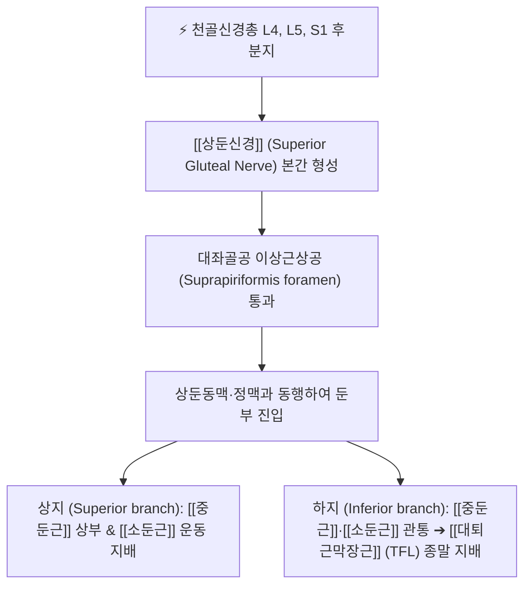

# 상둔신경 (Superior Gluteal Nerve, 위볼기신경)

> [!NOTE]
> 천골신경총(L4-S1) 앞가지의 후분지에서 기원하여 이상근 상방 대좌골공(이상근상공)을 통해 둔부로 진입하는 순수 운동신경으로, [[중둔근]], [[소둔근]], [[대퇴근막장근]]을 지배하며 손상 시 **트렌델렌부르크 징후(Trendelenburg sign)**를 유발하는 핵심 신경입니다.

---

## 1. 신경 기원 & 해부학적 분지 경로 (Anatomy & Course)

* **신경 기원 (Spinal Segments)**:
  * 천골신경총(Sacral plexus) **제4, 5 요추신경 및 제1 천추신경(L4, L5, S1)** 앞가지의 **후분지(Posterior divisions)**에서 기원합니다.
  * 운동 신경 섬유로만 구성된 순수 운동신경(Pure motor nerve)입니다.
* **대좌골공 이상근상공 통과**:
  * 골반강 내부에서 나와 [[이상근]](Piriformis) 상연과 대좌골절제(Greater sciatic notch) 상연 사이의 좁은 골섬유성 관인 **이상근상공(Suprapiriformis foramen)**을 통과합니다.
  * 상둔동맥(Superior gluteal artery) 및 상둔정맥과 밀착되어 혈관신경속을 이루며 둔부로 나옵니다.
* **둔근간 분지 경로**:
  * 이상근상공을 빠져나오자마자 상지(Superior branch)와 하지(Inferior branch)로 갈라져 [[중둔근]](Gluteus medius)과 [[소둔근]](Gluteus minimus) 사이의 근막면을 따라 외측 전방으로 주행합니다.
  * 하지는 중둔근과 소둔근 사이를 지나 최종적으로 골반 외측 전방의 **[[대퇴근막장근]](Tensor fasciae latae, TFL)**으로 진입하여 종말 지배합니다.

---

## 2. 신경 지배 맵 & 기능 네트워크 (Innervation Map)

* **운동 신경 지배 (Pure Motor)**:
  * **[[중둔근]] (Gluteus medius)**: 고관절 외전(Abduction)의 주동근이자 보행 시 골반 수평 유지의 핵심 근육.
  * **[[소둔근]] (Gluteus minimus)**: 고관절 외전 및 내회전(Internal rotation) 보조, 비구 관절와 동적 안정화.
  * **[[대퇴근막장근]] (Tensor fasciae latae, TFL)**: 장경인대(ITB)를 긴장시켜 무릎 외측 안정화 및 고관절 굴곡·외전 보조.
* **감각 신경 지배 부재**:
  * 피부 감각지는 전혀 없으며, 고관절낭 상외측면에 고유수용성 관절 감각지만을 일부 공급합니다.
* **보행 시 골반 수평 유지 기전 (Pelvic Stabilization)**:
  * 단하지 지지기(Single-leg stance)에서 지지하는 쪽의 중둔근과 소둔근이 강력하게 수축하여 반대쪽 골반이 아래로 처지지 않도록 수평을 유지해 줍니다.

---

## 3. 호발 포착 부위 & 터널 증후군 병태생리

* **이상근상공 골섬유성 관 포착 (Suprapiriformis Foramen)**:
  * 장골의 단단한 골성 능선과 이상근 상연 사이의 좁은 공간에서 이상근의 비후, 만성 연축 또는 골반 비틀림에 의해 신경이 조여집니다.
* **중둔근과 소둔근 사이 근막면 유착**:
  * 둔근간 근막의 만성 섬유화, 근막동통증후군, 둔부 둔상(낙상)에 의해 신경 가지가 주행 중 견인·압박을 받습니다.
* **의원성 수술 및 주사 손상**:
  * 고관절 치환술 시 후외측 접근법 절개창 견인, 둔부 근육주사 시 안전 영역(상외측 사분면)을 벗어나 너무 깊거나 내측으로 자입될 때 직접 손상될 수 있습니다.

---

## 4. 손상 레벨별 임상 증상 & 신경학적 결손

* **트렌델렌부르크 징후 (Trendelenburg Sign / 보행 파행)**:
  * 마비된 쪽 다리로 체중을 지탱하고 설 때, 반대쪽 골반이 아래로 툭 떨어지는 현상.
  * 걸을 때 상체를 마비된 쪽으로 심하게 기울이며 뒤뚱거리는 **오리걸음(Waddling gait / Trendelenburg gait)**을 보입니다.
* **둔부 상외측 및 장골능 통증**:
  * 엉덩이 위쪽 바깥면(장골능 아래)과 고관절 외측부로 조여드는 뻐근한 통증.
  * 장시간 서 있거나 보행 시 둔부 피로감과 보행 불안정성이 급격히 악화됩니다.

---

## 5. 관련 이학적 검사 & 신경 감별 매트릭스

* **트렌델렌부르크 검사 (Trendelenburg Test)**:
  * 환자에게 환측 다리로만 서 있게 할 때 건측 골반이 아래로 기울어지면 양성입니다 (중둔근 마비 확인).
* **고관절 외전 도수근력검사 (Hip Abduction MMT)**:
  * 측와위에서 다리를 천장 쪽으로 들어 올리도록 저항을 주어 중둔근 근력 저하를 평가합니다.
* **신경 감별 매트릭스**:
  | 구분 | [[상둔신경]] 마비 | 요추 5번(L5) 신경근증 | [[하둔신경]] 마비 |
  | :--- | :--- | :--- | :--- |
  | **주요 근력 약화** | [[중둔근]]·소둔근 (외전 불능) | 전경골근 약화 ([[족하수]]) + 외전 약화 | [[대둔근]] 약화 (계단 오르기 불능) |
  | **특징적 보행** | 트렌델렌부르크 보행 (외측 동요) | 계주 보행 (닭걸음) | 대둔근 보행 (상체를 뒤로 젖힘) |
  | **감각 결손** | 없음 (순수 운동) | 하지 외측 및 발등 감각 저하 | 없음 (순수 운동) |

---

## 6. 한의 신경 치료 프로토콜 (약침·침도·신경수기)

* **이상근상공 침도 감압술**:
  * 복와위에서 PSIS와 대전자를 연결하는 선의 상부 1/3 지점(이상근상공 투영점)에서 0.4×50mm 소침도를 장골 외측면을 향해 자입하여 이상근 상연과 골성 관의 비후된 섬유띠를 미세 박리합니다.
* **환도(GB30) 및 거료(GB29) 약침 치료**:
  * 중둔근과 소둔근 사이 신경 주행로인 거료혈 및 환도 상방 부위에 [[신바로약침]] 1.0cc를 심자 주입하여 신경 부종과 국소 근막 유착을 해소합니다.
* **중둔근 강화 및 골반 교정 추나**:
  * 천장관절 아탈구를 교정하여 이상근상공의 기계적 협착을 완화하고, 중둔근의 능동적 수축을 유도하는 신경근 촉진(PNF) 수기요법을 병행합니다.

---

## 7. 💡 사용자 진료실 핵심 필기 & 임상 팁 (원문 보존)

* **원문 필기 내용**:
  * `L4-S1 기원`
  * `이상근 상방 대좌골공 통과`
  * `중둔근, 소둔근, 대퇴근막장근(TFL) 운동 지배`
* **진료실 임상 고도화 팁**:
  * 걸을 때 골반이 한쪽으로 툭툭 떨어지며 허리와 엉덩이가 심하게 흔들리는 환자는 중둔근 마비(상둔신경 포착)를 확인해야 합니다.
  * 이상근상공(환도혈 약간 상외측)을 깊게 촉지하여 심한 압통을 확인하고, 소침도 감압과 신바로약침을 시술하면 둔근 근력이 되살아나며 보행 파행이 즉각 교정됩니다.

---

## 8. 출처 및 학술 참고 문헌 (References)

* Diop, M., & Parratte, B. (2002). "Anatomical bases of superior gluteal nerve entrapment syndrome in the suprapiriformis foramen." *Surgical and Radiologic Anatomy*, 24(3-4), 155-159. [PMID: 12375066](https://pubmed.ncbi.nlm.nih.gov/12375066/)
  - [연구 요약]: 이상근상공에서 상둔신경의 해부학적 포착 기전, 중둔근 위축 및 트렌델렌부르크 징후의 임상적 상관성 규명.
* Moore, K. L., Dalley, A. F., & Agur, A. M. (2018). *Clinically Oriented Anatomy* (8th ed.). Wolters Kluwer.
  - [연구 요약]: 상둔신경의 천골신경총 기원, 이상근상공 통과 및 둔근 지배 해부학 수록.
* 전국한의과대학 침구경혈학교실 (2020). *침구의학*. 집문당.
  - [연구 요약]: 둔통 및 중둔근 마비에 대한 거료, 환도 취혈 지침.
