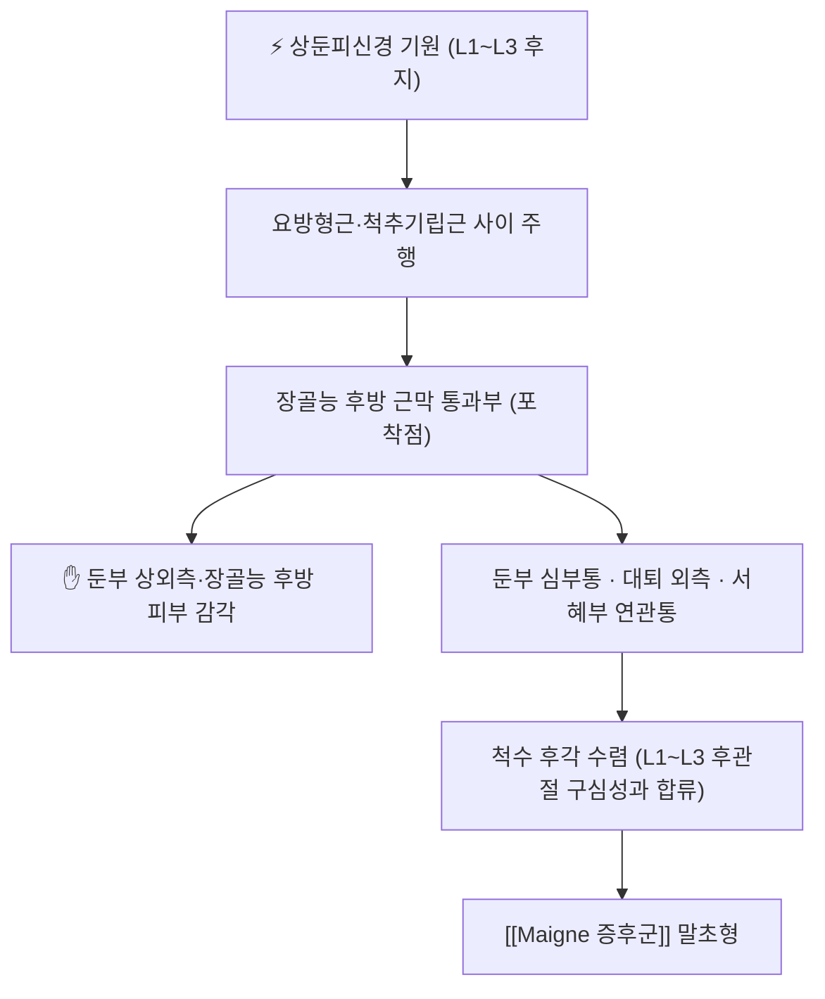

# ⚡ [[상둔피신경]] (Superior cluneal nerve / 上臀皮神經, 기원: L1~L3 후지)

> **핵심 3줄 요약 (Key Summary)**:
> - 🗺️ 신경 기원 & 해부학적 주행: [[요추]] L1~L3의 후지(dorsal rami)에서 나오는 내측지가 모여 이루어지며, [[요방형근]]과 [[척추기립근]]·[[다열근]] 사이를 지나 [[장골능]] 후방을 넘어 둔부 피부로 나간다. 요추신경총(전지)이 아니라 후지 계통이라는 점이 다른 둔부 신경과의 결정적 차이다.
> - 🎯 운동 지배(근육군) & 감각 지배 영역: 운동 지배는 없다(순수 피부 감각신경). [[대둔근]] 상부와 [[장골능]] 후방 피부, 둔부 상외측을 지배하며, 중둔피신경(S1~S3)·하둔피신경과 영역이 겹친다.
> - ⚠️ 호발 포착 부위 & 관련 임상 질환: [[장골능]] 후상방의 근막·건막 통과부가 주 포착점이다. 여기서 눌리면 둔부 심부통과 대퇴 외측·서혜부 연관통이 생기며, [[Maigne 증후군]] 말초형의 원인이 된다.
> - 🔍 주요 이학적 검사 & 신경학적 징후: 후상장골능 압통과 피부 집기-굴림 검사(pinch-roll)에서 연관통 재현이 핵심이다. 근력 저하·반사 소실은 원칙적으로 없으며, 이가 있으면 다른 신경근 병변을 먼저 배제한다.

---

## 📌 목차
1. [신경 기원 & 해부학적 분지 경로 (Anatomy & Course)](#1-신경-기원--해부학적-분지-경로-anatomy--course)
2. [신경 지배 맵 & 기능 네트워크 (Innervation Map)](#2-신경-지배-맵--기능-네트워크-innervation-map)
3. [호발 포착 부위 & 터널 증후군 병태생리](#3-호발-포착-부위--터널-증후군-병태생리)
4. [손상 레벨별 임상 증상 & 신경학적 결손](#4-손상-레벨별-임상-증상--신경학적-결손)
5. [관련 이학적 검사 & 신경 감별 매트릭스](#5-관련-이학적-검사--신경-감별-매트릭스)
6. [한의 신경 치료 프로토콜 (약침·침도·신경수기)](#6-한의-신경-치료-프로토콜-약침침도신경수기)
7. [💡 사용자 진료실 핵심 필기 & 임상 팁 (원문 보존)](#7--사용자-진료실-핵심-필기--임상-팁-원문-보존)
8. [출처 및 학술 참고 문헌 (References)](#8-출처-및-학술-참고-문헌-references)

---

## 1. 신경 기원 & 해부학적 분지 경로 (Anatomy & Course)

![[상둔피신경-20240918102352589.png|470]]
> [그림 1: 둔부 후방의 피부신경 분포 도해 — 상둔피신경(Superior cluneal nerves, L1·L2·L3 후지)이 장골능을 넘어 둔부 상외측으로 퍼지고, 중둔피신경(S1~S3 후지)·하둔피신경, 그리고 L1 전지에서 나오는 장골하복신경이 함께 표시돼 있다. 상둔피신경이 후지 계통임을 한눈에 대조할 수 있는 자료다 — 출처: 원장 첨부 도해(2024-09-18, 진료실 자료)]

![[상둔피신경_02_요추신경총_해부도해.jpg|470]]
> [그림 2: 요추신경총 사체 해부 실사 — 장골근(Iliac muscle) 위로 대퇴신경, 폐쇄신경, 외측대퇴피신경, 요천추신경줄기(truncus lumbosacralis)가 보인다. 모두 전지(ventral rami) 계통으로, 그림 1의 상둔피신경(후지)과 기원이 다르다는 점을 대조하기 위한 자료다 — Wikimedia Commons, CC BY-SA 3.0]

* 신경 기원 (Origin & Spinal Segments):
  * L1~L3 후지의 내측지가 결합해 형성된다. 일부 교과서는 L1~L2 기원을 강조하고, 문헌에 따라 L4 후지 섬유가 더해진다는 기술도 있어 분절 기원에 약간의 이견이 있다.
* 상세 주행 경로 (Detailed Pathway):
  * [[요방형근]]과 [[척추기립근]]·[[다열근]] 사이에서 후방으로 나온 뒤, [[장골능]] 후상방에서 근막과 건막성 섬유대를 통과해 피하로 나간다. 이 통과부가 가장 좁은 구간이며, 지방층이 두꺼운 체형에서는 통과부가 길어져 압박에 취약해진다.
* 주요 분지 (Major Branches):
  * 내측지·중간지·외측지의 세 줄기가 둔부 상부 피부를 나눠 지배한다. 관절 가지는 없어 관절 통증을 직접 매개하지 않고, 대신 인접 [[후관절]] 병소의 구심성 입력과 척수 수준에서 수렴한다.

---

## 2. 신경 지배 맵 & 기능 네트워크 (Innervation Map)

### 1) 운동 신경 지배 근육 (Motor Innervation)
* 순수 피부 감각신경으로 운동 지배 근육이 없다. 따라서 근력 저하가 확인되면 이 신경 포착이 아니라 [[요추 신경근병증]] 등 다른 원인을 찾아야 한다.
### 2) 감각 신경 지배 영역 (Sensory Distribution)
* [[대둔근]] 상부 피부, [[장골능]] 후방, 둔부 상외측이 주 영역이다. 중둔피신경(중둔부)과 하둔피신경(하둔부)이 아래쪽을 나눠 맡고, 상부는 L1·L2 피부분절과 겹쳐 환자가 '허리가 아프다'와 '엉덩이가 아프다'를 구별하지 못하는 경우가 많다.

> 🖼️ 이미지 미확보 — 감각 분포 전용 도해(피부분절 오버레이)와 포착 터널 단면 도해는 확인된 CC 라이선스 출처에서 구하지 못해 슬롯을 비웠다. 그림 1이 둔부 피부신경 분포를 라벨과 함께 보여주므로 이를 대체 자료로 쓴다.

---

## 3. 호발 포착 부위 & 터널 증후군 병태생리

* 제1 포착 터널 (장골능 후방 통과부):
  * 신경이 [[장골능]] 후상방에서 흉요추 근막과 둔부 근막의 섬유성 교차부를 통과한다. 반복 신전·회전, 장시간 좌위, 꽉 끼는 허리띠가 이 구간 압박을 키운다.
  * 해부학 연구에서는 이 지점의 압통이 장요인대 부착부 통증과 피부 후지신경 통증이 겹치는 자리임을 확인했다. 촉진으로 '인대'인지 '신경'인지 구별할 수 없다는 것이 임상적 함정이다.
* 제2 포착 터널 (근막 간극):
  * [[요방형근]] 외측연과 [[척추기립근]] 사이의 근막 간극에서도 신경이 눌릴 수 있다. 이 경우 요추 측굴·회전 시 통증이 재현되고, 요방형근의 단축이 동반된다. 원장 필기에서 치료포인트를 L1 레벨 또는 요방형근에서 잡은 것이 이 층위에 해당한다.

---

## 4. 손상 레벨별 임상 증상 & 신경학적 결손

| 손상 레벨 / 부위 | 마비·약화 근육 | 감각 결손 부위 | 전형적 외형 징후 |
| :--- | :--- | :--- | :--- |
| 장골능 통과부 포착 | 없음 | 장골능 후방·둔부 상외측 압통과 통각과민 | 특이 외형 없음, 압통점 국소화 |
| 근막 간극 포착 (요방형근 외측) | 없음 | 둔부 상부·측요부 | 요추 측굴 제한, 보호성 측만 자세 |
| L1 신경근 압박 (감별) | 없음(장골근 약화는 은폐) | 서혜부·대퇴 상부 | 피부분절 분포 저림, SLR 정상 |
| 상위 요추 신경근 압박 (감별) | 대퇴사두근·장요근 | 대퇴 전면 | 근력 저하·무릎 반사 변화 |

---

## 5. 관련 이학적 검사 & 신경 감별 매트릭스

| 이학적 검사명 | 검사 방법 및 유발 기전 | 양성 반응 | 관련 감별 신경·질환 |
| :--- | :--- | :--- | :--- |
| 후상장골능 압통 검사 | 장골능 후상방 압박 | 둔부·서혜부 연관통 재현 | [[Maigne 증후군]] |
| 피부 집기-굴림 검사 | 이행부 피부·피하조직을 집어 굴림 | 압통·피부 당김 제한 | [[Maigne 증후군]] |
| 흉추 압박 검사 | 흉추 극돌기 압박·진동 | 이행부 통증 재현 | [[Maigne 증후군]] |
| [[SLR test]] | 하지 직거상 | 방사통 재현 | [[요추 신경근병증]] |

---

## 6. 한의 신경 치료 프로토콜 (약침·침도·신경수기)

> 🖼️ 이미지 미확보 — 상둔피신경 자침·약침 시술 실사는 CC 라이선스 확인분을 얻지 못해 슬롯을 비웠다. 기전 도해를 술기 사진 자리에 대신 넣지 않는다.

* 신경 포착 해제 약침술 (Hydrodissection):
  * 표적은 [[장골능]] 후상방 통과부와 요방형근 외측연이다. 1회 0.1~0.3 mL/점, 총 1~2 mL 범위로 소량 주입하고, 늑골 하연과 신장 하단을 피해 외상방에서 내하방으로 각도를 잡는다.
* 침도·침 치료:
  * 장골능 후방 통과부의 섬유성 유착을 표적으로 하고, 표재성 압박이 주 원인이므로 과도한 심자는 피한다. 2023년 마이네 증후군 증례보고는 T11~L2 [[후관절]] 투영부를 주 표적으로 삼고 포착 신경별로 혈위를 추가했으며, 6례 전례에서 요통이 호전됐다.
* 신경 가동술 (Neurodynamic Mobilization):
  * 이 신경은 피부신경이라 고전적 신경 활주 기법보다 신전-회전 조절과 근막 이완이 우선이다. 요추 굴곡 상태에서 회전을 더하는 저부하 슬라이더 동작을 통증 3/10 이하 범위에서 시행한다.

* 양방 치료 & 의뢰 기준 (Conventional Treatment & Referral):
  * 약물 치료 — 단기 NSAIDs·근이완제. 신경병증성 약물은 근거가 약하다.
  * 비약물 시술 — 국소 스테로이드 주입, 영상 유도 선택적 차단(진단 겸 치료).
  * 수술 적응증 — 포착 부위 유리술은 보존 치료 실패 시 고려되는 예외적 선택이다.
  * 한·양방 병용 판단 — 병용 가능. 주입 직후 48시간은 자극을 줄인다.
  * 의뢰 트리거 — 진행성 근력 저하, 마미증후군 징후, 악성종양·골절 의심.

---

## 7. 💡 사용자 진료실 핵심 필기 & 임상 팁 (원문 보존)

* 사용자 원문 필기 (2026-09-22 작성분, 원문 그대로):
  * "치료포인트를 L1 레벨이나 [[요방형근]]을 치료한다."
  * 해석: 상둔피신경 병소를 국소 압통점만 보지 않고 L1 레벨(후지 기원 분절)과 요방형근(근막 간극)에서 함께 다룬다는 뜻이다. 2022년 리뷰가 정리한 말초형 포착 기전과 2023년 침 증례보고의 T11~L2 후관절 표적이 같은 방향을 가리킨다.
* 신경 촉진(Palpation) & 자침 안전 수칙:
  * 장골능 후상방에서 압통점을 찾고, 압박 시 둔부·서혜부 연관통이 재현되는지 확인한다. 자침은 장골능 위에서 외상방→내하방으로 두고, 신장·늑골하연을 피한다. 항응고 치료 중이면 0.20 mm 이하 세침으로 표재 자극만 한다.

---

## 8. 출처 및 학술 참고 문헌 (References)

1. Maigne JY, Maigne R (1991). *Trigger point of the posterior iliac crest: painful iliolumbar ligament insertion or cutaneous dorsal ramus pain? An anatomic study*. **Archives of Physical Medicine and Rehabilitation**, 72(10), 734-737. [PMID 1834038](https://pubmed.ncbi.nlm.nih.gov/1834038/)
   - [연구 요약]: 후상장골능 압통점이 장요인대 부착부 통증과 피부 후지신경(상둔피신경 계열) 통증이 겹치는 지점임을 해부학적으로 확인했다.
2. Randhawa S, et al. (2022). *Maigne Syndrome - A potentially treatable yet underdiagnosed cause of low back pain: A review*. **Journal of Back and Musculoskeletal Rehabilitation**, 35(1), 153-159. [PMID 34151827](https://pubmed.ncbi.nlm.nih.gov/34151827/) · [DOI](https://doi.org/10.3233/BMR-200297)
   - [연구 요약]: 마이네 증후군을 중심형(후관절 관절증)과 말초형(상둔피신경 내측지 포착)으로 구분하고, 포착 신경의 영상 해부와 차단 치료를 정리했다.
3. Lee H, Chae H, Ryu M, Yang C, Kim S (2023). *Acupuncture for patients with Maigne's syndrome: A case series*. **Medicine (Baltimore)**, 102(23), e33999. [PMID 37335654](https://pubmed.ncbi.nlm.nih.gov/37335654/) · [DOI](https://doi.org/10.1097/MD.0000000000033999)
   - [연구 요약]: 상둔피신경·늑하신경·장골하복신경 포착에 따라 혈위를 달리한 침 치료 6례로, 전례 요통 호전과 4례의 흉추 압박 검사 호전을 보고했다.

## 함께 보기
- [[Maigne 증후군]] · [[요추]] · [[후관절]] · [[장골능]] · [[요방형근]] · [[다열근]] · [[척추기립근]] · [[대둔근]] · [[중둔근]]
- [[요추 신경근병증]] · [[천장관절 증후군]] · [[SLR test]] · [[추나]] · [[HVLA]] · [[약침]] · [[침]]
- [[2026-10-26_근골격계-척추관절_심층리뷰]] · [[2026-10-26_근골격계-척추관절_개념학습]]
