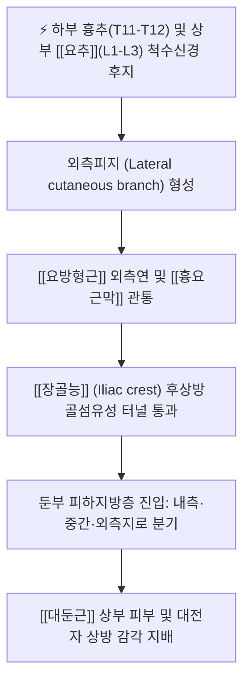

# 상둔피신경 (Superior Cluneal Nerve, 위볼기피부신경)

> [!NOTE]
> 하부 흉추(T11-T12) 및 상부 요추(L1-L3) 척수신경 후지의 외측피지에서 기원하여 [[요방형근]]과 [[흉요근막]]을 관통하고 [[장골능]] 후상방을 넘어 둔부 상부 피부 감각을 지배하는 순수 감각신경으로, **[[마이네 증후군]](Maigne Syndrome / 흉요추이행부 증후군)**과 난치성 요배통을 일으키는 대표적 말초신경입니다.

---

## 1. 신경 기원 & 해부학적 분지 경로 (Anatomy & Course)

* **신경 기원 (Spinal Segments)**:
  * 하부 흉추(T11, T12) 및 상부 [[요추]](L1, L2, L3) 척수신경 **후지(Dorsal rami)의 외측피지(Lateral branches)**에서 유래합니다.
  * 운동 신경 섬유가 없는 **순수 체감각 신경(Pure sensory nerve)**입니다.
* **흉요근막 및 복벽 주행 경로**:
  * 척추 기립근 심부에서 나와 하외측으로 비스듬히 주행하며 [[요방형근]](Quadratus lumborum)의 외측연을 가로지릅니다.
  * 광배근과 [[흉요근막]](Thoracolumbar fascia)의 후엽을 뚫고 표재층으로 진입합니다.
* **장골능 통과 및 분지 (Iliac Crest Crossing)**:
  * 정중선에서 외측으로 약 7~8cm 떨어진 **[[장골능]] 후상방(Posterior iliac crest)**의 골섬유성 터널(Osteofibrous tunnel)을 넘어 둔부로 진입합니다.
  * 내측지(Medial branch), 중간지(Intermediate branch), 외측지(Lateral branch)의 3개 분지로 갈라져 [[대둔근]] 상부를 덮는 피하지방층으로 넓게 분지합니다.

---

## 2. 신경 지배 맵 & 기능 네트워크 (Innervation Map)

* **피부 감각 신경 지배 (Sensory Innervation)**:
  * **둔부 상부 피부**: [[장골능]] 바로 아래부터 둔부 중앙부까지의 피부 감각 독점 지배.
  * **대전자 상방 영역**: 고관절 외측 [[중둔근]] 및 대전자 상부 피하지방층의 표재 감각.
  * **서혜부 및 하복부 연관 감각**: 신경 기원 분절(T11-L1)의 전피지 및 복벽 신경들과 연계되어 하복부와 서혜부로 연관통을 방사합니다.
* **운동 신경 기능의 부재**:
  * 순수 피부신경이므로 신경이 완전 포착되어도 [[대둔근]]이나 [[중둔근]]의 근력 약화는 발생하지 않습니다.
* **흉요추-골반 생체역학 네트워크**:
  * 흉요추 이행부(T12-L1)의 회전 운동성과 [[장골능]] 골반 고리 사이의 가동성 불일치를 감지하는 긴장 수용기 역할을 수행합니다.

---

## 3. 호발 포착 부위 & 터널 증후군 병태생리

* **1차 핵심 포착점: 장골능 골섬유성 터널 (Osteofibrous Tunnel at Iliac Crest)**:
  * [[장골능]] 골성 능선과 [[흉요근막]]-장골인대가 이루는 좁은 섬유성 터널을 통과할 때 기계적 마찰을 받습니다.
  * 특히 내측지(Medial branch)는 가장 단단한 골섬유 터널에 갇혀 있어 골반 회전이나 요추 굴곡 시 심하게 조여집니다.
* **2차 포착점: 흉요추 이행부 및 요방형근 외측연**:
  * T11-L2 척수신경 후지가 [[요추]] [[후관절]]을 돌아 나오는 척추 근위부에서 [[후관절]]증후군이나 [[요방형근]] 연축에 의해 포착됩니다.
* **마이네 증후군 (Maigne Syndrome / 흉요추이행부 증후군)**:
  * 흉요추 이행부(T11-L2)의 기능 부전으로 인해 상둔피신경이 자극받아 허리 아래쪽, 엉덩이 위쪽, 서혜부로 가짜 디스크 통증(Pseudo-radiculopathy)을 유발하는 병태입니다.

---

## 4. 손상 레벨별 임상 증상 & 신경학적 결손

* **요배통 및 둔부 작열통**:
  * [[장골능]] 후상방을 따라 타는 듯하거나 쑤시는 묵직한 통증, 손으로 누르면 극심한 자지러지는 압통(Trigger point).
  * 엉덩이 피부를 꼬집으면 감각이 둔하거나 반대로 깜짝 놀라게 아픈 핀치-롤(Pinch-roll) 양성 반응.
* **자세에 따른 통증 변화**:
  * 허리를 뒤로 젖히거나(신전) 환측으로 측굴할 때 [[장골능]] 터널이 좁아져 통증이 심해집니다.
  * 장시간 서 있거나 보행 시 둔부 통증이 악화되고, 앉아서 쉴 때 완화됩니다.
* **서혜부 및 고관절 가짜 연관통**:
  * [[요추 추간판탈출증]](L4-L5)이나 고관절염으로 오진되는 서혜부, 전자부 연관통이 동반됩니다.

---

## 5. 관련 이학적 검사 & 신경 감별 매트릭스

* **장골능 틴넬 및 압통 검사**:
  * PSIS 외측 7~8cm [[장골능]] 바로 위를 엄지손가락으로 깊게 압박하거나 타진할 때 둔부 전체로 찌릿한 방사통이 재현되면 양성입니다.
* **핀치-롤 검사 (Pinch-Roll Test / Skin Rolling)**:
  * [[장골능]] 상하의 둔부 피부를 엄지와 검지로 집어 올려 굴릴 때 건측에 비해 심한 통증과 피하지방층 비후가 확인되면 양성입니다.
* **신경 감별 매트릭스**:
  | 구분 | [[상둔피신경]] 포착증후군 | [[요추 추간판탈출증]] (L4-L5) | [[천장관절 증후군]] |
  | :--- | :--- | :--- | :--- |
  | **주요 압통점** | 장골능 후상방 (PSIS 외측 7cm) | 요추 극간 및 협척혈 | PSIS 직하방 및 천골구 |
  | **하지직거상(SLR)** | 정상 (음성) | 양성 (종아리·발끝 방사통) | 음성 또는 둔부 당김 |
  | **방사통 한계선** | 둔부 및 대전자 상방에 국한 | 무릎 아래 종아리, 발가락까지 | 둔부 및 대퇴 후면에 국한 |
  | **마비 증상** | 감각신경 (근력 마비 없음) | 운동 마비 ([[족하수]] 등) 가능 | 없음 |

---

## 6. 한의 신경 치료 프로토콜 (약침·침도·신경수기)

* **장골능 골섬유성 터널 침도 감압술**:
  * 복와위에서 [[장골능]] 후상방 압통점(PSIS 외측 7cm 부근)을 확인하고, 0.4×40mm 소침도를 장골능 골성 능선을 향해 직자합니다.
  * [[장골능]]을 덮고 있는 비후된 [[흉요근막]] 섬유띠와 골섬유 터널을 미세 절개·박리하여 신경을 완전히 감압합니다.
* **L1 레벨 협척혈 및 요방형근 심부 약침술**:
  * 신경 기원부인 T12-L2 협척혈 및 [[지실]](BL52) 부위 [[요방형근]] 외측연에 [[신바로약침]] 1.0cc를 심자 주입하여 신경근 기원부의 염증과 부종을 해소합니다.
* **장골능 압통점 약침 요법**:
  * [[장골능]] 통과부 압통점에 [[신바로약침]] 또는 중성어혈약침 0.5cc를 피하 및 근막 사이에 주입합니다.
* **흉요추 이행부 회전 가동 추나 (Maigne Mobilization)**:
  * T11-L2 흉요추 이행부의 회전 가동성 저하를 교정하는 척추 [[추나치료]]를 적용하여 후지 기원부의 신경 견인 장력을 해소합니다.

---

## 7. 💡 사용자 진료실 핵심 필기 & 임상 팁 (원문 보존)

* **원문 필기 핵심**:
  * `"치료포인트를 L1 레벨이나 [[요방형근]]을 치료한다."`
* **진료실 임상 고도화 해설**:
  * 원장님께서 진료실 필기에서 명쾌하게 짚어내신 바와 같이, 상둔피신경 포착 환자를 치료할 때 **엉덩이 위 [[장골능]] 압통점만 치료해서는 재발하기 쉬우며, 반드시 신경의 기원부인 L1 레벨(흉요추 이행부 [[후관절]])과 신경 주행로인 [[요방형근]]을 함께 치료해야 완치**됩니다.
  * 엉덩이 위쪽이 아프다고 호소하는 만성 요통 환자에서 [[장골능]] 외측 7cm 압통점을 확인하고, L1 협척혈과 [[요방형근]]에 침도 및 [[신바로약침]]을 복합 시술하면 척추 수술 후에도 낫지 않던 고질적인 허리·엉덩이 통증이 신속하게 소실됩니다.

---

## 8. 출처 및 학술 참고 문헌 (References)

* Maigne, J. Y., & Maigne, R. (1991). "Trigger point of the posterior iliac crest: painful iliolumbar ligament insertion or cutaneous dorsal ramus pain? An anatomic study." *Archives of Physical Medicine and Rehabilitation*, 72(10), 734-737. [PMID: 1834038](https://pubmed.ncbi.nlm.nih.gov/1834038/)
  - [연구 요약]: 후상장골능 압통점이 장요인대 부착부 통증과 상둔피신경 포착 통증의 중첩 부위임을 사체 해부학 연구를 통해 최초 규명.
* Randhawa, S., et al. (2022). "Maigne Syndrome - A potentially treatable yet underdiagnosed cause of low back pain: A review." *Journal of Back and Musculoskeletal Rehabilitation*, 35(1), 153-159. [PMID: 34151827](https://pubmed.ncbi.nlm.nih.gov/34151827/)
  - [연구 요약]: 마이네 증후군(Maigne syndrome)의 병태생리, 상둔피신경 내측지 포착 영상 해부학 및 보존적 중재술 총괄 리뷰.
* Lee, H., et al. (2023). "Acupuncture for patients with Maigne's syndrome: A case series." *Medicine (Baltimore)*, 102(23), e33999. [PMID: 37335654](https://pubmed.ncbi.nlm.nih.gov/37335654/)
  - [연구 요약]: 마이네 증후군 환자에서 상둔피신경 주행 경로 및 흉요추 이행부 혈위 침치료의 임상적 유효성 및 증례 보고.
