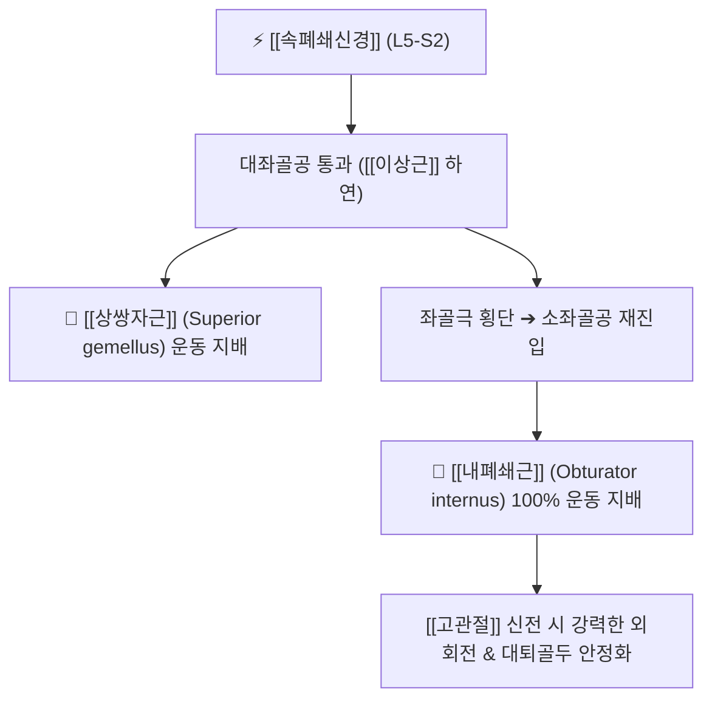

# 속폐쇄신경 (Nerve to Obturator Internus, 내폐쇄근신경)

> [!NOTE]
> 천골신경총(L5-S2) 전지에서 기원하여 대좌골공을 빠져나와 좌골극을 가로지른 후 소좌골공을 통해 골반 내면으로 재진입하는 순수 운동신경으로, [[내폐쇄근]]과 [[상쌍자근]]을 지배하며 **[[심부 둔부 증후군]](Deep Gluteal Syndrome)**과 고관절 심부 후방 둔통을 유발하는 핵심 신경입니다. 본 문서는 [[내폐쇄근신경]]과 동일한 개념을 다룹니다.

---

## 1. 신경 기원 & 해부학적 분지 경로 (Anatomy & Course)

* **신경 기원 (Origin & Spinal Segments)**:
  * [[천골신경총]](Sacral plexus)의 **제5 요추신경(L5) 및 제1, 2 천추신경(S1, S2)** 앞가지 전분지에서 기원합니다.
* **상세 주행 경로**:
  1. 골반강을 나와 [[이상근]](Piriformis) 하연의 대좌골공(이상근하공)을 통과합니다 ([[음부신경]]의 외측, [[좌골신경]]의 내측에 위치).
  2. 대좌골공을 빠져나오자마자 **[[상쌍자근]](Superior gemellus)**의 심층면으로 분지를 냅니다.
  3. 좌골극(Ischial spine)의 후면 및 천극인대 표면을 가로질러 주행합니다.
  4. 소좌골공(Lesser sciatic foramen)을 통과하여 골반 내면으로 다시 진입합니다.
  5. **[[내폐쇄근]](Obturator internus)**의 골반 내측면(심층면)으로 들어가 근육 실질에 방사상으로 정지합니다.

---

## 2. 신경 지배 맵 & 기능 네트워크 (Innervation Map)

* **운동 지배 근육군 (Pure Motor)**:
  * **[[상쌍자근]] (Superior gemellus)**: 고관절 외회전 보조.
  * **[[내폐쇄근]] (Obturator internus)**: 100% 운동 지배 (고관절 신전 상태에서 강력한 외회전, 90도 굴곡 상태에서 수평 외전 및 대퇴골두 안정화).
* **감각 신경 지배 부재**:
  * 순수 운동신경이므로 피부 감각 분지는 없습니다.
* **골반저 지지 네트워크**:
  * 내폐쇄근 근막은 항문거근 건궁과 연결되어 골반저 장기 안정화에 기여합니다.

---

## 3. 호발 포착 부위 & 터널 증후군 병태생리

* **이상근 하공 및 좌골극 주변 마찰**:
  * [[이상근]]의 비후, 연축 또는 천극인대의 섬유성 비후로 인해 좌골극을 돌아 나가는 모퉁이에서 신경이 조여집니다.
* **심부 둔부 증후군 (Deep Gluteal Syndrome, DGS)**:
  * 내폐쇄근과 쌍자근군의 만성 경결로 좌골신경과 속폐쇄신경이 동반 압박되어 심부 둔통을 유발합니다.

---

## 4. 손상 레벨별 임상 증상 & 신경학적 결손

* **둔부 심부 만성 둔통**:
  * 엉덩이 깊은 곳의 뻐근하고 조이는 통증, 양반다리를 하거나 고관절을 외회전할 때 둔부 심부 결림.
  * 딱딱한 의자에 장시간 착석 시 좌골극 압박으로 통증 심화.
* **고관절 외회전력 약화**:
  * 내폐쇄근 위축으로 보행 시 대퇴골두의 후방 안정성이 저하됩니다.

---

## 5. 관련 이학적 검사 & 신경 감별 매트릭스

* **FADIR 검사 (굴곡-내전-내회전 검사)**:
  * 고관절을 90도 굴곡, 내전, 내회전시킬 때 내폐쇄근이 최대로 신장되며 둔부 심부 통증이 유발되는지 확인합니다.
* **신경 감별 매트릭스**:
  | 구분 | [[속폐쇄신경]] 병변 | [[이상근 증후군]] | [[좌골신경]]통 |
  | :--- | :--- | :--- | :--- |
  | **통증 위치** | 둔부 심부 (좌골극 외측) | 둔부 중앙 + 대퇴 후면 방사 | 대퇴 후면 + 종아리 + 발바닥 |
  | **주요 압통점** | 좌골극 및 소좌골공 | 환도혈 (이상근 근복) | 좌골결절 외측 및 위중혈 |
  | **감각 결손** | 없음 (순수 운동) | 하지 방사통 가능 | 하지 전반 감각 이상 |

---

## 6. 한의 신경 치료 프로토콜 (약침·침도·신경수기)

* **환도(GB30) 및 질변(BL54) 심부 침치료**:
  * 75~90mm 장침을 이용하여 좌골극 외측연 투영 부위로 심자하여 내폐쇄근 건을 직접 자극합니다.
* **신바로약침 치료**:
  * 좌골극 주변 및 내폐쇄근 심부 건궁에 [[신바로약침]] 1.0cc를 주입하여 무균성 신경염을 치료합니다.
* **심부 외회전근 이완 추나**:
  * 고관절 굴곡-외회전 상태에서 둔부 심부 근막을 이완시키는 [[추나치료]]를 시행합니다.

---

## 7. 💡 사용자 진료실 핵심 필기 & 임상 팁 (원문 보존)

* **원문 필기 내용**:
  * `천골신경총 L5-S2 기원, 이상근 하연 대좌골공 나와 좌골극 가로질러 소좌골공 진입`
  * `내폐쇄근, 상쌍자근 100% 운동 지배, 심부 둔부 증후군(DGS) 및 고관절 심부 후방 둔통 유발`
* **진료실 임상 고도화 팁**:
  * 이상근 증후군 치료로 호전되지 않는 만성 둔통은 이상근 아래의 내폐쇄근 건과 속폐쇄신경 포착을 감별해야 합니다.
  * 질변혈 부위 좌골극 외측연을 향해 심자하여 [[신바로약침]]을 주입하면 수개월간 지속된 둔부 심부통이 빠르게 호전됩니다.

---

## 8. 출처 및 학술 참고 문헌 (References)

* Palmieri, B., & Ryals, B. (2026). "Unilateral Conjoint Tendon Formation of the Piriformis, Superior Gemellus, and Tendonized Obturator Internus: A Rare Cadaveric Variation of the Deep Gluteal Region." *Cureus*, 18(6), e85231. [PMID: 42535162](https://pubmed.ncbi.nlm.nih.gov/42535162/)
  - [연구 요약]: 심부 둔부 영역에서 내폐쇄근, 상쌍자근, 이상근 건의 해부학적 융합 변이와 속폐쇄신경 및 좌골신경 포착 기전 분석.
* Moore, K. L., Dalley, A. F., & Agur, A. M. (2018). *Clinically Oriented Anatomy* (8th ed.). Wolters Kluwer.
  - [연구 요약]: 속폐쇄신경의 주행 경로 및 고관절 외회전근 지배 해부학 수록.
* 전국한의과대학 침구경혈학교실 (2020). *침구의학*. 집문당.
  - [연구 요약]: 둔통에 대한 환도, 질변 취혈 지침.
