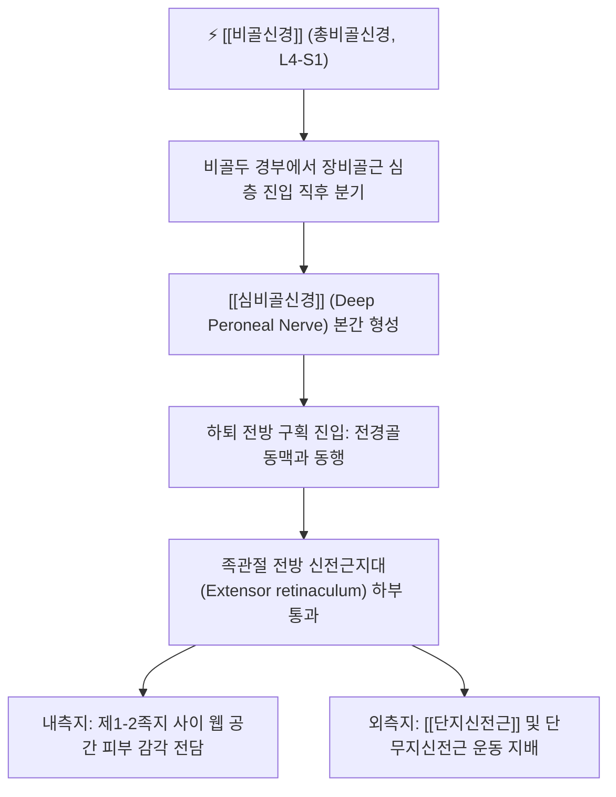

# 심비골신경 (Deep Peroneal Nerve / Deep Fibular Nerve, 깊은종아리신경)

> [!NOTE]
> [[비골신경]](총비골신경)의 심부 종말 줄기로 천골신경총(L4-S1)에서 기원하여 하퇴 전방 구획을 수직 하행하며, 족관절 족배굴곡 및 발가락 신전 근육군 전체를 운동 지배하고 발목의 전방 족근관을 지나 제1-2족지 사이 웹 공간의 피부 감각을 전담하며 **[[족하수]]** 및 **전방 족근관 증후군(Anterior Tarsal Tunnel Syndrome)**을 일으키는 핵심 말초신경입니다.

---

## 1. 신경 기원 & 해부학적 분지 경로 (Anatomy & Course)

* **신경 기원 (Spinal Segments)**:
  * [[천골신경총]](Sacral plexus) **제4, 5 요추신경 및 제1 천추신경(L4, L5, S1)** 앞가지의 후분지에서 유래한 [[비골신경]] 본간에서 갈라집니다.
* **하퇴 전방 구획 주행 경로**:
  * 비골두 경부에서 [[장비골근]] 기시부를 뚫고 전방 구획으로 들어와 골간막(Interosseous membrane) 전면을 따라 하행합니다.
  * [[전경골근]](Tibialis anterior)과 장지신전근 사이를 지나며 전경골동맥(Anterior tibial artery)과 신경혈관속을 이루어 주행합니다.
* **전방 족근관 통과 및 분기**:
  * 족관절 전면에서 상·하 신전근지대(Extensor retinaculum) 하부의 골섬유성 관인 **전방 족근관(Anterior tarsal tunnel)**을 통과합니다.
  * **내측지 (Medial branch)**: 족배동맥 외측을 따라 전진하여 제1족지와 제2족지 사이(엄지-둘째 발가락 사이) 웹 공간 족배면 피부 감각을 지배합니다.
  * **외측지 (Lateral branch)**: 단지신전근 심층으로 주행하여 단지신전근과 단무지신전근을 운동 지배하고 족근관절낭에 고유수용성 감각지를 냅니다.

---

## 2. 신경 지배 맵 & 기능 네트워크 (Innervation Map)

* **운동 신경 지배 (Motor Innervation)**:
  * **[[전경골근]] (Tibialis anterior)**: 족관절 족배굴곡(Dorsiflexion) 및 내번의 주동근.
  * **장무지신전근 (Extensor hallucis longus)**: 엄지발가락 신전 및 족배굴곡 보조.
  * **장지신전근 (Extensor digitorum longus)**: 제2~5지 신전 및 발목 족배굴곡.
  * **제3비골근 (Peroneus tertius)**: 족배굴곡 및 외번 보조.
  * **단지신전근 (Extensor digitorum brevis)** & 단무지신전근: 발가락 신전의 내재근.
* **피부 감각 신경 지배 (Sensory Innervation)**:
  * 제1족지와 제2족지 사이 족배면(엄지발가락과 둘째 발가락 갈림길 피부)의 쐐기형 영역 감각을 독점 지배합니다 (L5 신경근의 핵심 감각 지표).
* **보행 생체역학 기능**:
  * 보행 유각기(Swing phase)에서 발끝을 들어 올려 지면 충돌을 방지하고, 초기 접지기(Heel strike)에서 족하수를 방지하는 핵심 신경입니다.

---

## 3. 호발 포착 부위 & 터널 증후군 병태생리

* **1차 호발 포착점: 전방 족근관 (Anterior Tarsal Tunnel)**:
  * 족관절 전면 신전근지대 아래에서 꽉 끼는 구두, 스키 부츠, 끈을 꽉 묶은 운동화 착용으로 인한 외부 압박.
  * 거골 및 주상골 관절면의 골극(Osteophyte) 형성으로 인한 기계적 마찰.
* **2차 포착점: 하퇴 전방 구획증후군 (Anterior Compartment Syndrome)**:
  * 장거리 달리기, 과도한 행군 후 전방 구획 내압 상승으로 신경 허혈 및 급성 마비 발생.

---

## 4. 손상 레벨별 임상 증상 & 신경학적 결손

* **전방 족근관 증후군 (Anterior Tarsal Tunnel Syndrome)**:
  * 발목 앞쪽 및 발등을 따라 찌릿한 통증과 함께 **제1-2족지 사이 웹 공간의 감각 저하, 화끈거림, 시림**.
  * 끈이 있는 신발을 신을 때 발목 앞쪽 통증이 극심해집니다.
* **하퇴 고위 손상 시 [[족하수]] (Foot Drop)**:
  * 발목을 위로 젖히지 못하여 걸을 때 발끝이 지면에 끌리는 계주 보행(Steppage gait) 발생.

---

## 5. 관련 이학적 검사 & 신경 감별 매트릭스

* **발목 전면 틴넬 징후 (Tinel's Sign at Anterior Ankle)**:
  * 족관절 전면 중앙 해계혈 부위를 가볍게 두드릴 때 제1-2지 사이로 찌릿한 방사통이 재현되면 양성입니다.
* **신경 감별 매트릭스**:
  | 구분 | [[심비골신경]] 포착 | [[천비골신경]] 포착 | 요추 5번(L5) 신경근증 |
  | :--- | :--- | :--- | :--- |
  | **감각 결손 영역** | 제1-2족지 사이 웹 공간 국한 | 발등 대부분 및 하지 전외측 | 하지 외측 + 발등 전체 방사 |
  | **주요 운동 약화** | 족배굴곡 불능 ([[족하수]]) | 발목 외번 약화 | 족배굴곡 및 엄지 신전 약화 |
  | **발목 전면 틴넬** | 양성 (해계혈 부위) | 음성 (외과 전방 양성) | 음성 |

---

## 6. 한의 신경 치료 프로토콜 (약침·침도·신경수기)

* **해계(ST41) 전방 족근관 침도 감압술**:
  * 앙와위에서 발목 전면 해계혈 부위 신전근지대 압통점에 0.35×30mm 소침도를 자입하여 비후된 지대 섬유를 미세 절개하여 신경관을 감압합니다.
* **족삼리(ST36) 및 행간(LR2), 태충(LR3) 약침 요법**:
  * 심비골신경 종말지에 위치한 행간, 태충혈 및 전방 구획 족삼리혈에 [[신바로약침]] 0.5cc를 주입하여 신경 부종을 소퇴시킵니다.
* **전방 구획 근막 이완 및 족근골 가동 추나**:
  * 전경골근 근막을 이완시키고 거골과 주상골의 전방 변위를 교정하는 [[추나치료]]를 시행합니다.

---

## 7. 💡 사용자 진료실 핵심 필기 & 임상 팁 (원문 보존)

* **원문 필기 내용**:
  * `비골신경의 심부 분지, 하퇴 전방 구획 근육 및 단지신전근 지배`
  * `제1-2족지 사이 웹 공간 감각 지배, 전방 족근관 증후군 및 족하수 감별 표적`
* **진료실 임상 고도화 팁**:
  * 발등 앞쪽이 찌릿하고 엄지와 둘째 발가락 사이가 남의 살처럼 먹먹하다는 환자는 신발 끈 압박으로 인한 전방 족근관 증후군입니다.
  * 해계혈 주변 굴근지대 압통점을 찾아 침도 요법으로 감압하고 태충혈 부위에 [[신바로약침]]을 시술하면 발등 저림이 신속히 사라집니다.

---

## 8. 출처 및 학술 참고 문헌 (References)

* Almeida, S., & Cunha, A. (2026). "Ultrasound-guided peripheral nerve blocks for osteoarthritis pain management: a review of the genicular, suprascapular, PENG and deep peroneal nerve blocks." *Frontiers in Medicine (Lausanne)*, 13, 1342109. [PMID: 42840201](https://pubmed.ncbi.nlm.nih.gov/42840201/)
  - [연구 요약]: 심비골신경의 해부학적 주행, 초음파 유도하 말초신경 차단술 및 족부 관절 통증 조절 리뷰.
* Moore, K. L., Dalley, A. F., & Agur, A. M. (2018). *Clinically Oriented Anatomy* (8th ed.). Wolters Kluwer.
  - [연구 요약]: 심비골신경의 하퇴 전방 구획 주행 및 전방 족근관 통과 해부학 수록.
* 전국한의과대학 침구경혈학교실 (2020). *침구의학*. 집문당.
  - [연구 요약]: 족하수 및 족배통에 대한 족삼리, 해계, 태충 취혈 지침.
