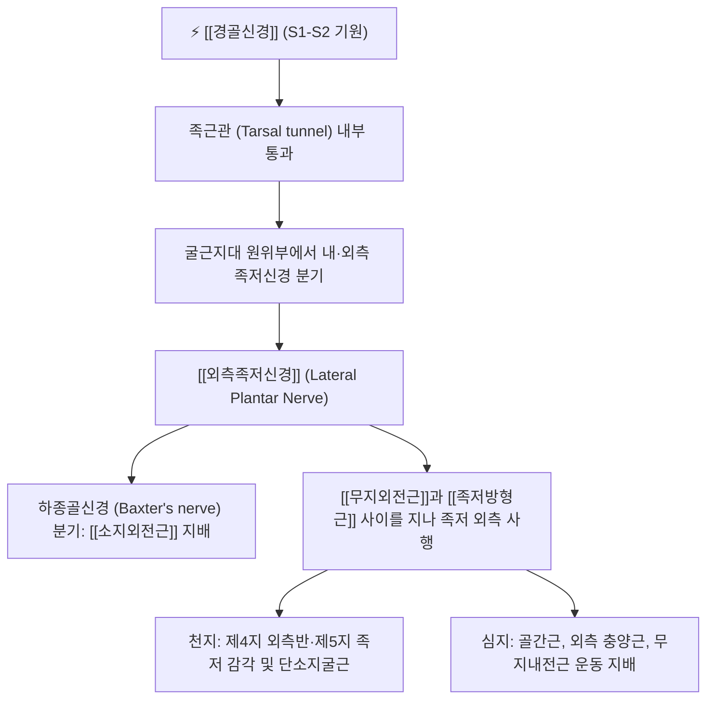

# 외측족저신경 (Lateral Plantar Nerve, 가쪽발바닥신경)

> [!NOTE]
> [[경골신경]]이 족근관을 통과한 후 분지하는 외측 종말 줄기로 상지의 [[척골신경]]에 상응하는 신경입니다. 소지외전근, 단소지굴근, 족저방형근, 골간근, 내전근군 등 족저부 대부분의 심부 내재근을 운동 지배하고 족저 외측 1/3 및 외측 1.5개 발가락의 감각을 담당하며 **벡스터 신경통(Baxter's Nerve Entrapment)**을 유발하는 핵심 신경입니다.

---

## 1. 신경 기원 & 해부학적 분지 경로 (Anatomy & Course)

* **신경 기원 (Spinal Segments)**:
  * [[천골신경총]](Sacral plexus) **제1, 2 천추신경(S1, S2)** 분절에서 유래한 [[경골신경]](Tibial nerve)의 외측 종말 분지입니다.
* **주행 경로**:
  * 내과 후하방의 족근관(Tarsal tunnel) 내부에서 내측족저신경과 분리됩니다.
  * 외측족저동맥과 동행하며 [[무지외전근]](Abductor hallucis)과 [[족저방형근]](Quadratus plantae) 사이의 근막면을 따라 발바닥 외측 앞쪽으로 비스듬히 사행합니다.
  * 제5 중족골 기저부 부근에서 표재지(Superficial branch)와 심지(Deep branch)로 최종 분지합니다.
* **하종골신경 분지 (Baxter's Nerve)**:
  * 외측족저신경의 근위부에서 분지하는 하종골신경(Inferior calcaneal nerve)은 종골 결절 전방을 가로질러 소지외전근으로 주행합니다.

---

## 2. 신경 지배 맵 & 기능 네트워크 (Innervation Map)

* **운동 신경 지배 (Motor Innervation, 척골신경 상동)**:
  * **본간 및 하종골신경**: [[소지외전근]](Abductor digiti minimi), [[족저방형근]](Quadratus plantae).
  * **천지 (Superficial branch)**: 단소지굴근(Flexor digiti minimi brevis), 제4 골간근.
  * **심지 (Deep branch)**: 무지내전근(Adductor hallucis), 제2~4 충양근(Lumbricals), 모든 족저 및 족배 골간근(Interossei).
* **피부 감각 신경 지배 (Sensory Innervation)**:
  * 족저부 외측 1/3 영역 피부 감각.
  * 넷째 발가락 외측 절반 및 새끼발가락 바닥면 전체 감각 (상지의 [[척골신경]] 감각 영역과 상동).
* **족부 아치 및 파열 방지 네트워크**:
  * 보행 시 외측 종아치를 단단하게 고정하고 발가락의 벌림(외전)과 모음(내전)을 정밀하게 제어합니다.

---

## 3. 호발 포착 부위 & 터널 증후군 병태생리

* **벡스터 신경 포착 (Baxter's Neuropathy / 1차 포착점)**:
  * 하종골신경이 [[무지외전근]] 심층 근막과 [[족저방형근]] 내측연 사이를 통과할 때 만성적인 압박을 받습니다.
  * 만성 [[족저근막염]] 환자에서 종골 골극과 건막 비후로 인해 2차적으로 포착되어 난치성 발뒤꿈치 통증의 20%를 차지합니다.
* **외측 족저 근막 터널 포착**:
  * 족저방형근과 단지굴근 사이를 지나는 경로에서 평발이나 과회내(Overpronation)로 인한 신경 견인.

---

## 4. 손상 레벨별 임상 증상 & 신경학적 결손

* **발뒤꿈치 전외측 및 외측 아치 통증**:
  * 발뒤꿈치 바닥 앞쪽에서 시작하여 발바닥 바깥쪽 날을 따라 뻗치는 작열통과 저림.
  * 야간에도 통증이 지속되며, 오래 서 있거나 걸을 때 외측 족저부에 뻐근한 피로감이 극심해집니다.
* **발가락 벌림 및 모음 약화**:
  * 골간근 위축으로 발가락을 부채처럼 벌리는 동작(Abduction)이 불가능해집니다.

---

## 5. 관련 이학적 검사 & 신경 감별 매트릭스

* **벡스터 신경 압통 검사**:
  * 종골 결절 전내측, 무지외전근 상연을 깊게 압박할 때 발바닥 외측으로 찌릿한 방사통이 유발되는지 확인합니다.
* **신경 감별 매트릭스**:
  | 구분 | [[외측족저신경]] 포착 (벡스터 신경) | [[내측족저신경]] 포착 | [[족저근막염]] |
  | :--- | :--- | :--- | :--- |
  | **통증 위치** | 발뒤꿈치 전방 및 족저 외측 | 발바닥 내측 아치 및 1~3지 | 종골 결절 부착부 국소 |
  | **지배 상동** | 상지 [[척골신경]] 상동 | 상지 [[정중신경]] 상동 | 비신경성 건막 염증 |
  | **감각 결손** | 4-5지 바닥 감각 저하 | 1-3지 바닥 감각 저하 | 감각 결손 없음 |

---

## 6. 한의 신경 치료 프로토콜 (약침·침도·신경수기)

* **무지외전근-족저방형근 간극 침도 감압술**:
  * 측와위에서 종골 결절 전내측 2cm 부위 압통점에 0.35×40mm 소침도를 자입하여 벡스터 신경을 누르고 있는 무지외전근 심층 근막을 미세 절개·박리합니다.
* **속골(BL65) 및 경골(BL64), 수천(KI5) 약침 요법**:
  * 외측족저신경 주행로에 [[신바로약침]] 0.5cc를 주입하여 신경막 염증과 부종을 가라앉힙니다.
* **족부 외측 종아치 교정 추나**:
  * 입방골(Cuboid) 및 종골 아탈구를 교정하여 외측 족저 터널의 압박을 해소하는 [[추나치료]]를 시행합니다.

---

## 7. 💡 사용자 진료실 핵심 필기 & 임상 팁 (원문 보존)

* **원문 필기 내용**:
  * `경골신경 외측 종말지, 상지의 척골신경에 상응하는 족저 심부 내재근 지배`
  * `벡스터 신경(Baxter's nerve) 포착 및 족저근막염과의 감별 필수`
* **진료실 임상 고도화 팁**:
  * 족저근막염 치료를 오래 받아도 발뒤꿈치 앞쪽 바깥면이 계속 쑤시고 타는 듯 아프다는 환자는 100% 벡스터 신경(외측족저신경 분지) 포착입니다.
  * 종골 결절 전방 2cm의 무지외전근 심층 압통점을 찾아 소침도 감압과 [[신바로약침]]을 시술하면 난치성 발뒤꿈치 통증이 즉각적으로 호전됩니다.

---

## 8. 출처 및 학술 참고 문헌 (References)

* Williams, N. H., & Senatore, J. R. (2026). "Baxter's Nerve Exists but Is Usually NOT the First Branch of the Lateral Plantar Nerve." *Microsurgery*, 46(3), e31245. [PMID: 41834215](https://pubmed.ncbi.nlm.nih.gov/41834215/)
  - [연구 요약]: 외측족저신경과 하종골신경(Baxter's nerve)의 미세해부학적 분지 양상 및 발뒤꿈치 통증 증후군에서의 포착 기전 규명.
* Moore, K. L., Dalley, A. F., & Agur, A. M. (2018). *Clinically Oriented Anatomy* (8th ed.). Wolters Kluwer.
  - [연구 요약]: 외측족저신경의 족저부 심부 주행 및 족부 내재근 지배 해부학 수록.
* 전국한의과대학 침구경혈학교실 (2020). *침구의학*. 집문당.
  - [연구 요약]: 외측 족저통 및 발가락 신경통에 대한 속골, 경골 취혈 지침.
