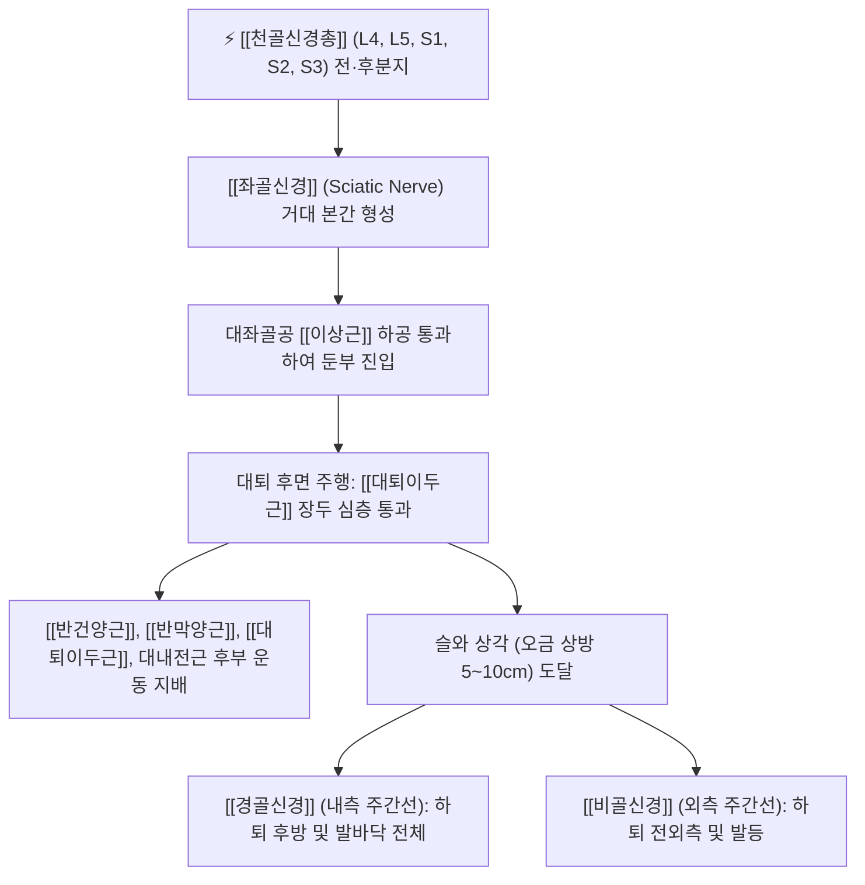

# 좌골신경 (Sciatic Nerve, 궁둥신경)

> [!NOTE]
> 인체에서 가장 굵고 긴 최대의 말초신경으로 천골신경총(L4-S3)에서 기원하여 이상근 하공을 빠져나와 둔부와 대퇴 후면을 수직 하행하며, 햄스트링 근육군 전체와 슬관절 하부 하지 전반의 운동 및 감각을 총괄하고 **[[이상근 증후군]]** 및 **좌골신경통(Sciatica)**을 유발하는 중추 신경 간선입니다.

---

## 1. 신경 기원 & 해부학적 분지 경로 (Anatomy & Course)

* **신경 기원 (Spinal Segments)**:
  * [[천골신경총]](Sacral plexus) **제4 요추신경부터 제3 천추신경(L4, L5, S1, S2, S3)** 앞가지의 전분지와 후분지가 단일 결합조직초(Sheath) 안에서 합류하여 형성된 거대 신경입니다.
  * 직경이 성인 엄지손가락 굵기(약 2cm)에 달하는 인체 최대 신경입니다.
* **둔부 및 대퇴부 주행 경로**:
  * 골반강을 나와 [[이상근]](Piriformis) 하연의 대좌골공(이상근하공)을 통과합니다.
  * 상쌍자근, 내폐쇄근 건, 하쌍자근, 대퇴방형근의 후면(표재면)을 가로질러 대전자와 좌골결절의 정중앙을 지나 대퇴부로 내려갑니다.
  * 대퇴 후면에서 [[대퇴이두근]](Biceps femoris) 장두의 심층으로 들어가 대내전근 후면을 타고 수직 하행합니다.
* **슬와부 종말 분기**:
  * 대퇴 후면 하부 1/3 지점(슬와 상각 부근)에서 **[[경골신경]]**(Tibial nerve)과 **[[비골신경]]**(총비골신경 / Common peroneal nerve)으로 최종 갈라집니다.

---

## 2. 신경 지배 맵 & 기능 네트워크 (Innervation Map)

* **운동 신경 지배 (Motor Innervation)**:
  * **[[햄스트링]] 근육군 (슬관절 굴곡 및 고관절 신전)**:
    * [[반건양근]](Semitendinosus): 경골신경부 지배.
    * [[반막양근]](Semimembranosus): 경골신경부 지배.
    * [[대퇴이두근]](Biceps femoris): 장두는 경골신경부, 단두는 총비골신경부의 이중 지배.
    * 대내전근(Adductor magnus) 후부 섬유: 고관절 강력 신전 보조.
  * **슬관절 하부 전체 운동 지배**:
    * 종말 분지인 경골신경과 비골신경을 통해 무릎 아래 하지의 모든 근육(종아리 굴근, 전방 신전근, 외측 비골근, 족부 내재근)을 100% 운동 지배합니다.
* **감각 신경 지배 (Sensory Innervation)**:
  * 대퇴 후면(후대퇴피신경과 중첩), 종아리 전·후·외측 및 발등과 발바닥 전체의 피부 감각을 총괄합니다 (하퇴 내측의 복재신경 영역 제외 전 영역).
* **보행 생체역학의 핵심**:
  * 유각기 감속(Deceleration)과 입각기 추진(Push-off), 발목 안정화 전체를 총괄합니다.

---

## 3. 호발 포착 부위 & 터널 증후군 병태생리

* **1차 핵심 포착점: 이상근하 공간 ([[이상근 증후군]] / Piriformis Syndrome)**:
  * 골반 이상근의 과긴장, 비후, 단축 또는 비골신경부가 이상근 실질을 관통하는 해부학적 변이(Beaton & Anson 분류)에 의해 신경이 만성적으로 짓눌립니다.
* **심부 둔부 증후군 (Deep Gluteal Syndrome, DGS)**:
  * 좌골극과 인대성 섬유띠, 내폐쇄근-쌍자근 복합체, 대퇴방형근 간극에서 좌골신경이 유착·견인됩니다.
* **햄스트링 근위부 건병증 및 섬유성 밴드**:
  * 좌골결절 부착부에서 햄스트링 건의 만성 파열 반흔과 섬유성 밴드에 의해 신경이 포착됩니다.

---

## 4. 손상 레벨별 임상 증상 & 신경학적 결손

* **전형적 좌골신경통 (Sciatica)**:
  * 둔부 뒤쪽에서 시작하여 허벅지 뒤쪽, 오금, 종아리 바깥쪽 및 발끝까지 찌릿찌릿 전기가 통하듯 내려가는 격심한 방사통과 저림.
  * 기침이나 재채기, 배변 시 복압이 상승하거나 의자에 앉을 때 둔부 통증이 악화됩니다.
* **고위 완전 마비 시 심각한 운동 결손**:
  * 무릎 굴곡력 약화 및 발목의 모든 운동 마비([[족하수]], 까치발 보행 불능).
  * 발바닥 감각 소실로 인한 보행 불능 및 신경병성 족부 궤양 발생.

---

## 5. 관련 이학적 검사 & 신경 감별 매트릭스

* **하지직거상 검사 (Straight Leg Raise / [[SLR test]])**:
  * 앙와위에서 슬관절을 신전시킨 채 다리를 천천히 들어 올릴 때 30~70도 사이에서 하지 방사통이 유발되면 양성입니다.
* **페어 검사 (FAIR Test / Flexion-Adduction-Internal Rotation)**:
  * 고관절을 90도 굴곡, 내전, 내회전시킬 때 이상근이 신장되며 좌골신경 방사통이 재현되면 이상근 증후군으로 진단합니다.
* **신경 감별 매트릭스**:
  | 구분 | [[이상근 증후군]] (말초 좌골신경 포착) | 요추 4-5번 추간판탈출증 (중추성 디스크) | 천장관절염 |
  | :--- | :--- | :--- | :--- |
  | **요통 동반 여부** | 요통 거의 없음 (둔통 위주) | 극심한 요통 선행 | 허리 하부 및 둔부 국소 |
  | **압통 부위** | 환도혈 (이상근 근복 중앙) | 요추 극간 및 협척혈 | PSIS 및 천골구 |
  | **FAIR 검사** | 극심한 방사통 재현 (양성) | 방사통 증가 경미 | 둔부 국소 통증만 유발 |

---

## 6. 한의 신경 치료 프로토콜 (약침·침도·신경수기)

* **환도(GB30) 이상근하 침도 감압술**:
  * 측와위(이환측 상방)에서 대전자와 천골열공을 연결하는 선의 외측 1/3 지점인 환도혈을 촉지합니다.
  * 0.5×75~90mm 소침도를 대좌골공을 향해 심자하여 비후된 이상근 하연 섬유와 좌골신경초 주변 유착을 미세 박리하여 즉각적인 신경 감압을 유도합니다.
* **은문(BL37) 및 위중(BL40) 심부 약침 요법**:
  * 대퇴 후면 은문혈 및 슬와 위중혈 부위에 [[신바로약침]] 1.0~2.0cc를 주입하여 신경 주위 무균성 부종을 흡수시키고 신경 재생을 촉진합니다.
* **골반 교정 및 좌골신경 가동술 (Neurodynamics)**:
  * 장골 아탈구를 바로잡는 골반 [[추나치료]]와 함께 앙와위에서 슬관절 신전 및 발목 배굴을 교대로 시행하는 신경 슬라이더 기법을 시행합니다.

---

## 7. 💡 사용자 진료실 핵심 필기 & 임상 팁 (원문 보존)

* **원문 필기 내용**:
  * `대퇴이두근, 반건양근, 반막양근, 대내전근 일부를 운동지배하고 총비골신경, 경골신경으로 분지`
  * `이상근의 아래를 통과, 포착> 하지 저림, 당김 유발`
* **진료실 임상 고도화 팁**:
  * 척추 MRI 상 디스크 탈출이 심하지 않은데도 다리가 끊어질 듯 당기고 저리다고 호소하는 환자는 십중팔구 이상근 아래에서의 좌골신경 포착입니다.
  * 환도혈을 강하게 압박했을 때 종아리와 발가락 끝까지 전기가 찌릿하게 통하는 것을 확인하고, 90mm 장침 또는 침도로 이상근을 정확히 관통하여 자극을 주면 수년간 앓던 좌골신경통이 현장에서 즉시 완화됩니다.

---

## 8. 출처 및 학술 참고 문헌 (References)

* Hanna, A. S., & Schmidt, B. T. (2024). "Anatomical Proximity Between Sciatic Nerve and Ischial Spine and its Relationship to the Development of Deep Gluteal Pain Syndrome." *World Neurosurgery*, 188, e485-e491. [PMID: 38796142](https://pubmed.ncbi.nlm.nih.gov/38796142/)
  - [연구 요약]: 좌골신경과 좌골극 사이의 해부학적 인접성 및 심부 둔부 통증 증후군(DGS) 발생과의 연관성, 신경 감압 치료 분석.
* Moore, K. L., Dalley, A. F., & Agur, A. M. (2018). *Clinically Oriented Anatomy* (8th ed.). Wolters Kluwer.
  - [연구 요약]: 좌골신경의 천골신경총 기원, 이상근하공 주행 해부학 및 햄스트링 지배 수록.
* 전국한의과대학 침구경혈학교실 (2020). *침구의학*. 집문당.
  - [연구 요약]: 좌골신경통 및 비증에 대한 환도, 은문, 위중 취혈 지침.
