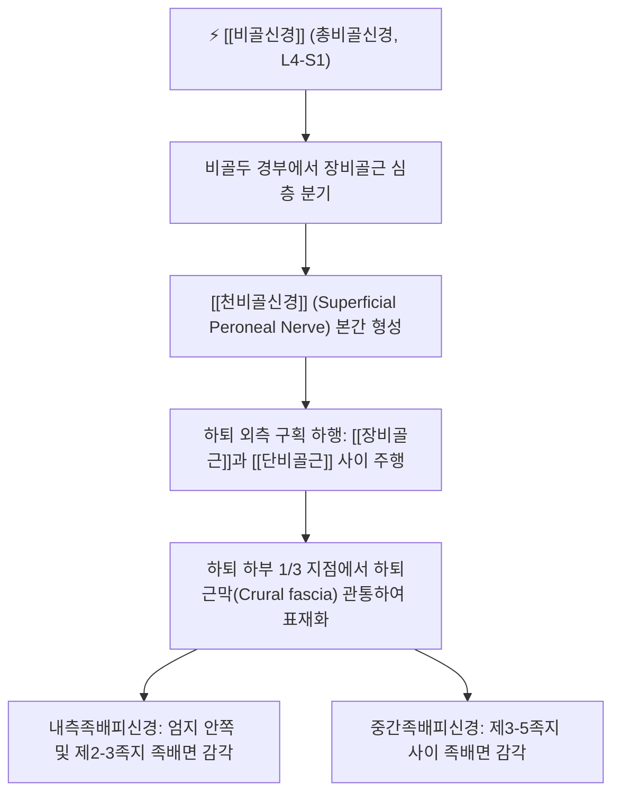

# 천비골신경 (Superficial Peroneal Nerve / Superficial Fibular Nerve, 얕은종아리신경)

> [!NOTE]
> [[비골신경]](총비골신경)의 표재 분지로 천골신경총(L4-S1)에서 기원하여 하퇴 외측 구획을 주행하며, [[장비골근]]과 [[단비골근]]을 운동 지배하고 하퇴 하외측과 발등 대부분의 피부 감각을 지배하며 **만성 발목 염좌 후 신경병증**을 일으키는 핵심 말초신경입니다.

---

## 1. 신경 기원 & 해부학적 분지 경로 (Anatomy & Course)

* **신경 기원 (Spinal Segments)**:
  * [[천골신경총]](Sacral plexus) **제4, 5 요추신경 및 제1 천추신경(L4, L5, S1)** 앞가지의 후분지에서 유래한 [[비골신경]] 본간에서 갈라집니다.
* **하퇴 외측 구획 주행 경로**:
  * 비골두 하방에서 [[장비골근]](Peroneus longus) 기시부 심층을 지나 장비골근과 [[단비골근]](Peroneus brevis) 사이의 근막면을 따라 하행합니다.
  * 하퇴 중간부에서 두 비골근에 운동 신경지를 공급합니다.
* **근막 관통 및 표재화 (Fascial Piercing Site)**:
  * 외과(바깥 복사뼈) 상방 약 10~12cm 지점에서 비골 전연의 단단한 하퇴근막(Crural fascia)을 뚫고 피하지방층으로 빠져나옵니다.
  * 발목 부근에서 **내측족배피신경**(Medial dorsal cutaneous nerve)과 **중간족배피신경**(Intermediate dorsal cutaneous nerve)으로 갈라져 발등 전체로 넓게 분지합니다.

---

## 2. 신경 지배 맵 & 기능 네트워크 (Innervation Map)

* **운동 신경 지배 (Motor Innervation)**:
  * **[[장비골근]] (Peroneus longus)**: 족관절 외번(Eversion) 및 제1 중족골두를 지면에 밀착시켜 족저 횡아치 유지.
  * **[[단비골근]] (Peroneus brevis)**: 족관절 강력 외번 및 보행 시 측방 균형 조절.
* **피부 감각 신경 지배 (Sensory Innervation)**:
  * 하퇴 하부 1/3의 전외측면 피부.
  * 발등(족배부) 대부분의 피부 감각.
  * 엄지발가락 내측면, 제2~5 발가락의 족배면 피부 (제1-2지 사이 웹 공간과 발가락 끝 족저면 제외 전 영역).
* **발목 안정성 네트워크**:
  * 발목이 안쪽으로 꺾이려 할 때 즉각적으로 비골근군을 반사 수축시켜 발목 염좌를 방지하는 고유수용성 감각 신경망을 형성합니다.

---

## 3. 호발 포착 부위 & 터널 증후군 병태생리

* **하퇴근막 관통부 포착 (Fascial Defect Entrapment)**:
  * 하퇴근막을 뚫고 표재로 나오는 섬유성 구멍에서 비골근의 비후, 근육 탈장(Muscle hernia), 만성 근막 구축에 의해 신경이 조여집니다.
* **발목 내번 염좌 (Inversion Sprain Traction)**:
  * 발목을 안쪽으로 심하게 접지를 때 외과 전상방에서 천비골신경이 순간적으로 강하게 신장(Tension)되어 견인 손상을 받습니다.
* **타이트한 신발 및 군화 압박**:
  * 끈을 세게 묶는 부츠나 깁스 착용으로 인한 표재성 피하지 압박.

---

## 4. 손상 레벨별 임상 증상 & 신경학적 결손

* **발등 저림 및 작열통**:
  * 정강이 바깥쪽 아래부터 발등 전체로 찌릿찌릿 뻗치는 저림, 화끈거림, 감각 둔마.
  * 보행 시 발목을 족척굴곡-내번(발끝을 아래로 내리고 안쪽으로 꺾을 때)하면 신경이 팽팽해지며 발등 통증이 극심해집니다.
* **발목 외번 근력 약화**:
  * 발목을 바깥쪽으로 젖히는 힘이 빠져 울퉁불퉁한 길을 걸을 때 발목을 반복적으로 삐끗하게 됩니다.

---

## 5. 관련 이학적 검사 & 신경 감별 매트릭스

* **근막 관통부 틴넬 징후**:
  * 외과 상방 10~12cm, 비골 전연을 가볍게 두드릴 때 발등으로 찌릿한 방사통이 재현되면 양성입니다.
* **천비골신경 신장 검사**:
  * 발목을 수동적으로 족척굴곡 및 내번시킬 때 발등 통증이 악화되는지 확인합니다.
* **신경 감별 매트릭스**:
  | 구분 | [[천비골신경]] 포착 | [[심비골신경]] 포착 | 요추 5번(L5) 디스크 |
  | :--- | :--- | :--- | :--- |
  | **주요 통증 부위** | 발등 전체 및 하퇴 전외측 | 제1-2지 사이 웹 공간 | 허리 + 둔부 + 하지 외측 |
  | **발목 외번 마비** | 양성 (비골근 약화) | 음성 (정상) | 약화 가능 |
  | **족하수 (발목 들기)** | 음성 (정상) | 양성 ([[족하수]] 발생) | 양성 |

---

## 6. 한의 신경 치료 프로토콜 (약침·침도·신경수기)

* **하퇴근막 관통부 침도 감압술**:
  * 앙와위에서 외과 상방 10cm 비골 전연의 근막 관통 압통점(광명혈 상방)에 0.35×30mm 소침도를 자입하여 단단해진 하퇴근막 출구를 미세 절개하여 신경을 감압합니다.
* **양릉천(GB34) 및 광명(GB37), 구허(GB40) 약침 요법**:
  * 천비골신경 주행로에 [[신바로약침]] 0.5cc를 주입하여 신경막 부종과 염증을 가라앉힙니다.
* **비골근 근막 이완 및 거골 가동 추나**:
  * 장·단비골근을 이완시키는 수기요법과 족관절 내번 변위를 교정하는 [[추나치료]]를 병행합니다.

---

## 7. 💡 사용자 진료실 핵심 필기 & 임상 팁 (원문 보존)

* **원문 필기 내용**:
  * `아랫다리 외측구획 근육 운동지배, 하부 외측 정강이, 발등 전체 감각지배`
* **진료실 임상 고도화 팁**:
  * 발목을 접지른 후 엑스레이 상 골절이 없고 인대가 다 아물었는데도 발등이 시리고 저리다고 호소하는 환자는 천비골신경의 견인 포착입니다.
  * 외과 상방 10cm 부위의 근막 관통점을 찾아 소침도로 터주고 광명혈 부위에 [[신바로약침]]을 시술하면 발등 저림과 반복적인 발목 불안정성이 즉각 개선됩니다.

---

## 8. 출처 및 학술 참고 문헌 (References)

* Allam, A. E., & Bergman, R. (2026). "Superficial Peroneal Nerve Block." *StatPearls Publishing*. [PMID: 30726048](https://pubmed.ncbi.nlm.nih.gov/30726048/)
  - [연구 요약]: 천비골신경의 해부학적 기원, 하퇴근막 관통 경로, 발등 피부분절 감각 분포 및 신경 차단술 임상 가이드라인.
* Moore, K. L., Dalley, A. F., & Agur, A. M. (2018). *Clinically Oriented Anatomy* (8th ed.). Wolters Kluwer.
  - [연구 요약]: 천비골신경의 외측 구획 주행 및 비골근 지배 해부학 수록.
* 전국한의과대학 침구경혈학교실 (2020). *침구의학*. 집문당.
  - [연구 요약]: 하지 외측 비증 및 발등 저림에 대한 광명, 구허 취혈 지침.
