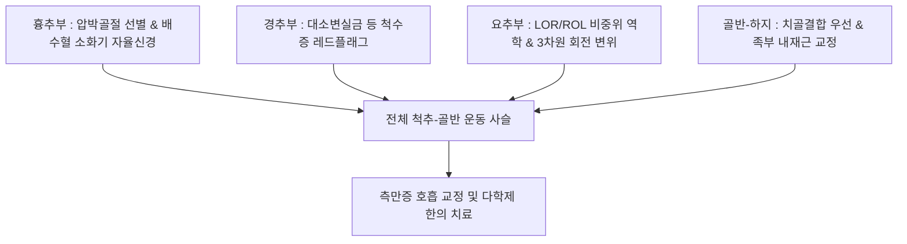

# 📋 [[2024 원추연 컨퍼런스 피드백]] (2024 Wonchuyeon Conference Feedback)

> **핵심 요약 (Key Summary)**:
> 2024년 원추연(원리 추나 연구회) 컨퍼런스에서 다루어진 척추·골반·하지 통합 수기치료 및 임상 진단 피드백을 체계적으로 집대성한 임상 지침 기록입니다.
> [[흉추]]부 압박골절 선별과 내장기-체성 반사, 경추 척수병증([[경추증성 척수증]])의 치명적 레드플래그 감별, 요추-골반 비중위(Non-neutral) 역학 및 3차원 골반 변위 평가를 포괄합니다.
> [[측만증]]에 대한 슈로스(Schroth) 호흡 운동의 본질, 좌측 평발(70%) 중심의 족부 내재근 재교육, 그리고 단순 수기 교정을 넘어선 환자 인지(Cognitive awareness) 및 심신 소통 전략을 유기적으로 연결합니다.

---

## 1. 개요 및 컨퍼런스 핵심 의의

본 문서는 원추연 임상 컨퍼런스에서 공유된 실전 척추신경 추나의 핵심 노하우와 감별 진단 포인트를 정리한 정본 기록입니다. 정형화된 테크닉의 단순 나열을 지양하고, 환자의 생체역학적 보상 사슬(Kinetic chain)과 신경계 반응을 정확히 읽어내어 침구·추나 치료의 효율성을 극대화하는 임상 지혜를 담고 있습니다.

---

## 2. 흉추부 임상 진단 및 수기 치료 피드백

1. **[[흉추]] 압박골절의 진단적 함정과 영상 한계**:
   - 노인 및 골다공증성 환자에서는 낙상 없이 **가벼운 기침만으로도 [[흉추]] 압박골절이 발생**할 수 있음을 항상 염두에 두어야 합니다.
   - 척추뼈는 외견상 안정성(Stability)이 유지된 상태에서도 미세 압박 골절이 잠재해 있을 수 있습니다.
   - 특히 [[늑골]](갈비뼈)은 단순 X-ray 영상검사만으로는 골절선을 조기에 확인하기 매우 어렵습니다.
   - 급성과 만성의 감별은 **MRI T2 강조영상 및 지방억제영상(STIR)의 골수 부종 음영**을 통해 명확히 확인하여 추나 적응증 여부를 판단합니다.
2. **흉배부 자율신경계와 소화기 연계 (내장기-체성 반사)**:
   - 흉배부 척추 주위에는 교감신경절(Sympathetic chain)이 밀집해 있으므로, 만성 소화불량을 호소하는 환자는 복와위에서 흉추 배수혈(비수, 위수, 담수 등)을 세밀하게 촉진하여 압통점과 조직 질감 변화(TART)를 확인해야 합니다.
   - 어깨 관절의 완전한 거상 가동성이 확보되기 위해서는 먼저 **흉추 신전(Extension) 가동성**이 선행되어야 합니다.
3. **호흡 패턴 이상과 경추-복부 연계**:
   - 과도한 흉식 호흡(Apical breathing)을 하는 환자는 [[사각근]]과 [[흉쇄유돌근]]의 단축을 유발하며, 이는 복부의 [[횡격막]]이 정상적으로 기능하지 못하고 있음을 방증하므로 흉추 추나와 함께 복부 이완 치료를 반드시 병행합니다.
   - 신경학적 긴장도 평가 시 하지 직거상 검사(SLT) 대신 **슬럼프 테스트(Slump test)**를 활용하는 것이 척수 경막의 긴장을 전 구간에서 편리하게 평가할 수 있습니다.

---

## 3. 경추부 중증 신경학적 레드플래그 선별

1. **치명적 척수 압박(Myelopathy) 증례 고찰**:
   - **임상 증례**: 하지 무력감(다리에 힘이 없음)을 주소로 내원한 환자에서, 뇌 영상진단상 뚜렷한 이상이 없었고 목 통증과 상지 저림증을 경미하게 호소함.
   - 문진상 **대소변 실금(Bowel & bladder incontinence)**이 동반되어 있음을 확인하고 상급병원 정밀 검사를 의뢰한 결과, [[경추]] 척수 종양(Cervical tumor)으로 확진됨.
2. **임상적 교훈 (Red Flags)**:
   - 단순 요통이나 하지 무력감 환자라 하더라도, 경부 통증이 동반되고 보행 실조(Ataxic gait), 미세 수부 운동 장애, 대소변 조절 장애가 나타나면 추나 치료를 즉각 중단하고 척수증(Myelopathy) 및 중추신경계 종양을 최우선적으로 감별 의뢰해야 합니다.

---

## 4. 요추-골반 생체역학 및 3평면 척추 변위 평가

1. **프라이에트(Fryette) 역학과 비중위 손상**:
   - LOR(Left on Right) 또는 ROL(Right on Left) [[천골]] 회전 변위는 비중위(Non-neutral) 상태에서 허리를 갑작스럽게 숙이며 비틀 때 요천추 [[인대]] 손상과 함께 호발합니다.
2. **기립 굴곡 검사 (Standing Flexion Test)**:
   - 서서 전방 굴곡 검사를 시행하여 관골([[장골]])의 3차원 변위를 평가합니다:
     - 인플레어(Inflare) 및 아웃플레어(Outflare)
     - 전방경사(Anterior tilt) 및 후방경사(Posterior tilt)
   - 척추 변위가 고착된 분절은 굴곡·신전 시 비대칭적인 우세 측굴 및 회전 움직임이 강제됩니다.
3. **근육분절(Myotome) 및 압통 분석**:
   - 허리 [[측만증]]이 있는 환자는 보통 압박을 받는 오목한 쪽보다 **과도하게 늘어나 편심성 장력을 받는 볼록한 쪽의 근육에서 통증이 먼저 발생**합니다.
   - 근육분절 검사를 통해 척추 주위 심부 기립근의 경결점과 억제된 근육을 정확히 감별합니다.

---

## 5. 측만증(Scoliosis) 호흡 및 3차원 보존적 운동 프로토콜

1. **슈로스(Schroth) 3차원 운동의 본질**:
   - 키가 커지는 느낌(Axial elongation)으로 척추를 위아래로 신장시키며, 회전 변형으로 함몰되고 좁아진 흉곽 부위에 의도적으로 호흡을 밀어 넣어 흉추와 갈비뼈가 제자리로 복원되도록 유도하는 능동적 교정 운동입니다.
2. **수기치료의 한계와 능동 치료의 중요성**:
   - [[측만증]]은 단순 [[침치료]]나 수동적 추나 치료만으로는 일시적인 완화에 그치며 지속 가능한 구조적 개선을 기대하기 어렵습니다.
   - 환자 스스로 자신의 척추 변형 형태를 3차원적으로 인지(Body awareness)하는 것이 치료의 제1보입니다.
   - 호흡 운동을 통해 흉곽 용적을 재배치하고, 일자목 및 일자허리에서 정상 시상면 생리적 전만 커브를 스스로 만들어내는 능동적 운동 치료를 주축으로 삼아야 합니다.

---

## 6. 하지 족부-골반 연계 및 기능적 검사

1. **족부 불균형과 골반 비틀림 (Ascending Chain)**:
   - 임상 환자의 약 **70%에서 좌측 평발(Flatfoot)**로 인한 하지 운동 사슬 붕괴와 골반대 불균형이 관찰됩니다.
   - 평발성 골반 변위 환자는 단순 아치 지지대를 넘어 **족부 내재근([[단지굴근]], [[충양근]]) 강화, 발가락 개폐 운동, 발바닥 고유수용성 감각(Proprioception)을 회복시키는 훈련**이 필수적입니다.
2. **골반 진단 순서와 치골결합(Pubic Symphysis) 우선 원칙**:
   - 골반대를 검사하고 치료할 때 **[[치골결합]]의 상하·전후 변위를 최우선적으로 확인하고 정렬**해야 [[천장관절]] 교정 효과가 유지됩니다.
   - 앉아 있다가 누웠을 때 환측 하지가 짧아지는 패턴은 전형적인 [[장골]] 후방경사(Posterior innominate) 변위를 시사합니다.

---

## 7. 한의 임상 수기·침구 통합 치료 및 환자 소통 전략

1. **추나 수기요법의 핵심 역학**:
   - 흉추 및 골반 교정 시 무조건적인 고속 과하중을 가하는 것은 위험하며, 관절의 생리적 가동제한벽(Restrictive barrier) 끝 지점까지 부드럽게 도달한 후 최소한의 진폭으로 관절면을 굴리듯 임팩트를 주어야 합니다.
2. **신경-근막 침구 배오**:
   - [[척추기립근]] 긴장과 자율신경 실조 시 협척혈(EX-B2) 및 배수혈 전침 치료를 병행하여 심부 [[다열근]]과 [[회선근]]을 재활성화합니다.
3. **심신 통합 소통 전략**:
   - 기질적 병변으로 설명되지 않거나 만성 난치성 통증을 호소하는 환자는 신체화 장애(Somatization) 및 심리적 불안·스트레스가 통증 역치를 낮추고 있을 가능성을 고려해야 합니다.
   - 라포(Rapport) 형성을 통해 환자의 심리적 고충을 경청하고 한의학적 이정변기(移精變氣) 요법을 연계하여 심신 통합 치유를 이끌어냅니다.

---

## 8. 참고문헌

* Langenfeld A. (2025). Systematic review on biomechanical effects of high-velocity, low amplitude spinal manipulation. *PLoS One*. PMID: 40680063

* Svoboda K. (2025). Provider kinematic strategies during the delivery of spinal manipulation and mobilization: a scoping review of the literature. *Chiropr Man Therap*. PMID: 39762951
