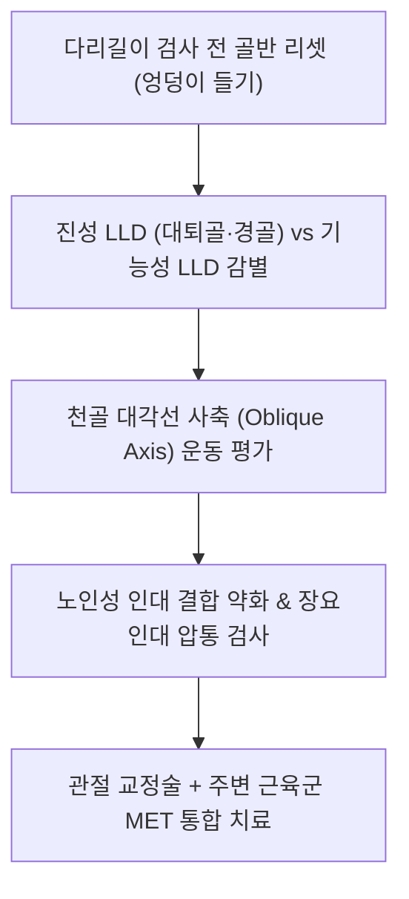

# 📋 [[골반 피드백]] (Pelvic Chuna Feedback)

> **핵심 요약 (Key Summary)**:
> 골반대(Pelvic girdle)의 3차원 변위 감별, 천골의 사축(Oblique axis) 운동학, 그리고 정밀 침구·추나 통합 수기 치료법을 집약한 임상 실전 피드백 기록입니다.
> 천장관절 인대 결합이 약화된 고령 환자에 대한 침도·화침(溫鍼) 강화 치료 전략과 [[장요인대]](Iliolumbar ligament)의 장골능 표적 자침법을 제시합니다.
> 앙와위 다리길이 검사(LLD) 전 골반 리셋(엉덩이 들기) 및 대퇴골·경골 분절 감별법, 강제 교정술의 한계를 보완하는 근에너지기법(MET), 그리고 외반슬과 족부 회내 장애가 골반 전방경사로 이어지는 상행성 사슬 증례를 분석합니다.

---

## 1. 개요 및 골반 추나 평가 원칙

골반은 인체의 상체 체중과 하지 반발력이 교차하는 중심 키스톤으로, 단순한 2차원적 기울어짐이 아니라 [[장골]](Ilium), [[천골]](Sacrum), [[좌골]](Ischium), [[치골]](Pubis)이 서로 얽힌 입체적 다축 변위를 나타냅니다.

골반 변위는 단일 면의 이상으로 국한되지 않으므로, 정적 촉진(Static palpation)과 동적 가동성 검사(Motion palpation)를 유기적으로 조합하여 진단해야 합니다.

---

## 2. 천골의 생체역학과 사축(Oblique Axis) 운동학

1. **대각선 사축(Oblique Axis) 중심의 천골 거동**:
   - [[천골]]은 단순한 전후 끄덕임(Nutation/Counternutation)뿐만 아니라, **좌우 상부 관절돌기에서 반대측 하외측각(ILA)을 연결하는 두 개의 대각선 사축(Right & Left Oblique Axes)**을 중심으로 3차원 비틀림 회전을 수행합니다.
   - 우사축 회전(Right on Right / Left on Right) 및 좌사축 회전(Left on Left / Right on Left) 변위는 요추 전만곡 및 천장관절 전단력에 지대한 영향을 미칩니다.
2. **골반 변위의 다양성 고려**:
   - 장골의 전방경사(Anterior tilt), 후방경사(Posterior tilt), 상방전위(Upslip), 인플레어(Inflare), 아웃플레어(Outflare)가 천골의 염전 변위와 결합하여 환자마다 천차만별의 임상 양상을 형성합니다.

---

## 3. 노인성 인대 결합 약화와 침구·화침 전략

1. **고령자 인대 이완의 병태생리**:
   - 노령층 환자는 장기간의 퇴행성 변화와 에스트로겐/콜라겐 감소로 인해 천장관절의 후배측 인대 및 골간인대 결합력이 극도로 약화되어 있습니다.
   - 촉진 시 후상장골극([[PSIS]]) 주변 관절 열극을 손가락으로 누르면 스펀지처럼 **쑥 들어가는 연약한 함요감(Spongy end-feel)**이 관찰됩니다.
2. **침구·전침 및 화침(溫鍼) 강화 치료**:
   - 인대가 이완된 고령 환자에게 과도한 충격력의 쓰러스트(Thrust) 교정을 적용하면 관절 불안정성이 심화될 위험이 있습니다.
   - 따라서 약화된 인대 부착부에 침 치료와 함께 **전침(Electroacupuncture) 또는 화침(Fire needle / 온침)**을 시술하여 국소 미세 열자극을 가함으로써 섬유모세포를 활성화하고 콜라겐 수축 및 인대 강화를 유도하는 것이 탁월한 치법입니다.

---

## 4. 장요인대(Iliolumbar Ligament) 정밀 촉진 및 자침법

1. **해부학적 위치 및 촉진 경로**:
   - [[장요인대]](Iliolumbar ligament)는 L5 횡돌기에서 [[장골능]](Iliac crest) 내순 후방으로 부착하는 요천추의 핵심 안정화 인대로, 만성 요통 환자의 대표적인 통증 유발점(Trigger point)입니다.
   - 촉진 시 [[PSIS]] 상방에서 요추 방향으로 거슬러 올라가며 L4-L5 레벨의 장골능 내측 모서리 함요부를 깊숙이 압박하여 확인합니다.
2. **정밀 자침 전략**:
   - 자침 시 신경 손상을 피하고 안전성을 확보하기 위해, 침 끝의 방향을 척추 중심관이 아닌 **단단한 골성 지표인 [[장골능]] 모서리를 목표(Bony stop)로 하여 직자 또는 사자**합니다.
   - 골막에 침단이 닿았을 때 가벼운 제삽으로 유착된 인대 섬유를 자극하여 요천추부 가동 제한을 즉각 해소합니다.

---

## 5. 다리길이 검사(LLD)의 표준화 및 감별 프로토콜

1. **검사 전 골반 리셋 (Pelvic Resetting Maneuver)**:
   - 앙와위 다리길이 검사 시 환자가 비틀린 채 누워 있으면 오진하기 쉽습니다.
   - 반드시 **무릎을 굽히고 발바닥을 바닥에 붙인 상태에서 엉덩이를 한번 번쩍 들었다가 내리게 한 후(Bridge movement)**, 다리를 천천히 펴주어 체간-골반 긴장을 리셋시킨 다음 복사뼈(내과) 높이를 비교해야 합니다.
2. **진성 하지길이부동 vs 기능성 변위 감별**:
   - 환자의 고관절을 수동 회전(Allis test)시켜 무릎 높이를 관찰함으로써, 길이 차이가 대퇴골(Femur) 길이 차이인지 정강이([[경골]], Tibia) 길이 차이인지 분절별로 감별합니다.

---

## 6. 골반 MET(근에너지기법) 및 주변 근육군 이완

1. **MET(Muscle Energy Technique)의 임상적 우수성**:
   - 관절면에 강한 충격을 주는 관절교정(HVLA) 기법도 유용하지만, 급성 동통 환자나 골다공증 환자에게는 환자 자신의 근육 수축력을 활용하는 **근에너지기법(MET)**이 훨씬 안전하고 재현성이 높습니다.
2. **주변 근육군 짝힘 제어**:
   - 골반 전방경사 교정: 단축된 [[장요근]] 및 [[대퇴직근]]의 PIR(Post-Isometric Relaxation) 신장.
   - 골반 후방경사 교정: 과긴장된 [[햄스트링]] 및 [[대둔근]]의 수축 후 이완.
   - 치골결합 변위: 내전근 복합체의 상반 신경 지배를 이용한 등척성 내전 저항 MET 적용.

---

## 7. 임상 증례 분석: 외반슬·발목회내·골반전방경사 연쇄

1. **증례 분석 (배성훈 환자 패턴)**:
   - **구조적 소견**: 심한 외반슬(Genu valgum, X자 다리) + 발목 족배굴곡 및 회내(Pronation) 제한(인대 손상 후유증) + 골반(관골)의 과도한 전방경사(Anterior pelvic tilt).
2. **상행성 운동 사슬(Ascending Kinetic Chain) 병리**:
   - 발목 인대 손상으로 거골하관절이 정상적인 회내 완충 기능을 하지 못하고 족배굴곡이 제한되자, 보행 시 대퇴골의 보상성 과도 내회전과 무릎 외반 붕괴가 초래되었습니다.
   - 이는 다시 고관절을 전내측으로 견인하여 골반을 전방으로 쏟아지게 만드는 전형적인 하지-골반 연쇄 부전입니다.
3. **치료 지침**:
   - 골반만 교정해서는 재발을 막을 수 없으며, 발목 관절낭 유착 해소(거골 가동술)와 비복근-가자미근 이완을 선행하여 족관절 가동성을 확보한 후 골반 추나를 적용해야 영구적 치료가 가능합니다.

---

## 8. 참고문헌

* Senol A. (2025). Effect of Muscle Energy Technique on Pain and Disability in People With Sacroiliac Joint Dysfunction: A Systematic Review and Meta-Analysis. *J Manipulative Physiol Ther*. PMID: 41196247

* Holmgren U. (2008). Inter-examiner reliability of four static palpation tests used for assessing pelvic dysfunction. *Man Ther*. PMID: 17210266
