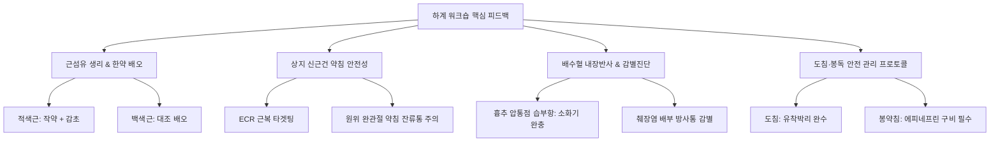
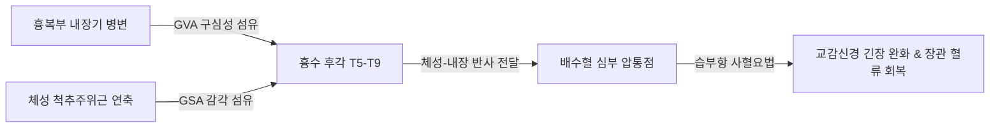

# 여름캠프 피드백 (Summer Workshop Clinical Feedback)

> **핵심 임상 요약 (Key Clinical Summary)**:
> - **근섬유 분자생리학과 본초 배오**: 백색근육(속근, Type II)의 피로·글리코겐 고갈에는 [[대추|대조]]를 응용하고, 적색근육(지근, Type I)의 산화적 손상과 강직성 경련에는 [[작약]]과 [[감초]]([[작약감초탕]])를 배오하여 골격근 항상성을 회복한다.
> - **상지 신근건 및 완관절 자침**: 단요측수근신근([[단요측수근신근|ECRB]])과 장요측수근신근([[장요측수근신근|ECRL]]) 기시부 통증(외측상과염) 시 원위 수근부 약침 주입은 장기간의 뻐근한 잔류 통증을 유발하므로 근위부 근복 및 기시부 위주로 자침한다.
> - **체성-내장 반사 및 감별 진단**: 흉추 배수혈 라인의 심부 압통점 습부항 사혈요법은 소화불량 및 위장관 운동 저하를 즉각 완충하며, 등 통증(T7-T9) 호소 시 단순 근막통 외에 [[췌장염]]의 방사통 가능성을 반드시 배제 진단해야 한다.
> - **침구·도침·봉독 안전 관리**: 혈관벽 기계적 자극을 최소화하기 위해 자침 직후 심부 도달 후 1~2mm 후퇴 유침을 시행하며, [[도침]] 시술 시 환자의 일시적 침감에 위축되지 않고 유착 해소 목표를 완수해야 한다. [[봉약침]] 적용 전에는 아나필락시스 쇼크에 대비해 응급 [[에피네프린]]을 필히 구비한다.

---

## 1. 하계 워크숍 임상 피드백 핵심 개요
원추연 하계 워크숍에서 다루어진 핵심 피드백은 근육의 조직학적 특성에 따른 한약 본초 배오, 상·하지 관절 부위의 자침 안전 심도, 내장-체성 반사에 기반한 배수혈 감별 진단, 그리고 [[도침]] 및 [[봉약침]] 등 특수 침구치료의 임상술기 표준화를 포괄한다.

단순한 근육 촉진을 넘어 분자생물학적 근섬유 유형(Type I vs Type II)에 맞춘 본초 선택과, 흉곽 내장기 질환의 체표 투사 경로를 이해함으로써 근골격계 통증과 내과적 질환의 감별 역량을 극대화하는 것을 목표로 한다.

---

## 2. 근섬유 유형별(적색근·백색근) 한약 약리 배오 원리
골격근 섬유는 미오신 중쇄(MHC) 동형단백질과 대사 경로에 따라 적색근(Type I, Slow-twitch oxidative)과 백색근(Type II, Fast-twitch glycolytic)으로 구분되며, 각 섬유의 병리적 피로 양상에 따라 최적화된 본초 배오가 요구된다.

| 근섬유 유형 | 주요 에너지 대사 | 주동근 예시 | 병리적 특징 | 추천 본초 및 처방 배오 |
| :--- | :--- | :--- | :--- | :--- |
| **적색근 (Type I)** | 미토콘드리아 산화적 인산화 | [[가자미근]], [[척추기립근]], [[자세유지근]] | 산소 소모량 과다, 산화 스트레스, 지속성 강직 경련 | [[작약]](Paeoniflorin, Ca²⁺ 재흡수 촉진), [[감초]](Glycyrrhizin, 항염증) → [[작약감초탕]] |
| **백색근 (Type II)** | 혐기성 해당과정 (Glycolysis) | [[비복근]], [[대퇴직근]], 상지 신근군 | 급격한 글리코겐 고갈, 젖산 축적, 파워 저하 및 피로 | [[대추|대조]](CAMP, 다당류 공급, ATP 재합성 보조), [[황기]] |

- **[[작약]]·[[감초]]의 분자역학**: [[작약]]의 주성분인 paeoniflorin은 근형질세망(Sarcoplasmic reticulum)의 SERCA 통로 활성을 유도하여 세포질 내 유리 칼슘 농도를 신속히 회복시키고, [[감초]]의 glycyrrhetinic acid는 근막 염증 매개물질 생성을 차단하여 긴장성 경련을 완화한다.
- **[[대추|대조]]의 대사적 기전**: 풍부한 환원당과 유기산, cAMP 활성 유도체를 함유하여 백색근의 고강도 수축 후 글리코겐 재합성을 촉진하고 중추성·말초성 피로 회복을 가속화한다.

---

## 3. 상지 신근건(ECR) 및 손목 부위 약침 자침 주의점
주관절 외측 통증(테니스 엘보)의 주원인인 수근신근군, 특히 단요측수근신근([[단요측수근신근|ECRB]])과 장요측수근신근([[장요측수근신근|ECRL]])의 병변 치료 시 자침 위치 선정이 치료 예후를 결정한다.

1. **외외측 상과 기시부와 근복 타겟팅**:
   - 병변의 주동 원인은 건 기시부의 미세 파열과 퇴행성 건병증(Tendinosis)이지만, 이차적인 신경근 긴장은 전완 근위 1/3의 근복에 형성된 [[발통점]](TrP)에서 기인한다.
   - 따라서 침구 및 [[약침]] 시술 시 완관절 근위부 근복을 주 타겟으로 삼아야 한다.
2. **원위 수근부 약침 주입의 부작용 방지**:
   - 수근관 및 수근 배측 지대 부위는 활액막, 건초, 피하 연부조직이 매우 조밀하고 공간이 협소하다.
   - 손목 주변 건초 내로 약침액(특히 고농도 증식제나 유성 제제)이 주입될 경우, 조직 내 내압 상승과 국소 화학적 무균성 염증으로 인해 수주 이상 지속되는 뻐근함과 가동통이 발생한다.
   - 따라서 원위 수근부에는 직접적인 고용량 약침 주입을 피하고, 0.20~0.25mm 호침을 이용한 표재성 혈위(양계, 양지, 양곡) 자침으로 한정한다.

---

## 4. 흉배부 배수혈 치료와 내장기 질환(췌장염 등) 감별 진단
흉추 배수혈 영역은 자율신경계 교감신경절과 척수신경 후지가 조밀하게 교차하는 부위로, 체성 근골격계 통증과 내장기 질환의 연관통이 빈번하게 중첩된다.

- **소화불량과 흉추 배수혈 사혈**:
  - 만성 소화불량 및 기능성 위장장애 환자에서 흉추 T5-T8 라인의 격수(BL17), 간수(BL18), 담수(BL19), 위수(BL21) 부위에 뚜렷한 경결과 압통이 관찰된다.
  - 해당 부위에 삼릉침 점자 후 [[습부항]]을 적용하면 분절성 교감신경 과항진이 억제되어 위장관 평활근 혈류량이 증가하고 연동운동이 즉각 개선된다.
- **[[췌장염]]의 배부 방사통 감별 진단**:
  - 급성 및 만성 [[췌장염]]은 흉추 T7-T9 높이의 좌측 배부 및 늑간을 따라 칼로 찌르는 듯한 둔통이나 관통통을 유발한다.
  - 상체를 앞으로 숙일 때 통증이 완화되고 앙와위에서 악화되는 체위성 특징, 식후 심와부 극통, 혈청 아밀라아제/리파아제 상승 징후를 확인하여 단순 흉배부 염좌로 오진하는 일이 없도록 철저히 감별한다.

---

## 5. 자침 및 유침 술기 원칙: 혈관 손상 예방과 후퇴 유침
자침 시 심부 목표 조직(근막, 골막, 관절낭)에 도달한 후 그대로 유침하는 행위는 미세 혈관 천공 및 시술 후 혈종(Hematoma) 형성 위험을 증대시킨다.

1. **후퇴 유침(Slight Withdrawal before Retention)**:
   - 목표 심도(예: 30~50mm 심부 근육)에 도달하여 침향(득기감)을 확인한 직후, 침을 약 1~2mm 후퇴(Withdrawal)시켜 유침을 유지한다.
   - **생리학적 근거**: 침첨이 심부 혈관초(Vascular sheath)나 신경 외막을 기계적으로 압박하거나 관통한 상태에서 환자가 호흡하거나 미세하게 움직이면 혈관벽 열상이 발생한다. 미세 후퇴는 혈관 탄성 복원 공간을 부여하여 일혈 및 지연성 혈종 형성을 차단한다.
2. **시술 후 처치 및 관찰**:
   - 발침 후 즉각적인 마른 솜 압박(최소 30초~1분)을 시행하고, 관절강 내 혹은 심부 주입 부위의 종창 여부를 확인한다.

---

## 6. 경추부 운동 처방 원칙: 회전 운동 지양과 등척성 운동
만성 경항통 및 경추 추간판 장애 환자에게 관습적으로 지도되는 과도한 경추 회전 운동(목 돌리기)은 심각한 생체역학적 손상을 유발하므로 근력 중심의 등척성 운동으로 전환해야 한다.

- **목 돌리기(경추 과회전·회선)의 유해성**:
  - 경추를 끝범위까지 회전하면서 신전시키는 동작은 추간공(Intervertebral foramen)을 극단적으로 협착시켜 신경근을 압박한다.
  - 또한 환추(C1)와 축추(C2) 사이를 주행하는 [[추골동맥|추골동맥(Vertebral artery)]]에 과도한 전단 응력(Shear stress)을 가하여 동맥 박리나 뇌허혈을 초래할 수 있다.
- **경추 등척성 운동(Isometric Neck Exercise) 프로토콜**:
  - 두경부를 중립 위치(Neutral position)에 고정한 상태에서 환자의 손바닥으로 전두부, 후두부, 측두부를 지지하고 상호 대항하는 힘을 6~10초간 유지한다.
  - 척추 관절면의 마찰 없이 심부 경추 굴곡근([[경장근]], [[두장근]])과 신전근의 협응 수축을 유도하여 경추 안정성을 극대화한다.

---

## 7. 침도 및 봉독약침 안전 관리: 아나필락시스 대비와 도침 시술 원칙
만성 난치성 건인대 유착 및 신경 포착 치료에 적용되는 [[도침]]과 [[봉약침]]은 고도의 임상 효과와 함께 철저한 안전 관리 수칙 준수를 요구한다.

### 7.1 도침(Acupotomy) 시술 원칙
- **유착 박리의 완수 원칙**:
  - 시술 부위의 만성 반흔 조직과 섬유성 유착을 박리할 때, 환자가 국소 통증(침감)을 호소하더라도 목표한 병리적 결절의 해소(Release) 단계까지 시술을 정밀하게 완수해야 한다.
  - 시술을 중간에 어설프게 중단하면 유착은 해소되지 않은 채 조직 내 미세 출혈과 반응성 염증만 유발하여 시술 후 통증(Post-needling soreness)만 심화된다.
  - 단, 주요 신경 줄기와 대동맥 주행 경로를 3차원 해부학적으로 숙지하여 신경 손상이 없는 안전면(Safe plane) 내에서만 절개·박리를 시행한다.

### 7.2 봉약침(Bee Venom) 아나필락시스 대비
- **알레르기 반응의 잠재성**:
  - 봉약침의 주성분인 멜리틴(Melittin)과 아파민(Apamin)은 강력한 항염증 효과를 발휘하나, 포스포리파아제 A2(PLA2) 등은 드물게 IgE 매개 제1형 과민반응(Anaphylaxis)을 유발할 수 있다.
  - 스킨 테스트 음성 환자라도 반복 투여 과정에서 감작되어 지연성 쇼크가 발생할 수 있다.
- **원내 응급 약물 구비 의무**:
  - 봉독을 시술하는 한의원 내에는 반드시 응급 자가주사용 [[에피네프린|에피네프린(Epinephrine)]] 앰플 또는 오토인젝터(EpiPen)를 상시 구비해야 한다.
  - 호흡곤란, 후두부 부종, 급격한 혈압 강하 발생 시 대퇴 전외측에 에피네프린을 즉각 근육 주사(성인 0.3~0.5mg)하고 119 응급 이송을 시행하는 위기 관리 매뉴얼을 확립한다.

---

## 8. 참고문헌 및 학술 연구 요약

- Sun Y et al. (2025). Efficacy of Myofascial Trigger Point Dry Needling in Treatment of Primary Dysmenorrhea: A Study Protocol for a Three-Arm Randomized Controlled Trial. *J Pain Res*. 18():4623-4633. PMID: 40933501

  - [연구 요약] 근막 발통점 건침(Dry Needling) 자침이 분절성 자율신경 조절 및 통증 역치 개선에 미치는 임상 효과를 무작위 대조 시험 프로토콜을 통해 규명함.

- Bae IH et al. (2022). Investigation of the Adverse Events Associated with Bee Venom Pharmacopuncture in Patients Hospitalized in a Korean Hospital: A Retrospective Chart Review Study. *Toxins (Basel)*. 14(10):689. PMID: 36287931

  - [연구 요약] 한방병원 입원 환자에서 봉약침 시술 후 발생하는 이상반응과 아나필락시스 발생 빈도 및 안전 관리 지침을 후향적 차트 분석을 통해 체계화함.
