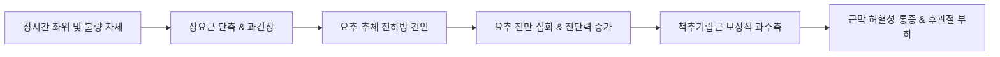

# 요추 피드백 (Lumbar Spine Clinical Feedback)

> **핵심 임상 요약 (Key Clinical Summary)**:
> - **비특이적 요통의 다인자성 병리**: 요통 환자의 약 85%는 특정 해부학적 단일 병변으로 한정되지 않는 [[비특이적 요통]](NSLBP)이며, 임상 현장에서는 [[추간판]] 변성, 근막 통증, 후관절 병변이 복합적으로 얽혀 나타난다.
> - **장요인대(Iliolumbar Ligament) 정밀 자침술기**: 만성 난치성 요통 및 [[골반]] 불안정성의 핵심인 장요인대는 [[장골능]] 최상단(L4 레벨)을 촉진한 후, L4-L5 [[횡돌기]] 부착부와 장골능 내측면 커브 변곡점을 연결하는 가상선을 설정하여 장골능 골막 접촉 심도까지 정밀 자침한다.
> - **요방형근([[요방형근]])의 초음파 유도 접근**: 요방형근은 체표 촉진은 가능하나 심부 자침 시 신장 손상 위험이 존재하므로, 초음파 유도하에 관찰하며 장골능 외측 부착부 위주로 [[약침]]을 안전하게 시술한다.
> - **신경수액박리술(Hydrodissection)과 삼투압 기전**: 5% 포도당 용액 약침은 신경 주위 유착을 물리적으로 박리하고 국소 삼투압 조절을 통해 신경부종을 완화하며 손상된 추간판 주변의 신경병증성 염증을 회복시킨다.
> - **퇴행성 복합 병변과 마미증후군 응급 감별**: 고령 환자의 요추 X-ray상 [[척추관 협착증|협착증(Stenosis)]]과 추간판 찌그러짐은 대부분 동반되므로 통합 치료하며, 압박골절 후방 전위로 인한 대소변 장애(마미증후군) 징후는 응급 전원 대상으로 신속히 감별한다.

---

## 1. 요통 임상 진단 원칙과 비특이성 요통의 역학
임상에서 접하는 요통의 약 85%는 영상의학적 소견과 임상 증상이 1:1로 일치하지 않는 [[비특이적 요통]](Non-specific Low Back Pain)으로 분류된다.

추간판 탈출증([[요추 추간판 탈출증]])이 단일 원인으로 주목받기도 하지만, 실제로는 [[요추 후관절 증후군]], 인대 결합 부전, 근막 [[발통점]]이 복합적으로 작용한다. 따라서 진단 시 신경근 압박증, 근육 좌상 및 염좌, 외상성 [[골절]], 퇴행성 [[추간판]] 질환을 체계적으로 감별해야 한다.

```mermaid
graph TD
    A[요통 환자 내원] --> B{응급 Red Flags 배제}
    B -->|마미증후군·골절 의심| R[응급 외과 전원: 대소변 장애·마비]
    B -->|비응급 상태| C[구조적·기능적 다각도 감별]
    
    C --> D[신경인성: 추간판 탈출증 & 협착증]
    C --> E[인대성: [[장요인대]] 증후군 & [[천장관절|천장관절염]]]
    C --> F[근막성: 척추기립근 & 요방형근 과긴장]
    
    D --> D1[5% 포도당 신경수액박리술 & 한약]
    E --> E1[장요인대 골막 약침 & 침도]
    F --> F1[초음파 유도 약침 & MET 추나]
```

---

## 2. 요추부 지지 인대와 장요인대(Iliolumbar Ligament) 심층 자침술기
장요인대(Iliolumbar ligament)는 L4 및 L5 횡돌기에서 기시하여 장골능 내측면에 정지하는 강력한 인대 복합체로, 요추와 골반을 연결하는 생체역학적 핵심 앵커(Anchor)이다.

### 2.1 해부학적 주행과 랜드마크 촉진법
1. **[[장골능]] 최상단 기준점 설정**:
   - 환자를 복와위로 위치시키고 양측 장골능(Iliac crest)의 최상단을 잇는 [[야코비선]](Jacoby's line, L4 극돌기 레벨)을 촉진한다.
   - L4와 L5의 횡돌기 외측 결절 부위를 가상 랜드마크로 설정한다.
2. **장골능 부착부 자침 경로**:
   - 장골능 외연을 따라 외측으로 이동하다가 능선이 전하방으로 꺾이는 커브 변곡점을 확인한다.
   - 횡돌기에서 장골능 내측면으로 향하는 인대 주행선 상에서, 횡돌기 자체보다 **장골능 내측 골막 부착부**를 일차 타겟으로 설정한다.
   - 직경 0.30mm, 길이 60~75mm 침을 장골능 골막을 향해 사자(Oblique needling)하여 골막 접촉 시의 둔중한 침감을 유도한다. 만성 환자에서는 이 부위에 중성어혈약침이나 프롤로 제제를 주입하여 인대 결합을 증식·강화한다.

---

## 3. 요방형근 촉진 한계와 초음파 유도하 장골능 부착부 약침 치료
[[요방형근]](Quadratus Lumborum, QL)은 장골능 후방에서 기시하여 12번 늑골과 L1-L4 횡돌기에 정지하는 심부 안정화 근육이다.

- **촉진과 맹검 자침의 위험성**:
  - 체표에서 요방형근의 외측연은 촉진 가능하지만, 환자의 체형(비만, 근육 위축)에 따라 두께와 깊이 변이가 극심하다.
  - 심부로 블라인드 자침 시 복막 강 내로 침이 진입하거나 신장(Kidney) 하극을 손상시킬 수 있는 치명적 위험이 존재한다.
- **초음파 유도 및 안전 자침 프로토콜**:
  - 요추 횡단면 초음파 스캔을 통해 [[광배근]], 척추기립근, 요방형근의 3개 층판과 전방 신장 주위 지방층을 명확히 확인한다.
  - 초음파 가이드하에 In-plane 방식으로 진입하여 요방형근의 후방 근막면 및 **장골능 부착부**에 약침을 정확히 투여함으로써 신경혈관 손상 없이 안전하게 치료한다.

---

## 4. 척추기립근과 장요근의 기립 과긴장 및 요추 견인 병태생리
기립 자세 및 좌위 유지 시 [[척추기립근]](Erector spinae)과 [[장요근]](Psoas major)은 체간의 전후방 균형을 유지하기 위해 상호 지속적인 등척성 수축을 유지한다.



- **상호 연쇄 과긴장의 악순환**:
  - 장시간 좌위는 고관절 굴곡 상태를 지속시켜 장요근의 단축성 구축을 유발한다.
  - 기립 시 단축된 장요근은 요추 추체를 전하방으로 강하게 전인(Anterior shearing)하여 요추 전만을 강제하고, 이에 대항하여 척추기립근은 척추를 세우기 위해 보상적으로 과긴장된다.
  - 이로 인해 요추 기저부의 압박 부하가 증대되어 디스크 내압 상승과 만성 근육성 요통이 유발된다. 치료 시 배부 기립근 이완뿐 아니라 복부 측면을 통한 장요근 이완이 필수적으로 병행되어야 한다.

---

## 5. 신경수액박리술(Hydrodissection)과 고장성/등장성 포도당 프롤로의 기전
퇴행성 요추 병변 및 신경근 포착성 통증에 적용되는 포도당 주입 요법은 생체역학적·생화학적 다중 기전을 발휘한다.

1. **신경수액박리술 (Nerve Hydrodissection)**:
   - 5% 등장성 포도당 용액을 척추 신경근 주변(경막외 또는 척수신경 후지 내측지 주변)에 주입하여 신경과 주변 반흔 조직 사이의 유착을 수압으로 박리한다.
   - 신경에 가해지는 기계적 압박을 즉각 제거하여 신경내 혈류 관류압을 복원한다.
2. **삼투압 및 조직 재생 기전**:
   - 포도당 용액은 국소 삼투압 차이를 형성하여 신경초의 염증성 부종을 감소시킨다.
   - 또한 국소 성장인자(PDGF, TGF-beta)의 분비를 유도하여 미세혈관 신생과 손상된 섬유륜 외측의 결합조직 회복을 촉진한다.

---

## 6. 퇴행성 척추관 협착증과 추간판 탈출증의 복합 병변 치료
고령 환자의 단순 방사선(X-ray) 사진에서는 대부분 요추 전반의 퇴행성 골극 형성, 척추관 협착([[척추관 협착증]]), 추간판 간격 협소화(Disc flattening)가 혼재되어 관찰된다.

- **복합 병변의 임상적 접근**:
  - [[요추 추간판 탈출증|추간판 탈출증]]과 [[척추관 협착증]]은 별개의 질환이 아니라 척추 퇴행성 연속선상의 동일 과정이다. 추간판 높이가 감소하면 [[황색인대]]가 비후되고 후관절이 비대해지며 협착증으로 이행한다.
  - 따라서 단순 디스크 감압이나 협착 확장 중 하나에 편중되지 않고, **척추 불안정성 해소(인대 강화) + 분절성 가동성 회복(추나교정) + 신경막 염증 제어(봉약침·한약)**의 통합 보존 치료를 기본 전략으로 삼는다.

---

## 7. 압박골절, 신경근 압박 및 마미증후군 응급 감별 지침
골다공증성 또는 외상성 요추 압박골절 환자에서는 추체 전방 붕괴와 함께 후방 피질 파편의 척추관 침범 여부를 면밀히 관찰해야 한다.

| 감별 질환 | 주요 병태생리 | 특징적 임상 소견 | 응급 조치 및 진료 방침 |
| :--- | :--- | :--- | :--- |
| **요추 압박골절 (Compression Fx)** | 추체 전방 쐐기형(Wedge) 압박 붕괴 | 체위 변경 시 격렬한 국소 통증, 척추 타진통(叩診痛) 양성 | 침상 안정, 흉요추 보조기(TLSO), 후방 척추관 침범 여부 CT/MRI 확인 |
| **신경근 압박 (Radiculopathy)** | 추간판 탈출 또는 협착에 의한 L4, L5, S1 압박 | 하지 [[방사통]], 감각 저하, 건반사 감소, 특정 피부분절 통증 | 보존적 침구·추나·신경수액박리 치료 진행 |
| **마미증후군 (Cauda Equina Syn.)** | 요천추 신경총(L2 이하 마미신경) 광범위 압박 | [[안장마비]](Saddle anesthesia), **대소변 실금 또는 배뇨 불능**, 양하지 마비 | **즉각적인 응급 척추외과 전원 (48시간 내 감압 수술 필수)** |

---

## 8. 참고문헌 및 학술 연구 요약

- Nayak BK et al. (2020). Recovering from nonspecific low back pain despair: Ultrasound-guided intervention in iliolumbar syndrome. *Indian J Radiol Imaging*. 30(4):448-452. PMID: 33737773

  - [연구 요약] 만성 비특이적 요통 환자에서 [[장요인대]] 증후군에 대한 초음파 유도하 중재술이 통증 감소 및 기능 회복에 미치는 임상적 유효성을 규명함.

- Harmon D et al. (2011). Sonoanatomy and injection technique of the iliolumbar ligament. *Pain Physician*. 14(5):469-74. PMID: 21927051

  - [연구 요약] 장요인대의 초음파 해부학적 랜드마크와 안전한 바늘 진입 각도 및 주사 술기를 체계적으로 확립함.
