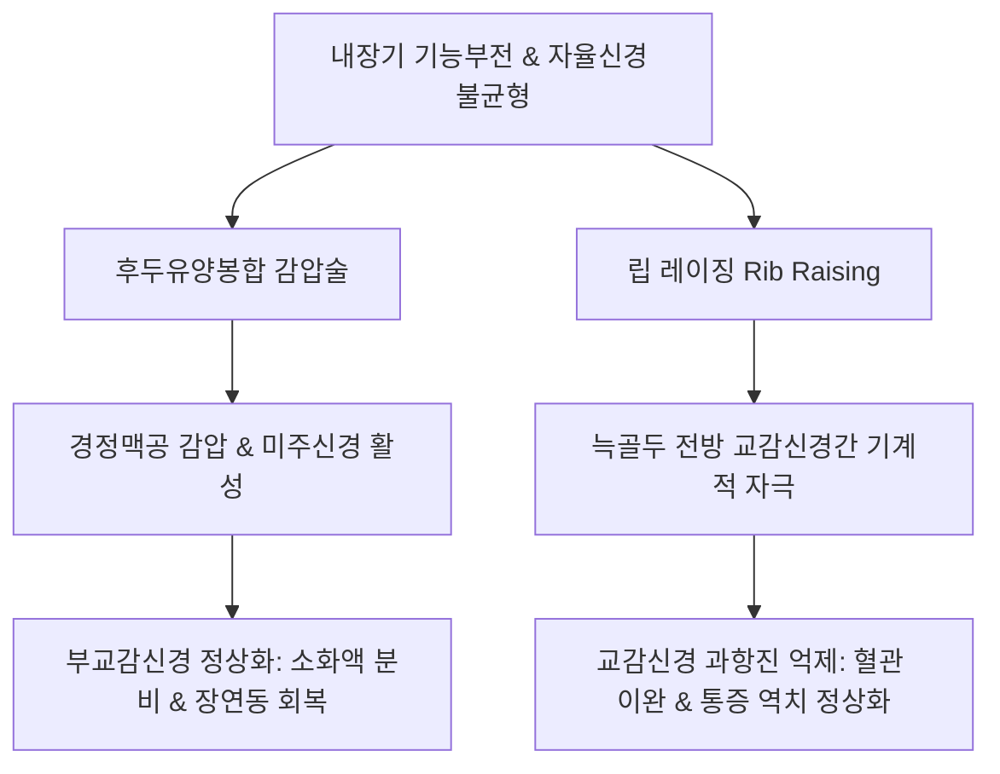

# 원추연 특강 (Advanced Cranial & Visceral Chuna Seminar)

> **핵심 임상 요약 (Key Clinical Summary)**:
> - **[[두개골]] [[추나요법|추나]]의 순서와 봉합학적 원리**: [[두개골]] [[추나요법|추나]]의 기본 진입 순서는 **'뒤(후두골) → 옆(측두골·두정골) → 앞(전두골·접형골)'**이며, 천골 근막이 두개골까지 연속된다는 고전 가설 대신 심박 박동과 [[뇌척수액]](CSF) 맥동에 기반한 3차원 봉합 가동성에 집중한다.
> - **두개천골 리듬(CRI)과 윈드케셀 효과(Windkessel Effect)**: CRI는 동맥 혈압파동, 뇌척수액 순환, 뇌혈관 탄성 수축의 상호작용이며, 대동맥의 윈드케셀 효과처럼 두개강 내 압력파를 분산·완충하여 중추신경계 미세혈류를 보존한다.
> - **유대골(Paired)과 단일골(Unpaired)의 운동학**: 짝 뼈(두정골, 측두골)는 외회전(확장)과 내회전(수축)을 하고, 홀수 뼈(후두골, 접형골, 서골)는 굴곡(확장)과 신전(되감기)을 수행하며, 접형후두연접부(SBS)의 굴곡·외회전 기능 부전이 일차 교정 대상이다.
> - **내장기 추나 및 자율신경 조절**: 후두유양봉합 감압술은 [[경정맥공]](Jugular foramen)을 통과하는 [[10. 미주신경|미주신경]]을 감압하여 부교감신경을 정상화하고, 립 레이징(Rib raising)은 늑골두 전방의 교감신경절을 기계적으로 자극하여 교감신경 과활성을 억제한다.
> - **요천추 역학 및 임상 감별 피드백**: 요추 전만 체형에서 고관절 굴곡근 치료 시 [[장요근]]뿐 아니라 [[대퇴근막장근|대퇴근막장근(TFL)]]을 감별해야 하며, 척추 타진 시 반응이 없더라도 치료 불응 시 미세골절을 의심하고, 심한 [[척추관 협착증]] 환자에서는 대소변 장애를 확인해야 한다.

---

## 1. [[두개골]] [[추나요법|추나]]요법(Cranial Chuna)의 기본 원리와 순서 체계
[[두개골]] [[추나요법|추나]]요법(Cranial Chuna Therapy)은 두개골 봉합(Cranial sutures)의 미세 가동성과 뇌척수액 맥동 순환을 정상화하여 뇌신경계 및 전신 자율신경 기능을 회복시키는 전문 수기치료이다.

```mermaid
graph LR
    A[[[두개골]] [[추나요법|추나]] 진입] --> B[1단계: 뒤 - 후두골 감압]
    B --> C[2단계: 옆 - 측두골·두정골 이완]
    C --> D[3단계: 앞 - 접형골·전두골 정렬]
    D --> E[접형후두연접부 SBS 통합 가동]
```

- **표준 치료 순서 체계 (뒤 → 옆 → 앞)**:
  1. **후방부 (뒤)**: 대후두공과 [[후두골]](Occiput) 감압을 선행하여 뇌척수액 배출구와 경정맥공 압박을 해소한다.
  2. **외측부 (옆)**: [[측두골]](Temporal bone)과 [[두정골]](Parietal bone)의 인상봉합 및 유양돌기 봉합면을 이완하여 중이관 및 미주·설인신경 주행을 확보한다.
  3. **전방부 (앞)**: [[접형골]](Sphenoid)과 [[전두골]](Frontal bone), 안면골 복합체를 교정하여 접형후두연접부(SBS)의 3차원 굴곡·외회전 펌핑을 완성한다.
- **두개천골 가설의 현대적 재해석**: 과거 천골의 경막이 두개골까지 단일 근막띠로 강력히 연결되어 당긴다는 가설은 해부학적 실증 연구로 재조명되었으며, 현재는 경막 내 정맥동(Venous sinus) 내압과 뇌척수액 순환계의 유체역학적 진동으로 설명된다.

---

## 2. 두개천골 리듬(CRI)과 윈드케셀 효과(Windkessel Effect)의 생체역학
두개골의 미세 팽창과 수축 주기를 의미하는 [[두개천골]] 리듬([[CRI]])은 분당 8~14회의 고유 진동을 보인다.

- **윈드케셀 효과(Windkessel Effect)와의 상관성**:
  - 심실 수축기 시 박출된 혈액이 탄성 동맥벽을 확장시키고, 이완기에 탄성 복원력으로 혈류를 지속시키는 윈드케셀 원리가 두개강 내에서도 작동한다.
  - 내경동맥과 추골동맥을 통해 유입되는 강한 동맥혈 맥박 에너지는 두개골 봉합부의 미세 가동성과 뇌실계로 흡수·분산되어 뇌 실질 세포에 가해지는 유체역학적 충격을 완충한다.
- **뇌척수액 순환 추동력**: 뇌실 맥락총(Choroid plexus)에서의 CSF 생성, 호흡성 흉강 내압 변화, 뇌혈관의 혈관운동(Vasomotion)이 복합 작용하여 CRI의 추진력을 형성한다.

---

## 3. 유대골(Paired) 및 단일골(Unpaired)의 3차원 가동학
두개골을 구성하는 22개의 뼈는 중앙선의 단일골과 양측 대칭의 유대골로 구분되며, 고유의 축을 중심으로 특정 운동 패턴을 나타낸다.

| 분류 | 해당 골격 | 주동 운동 축 | 확장기 (CRI 굴곡기) 운동 | 수축기 (CRI 신전기) 운동 |
| :--- | :--- | :--- | :--- | :--- |
| **단일골 (Unpaired)** | 후두골, 접형골, 서골, 사골 | 시상면 횡축 (Transverse axis) | **굴곡 (Flexion)**: SBS 거상, 전후경 단축, 횡경 확장 | **신전 (Extension)**: 되감기 과정, 원위치 복원 |
| **유대골 (Paired)** | 두정골, 측두골, 상악골, 관골 | 사선 전후축 (Anteroposterior axis) | **외회전 (External rotation)**: 측두골 외측 벌어짐 | **내회전 (Internal rotation)**: 내측 수축 회전 |

- **굴곡(Flexion)과 외회전(External Rotation)의 임상적 중요성**:
  - 두개골의 확장기 굴곡은 대뇌 겸(Falx cerebri)과 소뇌 천막(Tentorium cerebelli)의 장력을 재조정하는 능동적 생리 과정이다.
  - 임상적으로 두개골 가동 장애는 대부분 굴곡 및 외회전 제한 상태로 발현되므로, 수기 교정 시 굴곡과 외회전 방향으로의 미세 유도를 집중 적용한다.

---

## 4. 두개골 수기 평가(Vault Hold) 및 주요 봉합 이완 술기
술자의 양손을 이용한 Vault Hold는 [[CRI]]의 리듬, 진폭, 대칭성을 평가하는 표준 검진 및 치료 접촉법이다.

1. **Vault Hold 수기 접촉점**:
   - 검지: 접형골 대익(Greater wing of sphenoid)
   - 중지: 측두골 인상부(Squamous part) 및 외이도 전방
   - 약지: 측두골 유양돌기 기저부(Mastoid process)
   - 소지: 후두골 외측연(Squamous part of occiput)
   - 술자 수지 관절의 심부 고유수용성 감각을 통해 CRI의 주기와 비대칭성을 정밀 감지한다.
2. **앙와위 후두유양돌기 및 두정유양돌기 봉합 분절 교정**:
   - 후두골과 측두골 유양돌기가 접하는 [[후두골|후두유양봉합]](Occipitomastoid suture) 부위에 모지구를 접촉하고, 환자의 호흡과 연동하여 V-spread 기법으로 봉합면을 이완시킨다.

---

## 5. 내장기 추나요법(Visceral Chuna)과 자율신경 조절(립 레이징·후두감압)
[[내장기 추나]](Visceral Manipulation)은 흉복부 장기의 생리적 고유운동성(Motility)과 주변 장막·인대계의 유동성을 회복시켜 내장-체성 반사를 조절한다.



- **후두유양봉합 감압술과 [[10. 미주신경|미주신경]]**:
  - 후두골과 측두골 사이의 [[경정맥공]](Jugular foramen)은 제9(설인), 제10([[10. 미주신경|미주]]), 제11(부) 뇌신경이 통과하는 핵심 통로이다.
  - 후두유양봉합의 압박을 감압하면 미주신경 전달이 원활해져 위장관 연동운동 장애, 역류성 식도염, 심계항진 등 부교감신경 저하 증상이 즉각 완화된다.
- **립 레이징(Rib Raising)의 교감신경 억제 기전**:
  - 늑골두와 늑골경의 전방에는 흉부 교감신경간(Sympathetic chain ganglia)이 인접 주행한다.
  - 앙와위에서 술자가 양손으로 늑골각을 전상방으로 부드럽게 들어올리는 립 레이징을 시행하면, 교감신경절에 기계적 저신장 자극이 가해져 항진된 교감신경 활성도가 억제되고 말초 혈관 확장이 유도된다.

---

## 6. 요천추 및 골반부 역학: 장요근·대퇴근막장근·후관절의 감별
골반과 요추의 시상면 변위 환자에서 고관절 굴곡근과 요천추 후관절의 생체역학적 기능 부전을 명확히 감별해야 한다.

- **[[장요근]] vs [[대퇴근막장근]](TFL)의 감별**:
  - 요추 전만과 골반 전방경사 환자에서 고관절 굴곡근 단축이 관찰될 때, 장요근 단독 문제로 속단해서는 안 된다.
  - [[Thomas Test]] 시 고관절 굴곡과 함께 외전·내회전 보상 운동이 동반되면 [[대퇴근막장근]]의 과단축이 주원인이며, 이때 [[장경인대]]와 [[전자낭염]]이 호발하므로 치료 타겟을 분리해야 한다.
- **[[후관절 증후군]]과 침도 치료의 한계**:
  - 후관절 부위 만성 통증에 [[도침]]으로 후관절낭을 박리할 때, 퇴행성 비후 골극(Osteophyte)이 관절면을 잠식한 골성 협착 상태에서는 침도 박리만으로 영구적 구조 회복을 기대하기 어렵다.
  - 골극 형성 환자에게는 과도한 도침 자극보다 관절 가동성 추나와 주변 근육 균형 회복 운동 치료가 우선되어야 한다.

---

## 7. 임상 진단 피드백: 미세골절 타진, 협착증 마미증후군, 자세 운동 처방
임상 현장에서 간과하기 쉬운 척추 질환의 위험 징후와 장기적 관리 전략에 대한 피드백이다.

1. **미세골절 타진통(Tapping pain)의 진단학적 가치**:
   - 척추 [[극돌기]] 직접 타진 시 전형적인 국소 골절 통증이 뚜렷하지 않더라도, 통상적인 침구·추나 치료에 전혀 호전 반응이 없는 고령 환자는 잠재적 미세골절(Occult fracture)을 강력히 의심하고 MRI 촬영을 의뢰해야 한다.
2. **중증 협착증과 대소변 기능 확인**:
   - 보행 시 파행을 보이는 중증 [[척추관 협착증]] 환자에서는 침상 안정 지도와 함께 대소변 배뇨·배변 감각 이상 여부를 매 진료마다 확인하여 마미증후군 진행을 감시해야 한다.
3. **선천적 골격 비대칭과 운동 처방**:
   - 하지 길이 부동이나 반척추 등 선천적 골격 구조 이상을 가진 환자는 수기 치료로 근육을 이완시켜도 단시간 내에 원래 패턴으로 회귀한다.
   - 따라서 이러한 환자에게는 수기 치료에만 의존하지 말고 능동적 코어 강화 운동과 비대칭 교정 운동 처방을 통해 골격 부하를 스스로 분산시키도록 지도해야 한다.

---

## 8. 참고문헌 및 학술 연구 요약

- Stępnik J et al. (2023). Effects of the Fourth Ventricle Compression Technique and Rib Raising Osteopathic Technique on Autonomic Nervous System Activity Measured by Heart Rate Variability in 35 Healthy Individuals. *Med Sci Monit*. 29():e941167. PMID: 37641394

  - [연구 요약] 제4뇌실 압박(CV4) 기법과 립 레이징 수기요법이 정상인의 심박변이도(HRV)와 자율신경계 교감·부교감 활성도에 미치는 즉각적 조절 효과를 규명함.

- Davis SE et al. (2020). Weekly Osteopathic Manipulative Treatment to Improve Measures of Sympathetic Tone in Women With Polycystic Ovary Syndrome: A Randomized, Controlled Pilot Study. *J Am Osteopath Assoc*. 120(5):310-321. PMID: 32337566

  - [연구 요약] 자율신경계 과활성 질환 환자에서 두개천골 및 흉곽 수기치료가 교감신경 긴장 완화 및 생리 지표 개선에 미치는 임상적 유효성을 무작위 대조 시험으로 입증함.
