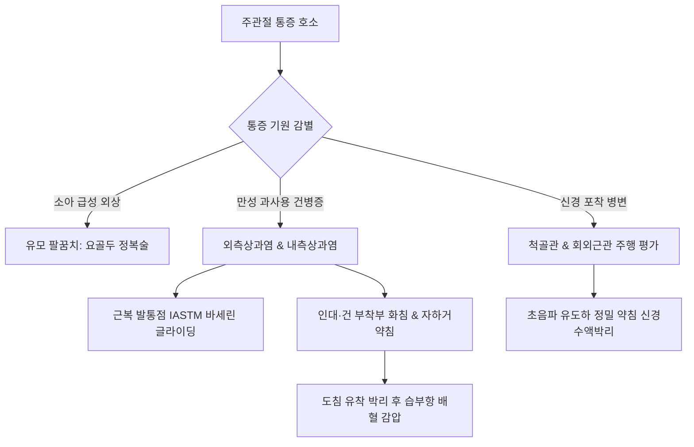

# 주관절 피드백 (Elbow Joint Clinical Feedback)

> **핵심 임상 요약 (Key Clinical Summary)**:
> - **임상 압통점 중심 접근**: 해부학 교과서처럼 개별 미세 근육을 일일이 분리 촉진하기보다 실제 임상에서는 최대 [[발통점]](TrP) 및 병리적 경결(Tender point)을 정확히 포착하여 집중 치료하는 것이 신속한 기능 회복의 핵심이다.
> - **연부조직 가동술(IASTM)과 바세린 윤활**: 전완 굴근·신근군의 광범위한 근막 유착에는 바세린 등 마찰 저감 매개체를 도포한 후 주먹이나 IASTM 툴을 활용하여 원위부로 활주(Gliding)시키는 수기 이완술이 탁월한 효과를 나타낸다.
> - **유모 팔꿈치(Nursemaid's Elbow) 도수정복술**: 소아 [[요골두]] 불완전 탈구 시 **'손바닥을 위로 하여(전완 회외, Supination) 장축 견인 후 주관절 급속 굴곡'** 또는 **'주관절 신전 상태에서 전완 급속 과회내(Hyperpronation)'**의 2대 표준 정복술기를 상황에 맞게 구사한다.
> - **인대 재생과 화침·약침 배오**: 손상된 외측/내측 측부인대는 혈관 분포가 희박하여 회복이 지연되므로 [[화침]](Fire needling)과 [[자하거약침]]을 병용하여 콜라겐 합성을 촉진하되, 급성 파열기에는 과자극을 삼간다.
> - **초음파 유도 신경 타겟팅과 침도 후 사혈**: [[척골신경]], [[요골신경]], [[정중신경]]의 포착 병변은 초음파 관찰하에 정밀 약침 치료를 시행하며, 손목 부위는 잔류 뻐근함이 심하므로 기시부 위주로 자침하고, [[도침]] 절개 후 울혈 시에는 [[습부항]] 사혈로 내압을 즉각 감압한다.

---

## 1. 주관절 임상 평가 원칙과 근막 압통점(Trigger Point) 치료
[[주관절]] 주변은 [[상완골]] 내·외측 상과를 중심으로 수많은 굴근·신근건과 인대, 말초신경이 교차하는 복잡한 해부학적 교차로이다.

실제 진료 현장에서는 개별 근육 섬유의 기시·정지부를 일일이 분리해 내기보다, 기능적 운동 단위(Myofascial functional unit) 내에서 최대 통증을 유발하는 **핵심 압통점(Trigger Point)**과 근막 결절을 촉진하여 주 치료점으로 설정하는 것이 임상적 효율을 극대화한다.

---

## 2. 유모 팔꿈치(요골두 아탈구)의 병태생리와 도수정복술기(회외-굴곡 vs 과회내)
소아(주로 1~4세)에서 보호자가 팔을 갑자기 잡아당길 때 호발하는 요골두 아탈구(Subluxation of radial head, 유모 팔꿈치)는 미성숙한 [[윤상인대]](Annular ligament)가 상완요골관절면 사이로 활입(Entrapment)되어 발생한다.

### 2.1 2대 표준 도수정복술기 비교

| 정복 술기 기법 | 시술 절차 | 생체역학적 기전 | 성공률 및 임상 팁 |
| :--- | :--- | :--- | :--- |
| **회외-굴곡법 (Supination-Flexion)** | 1. 환아의 주관절을 90도 굴곡하고 술자의 엄지로 [[요골두]]를 압박 2. 전완을 완전히 외회전(회외, Supination)하며 장축 견인 3. 그 상태에서 주관절을 어깨 쪽으로 완전히 굴곡 | 윤상인대를 [[요골두]] 결절부 위로 미끄러뜨려 원래 위치로 복원 | 고전적 표준 기법, 클릭(Click) 감각과 함께 정복 확인 |
| **과회내법 (Hyperpronation)** | 1. 환아의 주관절을 90도 굴곡하고 요골두 지지 2. 전완을 끝범위까지 강하게 내회전(과회내, Hyperpronation) | 방추상 요골두 외측 경사각을 이용해 갇힌 인대 후방 탈출 유도 | 최근 임상 시험에서 회외-굴곡법보다 1차 정복 성공률이 더 높고 통증이 적음 |

- 정복 성공 직후 약 5~15분 내에 환아가 상지를 정상적으로 거상하고 장난감을 잡는지 기능 평가를 수행한다.

---

## 3. 연부조직 가동술(IASTM/수기 이완)의 임상 적용과 윤활 매개
[[외측상과염]](테니스 엘보)이나 [[내측상과염]](골퍼 엘보) 환자에서 완관절 굴·신근군의 만성 근막 비후와 섬유성 유착은 관절 가동 범위를 심각하게 제한한다.

- **바세린 및 윤활 매개체의 중요성**:
  - 맨살에 직접 강한 기계적 마찰을 가하면 표피 박리와 모세혈관 파열로 인한 피하 출혈(멍)이 심해진다.
  - 바세린이나 마사지 크림을 전완부에 얇게 도포한 후, 술자의 수근부나 주먹, 스테인리스 IASTM(Instrument-Assisted Soft Tissue Mobilization) 블레이드를 활용한다.
- **스트로크 술기**:
  - 근위부 기시부에서 원위 수근부를 향해 장축 방향으로 지그시 압력을 가하며 밀어내는 글라이딩(Gliding) 스트로크를 적용한다.
  - 근막 간 계면 활주를 복원하고 정체된 세포간질액의 림프 배출을 촉진하여 근막 긴장도를 즉각 정상화한다.

---

## 4. 주관절 측부인대 손상과 화침·자하거약침 재생 프로토콜
주관절의 안정성을 담당하는 [[내측측부인대]](MCL)와 [[외측측부인대]](LCL)는 혈류 공급이 극히 제한적인 백색 섬유성 결합조직으로 구성되어 자연 치유가 매우 더디다.

- **[[화침]](Fire Needling)의 열자극 기전**:
  - 가열된 특수 침으로 인대 부착부의 골막 결합선에 순간적인 고열 자극(단자법)을 가하면, 국소 조직의 미세 응고 괴사와 함께 강력한 급성 무균성 염증 반응이 유도된다.
  - 이는 섬유아세포(Fibroblast)를 자극하여 제1형 콜라겐 합성을 촉진하고 인대 이완증(Laxity)을 수축·강화시킨다.
- **[[자하거약침]]의 조직 재생 보오**:
  - 풍부한 성장인자(EGF, FGF)와 필수 아미노산을 함유한 자하거약침을 인대 손상 부위에 주입하여 결합조직 재형성을 가속화한다.
  - **주의 사항**: 인대가 완전히 파열된 급성기(Grade III)나 혈관절증 상태에서는 화침과 고농도 약침 시술을 자제하고 안정 고정(Splint)을 우선한다.

---

## 5. 주관절 포착 신경(척골·요골·정중)의 초음파 유도 약침 신경차단술
주관절 부위는 주관증후군([[주관 증후군|주관증후군(Cubital Tunnel)]])의 척골신경, 회외근관(Frohse 아케이드)의 요골신경 심지(PIN), 회내근 증후군의 정중신경 등 말초신경 포착이 빈번하게 호발한다.

- **초음파 유도하 신경수액박리술(Hydrodissection)**:
  - 블라인드 자침 시 신경 섬유를 직접 관통하여 신경병증성 동통이나 마비를 유발할 위험이 높다.
  - 초음파 고주파 선형 프로브를 통해 척골신경구(Ulnar groove) 및 주관 내부의 '벌집 모양(Honeycomb)' 신경 다발을 실시간 관찰하면서, 외경 30G 미세 주늘로 신경 외막 주변에 5% 포도당 또는 중성어혈약침을 1~2cc 주입하여 압박 구조물을 수압으로 박리한다.

---

## 6. 전완 신근건 기시부와 원위 수근부 자침 배오 원칙
상지 신근건 병변 시 자침 포인트 선정의 생체역학적 원칙이다.

1. **원위 수근부 자침 자제**:
   - 손목 관절([[양계]], [[양지]], [[양곡]] 주변)은 건초와 골간 인대가 밀집되어 있어 심부 자침 시 환자가 장시간 뻐근함(잔여 침감)과 불편감을 호소한다.
2. **근위부 기시부 및 근복 중심 배오**:
   - [[상완골]] 외측상과 건 부착부와 함께, 주관절 원위 3~5cm 지점의 단요측수근신근([[단요측수근신근]]) 및 총지신근([[총지신근]]) 근복의 최대 긴장점에 침을 놓고 저주파(2~4Hz) [[전침]] 자극을 가한다.
   - 이는 건-골 접합부(Enthesis)에 가해지는 기계적 인장 부하를 상쇄시켜 치료 속도를 비약적으로 단축시킨다.

---

## 7. 주관절 도침 치료술기와 후처치 습부항 사혈요법
만성 난치성 [[테니스 엘보]] 환자의 골막 건 부착부 반흔 조직에 [[도침]]을 적용할 때의 필수 후처치 프로토콜이다.

- **도침 절개 및 박리술기**:
  - [[상완골]] 외측상과 외측 능선에서 건 부착부를 촉진하고, 건 주행 방향과 평행하게 도침 칼날을 진입시켜 반흔화된 섬유 다발을 2~3회 종축 절개·박리한다.
- **후처치 [[습부항]] 사혈의 당위성**:
  - 도침 시술 직후 골막 주변 미세 모세혈관망에서 스며 나오는 출혈이 관절낭 주위에 고이면 시술 후 압박 부종과 2차 섬유화를 초래한다.
  - 즉각적으로 멸균 부항컵을 장착하여 음압으로 혈종과 변성 조직액을 2~5cc 배출시키는 습부항 요법을 병행함으로써, 국소 내압을 낮추고 시술 후 통증을 드라마틱하게 경감시킨다.

---

## 8. 참고문헌 및 학술 연구 요약

- Aksel G et al. (2025). Comparison of supination/flexion maneuver to hyperpronation maneuver in the reduction of radial head subluxations: A randomized clinical trial. *Am J Emerg Med*. 88():29-33. PMID: 39579408

  - [연구 요약] 응급실에 내원한 소아 요골두 아탈구 환자에서 과회내법(Hyperpronation)과 회외-굴곡법(Supination-flexion)의 1차 도수정복 성공률 및 통증 지수를 비교한 무작위 임상시험.

- Tsai CC et al. (2024). The Relationship between the Bevel of the Radial Head Epiphysis and the Posterior Synovial Fringe During Rotation of the Elbow: An Ultrasonography Study with Possible Implications Regarding the Pathophysiology of Nursemaid's Elbow. *J Pediatr Orthop*. 44(2):e131-e137. PMID: 37820066

  - [연구 요약] 초음파 영상을 통해 주관절 회전 시 요골두 골단 경사각과 활액막 주름의 역학적 상관성을 분석하여 유모 팔꿈치의 발생 기전과 정복 메커니즘을 규명함.
