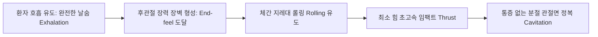
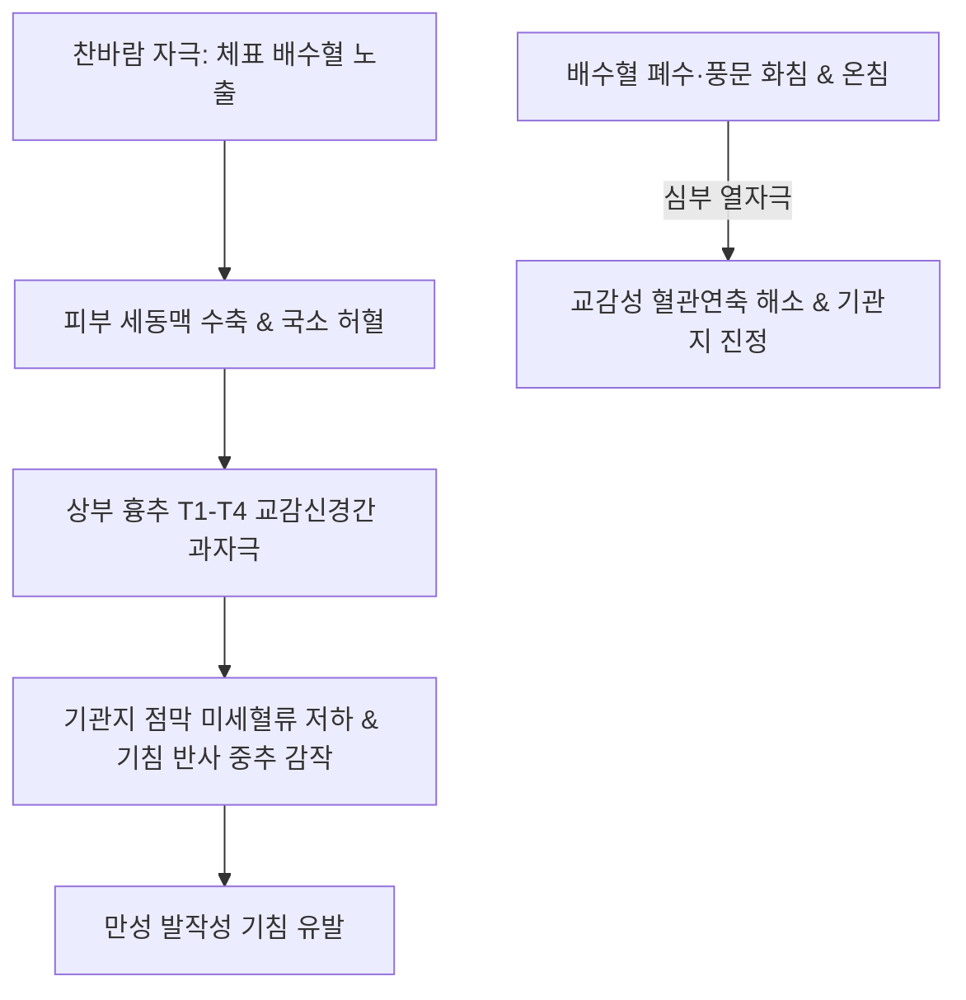

# 흉추 피드백 (Thoracic Spine Clinical Feedback)

> **핵심 임상 요약 (Key Clinical Summary)**:
> - **흉추 교정의 롤링(Rolling) 임팩트 역학**: [[흉추]] [[추나요법|HVLA 추나]] 시 무조건 힘으로 꺾거나 누르는 것이 아니라, 환자의 호흡 날숨 끝에서 관절 장력의 최종 한계점(End-feel)까지 부드럽게 유도한 후 지레대를 '굴리는 듯한' 순간 임팩트로 교정한다.
> - **앙와위 신전 변위 교정과 견갑흉곽 가동성**: [[견갑골]] 외전·상방회전이 불량하고 흉추 굴곡-신전 가동성이 저하된 환자에게 앙와위 흉추 신전 변위 교정기법을 적용하여 흉곽 유연성과 견갑흉곽 관절면을 동시에 활성화한다.
> - **흉배부 피부 지표와 교감신경 진단**: 흉배부의 비정상적 국소 발한, 피지 분비, 피부 주름선의 접힘, 특정 척추 분절의 만성 결절은 [[교감신경간]](Sympathetic chain) 과항진 및 내장기 연관 반사의 직접적 체표 투영이다.
> - **배수혈 한랭과 만성 기침의 병태생리**: 찬바람을 쐬면 배수혈 부위가 얼음처럼 차가워지는 만성 기침 환자는 단순 호흡기 감염이 아니라 배수혈 한랭에 따른 교감신경성 기관지 연축이므로 배수혈 온침·[[화침]](Fire needling) 치료가 주효하다.
> - **횡격막 기능부전과 흡기 보조근(사각근) 과긴장 연쇄**: [[흉식호흡]]으로 인한 횡격막 평탄화는 호흡 및 소화불량을 동반하며 전사각근·중사각근([[사각근]])의 보상적 단축을 유발하므로, 견갑대 상방회전근인 [[전거근]]과 함께 통합 치료해야 한다.

---

## 1. 흉추 추나 교정의 기본 역학: 끝범위 롤링(Rolling) 임팩트 기법
[[흉추]] 분절 교정([[추나요법|HVLA]]) 시 초심자가 범하기 쉬운 가장 큰 오류는 관절 장력의 장벽(Barrier)을 제대로 형성하지 않은 채 단순 체중이나 근력으로 강하게 밀어치는 것이다.

- **끝지점 도달과 롤링 감각의 원리**:
  1. 환자에게 완전한 이완 호흡을 유도시켜 날숨의 끝 지점에서 흉골과 척추 후관절이 자연스럽게 결합되도록 한다.
  2. 술자의 체중을 수직으로 내리꽂는 것이 아니라, 환자의 흉곽을 술자의 주먹 또는 모지구 위로 둥글게 '굴려 넘기는' 롤링(Rolling) 벡터를 형성한다.
  3. 관절의 유격이 완전히 사라진 최종 한계점(End-feel)에서 최소한의 진폭으로 순간 임팩트(Thrust)를 가하면, 불필요한 연부조직 타박 없이 안전하고 완벽한 관절포음(Cavitation)과 정복이 달성된다.

---

## 2. 앙와위 흉추 신전 변위 교정과 견갑흉곽 관절 가동성 회복
임상에서 상지 거상 장애 및 [[어깨 충돌 증후군|어깨 충돌 증상]]을 호소하는 환자들의 다수는 견갑골 자체의 이상보다 흉추의 신전 가동성 결손(Flat thoracic spine 또는 후만 고착)에 원인이 있다.

- **앙와위 흉추 신전 기법(Supine Thoracic Extension Technique)**:
  - 환자를 앙와위로 눕히고 양팔을 가슴 앞에서 교차하게 한 후, 술자는 하방 척추 추체의 [[극돌기]]/[[횡돌기]] 부위에 주먹 지지대를 위치시킨다.
  - 상부 체간을 굴곡시켰다가 후하방으로 신전시키면서 롤링 교정을 적용한다.
- **견갑골 움직임 회복과의 상관성**:
  - 상지를 180도 완전 거상할 때 흉추는 약 10~15도 신전되어야 한다.
  - 흉추 신전 변위를 해소하면 [[견갑골]]의 후방 경사(Posterior tilting)와 외회전이 즉각 회복되어 [[견봉하 공간]]이 확보된다.

---

## 3. 흉배부 교감신경간과 자율신경 징후(발한·한랭·주름선)의 진단학적 의의
척추옆 공간(Paravertebral space)을 따라 주행하는 [[교감신경간]](Sympathetic trunk)은 피부 혈관 수축, 입모근, 한선의 분비를 전담 조절한다.

| 진단학적 피부 지표 | 신경생리학적 기전 | 주요 관련 흉추 분절 | 의심 병태 및 임상적 의의 |
| :--- | :--- | :--- | :--- |
| **국소 피부 주름선 접힘** | 심부 다열근·최장근 만성 연축에 의한 피부 견인 | T4-T8 분절 | 척추 분절성 회전 변위 및 만성 근막 단축선 |
| **분절성 다한증 (발한)** | 회색교통지 교감신경 절후섬유의 비정상적 과흥분 | T2-T5 분절 | 심장·폐 교감신경 과민 및 자율신경 실조 |
| **국소 피부 한랭 (냉감)** | 세동맥 평활근 지속 수축으로 인한 피부 허혈 | T6-T10 분절 | 소화기 장관 허혈 및 만성 배수혈 한랭증 |

- 시진과 촉진을 통해 배부의 피부 온도차, 피부 접힘선, 피지 분비 상태를 관찰하는 것만으로도 해당 분절 자율신경계의 기능 상태를 신속히 파악할 수 있다.

---

## 4. 만성 기침과 배수혈 차가움(한랭)의 내장-체성 반사 병태생리
외기에 노출되거나 찬바람을 쐴 때 등에 오한을 느끼며 만성 기침을 연발하는 환자는 흉배부 [[배수혈]]의 병리적 한랭(Coldness)에 주목해야 한다.

- [[폐수]](BL13), [[궐음수]](BL14), [[풍문]](BL12) 부위는 호흡기계의 체표 투영 혈위이다.
- [[배수혈]]이 차가워지면 체성-내장 반사(Somatovisceral reflex)를 통해 기관지 점막의 방어 능력이 급감하고 과민성 기침이 유발된다.
- 이 경우 통상적인 진해거담제 복용보다 [[배수혈]] 부위의 [[온침]], [[화침]](Fire needling), 뜸(구법)을 통해 심부 체온을 복원하는 것이 근본 치료가 된다.

---

## 5. 횡격막 기능부전과 흡기 보조근(사각근) 과긴장의 연쇄 반응
스트레스나 척추 변위로 인해 정상적인 복식 횡격막 호흡이 상실되고 [[흉식호흡]]이 고착화되면 전신적인 근골격계 불균형이 초래된다.

1. **횡격막과 흉요추 연접부**:
   - 횡격막의 각(Crura)은 L1-L3 요추 추체 전면에 부착되어 호흡 시 요추 안정성을 지지한다.
   - 횡격막 가동성이 저하되면 흉복강 내압 조절 장애로 만성 소화불량이 발생한다.
2. **사각근의 보상적 단축**:
   - 횡격막이 하강하지 못하므로 1번, 2번 늑골을 위로 들어 올리기 위해 흡기 보조근인 전사각근과 중사각근([[사각근]])이 과도하게 동원된다.
   - 이는 사각근 삼각을 통과하는 [[상완신경총]]과 [[쇄골하동맥]]을 압박하여 흉곽출구증후군([[흉곽출구 증후군]])과 상지 저림을 유발한다. 따라서 만성 경항통 치료 시 반드시 횡격막 호흡 재교육이 병행되어야 한다.

---

## 6. 견갑골 상방회전 장애와 전거근(Serratus Anterior) 정밀 치료
상지 외전 시 견갑골이 부드럽게 상방회전되지 못하면 [[극상근]]건이 [[오훼견봉인대]]에 충돌하여 극심한 어깨 통증이 발생한다.

- **전거근([[전거근]])의 생체역학적 기능**:
  - 1~8 늑골 외측면에서 기시하여 견갑골 척추연 전면에 부착하는 전거근은 견갑골을 흉벽에 밀착시키고(Protraction) 하각을 외측 상방으로 견인하는 핵심 근육이다.
- **침구 및 근막 이완 치료법**:
  - 액와선 후방 5~8 늑골 외측면의 전거근 압통 부위에 사자(Oblique needling)하여 기흉 위험을 배제하면서 근막 유착을 해소한다.
  - 전거근이 활성화되면 견갑흉곽 리듬(Scapulohumeral rhythm, 2:1)이 즉각 회복되어 견관절 가동 범위가 정상화된다.

---

## 7. 인대 강화 및 신경 포착 치료를 위한 화침(Fire Needling)의 임상 확장
[[화침]](Fire Needling)은 전통적으로 만성 인대 이완이나 퇴행성 건병증의 결합조직 강화 목적으로 주로 인식되어 왔으나, 신경성 통증 제어 영역으로의 임상 확장이 필요하다.

- **인대 강화 치료**:
  - [[천장관절|천장인대]] 결합 부전, [[슬관절]] 측부인대 손상 등 만성 불안정성 부위에 화침의 강력한 열에너지를 가하여 콜라겐 섬유의 교차 결합(Cross-linking)을 촉진한다.
- **말초 신경 포착 치료의 확장**:
  - 척추 신경 후지 포착, 상둔신경 및 [[좌골신경]] 주위의 섬유성 터널 결절 부위에 화침을 점자(Dot needling)하면, 신경 주변의 반흔성 압박 조직이 열수축·이완되면서 국소 미세순환이 복원된다.
  - 난치성 신경병증성 저림 및 이상감각증 치료에 획기적인 임상 돌파구를 제공한다.

---

## 8. 참고문헌 및 학술 연구 요약

- Borg F et al. (2026). Immediate effects of spinal manipulation, exercise therapy, and open-label placebo on lifting performance and pain in individuals with chronic non-specific back pain: a motion laboratory-based crossover randomized controlled trial. *Chiropr Man Therap*. 34(1):. PMID: 42875790

  - [연구 요약] 만성 비특이적 요통 및 흉요추 통증 환자에서 척추 교정 수기치료(Spinal manipulation)가 체간 가동성, 인양 수행 능력 및 통증 감소에 미치는 즉각적 효과를 교차 무작위 대조 시험으로 검증함.

- Marineau E et al. (2026). Effects of Sports Expertise on Force Accuracy During Spinal Manipulation in Chiropractic Students. *J Integr Complement Med*. ():27683605261490742. PMID: 42765571

  - [연구 요약] 척추 수기 교정 시술자의 힘 조절 정밀도와 속도-변위 역동성을 정량 분석하여, 과도한 외력 배제와 장벽 한계점(End-feel) 순간 임팩트의 기술적 중요성을 규명함.
