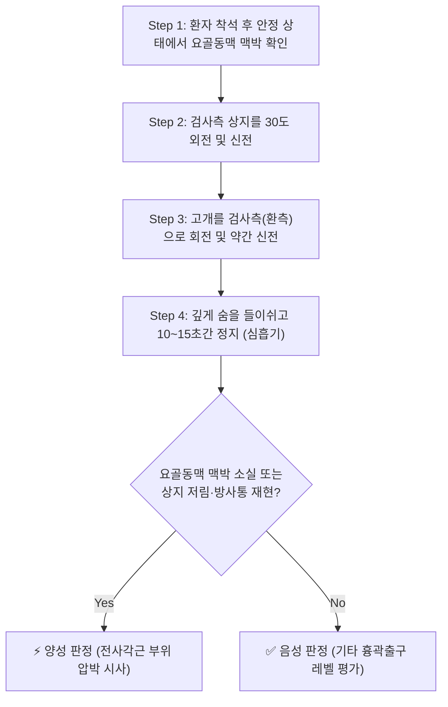
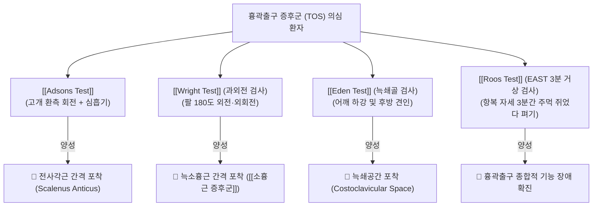

# 🩺 Adsons Test (애드슨 검사)

> **핵심 3줄 요약 (Key Summary)**:
> - 🎯 **검사 목적 & 타겟 병소**: [[흉곽출구 증후군]](Thoracic Outlet Syndrome, TOS) 중 **전사각근 증후군(Scalenus anticus syndrome)** 감별 및 전·중사각근 간격(Interscalene triangle) 내 [[쇄골하동맥]](Subclavian artery)과 [[완신경총]](Brachial plexus) 압박 평가.
> - 🔍 **검사 시행 프로토콜 & 양성 반응**: 환자의 요골동맥 맥박을 촉지한 상태에서 상지를 약간 외전·신전시키고, 고개를 환측으로 회전 및 신전한 뒤 깊게 숨을 들이쉬고 참게 했을 때 요골동맥 맥박의 현저한 감약/소실 및 상지 저림 재현.
> - 📊 **진단 정확도 & 임상적 의의**: 민감도 약 70~79%, 특이도 약 74~76%. 정상인에서도 일시적 혈관 압박으로 맥박이 감소할 수 있으므로 상지 신경학적 저림 증상의 동반 재현 여부가 필수적임.

## 1. 검사 기본 정보 & 진단 목적 (Diagnostic Overview)

| 항목 | 상세 내용 |
| :--- | :--- |
| **검사명 (Test Name)** | Adsons Test (애드슨 검사 / Adson's Maneuver) |
| **분류 (Category)** | 혈관 및 신경학적 유발 검사 (Provocative Vascular/Neurological Test) |
| **타겟 병소 (Target)** | 전·중사각근 간격([[전사각근]], [[중사각근]], [[제1늑골]]) |
| **의심 질환 (Suspected Pathologies)** | [[흉곽출구 증후군]](TOS), 전사각근 증후군, [[경늑골]](Cervical rib) 증후군 |
| **진단 정확도 (Diagnostic Accuracy)** | • **민감도 (Sensitivity)**: 70 ~ 79% • **특이도 (Specificity)**: 74 ~ 76% • **양성 우도비 (LR+)**: 약 2.7 ~ 3.1 |
| **타겟 신경혈관** | [[쇄골하동맥]](Subclavian artery), [[완신경총]](Brachial plexus) 하신경간(C8-T1) |

## 2. 해부학적 유발 메커니즘 & 생체역학적 원리 (Biomechanical Mechanism)

### 1) 사각근 간격(Interscalene Triangle)의 구조적 협착
사각근 삼각(Interscalene triangle)은 전방의 **[[전사각근]](Scalenus anterior)**, 후방의 **[[중사각근]](Scalenus medius)**, 하방의 **[[제1늑골]](First rib)** 상면에 의해 형성되는 좁은 해부학적 관문이다. 이 공간을 통해 쇄골하동맥과 완신경총의 신경간(Trunks)이 통과한다. *(참고: 쇄골하정맥은 전사각근 전방을 지나므로 사각근 삼각을 통과하지 않는다.)*

### 2) 유발 동작의 생체역학적 영향
1. **경추 회전 및 신전**: 환자가 고개를 환측으로 돌리고 신전시키면, 전사각근의 주행 방향이 팽팽하게 신장(stretch)되고 꼬이면서 사각근 삼각의 전후 직경이 협소해진다.
2. **심흡기(Deep Inspiration)**: 숨을 깊게 들이쉬면 전사각근과 중사각근이 수축하여 제1늑골을 상방으로 거상(elevation)시킨다. 제1늑골이 위로 들리면서 사각근 삼각의 바닥이 솟아올라 신경혈관 다발을 아래에서 위로 압박한다.
3. **상지 외전 및 신전**: 완신경총과 쇄골하동맥에 원위부 견인력을 가해 신경혈관 다발이 사각근 힘줄과 늑골 사이에 단단히 끼이도록 유도한다.

## 3. 표준 검사 시행 절차 (Step-by-Step Clinical Protocol)

### Step 1: 초기 환자 준비 및 기저 맥박 촉지
- 환자는 등받이가 없는 의자에 허리를 곧게 펴고 앉는다.
- 검사자는 환자의 뒤나 옆에 서서, 검사할 쪽 손목의 **[[요골동맥]](Radial artery)** 맥박을 시지·중지로 정확하게 촉지하여 박동의 강도와 리듬을 평가한다.

### Step 2: 상지 위치 세팅
- 검사자는 환자의 팔을 어깨관절에서 약 30도 외전(abduction)시키고 가볍게 후방으로 신전(extension)시킨 상태를 유지하며 맥박을 지속적으로 감시한다.

### Step 3: 경추 유발 동작
- 환자에게 고개를 **검사하는 쪽(환측)으로 완전히 돌리게(동측 회전)** 한 뒤, 턱을 약간 들어 올려 목을 신전(extension)하도록 지시한다.

### Step 4: 심흡기 및 호흡 정지 (Maneuver Execution)
- 환자에게 "숨을 끝까지 깊게 들이마신 후(심흡기), 숨을 멈추세요"라고 지시하여 10~15초 동안 유지하게 한다.

### Step 5: 판정 및 원위치
- 호흡 정지 상태에서 요골동맥 맥박의 변화(현저한 감약 또는 완전 소실) 및 환자가 평소 호소하던 상지 저림(paresthesia), 냉감, 무력감이 재현되는지 즉각 확인하고 호흡을 편안하게 뱉도록 한다.

## 4. 양성 반응 판정 기준 & 신경근/조직별 감별 맵핑 (Diagnostic Criteria & Mapping)

### 양성 판정 기준
1. **혈관성 양성 (Vascular Positive)**:
   - 심흡기 및 경추 회전 상태에서 촉지되던 요골동맥 맥박이 **완전히 소실(Absent)**되거나, 건측 대비 **현저하게 약화(Diminished)**되는 경우.
2. **신경성 양성 (Neurogenic Positive)**:
   - 맥박 변화와 함께 척골신경 또는 C8-T1 피부분절을 따라 제4-5수지, 전완 내측으로 찌릿한 저림과 통증이 재현되는 경우.

### 감별 맵핑 (경추 신경근병증과의 감별)
| 구분 | [[Adsons Test]] 양성 (TOS) | [[스펄링 검사]] 양성 ([[경추 추간판 탈출증]]) |
| :--- | :--- | :--- |
| **통증 유발 기전** | 사각근 수축 및 제1늑골 거상에 의한 흉곽 외측 압박 | 추간공 협착에 의한 경추 신경근 직접 압박 |
| **맥박 변화** | 요골동맥 맥박 감약/소실 동반 흔함 | 맥박 변화 없음 |
| **호흡 영향** | **심흡기 시 악화** | 호흡과 무관 |
| **주 호발 신경 분절** | C8-T1 (전완 내측, 제4-5수지 저림) | C5, C6, C7 분절 (엄지, 검지, 중지 저림) |

## 5. 연관 검사군 비교 & 다단계 감별 알고리즘 (Differential Battery & Algorithm)

흉곽출구 증후군은 포착 레벨에 따라 3대 압박 부위가 존재하므로 상호 보완적인 검사 배터리를 구성해야 한다:

- **[[Wright Test]] (과외전 검사)**: 상지를 90도 이상 외전 및 외회전시켜 소흉근(pectoralis minor) 건 하방 압박을 평가.
- **[[Costoclavicular Test]] (Eden 검사)**: 군인 차려 자세(어깨를 뒤로 당기고 내림)로 쇄골과 제1늑골 사이 공간 협착을 평가.
- **[[Roos Test]] (EAST)**: 3분 동안 상지를 들고 주먹을 쥐었다 펴는 동작을 통해 허혈성 피로와 파행을 평가.

## 6. 양성 소견 시 한의 임상 연계 치료 전략 (Integrative Korean Medicine)

### 한의학적 변증
- **기혈어체(氣血瘀滯)**: 불량한 라운드 숄더 및 거북목 자세로 인해 쇄골상와(缺盆) 주위 경락의 기혈이 막혀 상지 마목(痲木) 및 냉증 발생.
- **담음저락(痰飲阻絡)**: 경항부 근막의 만성 긴장으로 진액이 정체되어 손가락이 붓고 뻣뻣한 조조강직감 동반.

### 침구 및 혈위 치료
- **주요 취혈점**:
  - [[결분]](ST12): 쇄골상와 중앙, 전사각근 및 완신경총 통과 부위로 흉곽출구의 기혈을 직접 개방.
  - [[천정]](LI17), [[부돌]](LI18): 흉쇄유돌근 후연, 전·중사각근 TP 부위 긴장 완화.
  - [[견정]](GB21), [[천료]](TE15): 상부 승모근 및 견갑거근 이완으로 제1늑골 거상 장력 분산.
  - [[곡지]](LI11), [[수삼리]](LI10), [[외관]](TE5): 상지 방사통 완화 및 신경 전도 촉진.
- **자침 주의사항**: 결분혈 및 전사각근 심자 시 흉막 첨부(Apex of lung)를 찌르면 기흉이 발생할 수 있으므로, 늑골 표면을 확인하고 0.5~1촌 이내로 안전한 심도를 준수한다.

### 약침 및 도침 치료
- **약침 치료**:
  - [[신바로약침]] 또는 [[중성어혈약침]]: 전사각근 기시부(경추 횡돌기 전결절) 및 제1늑골 부착부에 0.5~1.0cc를 주입하여 사각근의 과긴장과 신경혈관 염증을 신속히 해소.
  - [[황련해독탕약침]]: 손바닥 화끈거림과 혈관성 충혈이 동반된 열증(熱證) 환자에게 응용.
- **도침 치료(Acupotomy)**: 제1늑골 상면의 전사각근 건 부착부의 비후된 섬유 밴드를 미세 박리하여 사각근 삼각의 간격을 물리적으로 확장.
- **추나 치료**: 상부 흉추(T1-T4) 신전 교정, [[경추]] 전만 회복, 제1늑골 하강 유도 수기 및 사각근 근막 이완(MET) 적용.

## 7. 💡 사용자 진료실 핵심 필기 & 실전 임상 팁 (원문 보존)

- **정상인 위양성(False Positive)의 함정**:
  - 건강한 정상인의 약 10~15%에서도 목을 과도하게 돌리고 심흡기를 하면 요골동맥 맥박이 일시적으로 감소합니다.
  - 따라서 **단순히 맥박이 약해졌다고 해서 섣불리 흉곽출구 증후군으로 단정해서는 안 되며, 반드시 평소 환자가 느끼던 '손가락 끝의 저림과 통증'이 동시에 재현되는지 확인**해야 합니다.
- **자세 교정 및 호흡 패턴의 중요성**:
  - 흉식 호흡 위주로 숨을 헐떡이며 쉬는 환자는 사각근이 과도하게 동원되어 제1늑골이 상방 고정됩니다.
  - 횡격막 복식 호흡 훈련을 시키고 사각근 스트레칭(고개를 반대측으로 측굴 및 회전)을 티칭하면 치료 효과가 수배로 올라갑니다.

## 8. 출처 및 학술 참고 문헌 (References)

- Osman M, et al. (2025). "Diagnostic Accuracy and Clinical Utility of Adson's Test in Detecting Subclavian Artery Compression Associated With Cervical Ribs: A Systematic Review." *Cureus*, 17(10), e94562. [PMID: 41220456](https://pubmed.ncbi.nlm.nih.gov/41220456/)
  - 애드슨 검사(Adson's test)의 진단적 정확도, 쇄골하동맥 압박 평가 유효성 및 경늑골 동반 환자에서의 임상적 유용성을 규명한 체계적 문헌고찰.
- Gillard J, et al. (2001). "Diagnosing thoracic outlet syndrome: contribution of provocative tests, ultrasonography, electrophysiology, and helical computed tomography in 48 patients." *Joint Bone Spine*, 68(5), 416-424.
  - 흉곽출구 증후군 환자에서 애드슨 검사, 에덴 검사, 라이트 검사의 민감도·특이도 및 도플러 초음파와의 정합성을 비교 평가한 임상 연구.
