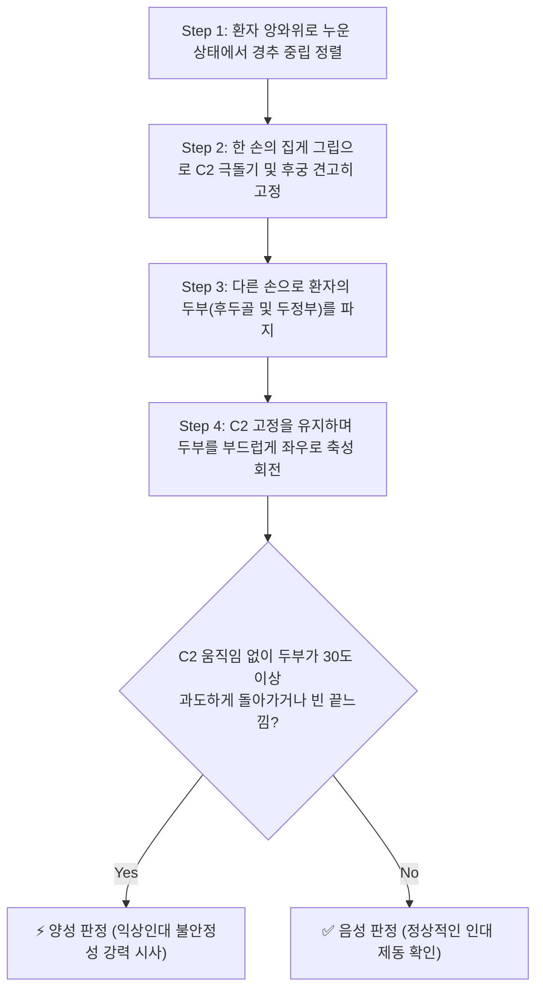
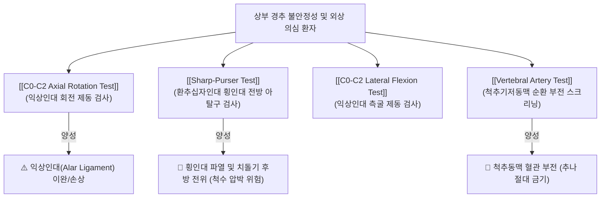

# 🩺 C0-C2 Axial Rotation Test (상부경추 축성 회전 검사)

> **핵심 3줄 요약 (Key Summary)**:
> - 🎯 **검사 목적 & 타겟 병소**: 상부 경추(C0-C1-C2, 두개경추 접합부)의 인대성 안정성 평가 및 **[[익상인대]](Alar ligament)**의 이완·단열로 인한 **상부경추 불안정성(Upper Cervical Instability)** 감별.
> - 🔍 **검사 시행 프로토콜 & 양성 반응**: 앙와위에서 축추(C2) 극돌기를 견고하게 고정한 상태로 후두골(C0)을 좌우로 축성 회전시켰을 때, C2의 동반 움직임 없이 두부가 30~40도 이상 과도하게 회전되거나 헐렁한 끝느낌(empty end-feel) 발생.
> - 📊 **진단 정확도 & 임상적 의의**: 두개경추 관절 안정성 평가의 필수 검사로, 류마티스 관절염, 다운 증후군, 교통사고 편타 손상 환자에서 경추 추나 및 도수치료 전 척수 손상을 예방하는 절대적 레드플래그 선별 도구.

## 1. 검사 기본 정보 & 진단 목적 (Diagnostic Overview)

| 항목 | 상세 내용 |
| :--- | :--- |
| **검사명 (Test Name)** | C0-C2 Axial Rotation Test (상부경추 축성 회전 검사 / 익상인대 검사) |
| **분류 (Category)** | 관절 안정성 및 인대 무결성 검사 (Ligamentous Stability Test) |
| **타겟 병소 (Target)** | **[[익상인대]](Alar ligament)**, 환축추 관절([[C1]], [[C2]]), 치돌기(Dens) |
| **의심 질환 (Suspected Pathologies)** | 상부경추 불안정성, 익상인대 파열/이완, 편타 손상 후 인대 손상, 치돌기 형성부전 |
| **진단 정확도 (Diagnostic Accuracy)** | • **특이도 (Specificity)**: 90% 이상 (정상적인 단단한 끝느낌 존재) • **임상적 가치**: 추나요법 전 척수 손상(경수 압박)을 예방하는 안전 스크리닝 |
| **금기 사항 (Contraindications)** | 급성 경추 골절, 활성기 류마티스성 척수병증, 척추기저동맥 허혈 환자 |

## 2. 해부학적 유발 메커니즘 & 생체역학적 원리 (Biomechanical Mechanism)

### 1) 익상인대(Alar Ligament)의 기능적 해부
- **부착 부위**: 축추(C2)의 치돌기(Dens) 첨부 양측면에서 시작하여 상외측으로 주행하여 대후두공(Foramen magnum) 외측연 및 후두과(Occipital condyle) 내측면에 부착한다.
- **기능적 역할**: 후두골-환추(C0-C1) 복합체의 과도한 축성 회전을 제한하는 **가장 강력한 1차적 수동 제동 인대(Primary passive restraint)**로 작용한다.

### 2) 생체역학적 회전 제동 원리
- 두부가 우측으로 회전할 때 좌측 익상인대가 치돌기를 감아쥐며 팽팽하게 긴장(Tightening)된다.
- **정상 반응**: 후두골을 회전시키면 익상인대의 즉각적인 장력 발생으로 인해, 회전 각도가 **20~30도에 도달하기 전(초기 5~10도 이내)**에 C2 극돌기가 반대 방향(좌측)으로 밀리며 즉각적인 동반 회전이 발생하고 단단한 관절낭-인대성 끝느낌(firm end-feel)이 나타난다.
- **병적 반응 (인대 단열/이완)**: 익상인대가 파열되거나 심하게 늘어난 경우, C2 극돌기의 동반 움직임 없이 두부만 30도, 40도 이상 비정상적으로 과도하게 회전되며 저항감이 느껴지지 않는 헐렁한 끝느낌(soft or empty end-feel)이 관찰된다.

## 3. 표준 검사 시행 절차 (Step-by-Step Clinical Protocol)

### Step 1: 환자 준비 및 중립 자세 세팅
- 환자는 치료대 위에 베개 없이 앙와위(Supine position)로 편안하게 눕는다.
- 검사자는 환자의 머리맡(Cranial side)에 서서 경추가 굴곡이나 신전되지 않도록 완벽한 해부학적 중립 위치를 맞춘다.

### Step 2: 축추(C2) 집게 고정 (Pincer Grasp)
- 검사자는 비우세손의 모지와 시지를 이용하여 집게 모양(Pincer grasp)을 만든다.
- 후두골 바로 아래로 손가락을 밀어 넣어 가장 처음 만져지는 굵은 골성 돌기인 **[[C2]](축추)의 극돌기(Spinous process)**를 양측에서 단단히 집어 움직이지 않도록 체간에 고정한다.

### Step 3: 후두골 파지 및 회전 부하 인가
- 우세손의 손바닥으로 환자의 후두골과 두정부를 넓게 감싸 쥔다.
- C2 극돌기의 고정이 풀리지 않도록 감시하면서, 두부를 한쪽 방향(예: 우측)으로 천천히 축성 회전(Axial rotation)시킨다.

### Step 4: 가동 각도 및 끝느낌 평가
- 정상적으로 초기 회전과 동시에 C2 극돌기가 손가락 끝에서 즉각 회전하는지 감지한다.
- 반대측 방향(좌측)으로도 동일하게 검사를 시행하여 양측의 가동 각도와 끝느낌의 대칭성을 비교 평가한다.

## 4. 양성 반응 판정 기준 & 신경근/조직별 감별 맵핑 (Diagnostic Criteria & Mapping)

### 양성 판정 기준
1. **과도한 회전 가동성 (Hypermobility)**:
   - C2 극돌기가 고정된 상태에서 두부의 회전 각도가 **30~40도 이상으로 명백하게 과도한 경우**.
2. **C2 동반 반응의 지연 또는 소실**:
   - 두부를 돌릴 때 C2 극돌기에서 인대의 장력 전달이 느껴지지 않고 두부만 따로 노는 느낌이 드는 경우.
3. **헐렁하거나 빈 끝느낌 (Empty End-Feel)**:
   - 회전 종말점에서 단단한 인대성 저항(Firm end-feel)이 전혀 없고 연부조직의 지지가 상실된 느낌.
4. **신경학적 징후 동반 (레드플래그)**:
   - 검사 도중 어지럼증, 안구진탕(Nystagmus), 입술 주변 감각 둔마, 연하 곤란 등 척수 또는 척추동맥 압박 증상이 유발되는 경우 즉시 검사를 중단한다.

## 5. 연관 검사군 비교 & 다단계 감별 알고리즘 (Differential Battery & Algorithm)

두개경추 접합부의 불안정성을 평가하기 위해서는 익상인대 검사 외에도 횡인대(Transverse ligament) 및 척추동맥 검사를 병행해야 한다:

## 6. 양성 소견 시 한의 임상 연계 치료 전략 (Integrative Korean Medicine)

### 임상적 주의사항 및 절대 금기 (Safety First)
- **고속 저진폭 쓰러스트(HVLA) 추나 절대 금기**:
  - 익상인대 손상으로 C0-C2 불안정성이 확인된 환자에게 목을 꺾는 강한 회전 교정(Thrust)을 시행하면 치돌기가 연수를 압박하여 사지 마비나 호흡 정지 등 치명적인 의료사고가 발생할 수 있다.
- **경추 깁스 및 칼라(Philadelphia collar) 착용 의뢰**: 급성 외상 환자에서 양성이면 즉시 정밀 영상 진단(Open-mouth X-ray, 경추 CT/MRI)을 의뢰한다.

### 한의 보존적 안정화 치료 (만성 이완증)
- **심부 경추 안정화 약침 요법**:
  - [[신바로약침]] 또는 [[자하거약침]]: 후두하삼각 근육군([[대후두직근]], [[상두사근]], [[하두사근]]) 부착부와 항인대에 0.5~1.0cc를 주입하여 국소 인대성 조직의 증식과 근막 안정성을 도모.
- **침구 치료**:
  - [[풍지]](GB20), [[천주]](BL10), [[대저]](BL11), [[후계]](SI3) 자침을 통해 경항부 표재 근육의 과긴장을 풀고 심부 안정화 근육의 긴장도를 정상화.
- **등척성 안정화 운동(Isometric Cervical Stabilization)**:
  - 관절의 가동 범위를 유발하지 않고 손바닥으로 이마와 뒤통수를 밀며 버티는 등척성 경추 운동 및 심부 경추 굴곡근(Deep neck flexors) 강화 훈련 지도.

## 7. 💡 사용자 진료실 핵심 필기 & 실전 임상 팁 (원문 보존)

- **추나 치료 전 필수 안전 관문**:
  - 만성 두통이나 목 통증으로 내원한 환자 중 "교통사고를 크게 당한 적이 있다", "목에서 덜컥거리는 느낌이 난다"고 하는 환자는 반드시 경추 교정 추나를 하기 전에 이 C0-C2 축성 회전 검사와 샤프-퍼서 검사를 먼저 시행해야 합니다.
- **손가락 끝 C2 감각 훈련**:
  - 초심자는 C2 극돌기를 고정하지 못해 환자 머리와 C2가 같이 돌아가는 것을 불안정성으로 오진하기 쉽습니다. 후두골 바로 밑에서 가장 크고 단단하게 만져지는 뼈가 C2 극돌기이므로, 모지와 시지로 양옆을 꽉 집어 치료대에 고정하는 손기술이 검사의 성패를 좌우합니다.

## 8. 출처 및 학술 참고 문헌 (References)

- Tisherman R, et al. (2020). "Biomechanical contribution of the alar ligaments to upper cervical stability." *Journal of Biomechanics*, 99, 109505. [PMID: 31813563](https://pubmed.ncbi.nlm.nih.gov/31813563/)
  - 두개경추 접합부에서 익상인대의 생체역학적 기여도와 축성 회전 제동 메커니즘을 사체 실험을 통해 규명한 랜드마크 연구.
- Radcliff KE, et al. (2015). "In vitro biomechanics of the craniocervical junction-a sequential sectioning of its stabilizing structures." *Spine Journal*, 15(7), 1618-1628. [PMID: 25666697](https://pubmed.ncbi.nlm.nih.gov/25666697/)
  - 두개경추 안정화 구조물의 순차적 절제를 통해 익상인대 손상 시 나타나는 과도한 축성 회전과 불안정성 양상을 검증한 논문.
