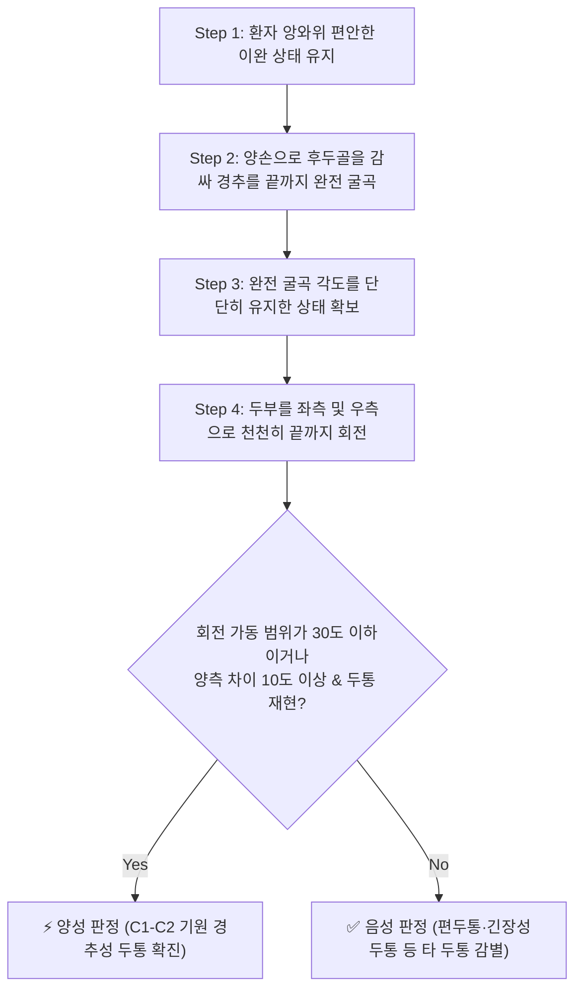
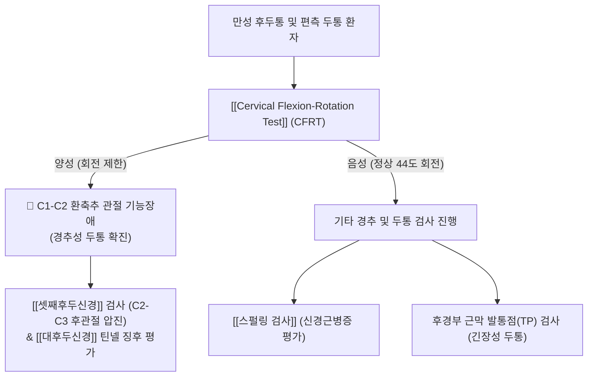

# 🩺 Cervical Flexion-Rotation Test (경추 굴곡-회전 검사)

> **핵심 3줄 요약 (Key Summary)**:
> - 🎯 **검사 목적 & 타겟 병소**: **[[경추성 두통]](Cervicogenic Headache, CEH)**의 주 원인인 **환축추 관절([[C1]]-[[C2]])의 회전 기능장애(Hypomobility)** 및 상부 경추성 관절 운동 장애 평가.
> - 🔍 **검사 시행 프로토콜 & 양성 반응**: 앙와위에서 경추를 끝까지 완전 굴곡(Full flexion)시켜 하부 경추를 잠근 상태에서 두부를 좌우로 회전시켰을 때, 정상(약 44도) 대비 10도 이상 회전 제한(30도 이하) 또는 건측 대비 10도 이상의 비대칭성과 함께 평소 두통 재현.
> - 📊 **진단 정확도 & 임상적 의의**: **민감도 90~91%, 특이도 88~90%**로 전 세계 물리치료 및 정형의학에서 경추성 두통 감별의 **골드 스탠다드(Gold Standard)** 유발 검사로 확립됨.

## 1. 검사 기본 정보 & 진단 목적 (Diagnostic Overview)

| 항목 | 상세 내용 |
| :--- | :--- |
| **검사명 (Test Name)** | Cervical Flexion-Rotation Test (경추 굴곡-회전 검사 / CFRT) |
| **분류 (Category)** | 상부 경추 분절 가동성 및 관절 기능장애 유발 검사 |
| **타겟 병소 (Target)** | **환축추 관절(Atlanto-Axial Joint, C1-C2)**, 하두사근, 대후두신경 |
| **의심 질환 (Suspected Pathologies)** | [[경추성 두통]](CEH), C1-C2 후관절 기능부전, 상부 경추 연관통 |
| **진단 정확도 (Diagnostic Accuracy)** | • **민감도 (Sensitivity)**: **90 ~ 91%** • **특이도 (Specificity)**: **88 ~ 90%** • **신뢰도 (Reliability)**: 검사자 간 일치도(Kappa) 0.85 ~ 0.93 (매우 우수) |
| **기준 컷오프 (Cut-off)** | 편측 회전 각도 **32도 이하** (또는 양측 차이 10도 이상) |

## 2. 해부학적 유발 메커니즘 & 생체역학적 원리 (Biomechanical Mechanism)

### 1) 경추 완전 굴곡에 의한 '하부 경추 잠김(Cervical Locking)' 원리
- 경추의 전체 축성 회전(약 80~90도) 중 절반에 해당하는 **약 40~45도는 C1-C2(환축추 관절) 한 분절**에서 발생하고, 나머지 절반은 C2-C7 하부 경추 분절들이 나누어 담당한다.
- 검사자가 경추를 끝까지 완전 굴곡(End-range flexion)시키면:
  1. C2-C7 후관절의 관절면들이 서로 미끄러져 벌어지면서 관절낭과 후방 인대들이 최대로 팽팽해진다(Ligamentous tension).
  2. 이로 인해 **C2부터 C7까지의 하부 경추 회전 움직임이 완벽하게 차단(Locking)되는 생체역학적 고정**이 일어난다.

### 2) 순수한 C1-C2 분절 회전의 선택적 평가
- 하부 경추가 잠긴 상태에서 두부를 회전시키면 오직 **C1-C2 환축추 관절만 독립적으로 회전**할 수 있게 된다.
- 따라서 이 검사는 다른 경추 분절의 보상적 회전을 완벽히 배제하고, C1-C2 관절 자체의 활막염, 관절낭 구축, 또는 [[하두사근]](Obliquus capitis inferior)의 경축 여부를 단독으로 분리하여 정밀하게 측정할 수 있다.

## 3. 표준 검사 시행 절차 (Step-by-Step Clinical Protocol)

### Step 1: 환자 자세 및 준비
- 환자는 치료대에 천장을 보고 바르게 눕는다(앙와위). 어깨와 경항부 근육을 완전히 이완시킨다.
- 검사자는 환자의 머리맡에 서서 양손으로 환자의 후두골과 경추 후면을 부드럽게 감싸 쥔다.

### Step 2: 경추 완전 굴곡 (Passive Full Flexion)
- 환자의 턱이 가슴(흉골)에 닿을 정도로 경추를 천천히 끝 범위까지 수동적으로 완전 굴곡시킨다.
- **중요**: 굴곡 각도가 불완전하면 하부 경추가 잠기지 않아 하부 경추의 보상 움직임으로 인한 위음성이 발생하므로 끝 범위까지 견고하게 굴곡을 유지해야 한다.

### Step 3: 축성 회전 유발 (Axial Rotation)
- 완전 굴곡 자세가 흐트러지지 않도록 주의하면서, 환자의 머리를 먼저 한쪽(예: 건측)으로 부드럽게 회전시켜 끝느낌(End-feel)과 가동 범위를 확인한다.
- 이어서 의심되는 환측 방향으로 천천히 회전시키며 저항감이 나타나는 각도를 정밀하게 측정한다.

### Step 4: 각도 및 증상 재현 평가
- 각도계(Goniometer) 또는 시각적 추정을 통해 회전 각도를 확인하고, 평소 환자가 겪던 후두부 및 안와부 두통이 유발되는지 환자에게 구두로 확인한다.

## 4. 양성 반응 판정 기준 & 신경근/조직별 감별 맵핑 (Diagnostic Criteria & Mapping)

### 양성 판정 기준
1. **회전 가동 범위의 현저한 제한**:
   - 정상적인 C1-C2 회전 각도는 편측당 평균 **40~44도**이다.
   - 회전 각도가 **32도 이하(통상 30도 이하)**로 제한될 때 명백한 양성으로 판정한다.
2. **양측 회전 각도의 비대칭 (10도 이상 차이)**:
   - 건측에 비해 환측의 회전 범위가 **10도 이상 감소**되어 있는 경우.
3. **익숙한 통증의 재현 (Pain Reproduction)**:
   - 회전 종말점에서 환자가 평소 호소하던 후두하부 통증, 정수리 방사통 또는 안와부 연관통이 그대로 재현되는 경우.

### 두통 유형별 감별 진단 매트릭스
| 구분 | [[경추성 두통]] (CEH) | [[긴장성 두통]] (TTH) | 원발성 편두통 (Migraine) |
| :--- | :--- | :--- | :--- |
| **CFRT 검사 결과** | **양성 (91% 민감도, 회전 제한)** | **음성 (정상 가동 범위 유지)** | **음성 (정상 가동 범위 유지)** |
| **통증 양상** | 후두부에서 안와로 방사되는 편측성 둔통 | 머리 전체를 조이는 띠 모양 압박감 | 욱신거리는 편측 박동성 극통 |
| **경추 가동성** | 상부 경추 굴곡·회전 뚜렷한 제한 | 경항부 근육 긴장 위주, 관절 정상 | 경추 관절 가동성과 무관 |
| **동반 증상** | 목 움직임 시 악화, 경추부 압통 | 피로감, 어깨 뻐근함 | 전조증상(Aura), 빛·소리 공포증, 구토 |

## 5. 연관 검사군 비교 & 다단계 감별 알고리즘 (Differential Battery & Algorithm)

## 6. 양성 소견 시 한의 임상 연계 치료 전략 (Integrative Korean Medicine)

### 한의학적 변증
- **어혈조락(瘀血阻絡)**: 교통사고, 외상, 만성 불량 자세로 상부 경추 후관절낭에 어혈이 정체되어 관절 가동이 불리하고 편측 후두통 유발.
- **풍한습비(風寒濕痺)**: 풍한 사기가 항배부(項背部) 경락에 침습하여 경근이 오그라들고 목을 돌리기 어려운 항강통(項强痛) 발생.

### 침구 및 혈위 치료
- **주요 취혈점**:
  - [[풍지]](GB20): 후두하근군 및 하두사근 이완, C1-C2 회전 가동성 즉각 개선.
  - [[천주]](BL10): 두반극근 및 상부 경추 후관절낭 감압.
  - [[후계]](SI3): 독맥(督脈)을 통솔하여 경항부 척추 관절의 굴신 및 회전 기능 회복.
  - [[대저]](BL11): 골회(骨會)로서 척추 관절 질환의 필수 배혈.
- **침치료 기법**: 풍지혈 자침 시 침첨을 반대측 안구 방향으로 1~1.5촌 심자하여 하두사근의 심부 경축을 직접 해소.

### 약침 및 도침 치료
- **약침 치료**:
  - [[신바로약침]] 또는 [[중성어혈약침]]: C1-C2 척추궁 사이 및 하두사근 부착부에 0.5~1.0cc를 심자 주입하여 후관절의 무균성 염증과 신경 부종 소퇴.
- **도침 치료(Acupotomy)**:
  - C1 횡돌기와 C2 극돌기 사이의 하두사근 건 부착부 섬유성 유착을 미세 박리하여 C1-C2 회전 공간을 확보.
- **추나 치료**:
  - **C1-C2 분절 가동 추나요법**: 경추 굴곡 상태를 유지하면서 부드러운 가동 기법(Mobilization)을 적용하여 제한된 C1-C2 관절의 회전 가동 범위를 점진적으로 회복.

## 7. 💡 사용자 진료실 핵심 필기 & 실전 임상 팁 (원문 보존)

- **편두통으로 오진된 경추성 두통 걸러내기**:
  - 신경과에서 편두통 진단을 받고 수년간 트립탄이나 진통제를 달고 살던 환자 중, 이 CFRT 검사를 시행하여 한쪽으로 목이 30도도 안 돌아가고 두통이 재현되는 환자가 매우 많습니다.
  - 이 검사에서 양성이 나오면 뇌 혈관 문제가 아니라 100% C1-C2 환축추 관절의 문제입니다. C1-C2 분절 추나와 풍지혈 약침을 2~3회 시술하면 수년간 앓던 편두통이 거짓말처럼 완치됩니다.
- **완전 굴곡 유지 팁**:
  - 환자가 목을 돌릴 때 무의식적으로 목을 약간 신전시켜 하부 경추의 잠김을 풀려고 합니다. 검사자의 가슴이나 복부로 환자의 정수리를 지지하며 완전 굴곡을 끝까지 유지한 채로 회전시켜야 정확한 진단이 나옵니다.

## 8. 출처 및 학술 참고 문헌 (References)

- Chys M, et al. (2025). "Effects of Dry Needling of the Obliquus Capitis Inferior in Patients with Cervicogenic Headache and Upper Cervical Dysfunction: An Exploratory Randomized Sham-Controlled Trial." *Journal of Clinical Medicine*, 14(18), 6542. [PMID: 41010828](https://pubmed.ncbi.nlm.nih.gov/41010828/)
  - 경추성 두통 및 상부 경추 기능장애 환자에서 굴곡-회전 검사(CFRT)를 통한 진단적 평가와 하두사근 침 치료의 회전 가동성 개선 효과를 입증한 무작위 대조군 임상 연구.
- Hall T, et al. (2008). "Reliability of clinical tests to evaluate the upper cervical spine in subjects with cervical headache." *Journal of Manipulative and Physiological Therapeutics*, 31(7), 540-546.
  - 경추 굴곡-회전 검사(CFRT)의 민감도(91%), 특이도(90%) 및 높은 검사자 간 신뢰도를 과학적으로 검증한 랜드마크 논문.
