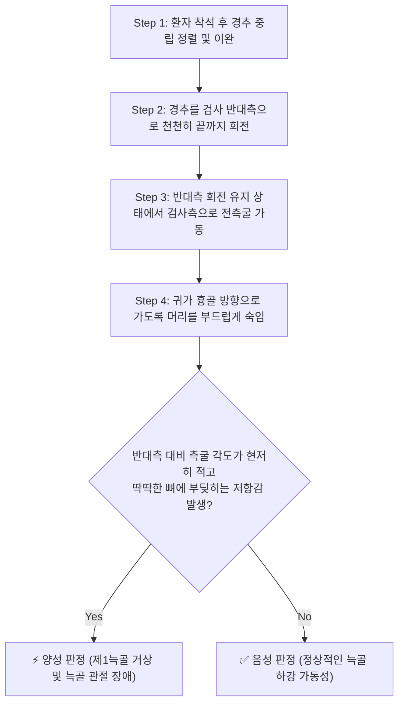
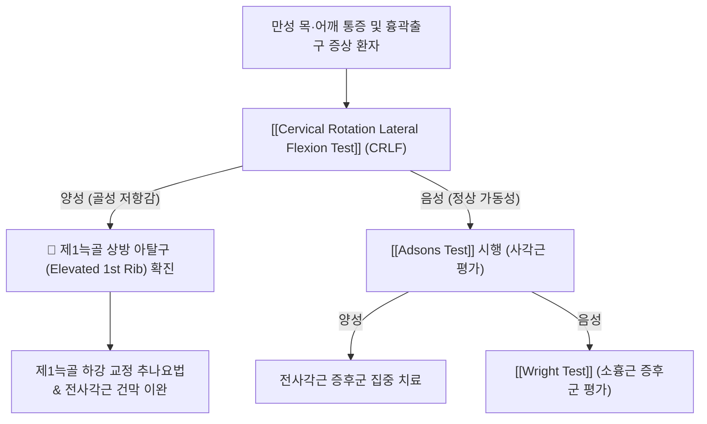

# 🩺 Cervical Rotation Lateral Flexion Test (경추 회전-측굴 검사)

> **핵심 3줄 요약 (Key Summary)**:
> - 🎯 **검사 목적 & 타겟 병소**: **[[제1늑골]](First rib)의 상방 아탈구·거상(Elevated First Rib)** 및 늑추관절 기능장애 감별, 흉곽출구 하부 관문 협착 평가.
> - 🔍 **검사 시행 프로토콜 & 양성 반응**: 환자를 앉힌 상태에서 경추를 검사 반대측으로 끝까지 회전시킨 후 귀가 흉골 방향을 향하도록 전외측으로 측굴시켰을 때, 정상측 대비 현저한 측굴 가동 제한 및 딱딱한 골성 끝느낌(Bone-on-bone end-feel) 발생.
> - 📊 **진단 정확도 & 임상적 의의**: 경추-흉곽 접합부 생체역학 평가의 핵심 검사로, 만성 경견통 및 흉곽출구 증후군 환자에서 제1늑골 가동성 장애를 선별하는 높은 특이도의 정형의학적 평가 도구.

## 1. 검사 기본 정보 & 진단 목적 (Diagnostic Overview)

| 항목 | 상세 내용 |
| :--- | :--- |
| **검사명 (Test Name)** | Cervical Rotation Lateral Flexion Test (CRLF Test / 린드그렌 검사) |
| **분류 (Category)** | 흉곽 입구 및 늑골 관절 가동성 검사 (Rib Mobility Test) |
| **타겟 병소 (Target)** | **[[제1늑골]](First rib)**, 늑추관절(Costovertebral joint), [[전사각근]] 부착부 |
| **의심 질환 (Suspected Pathologies)** | 제1늑골 거상증(Elevated 1st rib), [[흉곽출구 증후군]](TOS), 경추-흉곽 증후군 |
| **진단 가치 (Clinical Value)** | 제1늑골 도수교정 및 추나치료의 반응군을 예측하는 가장 유효한 선별 검사 |
| **양성 기준 (Criterion)** | 반대측 대비 측굴 각도의 현저한 감소 및 골성 충돌 저항감 |

## 2. 해부학적 유발 메커니즘 & 생체역학적 원리 (Biomechanical Mechanism)

### 1) 경추 회전-측굴 복합 운동 시 제1늑골의 생체역학
- 경추를 한쪽(예: 좌측)으로 끝까지 회전시키면, 반대쪽(우측) 경추 횡돌기(Transverse process)들이 전외측으로 회전 이동하게 된다.
- 이 상태에서 우측으로 측굴(Lateral flexion)을 시도하면, 정상적으로는 경추 횡돌기들이 우측 제1늑골 상면의 공간으로 미끄러져 내려가면서 약 30도 이상의 충분한 측굴 굴곡 가동성이 확보된다.

### 2) 제1늑골 거상 시의 골성 충돌(Bony Impingement)
- 만약 우측 **[[제1늑골]]이 비정상적으로 상방으로 거상(Elevation)**되어 있거나 아탈구되어 있다면:
  1. 경추를 반대측(좌측)으로 회전시킨 후 동측(우측)으로 측굴할 때, 하강해야 할 경추 횡돌기가 상방으로 솟아 있는 제1늑골 늑골체에 **물리적으로 부딪히는 골성 충돌(Bony block)**이 발생한다.
  2. 이로 인해 측굴 각도가 초기 범위(10~15도 이내)에서 턱 하고 막히며 더 이상 진행되지 않는 **딱딱한 골성 끝느낌(Hard bone-on-bone end-feel)**이 명확하게 나타난다.

## 3. 표준 검사 시행 절차 (Step-by-Step Clinical Protocol)

### Step 1: 환자 자세 및 정렬
- 환자는 등받이가 없는 의자에 허리를 곧게 펴고 앉는다. 양팔은 허벅지 위에 편안히 내려놓는다.
- 검사자는 환자의 뒤에 서서 환자의 어깨가 들리지 않도록 수평 정렬을 확인한다.

### Step 2: 반대측 수평 회전 (Full Rotation Away)
- 검사자는 양손으로 환자의 두부를 잡고, **검사하고자 하는 쪽의 반대 방향으로 경추를 끝까지 수평 회전(End-range passive rotation)**시킨다.
- *(예: 우측 제1늑골을 검사할 때는 머리를 좌측 끝까지 완전히 회전시킨다.)*

### Step 3: 동측 전측굴 가인 (Lateral Flexion)
- 반대측 완전 회전 각도를 철저히 유지한 상태에서, 환자의 머리를 환측(우측) 어깨 및 가슴(흉골) 앞쪽을 향해 부드럽게 전외측으로 측굴시킨다.
- 이때 환자의 귀가 가슴 앞쪽 쇄골 내측단을 향해 다가가도록 유도한다.

### Step 4: 가동 각도 및 끝느낌 비교
- 측굴이 멈추는 종말점(End-point)에서의 가동 각도를 확인하고, 반대측(좌측) 늑골도 동일한 방식으로 검사하여 양측의 가동성과 끝느낌을 비교한다.

## 4. 양성 반응 판정 기준 & 신경근/조직별 감별 맵핑 (Diagnostic Criteria & Mapping)

### 양성 판정 기준
1. **측굴 가동성의 현저한 비대칭성 제한**:
   - 정상측은 귀가 흉골 가까이 30도 이상 부드럽게 숙여지는 반면, 환측은 10~15도도 숙여지지 않고 조기에 움직임이 차단되는 경우.
2. **딱딱한 골성 끝느낌 (Hard Bone-on-Bone End-Feel)**:
   - 근육의 팽팽한 당김(Elastic end-feel)이 아니라 뼈와 뼈가 직접 맞부딪히는 단단하고 불쾌한 저항감이 발생하는 경우.
3. **국소 늑쇄관절 통증 및 견배부 방사통**:
   - 쇄골상와 깊은 곳에서 결리는 극통이 재현되거나 상지로 저림이 뻗치는 경우.

### 흉곽출구 질환 간 감별 맵핑
| 검사명 | 주 타겟 병소 | 검사 시 주 소견 |
| :--- | :--- | :--- |
| **[[Cervical Rotation Lateral Flexion Test]] (CRLF)** | **[[제1늑골]] 골성 거상 및 늑골 관절** | **회전 후 측굴 시 딱딱한 골성 충돌** |
| **[[Adsons Test]]** | [[전사각근]] 근육성 비후 및 긴장 | 심흡기 시 요골동맥 맥박 감약 |
| **[[Wright Test]]** | [[소흉근]] 건 하방 늑소흉 간격 | 상지 과외전 시 요골동맥 맥박 소실 |
| **[[Costoclavicular Test]]** | 쇄골과 제1늑골 사이 늑쇄 공간 | 군인 자세(어깨 하강 후방 견인) 시 맥박 소실 |

## 5. 연관 검사군 비교 & 다단계 감별 알고리즘 (Differential Battery & Algorithm)

## 6. 양성 소견 시 한의 임상 연계 치료 전략 (Integrative Korean Medicine)

### 한의학적 변증
- **어혈결체(瘀血結滯)**: 외상, 무거운 짐 들기, 만성 기침으로 흉곽 상구 및 결분(缺盆) 주위에 어혈이 맺혀 늑골 관절이 굳고 통증 유발.
- **간울기체(肝鬱氣滯)**: 흉식 호흡과 스트레스로 사각근과 흉곽 거상근이 만성 경축되어 제1늑골이 상방 고정됨.

### 제1늑골 하강 추나요법 (First Rib Manipulation)
- **앙와위 또는 착석 제1늑골 하강 교정**:
  - 검사자가 제1늑골 결절 상면에 제2중수골 기저부(피지폼 또는 주두)를 접촉하고, 환자의 호기에 맞추어 반대측 전하방(배꼽 방향)으로 부드럽고 순간적인 하강 교정(Thrust 또는 Mobilization)을 적용하여 늑추관절의 정상 위치를 복원.

### 약침 및 도침 치료
- **약침 치료**:
  - [[신바로약침]]: 쇄골상와 결분혈 부근 제1늑골 상면 전사각근 부착부 및 늑횡돌관절 주변에 0.5~1.0cc를 주입하여 늑골 관절낭의 염증과 부종 해소.
- **도침 치료(Acupotomy)**:
  - 제1늑골 상연에 부착된 비후된 전·중사각근 건 부착부를 골면에 안전하게 접촉시킨 후 미세 절개하여 늑골을 위로 잡아당기는 비정상적 장력을 해제.

## 7. 💡 사용자 진료실 핵심 필기 & 실전 임상 팁 (원문 보존)

- **만성 어깨 결림의 숨은 원인, 제1늑골**:
  - 승모근과 견갑거근을 수없이 침 맞고 마사지해도 낫지 않는 만성 어깨 결림 환자 10명 중 3~4명은 이 CRLF 검사에서 양성이 나오는 제1늑골 거상 환자입니다.
  - 이 검사로 제1늑골 거상을 확인한 후 늑골 하강 추나를 1회만 정확히 걸어주면 "어깨 위에 얹혀있던 바위가 쑥 내려간 것 같다"며 목과 어깨가 즉시 가벼워집니다.
- **촉진 팁**:
  - 제1늑골은 쇄골 바로 뒤쪽, 승모근 앞쪽의 쇄골상와 깊은 곳에서 만져집니다. 반대측으로 목을 돌린 상태에서 위에서 아래로 눌렀을 때 심한 압통과 함께 단단하게 솟아 있다면 제1늑골 아탈구를 의심해야 합니다.

## 8. 출처 및 학술 참고 문헌 (References)

- Koppenhaver SL, et al. (2022). "The validity of the cervical rotation lateral flexion test in predicting benefit after manipulation treatment to the first and second rib." *Musculoskeletal Science and Practice*, 62, 102652. [PMID: 35872564](https://pubmed.ncbi.nlm.nih.gov/35872564/)
  - 경추 회전-측굴 검사(CRLF test)의 진단적 타당도와 제1늑골 도수교정 추나치료 후 임상적 증상 개선 예측도를 체계적으로 검증한 임상 연구.
- Mastromarchi P, et al. (2021). "First rib dysfunction in patients with neck and shoulder pain: a Delphi investigation." *Journal of Manual and Manipulative Therapy*, 29(3), 162-171. [PMID: 32956019](https://pubmed.ncbi.nlm.nih.gov/32956019/)
  - 목·어깨 통증 환자에서 제1늑골 기능부전의 임상 평가, CRLF 검사의 유용성 및 전문가 합의 지침을 제시한 델파이 연구.
