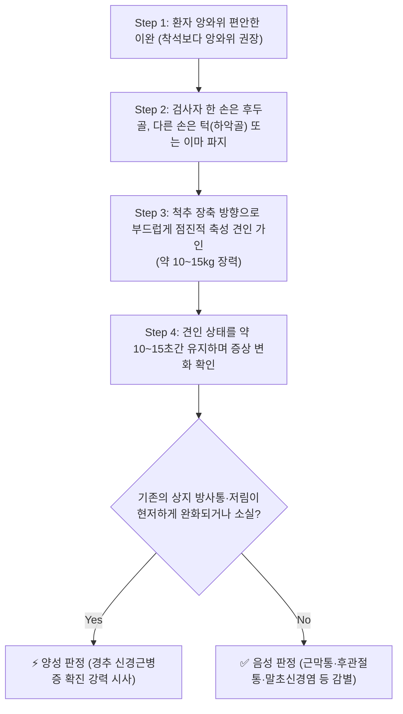
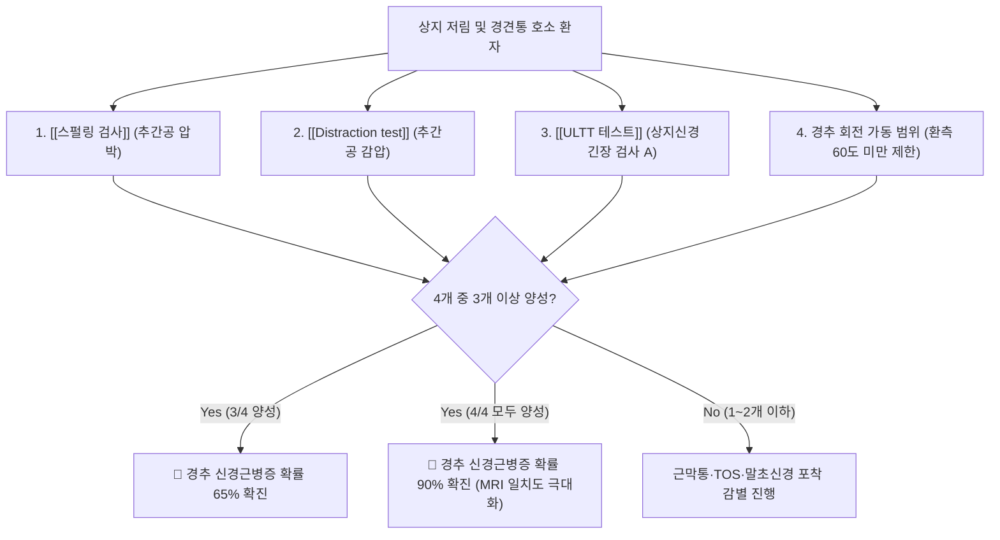

# 🩺 Distraction test (경추 견인 검사 / 신연 검사)

> **핵심 3줄 요약 (Key Summary)**:
> - 🎯 **검사 목적 & 타겟 병소**: **[[경추 신경근병증]](Cervical Radiculopathy)** 및 추간공 협착, [[경추 추간판 탈출증]]에 의한 경추 신경근(Cervical nerve roots)의 압박 여부 평가.
> - 🔍 **검사 시행 프로토콜 & 양성 반응**: 앙와위(또는 착석)에서 검사자가 후두골과 하악골을 파지하고 척추 장축 방향으로 약 10~15kg의 점진적 축성 견인(Distraction)을 가했을 때, 환자가 평소 겪던 상지 방사통 및 저림 증상이 **현저히 완화되거나 즉시 소실**.
> - 📊 **진단 정확도 & 임상적 의의**: **특이도 90~97%**의 매우 높은 확진 가치를 지니며, Wainner의 경추 신경근병증 4대 임상 예측 룰(CPR Cluster)의 핵심 구성 검사.

## 1. 검사 기본 정보 & 진단 목적 (Diagnostic Overview)

| 항목 | 상세 내용 |
| :--- | :--- |
| **검사명 (Test Name)** | Cervical Distraction Test (경추 견인 검사 / 신연 검사 / Distraction test) |
| **분류 (Category)** | 신경학적 증상 감압/완화 검사 (Decompressive Relief Test) |
| **타겟 병소 (Target)** | **경추 추간공(Intervertebral foramen)**, 경추 신경근(Cervical nerve roots) |
| **의심 질환 (Suspected Pathologies)** | [[경추 추간판 탈출증]](Cervical HIVD), 추간공 골극 협착증, 신경근염 |
| **진단 정확도 (Diagnostic Accuracy)** | • **민감도 (Sensitivity)**: 40 ~ 44% (단독 선별 가치는 낮음) • **특이도 (Specificity)**: **90 ~ 97% (양성 시 신경근병증 강력 확진)** • **양성 우도비 (LR+)**: 약 4.4 ~ 8.8 |
| **임상적 특징** | 증상을 유발(Provocation)하는 검사가 아니라, 증상을 **완화(Relief)**시키는 검사 |

## 2. 해부학적 유발 메커니즘 & 생체역학적 원리 (Biomechanical Mechanism)

### 1) 경추 추간공의 기계적 감압 원리
- 경추 신경근병증은 탈출된 추간판(수핵)이나 퇴행성 후관절 및 구추관절(Uncovertebral joint)의 골극에 의해 추간공 직경이 협소해져 신경근이 물리적으로 압박되고 혈류가 차단되어 발생한다.
- 검사자가 두부를 상방으로 축성 견인(Axial traction)하면:
  1. 인접한 척추체 사이의 추간판 높이가 일시적으로 확장된다.
  2. 추간공의 상하 및 전후 직경이 약 1.5~2mm가량 유의미하게 넓어진다.
  3. 협착된 추간공 내부의 공간 용적이 증가하면서 탈출된 디스크나 골극이 신경근에 가하던 **물리적 압박력과 마찰력이 즉각적으로 소실(Decompression)**된다.

### 2) 신경생리학적 통증 차단 기전
- 신경근에 가해지던 기계적 압박이 일시적으로 해제되면 신경근내 정맥 울혈과 국소 허혈(Ischemia)이 즉시 개선된다.
- 침해수용성 C 섬유 및 A-델타 섬유의 이소성 활동전위(Ectopic axonal firing) 생성이 중단되어 환자가 느끼던 상지 방사통, 저림, 작열감이 드라마틱하게 경감된다.

## 3. 표준 검사 시행 절차 (Step-by-Step Clinical Protocol)

### Step 1: 환자 준비 및 최적 자세 세팅
- 환자는 치료대에 천장을 보고 편안히 눕는다(앙와위 권장). 
- *(참고: 착석 상태에서도 시행 가능하나, 앙와위가 두부와 경추 근육을 완벽히 이완시킬 수 있어 위음성을 줄이고 검사 정확도가 훨씬 높다.)*

### Step 2: 정확한 검사자 핸드 그립 (Hand Placement)
- 검사자는 환자의 머리맡에 선다.
- 한 손(주 견인 손)은 환자의 **후두골(Occiput) 하연**을 컵 모양으로 넓게 받쳐 쥐고, 다른 손은 환자의 **하악골(턱 끝) 또는 이마**를 부드럽게 감싸 쥔다.
- *(주의: 턱관절 장애(TMD)가 있는 환자의 경우 턱을 강하게 누르면 턱관절 통증이 유발되므로, 전두부(이마)를 지지점으로 사용하는 것이 안전하다.)*

### Step 3: 점진적 축성 견인 인가 (Gradual Distraction)
- 환자의 몸통 쪽으로 힘을 주지 않고, 척추의 장축(Cephalic direction)을 따라 부드럽게 체중을 뒤로 실으며 약 **10~15kg(약 100~140N)**의 견인력을 3~5초에 걸쳐 점진적으로 가한다.

### Step 4: 반응 확인 및 천천히 감압
- 견인력을 10~15초 동안 유지하면서 환자에게 "팔이나 어깨로 내려가던 저림이나 통증이 줄어들거나 편해지나요?"라고 묻는다.
- 확인 후 반동이 생기지 않도록 천천히 견인력을 풀어 중립 상태로 복귀시킨다.

## 4. 양성 반응 판정 기준 & 신경근/조직별 감별 맵핑 (Diagnostic Criteria & Mapping)

### 양성 판정 기준
1. **신경근성 방사통의 명백한 완화 (Positive Relief)**:
   - 견인을 가했을 때 목에서부터 견갑골 내측, 어깨, 팔, 손가락으로 뻗치던 **찌릿한 방사통(Radicular pain) 및 저림 증상이 현저히 감소하거나 완전히 사라지는 경우**.
2. **주의 — 양성으로 판정하지 않는 소견**:
   - 단순한 뒷목 근육의 뻐근함이 시원해지는 느낌은 근육 신장에 의한 반응일 뿐이며, 신경근병증 양성 반응이 아니다. 반드시 **원위부 상지 방사 증상의 호전**이 확인되어야 한다.

### 경추 신경근병증 vs 기타 경견통 감별
| 질환 구분 | [[Distraction test]] (견인) | [[스펄링 검사]] (압박) | 병태생리 |
| :--- | :--- | :--- | :--- |
| **[[경추 신경근병증]] (Cervical Radiculopathy)** | **증상 즉각 완화 (양성)** | **방사통 극심 재현 (양성)** | 추간공 내 신경근 압박 |
| **경추 후관절 증후군 (Facet Syndrome)** | 목 국소 통증 약간 완화 가능 | 목 국소 통증 악화 (방사통 없음) | 후관절낭 활막 감돈 |
| **흉곽출구 증후군 (TOS)** | **변화 없음 또는 오히려 당김** | 변화 없음 ([[Adsons Test]] 양성) | 쇄골하 공간 완신경총 압박 |
| **근막통증 증후군 (MPS)** | 근육 신장으로 뻐근함 완화 | 변화 없음 (발통점 압박 시 압통) | 승모근·견갑거근 근경축 |

## 5. 연관 검사군 비교 & 다단계 감별 알고리즘 (Differential Battery & Algorithm)

### Wainner의 경추 신경근병증 4대 복합 진단 클러스터 (CPR Cluster)
단독 신연 검사는 민감도가 40%대로 낮으므로, 다음 4개 검사를 종합 평가하여 확진율을 극대화한다:

## 6. 양성 소견 시 한의 임상 연계 치료 전략 (Integrative Korean Medicine)

### 1) 경추 감압 추나요법 및 견인 치료의 절대적 적응증
- 신연 검사에서 방사통 완화가 확인된 환자는 **한의 척추신경추나의 경추 신연 가동 기법 및 감압 견인 치료(Traction therapy)에 가장 드라마틱하게 호전되는 최우선 반응군**이다.
- 앙와위 경추 신연 추나(Cervical Distraction Manipulation)를 적용하여 지속적인 추간공 감압을 유지한다.

### 2) 침구 및 약침 치료 프로토콜
- **화타협척혈([[협척혈]]) 약침 치료**:
  - 이환된 분절(예: C5-C6, C6-C7)의 극돌기 외방 0.5촌 협척혈에 [[신바로약침]] 1.0~1.5cc를 심자 주입하여 신경근 주위의 염증성 사이토카인을 억제하고 신경 부종을 소퇴.
- **주요 경혈 자침**:
  - [[대저]](BL11), [[견외수]](SI14), [[견중수]](SI15), [[곡지]](LI11), [[수삼리]](LI10), [[외관]](TE5), [[합곡]](LI4).
- **전침 치료**: 신경근 포착 분절과 원위부 합곡혈에 2Hz 저주파 전침을 인가하여 신경 재생을 촉진.

## 7. 💡 사용자 진료실 핵심 필기 & 실전 임상 팁 (원문 보존)

- **환자 티칭 및 치료 확신 유도 도구**:
  - 스펄링 검사로 통증을 확인한 직후, 바로 이 견인 검사를 시행하여 "목을 위로 살짝 당겼을 때 팔 저림이 시원하게 줄어들죠? 이것이 바로 환자분의 디스크가 신경을 누르고 있다는 확실한 증거이며, 저희 한의원의 추나요법과 약침 치료로 이 공간을 열어주면 완치될 수 있습니다"라고 설명하면 환자의 치료 순응도와 신뢰도가 200% 상승합니다.
- **견인 시 턱관절 보호 노하우**:
  - 턱을 강하게 위로 젖히며 당기면 턱관절 디스크에 손상이 오거나 목이 과신전되어 오히려 척수관이 좁아질 수 있습니다. 반드시 턱을 살짝 당긴(Chin-tuck) 가벼운 굴곡 자세를 유지하며 후두골을 메인으로 들어 올려야 안전합니다.

## 8. 출처 및 학술 참고 문헌 (References)

- Wainner RS, et al. (2003). "Reliability and diagnostic accuracy of the clinical examination and patient self-report measures for cervical radiculopathy." *Spine*, 28(1), 52-62. [PMID: 12544957](https://pubmed.ncbi.nlm.nih.gov/12544957/)
  - 경추 신연 검사의 높은 특이도(90%)와 4대 복합 진단 클러스터의 진단 정확도를 최초로 확립한 정형의학적 랜드마크 연구.
- Grondin F, et al. (2026). "Independent validation of a clinical prediction rule for cervical radiculopathy." *Brazilian Journal of Physical Therapy*, 30(3), 100780.
  - 방사통을 동반한 경추 신경근병증 환자에서 경추 신연 검사(Distraction test), 스펄링 검사, ULTT를 포함한 임상 예측 룰(CPR)의 독립적 타당도와 높은 진단 정확도를 입증한 최신 연구.
