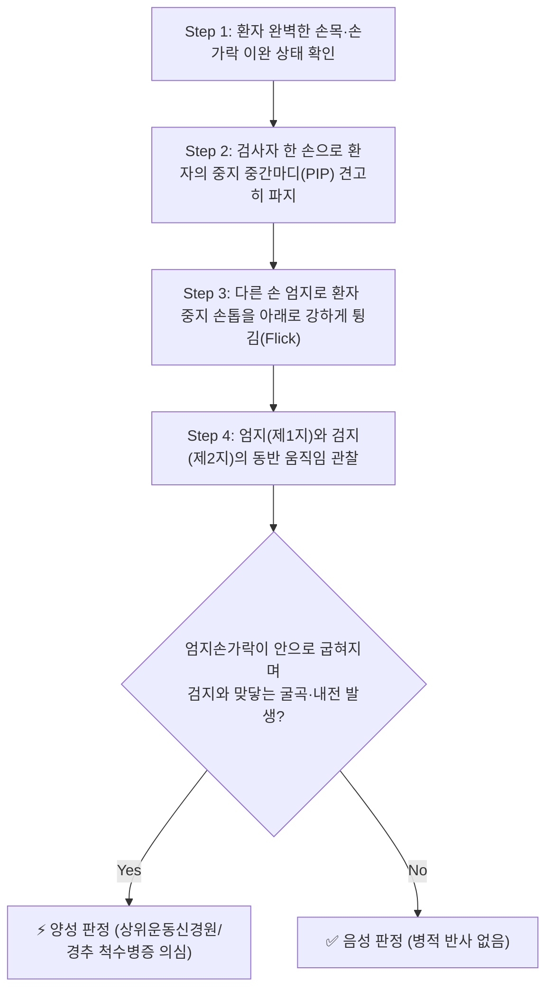
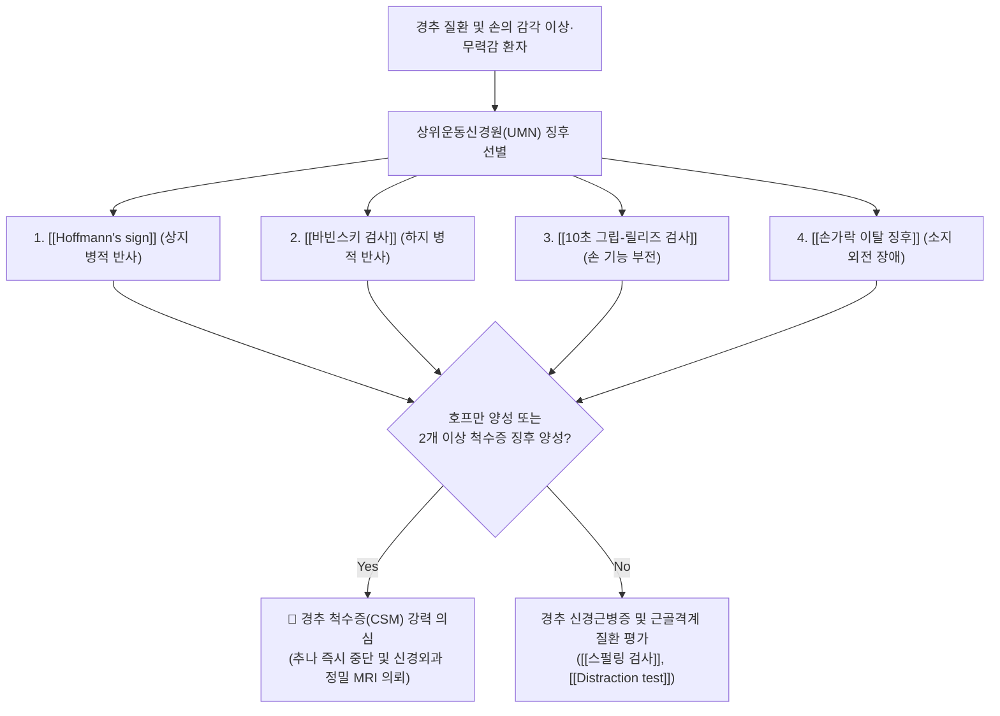

# 🩺 Hoffmann's sign (호프만 징후)

> **핵심 3줄 요약 (Key Summary)**:
> - 🎯 **검사 목적 & 타겟 병소**: **[[경추 척수증]](Cervical Spondylotic Myelopathy, CSM)** 및 피질척수로(Corticospinal tract) 손상으로 인한 **상위운동신경원(Upper Motor Neuron, UMN) 병변** 감별.
> - 🔍 **검사 시행 프로토콜 & 양성 반응**: 환자의 중지(제3수지) 근위지간관절을 고정하고 원위지절 손톱을 아래로 강하게 튕겼을 때(Flicking), 동측 엄지손가락(제1지)의 굴곡·내전 및 검지손가락(제2지)의 굴곡 반사가 불수의적으로 동반 출현.
> - 📊 **진단 정확도 & 임상적 의의**: 민감도 약 58~80%, 특이도 약 78~89%. 양성 출현 시 경추 척수 압박을 강력히 시사하는 **절대적 레드플래그(Red Flag)** 징후로, 경추 고속 회전 추나요법의 절대 금기 기준.

## 1. 검사 기본 정보 & 진단 목적 (Diagnostic Overview)

| 항목 | 상세 내용 |
| :--- | :--- |
| **검사명 (Test Name)** | Hoffmann's sign (호프만 징후 / Hoffmann Reflex) |
| **분류 (Category)** | 신경학적 병적 반사 검사 (Pathological Reflex / UMN Sign) |
| **타겟 병소 (Target)** | **경수 척수(Cervical spinal cord)**, 외측 피질척수로(Lateral corticospinal tract) |
| **의심 질환 (Suspected Pathologies)** | [[경추 척수증]](CSM), 후종인대골화증([[OPLL]]), 다발성 경화증, 척수 종양 |
| **진단 정확도 (Diagnostic Accuracy)** | • **민감도 (Sensitivity)**: 58 ~ 80% • **특이도 (Specificity)**: 78 ~ 89% • **양성 우도비 (LR+)**: 약 3.6 ~ 5.2 |
| **임상적 가치** | 상지에서 바빈스키 징후(Babinski sign)에 상응하는 대표적 척수병증 선별 검사 |

## 2. 해부학적 유발 메커니즘 & 생체역학적 원리 (Biomechanical Mechanism)

### 1) 피질척수로(Corticospinal Tract) 억제성 조절 상실
- 건강한 정상 성인의 신경계에서는 대뇌 피질에서 하행하는 상위운동신경원(UMN) 섬유가 척수 전각 세포와 척수 반사궁(Reflex arc)에 대해 지속적인 **강장성 억제(Tonic inhibition)**를 가하고 있다.
- 퇴행성 디스크 탈출, 경추관 협착증, 골극 또는 [[OPLL]](후종인대골화증)로 인해 C3-C7 레벨에서 경추 척수가 만성적으로 압박을 받으면:
  1. 외측 피질척수로의 전도 장애와 허혈성 탈수초가 발생한다.
  2. 하위 척수 분절로 전달되던 대뇌의 억제성 신호가 차단(Disinhibition)된다.
  3. 경수 C7-C8 분절의 심부 건반사궁이 병적으로 과흥분(Hyperreflexia) 상태로 전환된다.

### 2) 튕김 자극(Flicking)에 의한 다시냅스성 반사 확산
- 검사자가 중지의 원위지절 손톱을 튕겨 순간적인 과신전을 유도하면, 심지굴근(FDP) 건 방추(Muscle spindle)에서 발생한 Ia 감각 구심성 신경 흥분이 C8-T1 척수 분절로 급격히 유입된다.
- 억제 기전이 상실된 척수 내에서 이 신호가 인접한 모지굴근(FPL), 단모지내전근(Adductor pollicis), 시지굴근의 운동 신경원으로 광범위하게 확산(Irradiation)되어, 자극하지 않은 엄지와 검지가 집게 모양으로 불수의적 굴곡-내전 수축을 일으키게 된다.

## 3. 표준 검사 시행 절차 (Step-by-Step Clinical Protocol)

### Step 1: 환자 자세 및 근육 이완
- 환자는 편안하게 앉거나 누운 상태에서 손목과 손가락에 완전히 힘을 빼도록 지도한다.
- 환자의 손목은 약간 배측 굴곡(Dorsiflexion)된 중립 위치를 유지하고 손가락들은 자연스럽게 반쯤 굽힌 상태로 둔다.

### Step 2: 중지(제3수지) 안정적 파지
- 검사자는 한 손의 검지와 중지로 환자 중지의 **근위지간관절(PIP joint)**을 단단히 잡고 손가락을 고정한다.
- 환자의 원위지간관절(DIP joint)은 자유롭게 움직일 수 있도록 노출시킨다.

### Step 3: 손톱 튕김 자극 (Flicking Maneuver)
- 검사자는 다른 손 엄지손톱을 환자의 중지 손톱 위에 얹고, 아래 방향으로 강하게 긁어내리듯 튕겨 순간적으로 DIP 관절을 굴곡시켰다가 탄력적으로 튕겨져 올라오게 한다.

### Step 4: 즉각적 불수의적 반응 확인
- 자극 직후 동측 **엄지손가락(Thumb)의 지절간관절(IP joint)이 굽혀지면서 검지 쪽으로 모이는지(Flexion & Adduction)**, 그리고 **검지(Index finger)의 끝마디가 굽혀지는지**를 면밀히 관찰한다.

## 4. 양성 반응 판정 기준 & 신경근/조직별 감별 맵핑 (Diagnostic Criteria & Mapping)

### 양성 판정 기준
1. **전형적 양성 (Classical Positive)**:
   - 중지 손톱을 튕기는 순간, **엄지손가락 끝마디가 굽혀지고 안쪽으로 모이며 검지손가락 끝마디도 함께 굴곡**하는 불수의적 집게 반사(Pincer response)가 명확히 관찰되는 경우.
2. **불완전 양성 (Incomplete Positive)**:
   - 엄지만 가볍게 씰룩거리거나 검지만 단독으로 굴곡하는 경우 (경계선 소견으로 양측 대칭성을 비교 평가).
3. **위양성 가능성 (양측성 대칭적 과반사)**:
   - 젊고 마른 체형의 불안 신경증 환자나 전신 건반사 항진증 환자에서 양측 대칭적으로 약하게 나타나는 경우가 있으므로, **비대칭성 편측 양성**이거나 보행 장애, 손의 협응력 장애가 동반될 때 진단적 가치가 훨씬 높다.

### 경추 척수병증 vs 경추 신경근병증 감별
| 구분 | [[Hoffmann's sign]] 양성 ([[경추 척수증]]) | [[스펄링 검사]] 양성 ([[경추 신경근병증]]) |
| :--- | :--- | :--- |
| **손상 부위** | **척수 본체 (중추신경 / UMN)** | **신경근 (말초신경 / LMN)** |
| **임상 양상** | 젓가락질·단추 채우기 서툼, 보행 실조, 둔마감 | 특정 신경근 피부분절을 따른 날카로운 방사통 |
| **건반사 (DTR)** | **병적 항진 (Hyperreflexia)** | **저하 또는 소실 (Hyporeflexia)** |
| **병적 반사** | **호프만 양성, 바빈스키 양성** | 모두 음성 |
| **치료 원칙** | **추나 절대 금기, 조기 수술 의뢰** | 한의 보존적 치료(약침·추나) 최우선 적응증 |

## 5. 연관 검사군 비교 & 다단계 감별 알고리즘 (Differential Battery & Algorithm)

## 6. 양성 소견 시 한의 임상 연계 치료 전략 (Integrative Korean Medicine)

### 임상적 주의사항 및 절대 금기 (Safety First)
- **경추 고속 저진폭 교정(HVLA 추나) 절대 금기**:
  - 호프만 징후가 양성인 척수증 환자에게 경추를 순간적으로 비틀어 소리를 내는 강한 관절 교정을 시행할 경우, 협착된 척수관 내부에서 척수가 치명적인 압박 손상을 받아 사지 마비가 발생할 수 있다.
- **신속한 상급 병원 의뢰 원칙**:
  - 척수증은 비가역적 신경 손상이 진행될 수 있으므로, 환자에게 신경외과/정형외과 경추 MRI 검사 및 수술적 감압술 상담을 지체 없이 안내한다.

### 한의 보존적 보조 요법 (수술 전후 및 경증 척수증)
- **사지 말초 혈류 및 신경 가소성 촉진 침구 치료**:
  - [[팔사]](EX-UE9), [[합곡]](LI4), [[외관]](TE5), [[곡지]](LI11): 수부 세밀 운동 장애(Fine motor deficit) 완화 및 말초 순환 촉진.
  - [[족삼리]](ST36), [[양릉천]](GB34), [[현종]](GB39): 하지 근력 유지 및 보행 실조 완화.
- **경추부 신바로약침 요법**:
  - C4-C7 분절 협척혈에 [[신바로약침]] 0.5~1.0cc를 얕게 주입하여 척수관 후방 연부조직의 부종과 무균성 염증을 안전하게 완화.

## 7. 💡 사용자 진료실 핵심 필기 & 실전 임상 팁 (원문 보존)

- **목 디스크 환자에서 가장 먼저 확인해야 할 손가락**:
  - "손이 저리고 목이 아파요"라며 내원한 환자를 진료실 책상에 앉히자마자 가장 먼저 해야 할 일은 호프만 검사입니다.
  - 환자의 중지 손톱을 튕겼을 때 엄지가 툭 하고 굽혀지며 안으로 모인다면, 이것은 단순한 목 디스크(신경근병증)가 아니라 척수 자체가 짓눌리고 있는 척수증 환자입니다.
- **"젓가락질이나 단추 채우기가 어떠세요?"**:
  - 호프만 징후가 의심될 때 반드시 이 질문을 던져야 합니다. "최근 들어 글씨체가 삐뚤빼뚤해졌다", "단추를 채우거나 동전을 집을 때 손이 내 맘대로 안 움직인다"고 대답하면 지체 없이 척수증으로 진단하고 환자 안전을 최우선으로 관리해야 합니다.

## 8. 출처 및 학술 참고 문헌 (References)

- Kato Y, et al. (2025). "Accuracy and Reliability of Physical Signs as a Diagnostic Tool for Cervical Cord Compression: A Cross-Sectional Study." *Spine Surgery and Related Research*, 9(2), 150-157. [PMID: 40223840](https://pubmed.ncbi.nlm.nih.gov/40223840/)
  - 경추 척수 압박 환자에서 호프만 징후(Hoffmann's sign)의 민감도, 특이도 및 진단적 정확도를 정밀 평가한 최신 척추외과 임상 연구.
- Funaba M, et al. (2025). "The Utility of a Prediction Model Using Neurological Examination Findings for Diagnosing Degenerative Cervical Myelopathy." *The Journal of Bone and Joint Surgery. American Volume*, 107(13), 1210-1218. [PMID: 40638695](https://pubmed.ncbi.nlm.nih.gov/40638695/)
  - 퇴행성 경추 척수증 진단에서 신경학적 신체 검사 소견을 활용한 예측 모델의 임상적 유용성을 검증한 랜드마크 연구.
