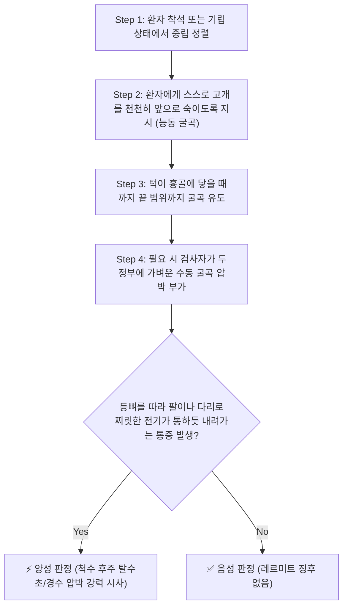
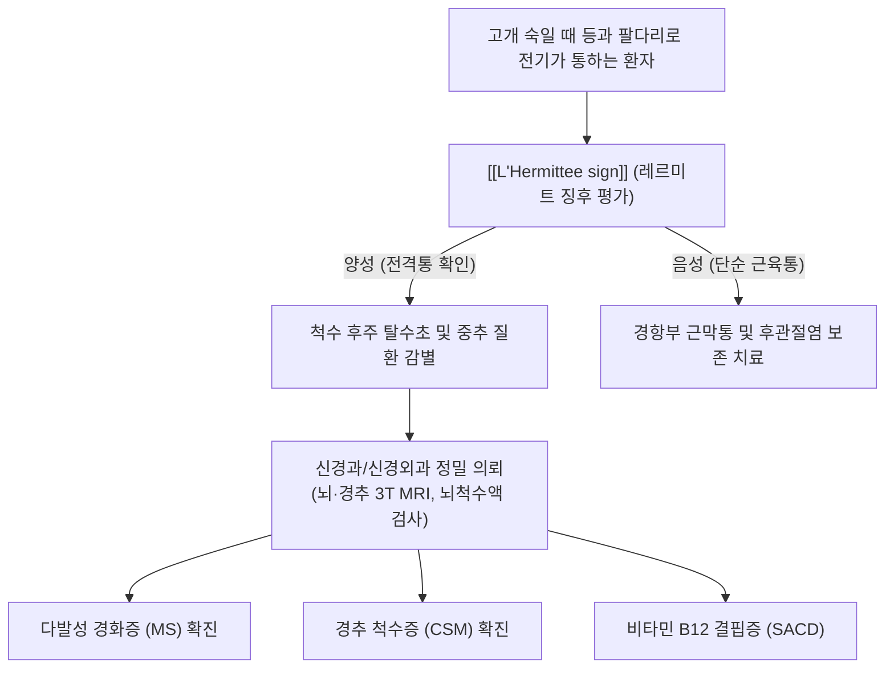

# 🩺 L'Hermittee sign (레르미트 징후)

> **핵심 3줄 요약 (Key Summary)**:
> - 🎯 **검사 목적 & 타겟 병소**: **경수 척수 후주(Dorsal columns, 박속·쐐기속)**의 탈수초 및 심부 압박 병변 감별 (다발성 경화증, [[경추 척수증]], 비타민 B12 결핍증 등).
> - 🔍 **검사 시행 프로토콜 & 양성 반응**: 환자가 목을 앞으로 숙이거나(능동/수동 굴곡) 턱을 가슴에 댈 때, 척추를 따라 등뼈와 팔다리로 번개가 치듯 찌릿하게 아래로 뻗치는 **전기 충격감(Electric shock-like sensation)** 유발.
> - 📊 **진단 정확도 & 임상적 의의**: 다발성 경화증 환자의 약 33~40%, 심한 경추 척수병증 환자에서 양성으로 나타나는 **치명적 척수 병변의 대표적 레드플래그(Red Flag)** 징후.

## 1. 검사 기본 정보 & 진단 목적 (Diagnostic Overview)

| 항목 | 상세 내용 |
| :--- | :--- |
| **검사명 (Test Name)** | L'Hermittee sign (레르미트 징후 / Lhermitte's Phenomenon / 전격통 징후) |
| **분류 (Category)** | 척수 후주 감각신경로 신장 유발 검사 (Dorsal Column Stretch Test) |
| **타겟 병소 (Target)** | **경수 척수 후주(Dorsal column)**, 박속(Gracile fasciculus), 쐐기속(Cuneate fasciculus) |
| **의심 질환 (Suspected Pathologies)** | [[다발성 경화증]](MS), [[경추 척수증]](CSM), [[척수]] 결핵, [[척추증]], 아급성 연합 변성(SACD) |
| **임상적 특징** | 목을 굽힐 때 등뼈를 타고 번개가 치듯 사지로 찌릿하게 내려가는 특이적 전기통 |
| **절대 금기** | 급성 외상성 [[척추]] 골절 의심 환자, [[척추]] 불안정성 환자에서 과도한 강제 굴곡 |

## 2. 해부학적 유발 메커니즘 & 생체역학적 원리 (Biomechanical Mechanism)

### 1) 경추 굴곡 시 척수의 물리적 신장
- 정상적인 해부학적 상태에서 [[경추]]를 앞으로 굴곡시키면 척수관(Spinal canal)의 길이가 늘어나며, 내부의 [[척수]] 실질과 경막(Dura mater)이 미세하게 상하로 신장(Elongation)을 받는다.
- 건강한 신경 섬유는 수초(Myelin sheath)로 완벽히 보호되어 있어 이러한 정상적인 신장 자극에 통증 반응을 일으키지 않는다.

### 2) 탈수초화된 축삭의 기계적 과감작 및 이소성 방전
- [[다발성 경화증]]이나 만성 [[경추증]]으로 인해 **척수 후주(Dorsal columns)의 유수신경 섬유가 탈수초(Demyelination)**되면:
  1. 축삭막의 전압 개폐성 이온 통로가 비정상적으로 노출된다.
  2. 축삭이 기계적 자극(신장 스트레스)에 극도로 과민해진다(Mechanosensitivity).
  3. 목을 숙여 [[척수]]가 팽팽하게 당겨지는 순간, 탈수초 부위에서 자발적인 **이소성 활동전위(Ectopic axonal discharge)**가 폭발적으로 발화한다.
  4. 이 병적 신호가 척수 후주를 타고 하행하여 체간과 사지 말초로 투사되면서 번개나 전기가 통하는 듯한 극심한 전격통이 발생한다.

## 3. 표준 검사 시행 절차 (Step-by-Step Clinical Protocol)

### Step 1: 환자 초기 자세 세팅
- 환자는 등받이가 없는 의자에 바르게 앉거나 편안하게 선다.
- 척추가 구부정하지 않도록 체간을 곧게 펴고 중립 위치를 유지한다.

### Step 2: 능동적 경추 굴곡 (Active Neck Flexion)
- 환자에게 "턱을 가슴 쪽으로 당기면서 고개를 천천히 끝까지 푹 숙여보세요"라고 지시한다.
- 환자가 고개를 숙이는 동안 통증이나 감각 이상의 발생 여부를 모니터링한다.

### Step 3: 수동적 과굴곡 부가 (Passive Overpressure - 필요 시)
- 능동 굴곡에서 명확한 증상이 나타나지 않는 경우, 검사자가 양손을 환자의 후두부에 가볍게 얹고 부드럽게 끝 범위 과굴곡(Passive overpressure)을 2~3초간 부가한다.
- *(주의: 갑작스러운 충격이나 과도한 힘을 가하지 않도록 주의한다.)*

### Step 4: 방사 경로 및 느낌 확인
- 고개를 숙이는 순간 등뼈를 타고 꼬리뼈, 양 팔다리, 발가락 끝까지 전기가 찌릿하게 통하는 느낌이 재현되는지 확인하고 즉시 고개를 중립으로 복귀시킨다.

## 4. 양성 반응 판정 기준 & 신경근/조직별 감별 맵핑 (Diagnostic Criteria & Mapping)

### 양성 판정 기준
1. **전형적 전격통의 재현 (Positive Shock-like Sensation)**:
   - 경추 굴곡 시 **목덜미에서 시작하여 척추 정중선을 타고 등, 요추, 둔부, 그리고 상하지로 찌릿한 전기 충격이 수 초간 번개처럼 뻗쳐 내려가는 느낌**을 호소하는 경우.
2. **주의 — 양성이 아닌 단순 소견**:
   - 목 뒤쪽 근육이나 승모근이 단순히 땡기거나 뻐근하게 아픈 것은 근육 신장통일 뿐이며, 레르미트 징후가 아니다. 반드시 **척수를 타고 내려가는 전격적인 방전감**이어야 한다.

### 척수 후주 병변 vs 기타 척추 질환 감별
| 질환 구분 | [[L'Hermittee sign]] (레르미트) | 유발 동작 | 병태생리 |
| :--- | :--- | :--- | :--- |
| **다발성 경화증 (MS)** | **매우 강한 전격통 (양성)** | 경추 굴곡 | 척수 후주 면역성 탈수초 |
| **[[경추 척수증]] (CSM)** | **전격통 동반 가능 (양성)** | 경추 굴곡 | 경추관 협착에 의한 척수 후면 압박 |
| **[[경추 추간판 탈출증]] (신경근)** | **음성 (굴곡 시 변화 적음)** | **경추 신전+환측 측굴 ([[스펄링 검사]])** | 추간공 내 신경근(말초) 압박 |
| **경추 염좌 / 근막통** | 음성 (국소 근육 당김통만 발생) | 굴곡 시 목 뒤 근육 뻐근함 | 승모근·두판상근 근경축 |

## 5. 연관 검사군 비교 & 다단계 감별 알고리즘 (Differential Battery & Algorithm)

## 6. 양성 소견 시 한의 임상 연계 치료 전략 (Integrative Korean Medicine)

### 임상적 주의사항 및 절대 금기 (Safety First)
- **추나요법 및 강한 목 굴곡·회전 절대 금기**:
  - 레르미트 징후가 양성인 환자는 [[척수]] 실질이 심각하게 손상되어 있거나 탈수초화되어 있는 상태이므로, 어떠한 형태의 경추 교정 [[추나요법]]이나 강한 스트레칭도 척수 손상을 급격히 악화시킬 수 있어 절대 금기이다.
- **신경과 정밀 검사 필수 의뢰**:
  - [[다발성 경화증]]이나 중추신경계 탈수초 질환의 가능성을 염두에 두고 즉시 대학병원 신경과로 의뢰하여 뇌·척수 MRI 검사를 받도록 한다.

### 한의 보존적 보조 요법 (만성기 신경 보호)
- **보기양혈(補氣養血) 및 통락(通絡) 한약 치료**:
  - [[황기계지오물탕]](黃芪桂枝五物湯), 사물탕 가감방을 응용하여 신경 세포의 허혈과 신경영양인자 결핍을 보완.
- **침구 치료**:
  - [[대저]](BL11), [[풍지]](GB20), [[곡지]](LI11), [[족삼리]](ST36) 등에 온화한 평보평사(平補平瀉) 자침으로 전신 기혈 순환 개선 및 [[항강증]] 완화.

## 7. 💡 사용자 진료실 핵심 필기 & 실전 임상 팁 (원문 보존)

- **"머리를 감으려고 숙일 때 등이 찌릿해요"**:
  - 아침에 머리를 감으려고 고개를 숙이는 순간 "등뼈에서 번개가 쳐서 다리까지 찌릿찌릿했다"고 말하는 환자는 1초도 지체하지 말고 레르미트 징후를 기록해야 합니다.
  - 이 증상은 근육통이나 단순 디스크에서 절대 나타나지 않는 중추 척수 질환의 대표적 신호입니다.
- **목 깁스 및 과굴곡 방지 교육**:
  - 정밀 진단 결과가 나오기 전까지 환자에게 절대로 고개를 깊게 숙이지 말 것을 신신당부하고, 스마트폰을 볼 때도 고개를 숙이지 말고 화면을 눈높이로 들어 올리도록 교육해야 신경 손상의 진행을 막을 수 있습니다.

## 8. 출처 및 학술 참고 문헌 (References)

- Teoli D, et al. (2023). "Lhermitte Sign." *StatPearls Publishing*. [PMID: 29630289](https://pubmed.ncbi.nlm.nih.gov/29630289/)
  - 레르미트 징후의 병태생리학적 기전(척수 후주 탈수초 및 이소성 방전), 다발성 경화증과 경추 척수병증에서의 감별 진단적 가치를 종합 고찰한 의학 종설.
- Poppen O, et al. (2024). "Spinal ependymoma presenting as subtle neurological findings in a VA chiropractic clinic: a case report in differential diagnosis and appropriate use of diagnostic imaging." *Journal of the Canadian Chiropractic Association*, 68(1), 58-64. [PMID: 38840970](https://pubmed.ncbi.nlm.nih.gov/38840970/)
  - 척추 척수 종양 환자에서 미세 신경학적 징후로서의 레르미트 징후 감별 진단 및 도수치료 전 정밀 영상 진단의 임상적 중요성을 입증한 증례 연구.
