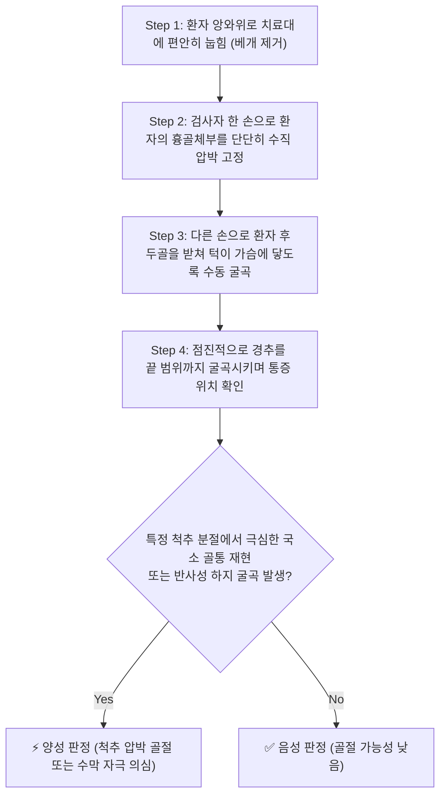
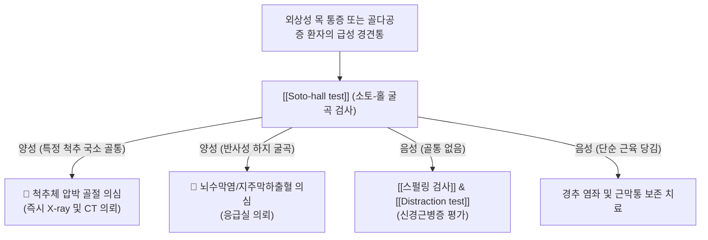

# 🩺 Soto-hall test (소토-홀 검사)

> **핵심 3줄 요약 (Key Summary)**:
> - 🎯 **검사 목적 & 타겟 병소**: 경추 및 상부 흉추의 **척추체 압박 골절(Vertebral compression fracture)**, 후방 인대 복합체([[항인대]], 극간인대) 손상 및 수막자극징후(Meningeal irritation) 감별.
> - 🔍 **검사 시행 프로토콜 & 양성 반응**: 앙와위에서 검사자가 환자의 흉골(Sternum)을 한 손으로 단단히 고정하여 흉곽의 들림을 막은 상태에서, 다른 손으로 환자의 머리를 천천히 수동 굴곡시켰을 때 특정 척추 분절에서의 극심한 국소 골성 통증 재현.
> - 📊 **진단 정확도 & 임상적 의의**: 외상성 골절 및 골다공증성 척추 압박 골절을 선별하는 고전적 정형외과 선별 검사로, 단순 경추 염좌와 구조적 골절을 신속히 감별하는 안전 진단 도구.

## 1. 검사 기본 정보 & 진단 목적 (Diagnostic Overview)

| 항목 | 상세 내용 |
| :--- | :--- |
| **검사명 (Test Name)** | Soto-hall test (소토-홀 검사 / Soto-Hall Sign) |
| **분류 (Category)** | 척추 골절 유발 및 척추 안정성 선별 검사 (Bony & Ligamentous Stress Test) |
| **타겟 병소 (Target)** | **경추 및 흉추 척추체(Vertebral body)**, [[항인대]], [[극간인대]], [[황색인대]], 척수 경막 |
| **의심 질환 (Suspected Pathologies)** | [[척추 압박 골절]], 골다공증성 [[척추]] 미세 골절, [[늑골]] 골절, [[경추]] 중증 염좌, [[뇌수막염]] |
| **핵심 기전** | [[흉골]] 고정을 통한 흉곽 움직임 차단 후 경추 굴곡력의 분절별 집중 |
| **주의 사항** | 명백한 외상 후 [[척추]] 탈구 의심 환자에서는 급격한 강제 굴곡 절대 금기 |

## 2. 해부학적 유발 메커니즘 & 생체역학적 원리 (Biomechanical Mechanism)

### 1) 흉골 고정(Sternal Fixation)에 의한 지레목 원리
- 환자가 누운 상태에서 단순히 머리를 들어 올리면, [[흉골]]과 흉곽 전체가 함께 위로 들리며 척추에 가해지는 굴곡 부하가 전신으로 분산된다.
- 소토-홀 검사에서는 검사자가 환자의 **[[흉골]] 체부(Sternal body)**를 수직 아래로 강하게 압박하여 흉곽의 상방 이동을 원천 차단한다.
- 이 상태에서 머리를 굴곡시키면 [[경추]]와 상부 [[흉추]]가 흉골 지지점을 축으로 한 강력한 **1종 지레(First-class lever)** 구조를 형성하여, 굴곡력이 척추체 앞쪽과 후방 인대 복합체에 집중된다.

### 2) 골절 및 인대 손상 부위의 기계적 스트레스 집중
1. **전방 척추체 압박 (Anterior Compression)**:
   - 척추 전만이 소실되고 과굴곡되면서 척추체 전방 1/3 부위에 강한 축성 압박 쐐기력(Wedge compressive force)이 작용한다. 척추체에 미세 골절이나 골다공증성 압박 골절이 존재할 경우 이 부위에서 극심한 골성 통증이 유발된다.
2. **후방 인대 장력 부하 (Posterior Tension)**:
   - 후방에서는 **[[항인대]](Ligamentum nuchae)**, 극간인대(Interspinous ligament), 황색인대가 강하게 당겨진다. 후방 인대 염좌나 파열이 있는 경우 목 뒤쪽 극돌기 사이에서 날카로운 인대성 당김통이 발생한다.
3. **경막 견인 (Dural Traction)**:
   - 척수와 경막이 상방으로 팽팽하게 견인되어 수막염 환자에서는 반사적으로 무릎과 엉덩이가 굽혀지는 [[부르진스키 징후]](Brudzinski sign)가 동반 출현한다.

## 3. 표준 검사 시행 절차 (Step-by-Step Clinical Protocol)

### Step 1: 환자 준비
- 환자는 치료대 위에 베개 없이 똑바로 눕는다(앙와위). 
- 양팔은 몸통 옆에 편안하게 내려놓고 전신의 힘을 빼도록 지도한다.

### Step 2: 흉골체부 견고한 고정 (Sternal Stabilization)
- 검사자는 환자의 옆에 선다.
- 한 손(비우세손)의 손바닥을 환자의 **흉골체부(Sternum)** 중앙에 얹고, 체중을 실어 바닥 방향으로 단단하게 눌러 고정함으로써 검사 도중 쇄골이나 늑골이 들리지 않도록 완전히 밀착시킨다.

### Step 3: 수동적 경추 굴곡 인가 (Passive Cervical Flexion)
- 다른 손(우세손)을 환자의 후두부 아래에 깊숙이 밀어 넣어 머리를 안정적으로 감싸 쥔다.
- 흉골을 누르고 있는 손의 압력을 유지하면서, 후두부를 천천히 상전방으로 들어 올려 **환자의 턱이 흉골에 닿을 때까지 경추를 수동 굴곡**시킨다.

### Step 4: 통증 부위 및 반응 평가
- 머리를 굽히는 도중 환자가 어느 부위에서 통증을 느끼는지 즉각 질문하고, 통증이 발생하는 정확한 척추 분절(경추 몇 번 또는 흉추 몇 번)을 확인한다.

## 4. 양성 반응 판정 기준 & 신경근/조직별 감별 맵핑 (Diagnostic Criteria & Mapping)

### 양성 판정 기준
1. **척추 골절 양성 (Bony Positive)**:
   - 굴곡 동작 시 특정 척추 분절(경추부 또는 상부 흉추부)의 뼈 깊숙한 곳에서 날카롭고 극심한 국소 골성 통증(Sharp localized bony pain)이 유발되는 경우 $\rightarrow$ **척추 압박 골절 강력 의심**.
2. **인대 염좌 양성 (Ligamentous Positive)**:
   - 목 뒤쪽 정중선을 따라 극돌기 사이나 목덜미 근육-인대 접합부에서 팽팽하게 찢어지는 듯한 표재성 당김통이 발생하는 경우 $\rightarrow$ **경추 후방 인대 염좌 및 근막 좌상**.
3. **수막자극징후 양성 (Meningeal Positive)**:
   - 고개를 숙이는 순간 심한 두통과 함께 양측 고관절과 슬관절이 불수의적으로 굽혀지는 경우 $\rightarrow$ **뇌수막염(Meningitis) 또는 지주막하 출혈**.

### 손상 조직별 감별 매트릭스
| 구분 | 척추체 압박 골절 | 경추 후방 인대 파열/염좌 | 뇌수막염 ([[부르진스키 징후]]) |
| :--- | :--- | :--- | :--- |
| **주 통증 위치** | 특정 척추체 전방 심부 골통 | 후두하부~항인대 극돌기 사이 | 후두통, 항강증, 전신성 |
| **통증 양상** | 찌르는 듯한 국소 골통, 두드림 악화 | 팽팽하게 당기는 인대성 둔통 | 극심한 두통 및 오심 동반 |
| **하지 반응** | 하지 반응 없음 | 하지 반응 없음 | **양측 무릎·엉덩이 반사성 굴곡** |
| **필수 검사** | 경추 X-ray, CT/MRI | 경추 굴곡-신전 동적 X-ray | 뇌척수액 검사(CSF tapping) |

## 5. 연관 검사군 비교 & 다단계 감별 알고리즘 (Differential Battery & Algorithm)

## 6. 양성 소견 시 한의 임상 연계 치료 전략 (Integrative Korean Medicine)

### 임상적 주의사항 및 절대 금기 (Safety First)
- **추나요법 및 도수치료 절대 금기**:
  - 소토-홀 검사에서 국소 골통이 유발된 환자에게 척추 교정 추나나 강한 마사지를 시행하면 불완전 골절이 완전 골절로 전위되거나 척추 후방벽이 파열되어 척수 손상을 일으킬 수 있다.
- **영상 검사 후 보존적 고정**:
  - 골절이 배제될 때까지 경추 보조기(Cervical collar)를 착용시켜 척추를 안정시킨 후 단순 방사선(X-ray) 및 MRI 검사를 의뢰한다.

### 한의 보존적 안정화 치료 (골절 배제된 단순 인대 염좌 시)
- **항인대 및 후방 복합체 약침 치료**:
  - 골절이 배제된 만성 편타 손상성 인대 염좌 환자의 경우, 극간인대와 항인대 부착부에 [[신바로약침]] 또는 [[중성어혈약침]] 0.5~1.0cc를 주입하여 인대 염증을 소퇴시키고 건골 강화를 유도.
- **침구 및 한약 치료**:
  - [[대저]](BL11), [[풍문]](BL12), [[후계]](SI3), [[신주]](GV12) 자침.
  - 급성기 경항부 강직에는 [[갈근탕]](葛根湯) 또는 서경탕(舒經湯), 만성 어혈성 통증에는 당귀수산(當歸鬚散)에 속단, 두충을 가미하여 손상된 결합조직을 재생.

## 7. 💡 사용자 진료실 핵심 필기 & 실전 임상 팁 (원문 보존)

- **낙상·교통사고 환자의 첫 관문**:
  - 빙판길에서 넘어졌거나 교통사고를 당해 목과 등을 부여잡고 온 환자는 절대 엎드리게 하거나 목을 함부로 비틀어서는 안 됩니다.
  - 똑바로 눕힌 상태에서 흉골을 누르고 고개를 가볍게 숙여보는 소토-홀 검사를 시행하여 특정 뼈마디가 바늘로 찌르듯 아프다고 하면 미세 골절을 먼저 의심하고 엑스레이를 찍어야 안전사고를 100% 예방할 수 있습니다.
- **고령자 골다공증성 압박 골절 감별**:
  - 70대 이상 고령 환자는 넘어지지 않고 무거운 물건을 들거나 기침을 심하게 한 것만으로도 상부 흉추나 하부 경추에 압박 골절이 생깁니다. 이때 소토-홀 검사는 가장 안전하고 확실한 감별 진단 도구입니다.

## 8. 출처 및 학술 참고 문헌 (References)

- Yoganandan N, et al. (2007). "Failure properties of cervical spinal ligaments under fast strain rate deformations." *Spine*, 32(1), E7-13. [PMID: 17202883](https://pubmed.ncbi.nlm.nih.gov/17202883/)
  - 고속 변형 하에서 경추 인대 복합체(항인대, 극간인대, 황색인대)의 생체역학적 파열 특성과 경추 급격 굴곡 시 후방 인대 장력 밴드의 손상 역치를 규명한 연구.
- Nakao JH, et al. (2010). "Accuracy of physical signs for detecting meningitis: a hospital-based diagnostic accuracy study." *Clinical Neurology and Neurosurgery*, 112(9), 789-794. [PMID: 20615607](https://pubmed.ncbi.nlm.nih.gov/20615607/)
  - 경추 전굴 검사 및 수막 자극 검사들의 진단 정확도를 평가하여 경부 강직과 하지 반사성 굴곡 징후의 임상적 특이도를 보고한 연구.
