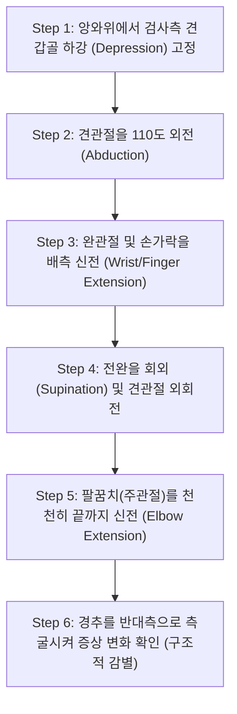
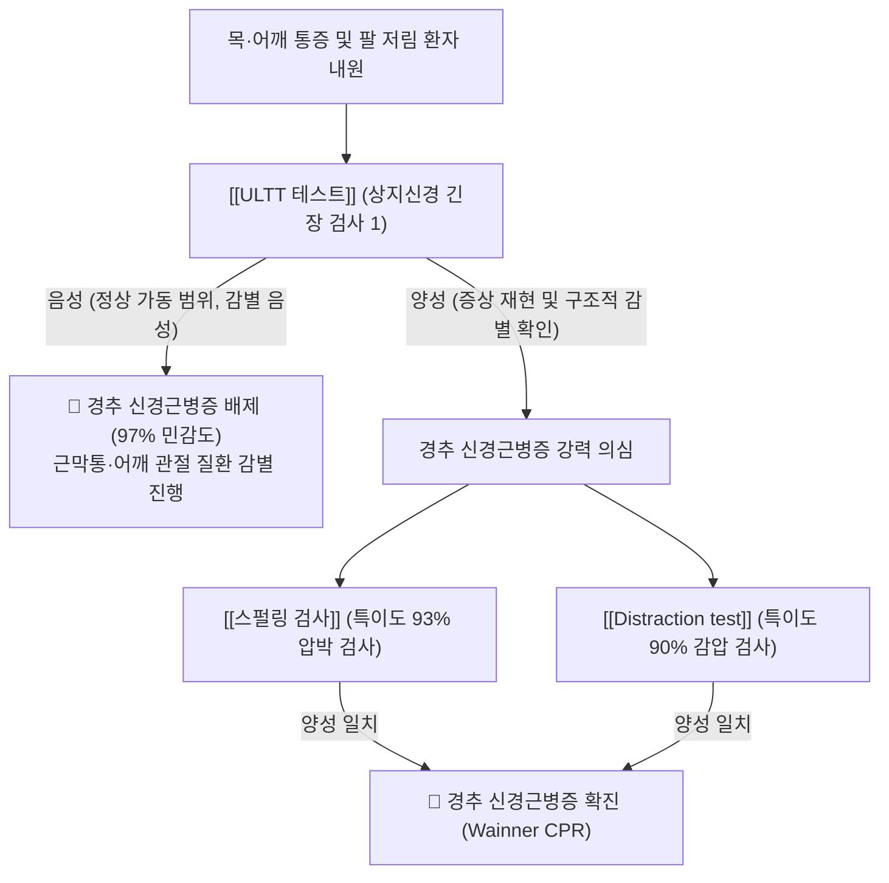

# 🩺 ULTT 테스트 (상지신경 긴장 검사)

> **핵심 3줄 요약 (Key Summary)**:
> - 🎯 **검사 목적 & 타겟 병소**: **[[경추 신경근병증]](Cervical Radiculopathy)** 및 상지 주요 말초신경([[정중신경]], [[요골신경]], [[척골신경]])의 기계적 포착과 신경역동학적(Neurodynamic) 민감도 평가.
> - 🔍 **검사 시행 프로토콜 & 양성 반응**: 상지의 견갑골, 어깨, 팔꿈치, 손목, 손가락을 단계적으로 신장시켜 신경에 장력을 가한 후, 경추 반대측 측굴 시 방사통이 악화되고 동측 측굴 시 완화되는 구조적 감별 반응(Structural differentiation) 확인.
> - 📊 **진단 정확도 & 임상적 의의**: **민감도 97%**에 달하는 최우선 룰아웃(Rule-Out) 선별 검사로, 하지의 [[SLR 검사]](하지직거상검사)에 상응하는 상지 신경근병증의 필수 관문.

## 1. 검사 기본 정보 & 진단 목적 (Diagnostic Overview)

| 항목 | 상세 내용 |
| :--- | :--- |
| **검사명 (Test Name)** | Upper Limb Tension Test (ULTT / Elvey Test / 상지신경 긴장 검사) |
| **분류 (Category)** | 신경역동학적 유발 및 장력 검사 (Neurodynamic Tension Test) |
| **타겟 병소 (Target)** | **경추 신경근(C5, C6, C7, C8)**, 완신경총, 정중·요골·척골신경 |
| **의심 질환 (Suspected Pathologies)** | [[경추 추간판 탈출증]], 흉곽출구 증후군, 수근관 증후군, 회내근 증후군 |
| **진단 정확도 (ULTT 1 기준)** | • **민감도 (Sensitivity)**: **97% (음성 시 신경근병증 배제 가능)** • **특이도 (Specificity)**: 75 ~ 83% • **음성 우도비 (LR-)**: 0.12 (극히 우수한 선별력) |
| **대응 검사** | 요추 신경근병증의 하지직거상검사([[SLR 검사]])와 완벽히 동일한 원리 |

## 2. 해부학적 유발 메커니즘 & 생체역학적 원리 (Biomechanical Mechanism)

### 1) 신경의 연속적 결합조직 긴장(Continuity of the Nervous System)
- 말초신경계는 중추 경막에서부터 척추 추간공을 거쳐 손가락 끝 감각 수용기까지 하나로 이어진 물리적 연속체(Mechanical continuum)를 형성한다.
- 상지의 각 관절(견갑대 $\rightarrow$ 견관절 $\rightarrow$ 주관절 $\rightarrow$ 완관절 $\rightarrow$ 수지)을 특정 순서로 신장시키면, 말초에서 발생한 기계적 장력(Tensile stress)이 신경간을 따라 중추 방향으로 순차적으로 전달되어 추간공 내의 신경근까지 당겨지게 된다.

### 2) 구조적 감별(Structural Differentiation) 원리
- 단순히 팔을 뻗을 때 나타나는 국소 근육이나 관절낭의 땡김과 진짜 신경성 통증을 구별하기 위해 **원격 부위인 '경추의 측굴(Cervical lateral flexion)'을 감별 인자**로 사용한다:
  1. 상지의 모든 관절을 신장시킨 상태에서 환자가 **고개를 반대측으로 갸우뚱(Contralateral flexion)**하면 경추 신경근이 근위부로 더욱 강하게 당겨지며 손가락 저림이 악화된다.
  2. 반대로 환자가 **고개를 아픈 쪽으로 기울이면(Ipsilateral flexion)** 신경근의 긴장이 풀리면서 상지 저림이 즉각 감소한다.
  3. 이 반응이 나타나면 관절이나 근육통이 아닌 **100% 신경계 유래 통증(Neural origin)**으로 확진할 수 있다.

## 3. 표준 검사 시행 절차 (Step-by-Step Clinical Protocol)

ULTT는 타겟 신경에 따라 4가지 표준 변형(ULTT 1, 2a, 2b, 3)으로 구성되며, 가장 기본이 되는 정중신경/신경근병증 선별 검사는 **ULTT 1**이다:

### 1) ULTT 1 (Elvey Test — 정중신경 / C5, C6, C7 신경근 바이어스)
1. **견갑골 하강(Depression)**: 검사자의 한 손으로 환자의 어깨를 아래로 눌러 고정한다.
2. **견관절 외전(Abduction)**: 팔을 외전 각도 약 110도까지 벌린다.
3. **완관절 및 수지 신전(Extension)**: 손목과 손가락을 뒤로 젖힌다.
4. **전완 회외(Supination) 및 상지 외회전(External rotation)**.
5. **주관절 신전(Elbow extension)**: 팔꿈치를 천천히 펴면서 첫 번째 저림이나 저항감이 나타나는 각도를 확인한다.
6. **경추 측굴 감별**: 저림 발생 시 환자에게 고개를 반대측/동측으로 기울이게 하여 증상 증감을 확인한다.

### 2) ULTT 2b (요골신경 바이어스 — Radial Nerve)
- 견갑골 하강 $\rightarrow$ 주관절 신전 $\rightarrow$ 상지 전체 내회전(Internal rotation) $\rightarrow$ 완관절 굴곡(Flexion) 및 척측 편위(Ulnar deviation) $\rightarrow$ 상지 10도 외전.

### 3) ULTT 3 (척골신경 바이어스 — Ulnar Nerve / C8-T1)
- 견갑골 하강 $\rightarrow$ 견관절 90도 외전 $\rightarrow$ 주관절 완전 굴곡(Elbow flexion) $\rightarrow$ 전완 회내 $\rightarrow$ 완관절 신전 및 요측 편위 (귀 옆에 안경을 쓰는 듯한 자세).

## 4. 양성 반응 판정 기준 & 신경근/조직별 감별 맵핑 (Diagnostic Criteria & Mapping)

### 양성 판정 기준 (모두 충족 필요)
1. **환자가 호소하던 전형적인 상지 증상(방사통, 저림, 작열감)의 재현**.
2. **건측 대비 팔꿈치 신전 가동 범위의 10도 이상 조기 제한**.
3. **경추 반대측 측굴 시 증상 악화, 동측 측굴 시 증상 완화 (구조적 감별 양성)**.

### 신경 분지별 증상 발현 맵핑
| 검사 유형 | 주 타겟 신경 | 양성 시 주 저림 부위 | 감별 질환 |
| :--- | :--- | :--- | :--- |
| **ULTT 1** | [[정중신경]] (C5-C7) | 엄지, 검지, 중지 족저면, 전완 전면 | C6/C7 신경근병증, [[수근관 증후군]] |
| **ULTT 2b** | [[요골신경]] (C6-C8) | 엄지손가락 손등, 전완 요측 배면 | 요골신경마비, 외측상과염 연관통 |
| **ULTT 3** | [[척골신경]] (C8-T1) | 제4-5수지, 손바닥 척측 연 | C8 신경근병증, 주관터널 증후군 |

## 5. 연관 검사군 비교 & 다단계 감별 알고리즘 (Differential Battery & Algorithm)

## 6. 양성 소견 시 한의 임상 연계 치료 전략 (Integrative Korean Medicine)

### 신경역동학적 가동술과 한의 추나의 융합
- **신경 활주 기법(Nerve Flossing / Gliding)**:
  - 신경을 양쪽에서 무리하게 잡아당기지 않고, 한쪽을 당길 때 다른 쪽을 풀어주는 시소 방식의 활주 운동(예: 손목을 젖힐 때 고개를 같은 쪽으로 기울임)을 추나 후 재활 운동으로 지도하여 신경 유착을 무통으로 해소.
- **경추 분절 신연 추나**:
  - 이환된 신경근의 추간공을 열어주는 분절별 굴곡-신연 기법 적용.

### 침구 및 약침 치료
- **표적 신경근 협척혈 약침**:
  - 정중신경 증상 시 C5-C6 협척혈, 척골신경 증상 시 C7-T1 협척혈에 [[신바로약침]] 1.0cc 주입.
- **주요 말초 신경 통로 취혈**:
  - 정중신경: [[극문]](PC4), [[내관]](PC6), [[대릉]](PC7).
  - 요골신경: [[수삼리]](LI10), [[곡지]](LI11), [[편력]](LI6).
  - 척골신경: [[소해]](HT3), [[양로]](SI6).

## 7. 💡 사용자 진료실 핵심 필기 & 실전 임상 팁 (원문 보존)

- **"목 디스크 룰아웃(Rule-Out)의 최고 무기"**:
  - 팔이 저리다는 환자가 왔을 때 ULTT 1 검사를 끝까지 편안하게 양쪽 다 통과하고 고개를 돌려도 아무런 저림이 없다면, 그 환자는 목 디스크(신경근병증)일 확률이 3% 미만입니다.
  - 즉, 쓸데없이 고가의 MRI를 남발하지 않고 회전근개 파열이나 단순 근막통증 증후군으로 진단 방향을 빠르게 전환할 수 있는 가장 훌륭한 배제 도구입니다.
- **신경 활주 운동 처방 요령**:
  - 신경이 심하게 부어 있는 급성기 환자에게 팔을 끝까지 펴서 늘리는 스트레칭을 시키면 신경염이 악화됩니다. 반드시 머리와 손목을 같은 방향으로 움직이는 '신경 슬라이딩(Flossing)' 기법을 처방해야 안전하게 호전됩니다.

## 8. 출처 및 학술 참고 문헌 (References)

- Wainner RS, et al. (2003). "Reliability and diagnostic accuracy of the clinical examination and patient self-report measures for cervical radiculopathy." *Spine*, 28(1), 52-62. [PMID: 12544957](https://pubmed.ncbi.nlm.nih.gov/12544957/)
  - 상지신경 긴장 검사(ULTT 1)의 높은 민감도(97%)와 경추 신경근병증 진단 클러스터의 임상적 예측 가치를 확립한 정형의학적 랜드마크 연구.
- Grondin F, et al. (2026). "Independent validation of a clinical prediction rule for cervical radiculopathy." *Brazilian Journal of Physical Therapy*, 30(3), 100780.
  - 경추 신경근병증 진단에서 ULTT와 신경역동학적 신체 검사의 높은 민감도와 다단계 진단 모델의 임상적 타당도를 독립적으로 재검증한 임상 연구.
