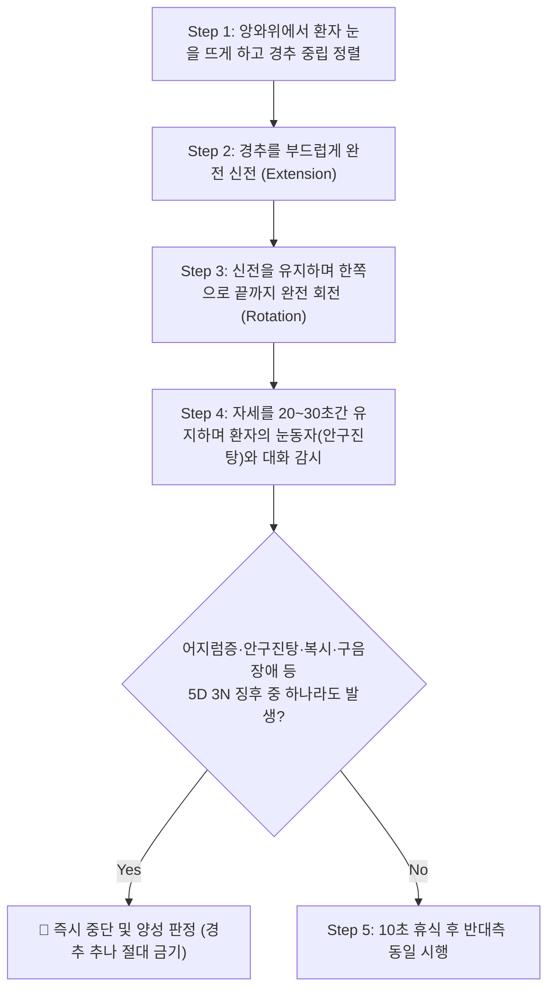
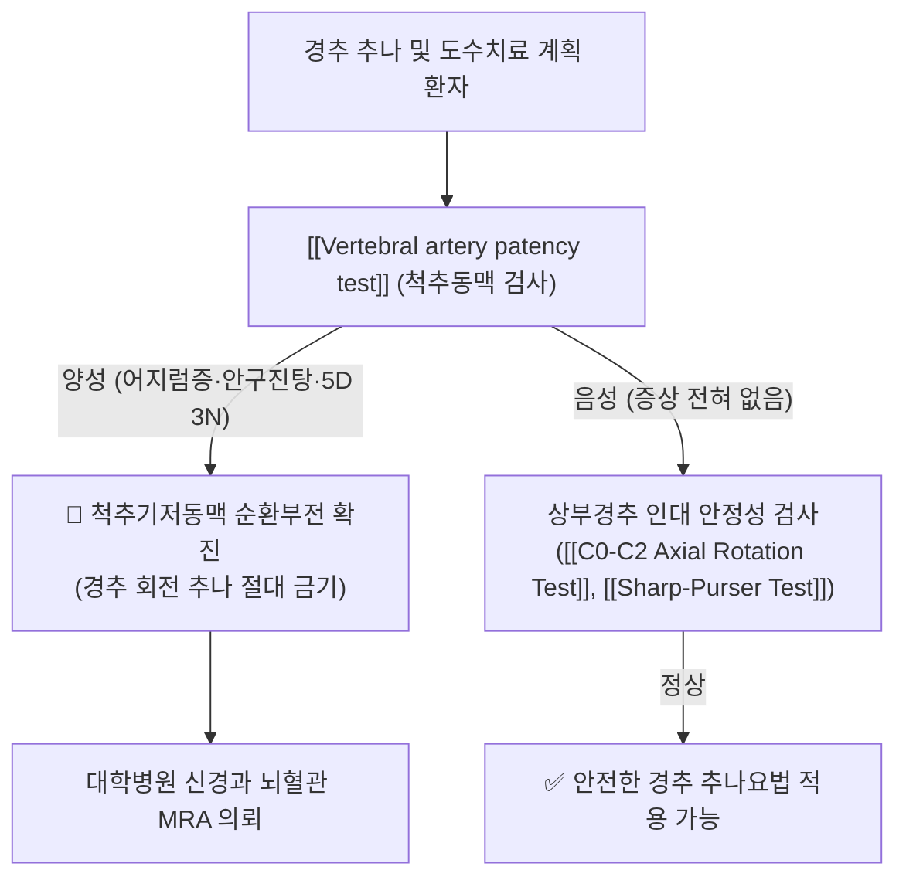

# 🩺 Vertebral artery patency test (척추동맥 개구도 검사)

> **핵심 3줄 요약 (Key Summary)**:
> - 🎯 **검사 목적 & 타겟 병소**: **[[척추기저동맥 순환부전]](Vertebrobasilar Insufficiency, VBI)** 및 **[[척추동맥]](Vertebral artery)**의 혈류 개구도(Patency) 평가, 경추 추나 전 뇌허혈 위험 선별.
> - 🔍 **검사 시행 프로토콜 & 양성 반응**: 앙와위 또는 착석 상태에서 경추를 끝까지 신전시키고 한쪽으로 완전 회전 및 측굴시켜 20~30초간 유지했을 때, 어지럼증(Dizziness), 안구진탕(Nystagmus), 복시, 오심, 안면 감각 저하 등 **5D 3N 징후** 출현.
> - 📊 **진단 정확도 & 임상적 의의**: 경추 도수치료 및 고속 저진폭(HVLA) 추나요법 전 척추동맥 박리(CAD)와 소뇌·뇌간 경색을 예방하기 위한 **절대적 레드플래그(Red Flag) 안전 검사**.

## 1. 검사 기본 정보 & 진단 목적 (Diagnostic Overview)

| 항목 | 상세 내용 |
| :--- | :--- |
| **검사명 (Test Name)** | Vertebral Artery Patency Test (척추동맥 개구도 검사 / VBI Test / DeKleyn 검사) |
| **분류 (Category)** | 뇌혈관 순환 부전 및 추나 안전 스크리닝 검사 (Vascular Safety Screening) |
| **타겟 병소 (Target)** | **[[척추동맥]](Vertebral artery) (특히 C1-C2 V3 구간)**, [[기저동맥]], 후두하삼각 |
| **의심 질환 (Suspected Pathologies)** | [[척추기저동맥 순환부전]](VBI), 척추동맥 박리증, 죽상동맥경화성 협착, [[뇌졸중]] |
| **임상적 가치** | 경추 회전 [[추나요법]] 적용 여부를 결정하는 **법적·임상적 최우선 안전 관문** |
| **절대 금기** | 검사 도중 어지럼증이나 안구진탕이 나타나는 즉시 자세를 중립으로 원복해야 함 |

## 2. 해부학적 유발 메커니즘 & 생체역학적 원리 (Biomechanical Mechanism)

### 1) 척추동맥 V3 구간의 독특한 주행 해부학
- 척추동맥은 [[쇄골하동맥]]에서 분지하여 C6부터 C1까지 경추 횡돌기공(Transverse foramen)을 수직 상행한다.
- 특히 **축추([[C2]])와 환추([[C1]]) 사이, 그리고 C1에서 [[대후두공]]으로 들어가는 제3구간(V3 segment)**에서 동맥은 S자 모양으로 급격하게 꺾이며 [[후두하삼각]]을 가로지른다.

### 2) 경추 회전-신전 시의 혈류 차단 생체역학
- 두부를 우측으로 끝까지 회전시키면:
  1. 환추(C1)가 축추(C2) 위에서 약 45도 회전하면서, **반대측(좌측) 척추동맥 V3 구간이 치돌기 외측에서 전방으로 강하게 당겨지고 늘어난다(Stretching)**.
  2. 동시에 횡돌기공 골벽과 후두골 하연에 의해 동맥 내강이 압박되어 반대측 척추동맥의 혈류량이 정상의 50~80%까지 급감한다.
- **정상 반응**: 동측(우측) 척추동맥과 [[윌리스 환]](Circle of Willis)을 통한 측부 순환(Collateral circulation)이 원활하므로 [[뇌간]]과 [[소뇌]]에 정상적인 혈액 공급이 유지된다.
- **병적 반응 (VBI 양성)**: 기저 혈관질환(동맥경화, 형성부전, 혈전)이 존재할 경우, 반대측 동맥이 압박되는 순간 뇌간과 소뇌로 가는 혈류가 차단되어 급성 뇌허혈 증상(**5D 3N 징후**)이 폭발한다.

## 3. 표준 검사 시행 절차 (Step-by-Step Clinical Protocol)

### Step 1: 환자 준비 및 모니터링 세팅
- 환자는 치료대에 천장을 보고 눕는다(앙와위 권장). 머리를 치료대 끝으로 살짝 빼서 검사자가 양손으로 완전히 지지한다.
- **중요**: 환자에게 **"검사 중 절대로 눈을 감지 마시고 제 눈을 바라보세요"**라고 지시한다(안구진탕 관찰 필수).

### Step 2: 3차원 유발 자세 인가 (Extension + Rotation + Lateral Flexion)
1. 검사자는 환자의 머리를 천천히 끝 범위까지 수동 신전(Extension)시킨다.
2. 신전 상태를 유지한 채, 머리를 한쪽 방향(예: 우측)으로 끝까지 완전히 회전(Rotation)시킨다.
3. 가벼운 동측 측굴(Lateral flexion)을 함께 부가하여 척추동맥의 꼬임을 극대화한다.

### Step 3: 20~30초간 정지 유지 및 실시간 대화 (Monitoring)
- 이 자세를 **20~30초 동안 그대로 유지**한다.
- 검사자는 환자의 동공을 응시하여 **안구진탕(Nystagmus)**이 발생하는지 관찰한다.
- 환자에게 1부터 10까지 천천히 소리 내어 숫자를 세게 하거나 질문을 던져 **발음이 어눌해지는지(구음장애), 의식이 흐려지는지**를 실시간으로 확인한다.

### Step 4: 즉각적 원위치 및 반대측 평가
- 이상 증상이 나타나면 1초의 지체도 없이 즉시 머리를 중립으로 복귀시킨다.
- 증상이 없으면 중립에서 10~15초간 휴식한 후, 반대측(좌측) 회전 방향으로 동일하게 시행한다.

## 4. 양성 반응 판정 기준 & 신경근/조직별 감별 맵핑 (Diagnostic Criteria & Mapping)

### 양성 판정 기준 (5D 3N 징후 — 하나라도 발생 시 즉시 양성)
- **5 D (Five D's)**:
  1. **Dizziness**: 빙빙 도는 현훈 또는 아찔한 어지럼증.
  2. **Drop attacks**: 의식 소실 없이 갑자기 다리에 힘이 풀려 주저앉는 발작.
  3. **Diplopia**: 사물이 둘로 겹쳐 보이는 복시.
  4. **Dysarthria**: 혀가 꼬이고 발음이 어눌해지는 구음장애.
  5. **Dysphagia**: 침을 삼키기 어려운 연하곤란.
- **3 N (Three N's)**:
  1. **Nausea**: 울렁거림, 메스꺼움 또는 구토.
  2. **Numbness**: 입술 주변이나 안면부의 편측성 감각 저하.
  3. **Nystagmus**: 안구가 제멋대로 떨리는 불수의적 안구진탕.
- **A (Ataxia)**: 팔다리 조절이 안 되는 보행 실조 및 운동 실조.

### 이석증(BPPV)과의 감별
| 구분 | 척추기저동맥 순환부전 (VBI) | 양성 돌발성 두위 현훈 (BPPV / 이석증) |
| :--- | :--- | :--- |
| **병인** | 뇌간·소뇌 척추동맥 혈류 일시적 차단 | 내이 반고리관 내 이석(Otoconia) 이동 |
| **안구진탕 양상** | 수직성 또는 방향이 바뀌는 중추성 안구진탕 | 회선성-수평성 말초성 안구진탕 (피로현상 있음) |
| **신경학적 징후** | **구음장애, 복시, 안면 마비, 실신 동반** | 순수 회전성 어지럼증과 오심에 국한 |
| **추나 영향** | **추나 시 뇌경색 위험 (절대 금기)** | 에플리(Epley) 정복술로 즉시 치유 |

## 5. 연관 검사군 비교 & 다단계 감별 알고리즘 (Differential Battery & Algorithm)

## 6. 양성 소견 시 한의 임상 연계 치료 전략 (Integrative Korean Medicine)

### 임상적 주의사항 및 절대 금기 (Safety First)
- **경추 고속 저진폭(HVLA) 회전 쓰러스트 추나 절대 금기**:
  - VBI 검사에서 양성이 나온 환자에게 목을 순간적으로 꺾어 우두둑 소리를 내는 회전 교정을 시행할 경우, 취약해진 척추동맥 내막이 찢어지는 **척추동맥 박리(Vertebral Artery Dissection)**나 혈전 형성으로 인한 **소뇌·뇌간 뇌경색(Stroke)**이 유발될 수 있다.
- **안전한 경추 교정 기법으로 대체**:
  - 회전(Rotation) 성분을 완전히 배제하고, 축성 견인(Traction)이나 가벼운 굴곡-신전 신연 기법, 근에너지기법(MET)만을 안전하게 적용한다.

### 한의 혈류 개선 치료 (만성 뇌허혈 경증 환자)
- **자음식풍(滋陰熄風) 및 활혈통락(活血通絡) 한약**:
  - 반하백출천마탕(半夏白朮天麻湯), 조등산(釣藤散)을 처방하여 뇌혈류 순환을 촉진하고 담훈(痰暈)을 해소.
- **안전한 원위부 침구 치료**:
  - 경추를 과도하게 젖히지 않는 상태에서 [[풍지]](GB20), [[백회]](GV20), [[태충]](LR3), [[족삼리]](ST36), [[현종]](GB39) 자침.

## 7. 💡 사용자 진료실 핵심 필기 & 실전 임상 팁 (원문 보존)

- **원장님과 환자 모두를 지키는 30초의 기적**:
  - 경추 추나를 하기 전 이 30초짜리 척추동맥 검사를 루틴으로 돌리는 것은 환자의 생명을 지키고 한의사의 법적 리스크를 100% 방어하는 가장 위대한 습관입니다.
  - "목 뒤로 젖히고 돌렸을 때 어지럽거나 눈앞이 핑 도나요?"를 확인하고 차트에 기록해 두면 의료분쟁에서 완벽한 면책 근거가 됩니다.
- **안구진탕을 놓치지 않는 눈맞춤**:
  - 환자가 어지럽다는 말을 안 하더라도, 눈동자가 상하로 툭툭 튀거나 좌우로 파들파들 떨리는 안구진탕이 보이면 즉시 혈관 이상으로 판단하고 목을 풀어주어야 합니다.

## 8. 출처 및 학술 참고 문헌 (References)

- de Best RF, et al. (2021). "Interexaminer Agreement and Reliability of an Internationally Endorsed Screening Framework for Cervical Vascular Risks Following Manual Therapy and Exercise: The Go4Safe Project." *Physical Therapy*, 101(10), pzab162. [PMID: 34174073](https://pubmed.ncbi.nlm.nih.gov/34174073/)
  - 경추 도수치료 및 운동요법 전 척추동맥 및 뇌혈관 위험도를 선별하는 국제 표준 스크리닝 프레임워크의 신뢰도와 임상적 타당도를 입증한 다기관 전향적 연구.
- Lambert C, et al. (2026). "Educational approaches to the relationship between cervical adjusting and risk of cervical artery dissection; a survey of chiropractic faculty." *Chiropractic & Manual Therapies*, 34(1), 42. [PMID: 42687170](https://pubmed.ncbi.nlm.nih.gov/42687170/)
  - 경추 교정 추나와 척추동맥 박리 위험 간의 상관관계 및 안전한 혈관 스크리닝 교육 지침을 고찰한 연구.
