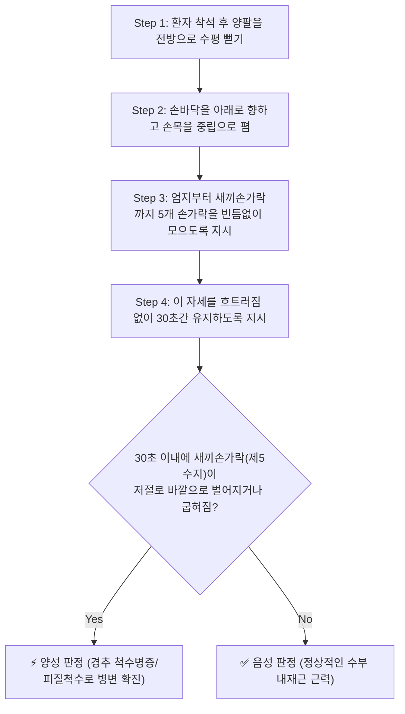
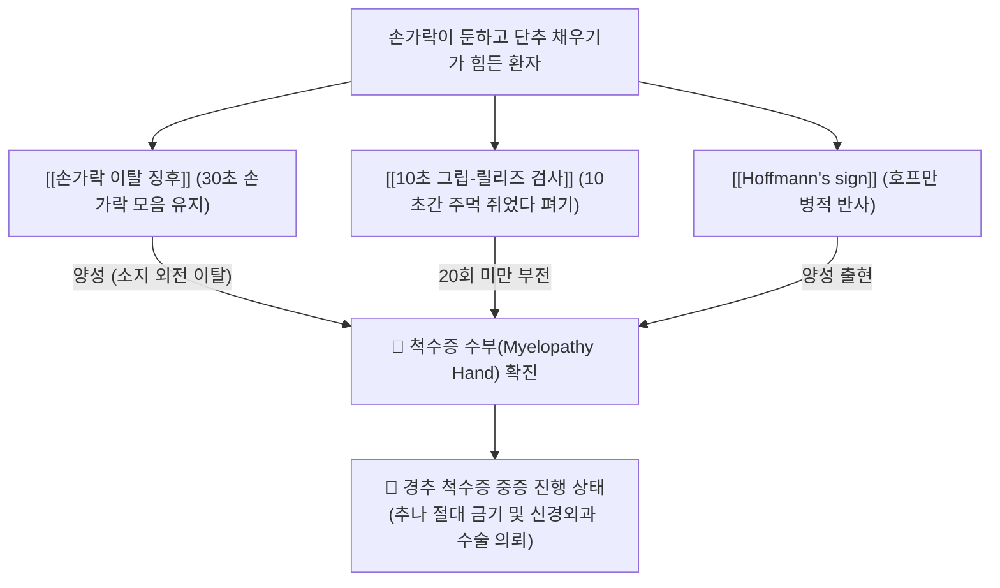

# 🩺 손가락 이탈 징후 (Finger Escape Sign)

> **핵심 3줄 요약 (Key Summary)**:
> - 🎯 **검사 목적 & 타겟 병소**: **[[경추 척수증]](Cervical Spondylotic Myelopathy, CSM)**으로 인한 피질척수로(Corticospinal tract) 손상 및 수부 내재근(골간근) 마비성 기능부전 평가.
> - 🔍 **검사 시행 프로토콜 & 양성 반응**: 환자에게 양 팔을 앞으로 뻗고 손바닥을 아래로 향한 채 다섯 손가락을 모아 30초간 곧게 펴고 있도록 지시했을 때, 소지(제5수지)가 스스로 조절되지 않고 외측으로 벌어지거나(Abduction) 굽혀지는(Flexion) 이탈 현상 발생.
> - 📊 **진단 정확도 & 임상적 의의**: 경추 척수증 환자에서 나타나는 척수증 손(Myelopathy hand)의 대표적 조기 선별 검사로, **추나요법 절대 금기 및 응급 척추 수술 상담을 결정하는 핵심 레드플래그**.

## 1. 검사 기본 정보 & 진단 목적 (Diagnostic Overview)

| 항목 | 상세 내용 |
| :--- | :--- |
| **검사명 (Test Name)** | Finger Escape Sign (손가락 이탈 징후 / 오노 징후 / Ono's Sign) |
| **분류 (Category)** | 신경학적 수부 운동 기능부전 검사 (Motor Deficit / Myelopathy Sign) |
| **타겟 병소 (Target)** | **경수 척수(Cervical cord C7-T1)**, 피질척수로, 수부 내재근([[골간근]]) |
| **의심 질환 (Suspected Pathologies)** | [[경추 척수증]](CSM), 후종인대골화증([[OPLL]]), 경추관 협착증 |
| **임상적 특징** | 단추 채우기, 젓가락질 등 세밀한 손가락 협응 동작의 장애를 객관적으로 시각화 |
| **판정 기준** | 30초간 손가락을 모은 자세를 유지하지 못하고 제5수지(소지)가 외측으로 벌어짐 |

## 2. 해부학적 유발 메커니즘 & 생체역학적 원리 (Biomechanical Mechanism)

### 1) 경수 척수증 환자에서의 '척수증 손(Myelopathy Hand)'
- 경추관 협착증이나 디스크 돌출로 경수가 만성적으로 눌리면, 경추 C7-T1 전각 세포와 피질척수로가 침범당하여 수부 내재근(손바닥과 손가락 사이의 작은 근육들)의 지배력이 가장 먼저 약화된다.
- 특히 손가락을 서로 모아주는 **수장측 골간근(Palmar interossei)**의 근력이 현저하게 떨어지게 된다.

### 2) 외전근과 내전근의 근력 불균형에 의한 소지 이탈
- 손가락을 모으는 힘(수장측 골간근)과 벌리는 힘(소지외전근, 배측 골간근) 사이의 균형이 깨진다.
- 환자가 손가락을 펴고 있을 때 척골신경과 피질척수로의 억제 결핍으로 인해, 상대적으로 강력한 **[[소지외전근]](Abductor digiti minimi)**과 신전건의 장력이 우세해지면서 새끼손가락이 저절로 바깥쪽으로 튕겨 나가듯 벌어지게 된다.
- 시간이 지나며 피로가 누적되면 제4수지(약지)까지도 함께 외측으로 벌어지고 손가락들이 갈고리 모양으로 굽혀지는 진행성 이탈이 발생한다.

## 3. 표준 검사 시행 절차 (Step-by-Step Clinical Protocol)

### Step 1: 환자 초기 자세 세팅
- 환자는 의자에 바르게 앉는다.
- 양팔을 어깨높이로 앞으로 나란히 들어 올려 팔꿈치를 곧게 편다.

### Step 2: 손가락 모음 자세 형성
- 양 손바닥이 바닥을 향하도록(전완 회내) 위치시킨다.
- 환자에게 **"손가락 사이에 종이 한 장도 안 들어갈 정도로 다섯 손가락을 꽉 붙이고 곧게 펴세요"**라고 지시한다.

### Step 3: 30초 유지 및 정밀 관찰 (Timing)
- 초시계를 누르고 환자가 그 자세를 30초 동안 유지할 수 있는지 관찰한다.
- 검사자는 환자의 양측 새끼손가락(제5수지)의 움직임을 집중 감시한다.

### Step 4: 이탈 단계 평가
- 10초, 20초, 30초 경과 시점에서 소지가 외측으로 벌어지는 각도와 굴곡 여부를 기록한다.

## 4. 양성 반응 판정 기준 & 신경근/조직별 감별 맵핑 (Diagnostic Criteria & Mapping)

### 양성 판정 기준
1. **제1단계 양성 (경증 이탈)**:
   - 30초 이내에 제5수지(새끼손가락)만 바깥쪽으로 슬그머니 벌어지며 약지와의 사이에 틈이 벌어지는 경우.
2. **제2단계 양성 (중등도 이탈)**:
   - 제5수지가 완전히 외측으로 벌어지면서 동시에 손가락 마디가 반쯤 굽혀지는 경우.
3. **제3단계 양성 (중증 이탈)**:
   - 제5수지뿐만 아니라 제4수지(약지)까지 함께 외측으로 벌어지며 손가락 전체의 굴곡 구축이 나타나는 경우.

### 경추 척수증 vs 척골신경 마비 감별
| 구분 | [[손가락 이탈 징후]] ([[경추 척수증]]) | 주관터널 증후군 ([[척골신경]] 마비) |
| :--- | :--- | :--- |
| **병변 위치** | **경추 척수 실질 (중추성 / UMN)** | **팔꿈치 주관터널 (말초성 / LMN)** |
| **반사 반응** | **[[Hoffmann's sign]] 양성, 슬개건반사 항진** | 상완삼두근·상완요골근 반사 정상, 병적반사 음성 |
| **양측성 여부** | **양측성 발현 흔함** (하지 보행 장애 동반) | 편측성 (다리 증상 전혀 없음) |
| **감각 저하** | 손 전체의 둔마감 및 장갑 모양 감각 저하 | 제4수지 내측 및 제5수지에 국한된 감각 저하 |

## 5. 연관 검사군 비교 & 다단계 감별 알고리즘 (Differential Battery & Algorithm)

## 6. 양성 소견 시 한의 임상 연계 치료 전략 (Integrative Korean Medicine)

### 임상적 주의사항 및 절대 금기 (Safety First)
- **경추 쓰러스트 추나요법 절대 금기**:
  - 손가락 이탈 징후가 양성이라는 것은 척수 압박이 이미 운동 신경원 마비를 일으킬 정도로 진행되었음을 의미하므로, 어떠한 강한 경추 교정도 척수 완전 마비를 초래할 수 있어 절대 금기이다.
- **수술적 감압술 적응증 평가**:
  - 척수증 수부 징후가 나타난 환자는 자연 치유가 어렵고 시간이 갈수록 마비가 고착화되므로 신경외과 수술 상담을 최우선으로 권고한다.

### 한의 보존적 재활 치료 (수술 전후 신경 가소성 회복)
- **수부 내재근 전침 자극 치료**:
  - [[팔사]](EX-UE9): 손가락 갈림길의 배측 골간근 부위에 자침하여 2~4Hz 저주파 전침을 인가함으로써 내재근 위축을 방지.
  - [[합곡]](LI4), [[후계]](SI3), [[중저]](TE3): 수부 말초 신경망 자극.
- **손가락 저항 운동 지도**:
  - 다섯 손가락에 고무줄을 끼우고 벌렸다 모으는 내재근 저항 재활 훈련 지도.

## 7. 💡 사용자 진료실 핵심 필기 & 실전 임상 팁 (원문 보존)

- **30초 만에 끝나는 가장 확실한 척수증 진단**:
  - 호프만 검사가 반사 검사라 애매할 때, 환자에게 "손을 앞으로 뻗고 손가락을 모은 채 30초만 가만히 있어보세요"라고 시켜보십시오.
  - 10초만 지나도 새끼손가락이 환자 의지와 상관없이 저절로 바깥으로 스르륵 벌어집니다. 환자 본인도 "어? 새끼손가락이 왜 지 혼자 벌어지죠?"라며 자기 병의 심각성을 즉시 인지하게 됩니다.
- **10초 그립-릴리즈 검사 병행**:
  - 손가락 이탈 징후와 함께 "주먹을 꽉 쥐었다가 완전히 쫙 펴는 동작"을 10초 동안 빠르게 시켜보아 20회를 못 넘기면 척수증이 100% 확실합니다.

## 8. 출처 및 학술 참고 문헌 (References)

- Ono K, et al. (1987). "Myelopathy hand: new clinical signs of cervical cord damage." *The Journal of Bone and Joint Surgery. British Volume*, 69(2), 215-219. [PMID: 3818728](https://pubmed.ncbi.nlm.nih.gov/3818728/)
  - 경추 척수 손상 환자에서 나타나는 수부 내재근 마비 및 손가락 이탈 징후(Finger escape sign)와 10초 그립-릴리즈 검사의 진단적 유효성을 세계 최초로 정립한 역사적 랜드마크 연구.
- Wang ZH, et al. (2014). "The diagnostic value of finger escape sign in cervical spondylotic myelopathy." *Spine*, 39(10), 812-817. [PMID: 24525995](https://pubmed.ncbi.nlm.nih.gov/24525995/)
  - 경추 척수증 환자 210명을 대상으로 손가락 이탈 징후의 민감도와 특이도를 전향적으로 분석하여 MRI상 척수 압박 정도 및 수술 후 예후와의 유의한 임상적 상관관계를 입증한 연구.
