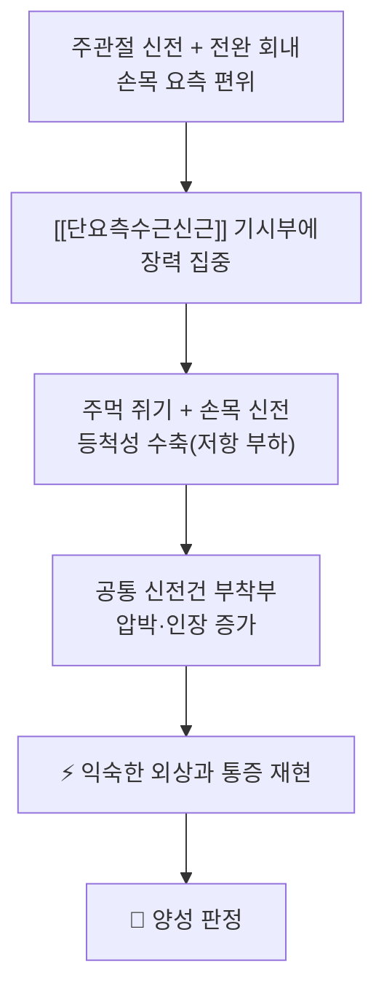
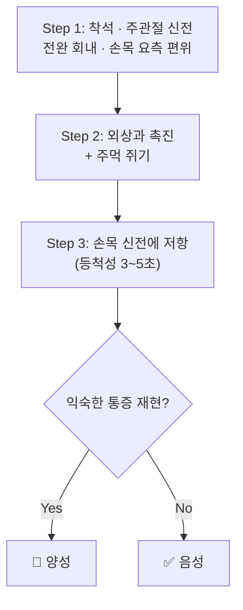

# 🩺 Cozen’s Test (코젠 검사 / 저항 손목신전 검사)

> 🖼️ **영상·이미지 규격(정본)**: `.agents\rules\이미지_가이드.md` §3.5 — 시연 영상이 1순위, 이미지는 자세 실사·스틸컷 2~3장으로 보조.

> **핵심 3줄 요약 (Key Summary)**:
> 🎯 검사 목적 & 타겟 병소: 외측 팔꿈치 건병증([[외측상과염]])을 유발해 [[단요측수근신근]] 기시부(공통 신전건)의 병변을 확인한다
> 🔍 시행 & 양성 반응: 주관절 신전·전완 회내·손목 요측 편위 상태에서 주먹을 쥐고 손목 신전에 저항을 걸어, 평소의 외상과 통증이 재현되면 양성이다
> 📊 진단 정확도 & 의의: 단독 확진 검사가 아니다 — 진단 정확도 체계적 문헌고찰에서 개별 유발 검사의 근거가 제한적이어서 병력·촉진·다른 검사를 조합해 판단한다
> ⚠️ 위양성/위음성 & 금기: 급성 외상·골절 의심, 감염성 관절염, 심한 부종에서는 시행을 미루고 [[요골관 증후군]]·경추 신경근병증과 감별한다

---

## 📌 목차
1. [검사 기본 정보 & 진단 목적](#1-검사-기본-정보--진단-목적)
2. [해부학적 유발 메커니즘 & 생체역학적 원리](#2-해부학적-유발-메커니즘--생체역학적-원리)
3. [표준 검사 시행 절차](#3-표준-검사-시행-절차)
4. [양성 반응 판정 기준 & 감별 맵핑](#4-양성-반응-판정-기준--감별-맵핑)
5. [연관 검사군 비교 & 다단계 감별](#5-연관-검사군-비교--다단계-감별)
6. [양성 소견 시 한·양방 임상 연계 전략](#6-양성-소견-시-한양방-임상-연계-전략)
7. [💡 진료실 핵심 필기 & 실전 임상 팁](#7--진료실-핵심-필기--실전-임상-팁)
8. [출처 및 학술 참고 문헌](#8-출처-및-학술-참고-문헌)

---

## 1. 검사 기본 정보 & 진단 목적

| 항목 | 상세 내용 |
| :--- | :--- |
| **검사명** | Cozen’s Test (코젠 검사 / 저항 손목신전 검사, Resisted wrist extension test) |
| **분류** | 정형외과적 유발 검사(저항성 등척성 수축) |
| **타겟 병소** | [[단요측수근신근]] 기시부 · 공통 신전건 · [[외상과]] |
| **의심 질환** | [[외측상과염]], [[전완 외측 통증 증후군]], [[요골관 증후군]] 감별 |
| **진단 정확도** | 단일 검사 확진 불가 — 외측 팔꿈치 건병증 검사법 진단 정확도 체계적 문헌고찰에서 개별 검사의 근거가 이질적이어서 병력·촉진·Mill’s Test 등과 조합해 해석한다 |
| **시연 영상 (Video Guide)** | [🎥 Physiotutors — Cozen’s Test / Lateral Epicondylalgia](https://www.youtube.com/watch?v=vPCkCcvD7P8) |

---

## 2. 해부학적 유발 메커니즘 & 생체역학적 원리

### 1) 해부학적 스트레스 전달 경로
- [[단요측수근신근]]은 [[외상과]]에서 기시해 손목 신전과 요측 편위를 담당한다. 전완을 회내하고 손목을 요측 편위한 상태에서 신전 저항을 걸면 건-골 접합부에 인장과 압박이 함께 걸린다.
- 주관절을 신전하면 기시부가 신장된 상태에서 수축해야 하므로 부하가 커진다(수동 긴장 + 능동 수축의 결합).
- 전완 회내 + 손목의 약간의 요측 편위가 요측수근신근군의 정렬을 병변부에 맞춘다 — 이것이 단순 악력 검사와 다른 점이다.

### 2) 통증 유발의 신경생리학적 기전
- 건병증 조직은 신경혈관 증식과 국소 통증수용기 감작이 동반되어, 정상 조직이 견디는 등척성 부하에도 통증이 발생한다.
- 통증이 외상과 국소에 한정되면 건병증을, 전완 후면 근복이나 방사통이면 [[요골관 증후군]]·신경 포착을 먼저 의심한다.

---

## 3. 표준 검사 시행 절차

### Step 1: 환자 준비 및 시작 자세
- 환자를 침상 옆 의자에 앉히고 환측 팔을 침상에 얹어 주관절을 펴고 전완을 회내시킨다.
- 손목은 중립에서 약간 요측 편위로 둔다(과도한 신전은 피한다).

![[Cozen_1_시작자세_전완고정.jpg|520]]
> [그림 1: 시작 자세 — 검사자가 환측 전완을 잡아 고정하고 외상과에 손을 댄 상태 — Physiotutors 「Cozen’s Test」 스틸컷]

### Step 2: 외상과 촉진 + 주먹 쥐기
- 한 손 엄지로 [[외상과]]와 공통 신전건 부착부를 눌러 기저 압통을 먼저 확인한다(양성 판정의 기준점).
- 환자에게 주먹을 쥐게 하고 손목을 신전·요측 편위 방향으로 유지시킨다.

![[Cozen_2_주먹쥐기_손목신전.jpg|520]]
> [그림 2: 주먹을 쥐고 손목을 신전·요측 편위한 상태 — 검사자 엄지는 외상과에 그대로 둔다 — Physiotutors 「Cozen’s Test」 스틸컷]

### Step 3: 손목 신전 저항 (핵심 동작)
- 반대 손을 환자 손등에 얹고 손목 신전 방향으로 저항을 건다. 환자는 3~5초 등척성으로 버틴다.
- 저항은 2~3초에 걸쳐 올린다 — 급격한 부하는 건-골 접합부를 자극해 판정이 흐려진다.

![[Cozen_3_저항_손목신전.jpg|520]]
> [그림 3: 손등 쪽에서 손목 신전에 저항을 걸면서 다른 손 엄지로 외상과 압통을 확인하는 장면 — Physiotutors 「Cozen’s Test」 스틸컷]

### Step 4: 반응 평가 및 종료
- 통증 재현 즉시 저항을 풀고 통증의 위치(외상과 국소 / 전완 후면 / 방사)를 기록한다.
- 좌우 비교 시 같은 자세·같은 강도로 반대측을 시행한다.

---

## 4. 양성 반응 판정 기준 & 감별 맵핑

- **진정한 양성**: 촉진으로 확인한 [[외상과]] 부위에 익숙한 통증이 저항 시 재현될 때. 근복(전완 후면)에만 국한되면 건병증보다 과사용·신경 포착 쪽으로 해석한다.
- **음성**: 저항 시 통증 없음.
- **가양성 감별**: 악력 저하·야간통·감각 이상이 동반되면 [[요골관 증후군]](후골간신경 포착) 또는 경추 C6·C7 신경근병증. 외상 직후라면 [[외상과]] 골절·인대 손상을 먼저 배제한다.

| 감별 대상 | 구분 단서 | 확인 방법 |
| :--- | :--- | :--- |
| [[외측상과염]] | 외상과 국소 압통, 악력 시 통증 | Cozen 양성 + Mill 양성 + 촉진 |
| [[요골관 증후군]] | 전완 후면 통증, 야간통, 중지 신전 약화 | 중지 신전 저항, 요골관 압박 |
| 경추 신경근병증 C6·C7 | 목·견부 통증 동반, 방사통 | [[스펄링 검사]], 상지 신경학적 검사 |
| 관절 내 병변 | 관절선 압통, 삼출, 잠김 | 가동범위·불안정성 검사 |

---

## 5. 연관 검사군 비교 & 다단계 감별

| 검사명 | 검사 수기 및 동작 | 병태생리적 원리 | 임상적 역할 |
| :--- | :--- | :--- | :--- |
| [[Cozen’s Test]] | 신전·회내·요측 편위 + 주먹 + 저항 신전 | 건-골 접합부 등척성 부하 | 유발(능동) |
| [[Mill’s Test]] | 수동 회내 + 손목 굴곡 + 주관절 신전 | 수동 신장으로 건 긴장 | 유발(수동) |
| Maudsley’s Test | 중지 신전 저항 | 공통 신전건 국소 부하 | 유발(선별) |
| Thomsen Test | 주먹 쥔 채 손목 신전 등척성 유지 | 지속 등척성 수축 | 유발(지속 부하) |
| Chair Test | 의자 들어올리기 | 기능적 부하 재현 | 기능 평가 |

- 순서: 촉진 → Cozen(등척성) → Mill(수동) → Maudsley·Thomsen. 한 검사 음성만으로 배제하지 않고 2개 이상 양성일 때 건병증 가능성을 높게 본다.

---

## 6. 양성 소견 시 한·양방 임상 연계 전략

- **침구**: [[외상과]] 주위 아시혈에 곡지(LI11)·수삼리(LI10)·척택(LU5)을 조합한다. 국소 건병증에는 [[건침]]·[[도침]]을, 전완 요측 경근을 따라가는 [[경근자법]]도 같은 축으로 검토한다.
- **약침**: 국소 압통점 소량 점자가 흔하다. 혈관·신경이 얕게 지나는 부위는 피하고 출혈·감염 관리에 유의한다.
- **수기·운동**: 급성 통증기에는 국소 자극으로 창을 열고, 통증이 4/10 이하로 내려오면 [[견갑 안정화 운동]]과 [[회전근개]] 강화로 상지 근위부를 재세팅한다(2026-10-28 리뷰 3번 RCT와 연결).
- **한약**: 급성 염증·종창기에는 [[오적산]]·[[갈근탕]] 계열, 만성 건병증에는 어혈·담음 축을 겨냥한 처방을 변증에 따라 검토한다.
- **양방 연계·의뢰**: 보존 치료 6~12개월에도 기능 제한이 지속되거나 감각·근력 저하가 새로 생기면 정형외과 평가로 넘긴다.

---

## 7. 💡 진료실 핵심 필기 & 실전 임상 팁

- **원문 필기**: 이 노트는 2026-09-25 생성 스텁이었고 원장님 수기 필기는 아직 없다 — 2026-10-28 회차에서 표준 8섹션으로 새로 채웠다.
- **촉진을 먼저, 저항은 나중에**: 저항 검사만 하면 "아프다/안 아프다"만 남는다. 외상과를 먼저 눌러 환자가 아는 그 통증을 확인해 두면 재현 여부 판정이 훨씬 정확해진다.
- **무통 악력이 반대측 대비 20% 이상 낮으면** 부하가 큰 상태다 — 국소 치료와 함께 그립·도구·작업 자세 관리를 같이 처방한다.
- **주먹 쥐기 단계에서 이미 아프면** 저항까지 밀지 말고 1단계 양성으로 기록한다. 통증 악화는 진단 이득이 없다.

---

## 8. 출처 및 학술 참고 문헌

1. **Karanasios S, et al. (2022)**. Diagnostic accuracy of examination tests for lateral elbow tendinopathy (LET) — A systematic review. *Journal of Hand Therapy*.
   - [PMID 33814224](https://pubmed.ncbi.nlm.nih.gov/33814224/)
   - **[연구 요약]**: 외측 팔꿈치 건병증 이학적 검사법의 진단 정확도를 정리한 체계적 문헌고찰. 개별 유발 검사의 근거가 이질적이어서 단일 검사 확진이 어렵고 조합 해석이 필요함을 시사한다.
2. **Stasinopoulos D, et al. (2023)**. Differences in Clinical Tests for Assessing Lateral Epicondylitis Elbow in Adults Concerning Their Physical Activity Level: Test Reliability. *International Journal of Environmental Research and Public Health*.
   - [PMID 36767167](https://pubmed.ncbi.nlm.nih.gov/36767167/)
   - **[연구 요약]**: 외측상과염 평가 검사의 신뢰도를 활동 수준별로 비교 — 검사자 간 일치도가 검사마다 달라 표준 자세 고정이 필요하다.
3. **외측 팔꿈치 건병증 견갑·회전근개 강화 RCT (2026)**. *Archives of Physical Medicine and Rehabilitation* 2026;107(10):2755-2765.
   - [PMID 42177007](https://pubmed.ncbi.nlm.nih.gov/42177007/)
   - **[연구 요약]**: Cozen·Maudsley·Mill·Thomsen 중 2개 이상 양성인 환자를 대상으로 국소 운동에 견갑·회전근개 강화를 추가한 군이 1년 추적에서 PRTEE·압통역치·무통 악력이 더 좋았다 — 진단 검사 조합이 임상시험 선별에도 쓰인 근거.
4. **Physiotutors (영상)**. Cozen’s Test — Lateral Epicondylalgia / Tennis Elbow.
   - [https://www.youtube.com/watch?v=vPCkCcvD7P8](https://www.youtube.com/watch?v=vPCkCcvD7P8)
   - **[연구 요약]**: 전완 회내·손목 요측 편위·주먹 쥐기·저항 신전의 단계를 실사로 보여준다(스틸컷 3장의 출처).
