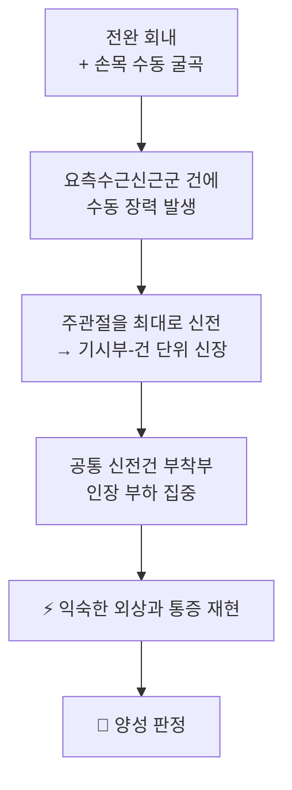
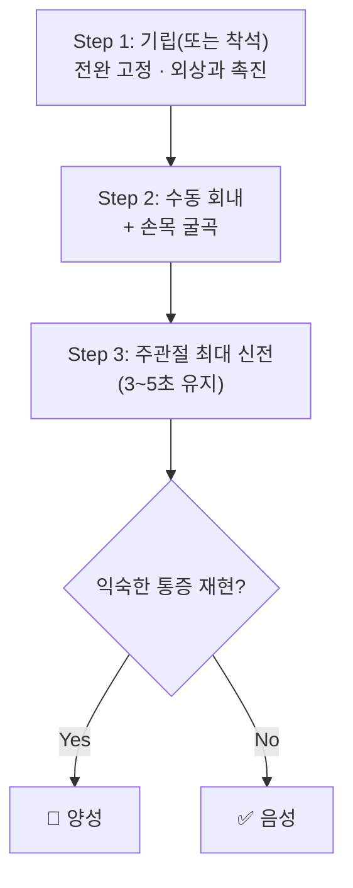

# 🩺 Mill’s Test (밀 검사 / 외측상과염 수동 신장 검사)

> 🖼️ **영상·이미지 규격(정본)**: `.agents\rules\이미지_가이드.md` §3.5 — 시연 영상이 1순위, 이미지는 자세 실사·스틸컷 2~3장으로 보조.

> **핵심 3줄 요약 (Key Summary)**:
> 🎯 검사 목적 & 타겟 병소: [[외측상과염]]을 수동 신장으로 유발해 [[단요측수근신근]]·요측수근신근군의 공통 신전건 병변을 확인한다
> 🔍 시행 & 양성 반응: 전완을 회내하고 손목을 굴곡시킨 채 주관절을 신전해 건에 수동 장력을 걸었을 때, 익숙한 외상과 통증이 재현되면 양성이다
> 📊 진단 정확도 & 의의: 저항성 검사(Cozen)와 달리 근수축 없이 조직을 늘리는 방식이라, 근육통이 아니라 건 자체를 겨냥한다 — 단독 확진은 불가하고 조합 해석한다
> ⚠️ 위양성/위음성 & 금기: 급성 염증·골절·관절 불안정성에서는 시행하지 않는다 — 강한 수동 신장은 건병증을 악화시킬 수 있다

---

## 📌 목차
1. [검사 기본 정보 & 진단 목적](#1-검사-기본-정보--진단-목적)
2. [해부학적 유발 메커니즘 & 생체역학적 원리](#2-해부학적-유발-메커니즘--생체역학적-원리)
3. [표준 검사 시행 절차](#3-표준-검사-시행-절차)
4. [양성 반응 판정 기준 & 감별 맵핑](#4-양성-반응-판정-기준--감별-맵핑)
5. [연관 검사군 비교 & 다단계 감별](#5-연관-검사군-비교--다단계-감별)
6. [양성 소견 시 한·양방 임상 연계 전략](#6-양성-소견-시-한양방-임상-연계-전략)
7. [💡 진료실 핵심 필기 & 실전 임상 팁](#7--진료실-핵심-필기--실전-임상-팁)
8. [출처 및 학술 참고 문헌](#8-출처-및-학술-참고-문헌)

---

## 1. 검사 기본 정보 & 진단 목적

| 항목 | 상세 내용 |
| :--- | :--- |
| **검사명** | Mill’s Test (밀 검사 / 외측상과염 수동 신장 검사) |
| **분류** | 정형외과적 유발 검사(수동 신장) |
| **타겟 병소** | [[단요측수근신근]]·요측수근신근군 기시부 · 공통 신전건 · [[외상과]] |
| **의심 질환** | [[외측상과염]], [[전완 외측 통증 증후군]] |
| **진단 정확도** | 수동 신장형 유발 검사로, Cozen’s Test와 상보적이다. 외측 팔꿈치 건병증 검사법의 진단 정확도 체계적 문헌고찰에서 개별 검사 근거가 이질적이어서 단독 확진은 불가하다 |
| **시연 영상 (Video Guide)** | [🎥 Physiotutors — Mill’s Test / Lateral Epicondylalgia](https://www.youtube.com/watch?v=r_HB-wUXcAQ) |

---

## 2. 해부학적 유발 메커니즘 & 생체역학적 원리

### 1) 해부학적 스트레스 전달 경로
- 손목 굴곡은 신전근군 건을 근위로 당기고, 주관절 신전은 기시부를 원위로 이동시킨다. 두 동작이 겹치면 [[단요측수근신근]] 건이 **양쪽에서 동시에** 신장되어 가장 짧은 길이에 놓인다.
- 전완 회내는 요측수근신근군을 표면으로 돌출시켜 촉진과 장력 집중을 돕는다.
- Cozen’s Test가 **능동 수축(등척성)** 으로 건-골 접합부를 압박하는 반면, Mill’s Test는 **수동 장력**으로 같은 부위를 겨냥한다 — 두 검사가 함께 양성이면 건 자체 병변 가능성이 높아진다.

### 2) 통증 유발의 신경생리학적 기전
- 건병증 조직의 신경혈관 증식과 국소 감작이 수동 신장에도 통증을 만든다. 근육 과사용만 있는 경우에는 근복의 당김·불편감으로 표현되어 통증 위치가 달라진다.

---

## 3. 표준 검사 시행 절차

### Step 1: 환자 준비 및 시작 자세
- 환자는 서거나 앉은 자세에서 팔을 편안히 내리고, 검사자는 한 손으로 전완을 잡아 고정하며 엄지로 [[외상과]]를 촉진한다.
- 어깨는 중립, 주관절은 굴곡된 상태에서 시작한다.

![[Mill_1_외상과_엄지촉진.jpg|520]]
> [그림 1: 시작 자세 — 검사자가 전완을 고정하고 엄지로 외상과(공통 신전건 부착부)를 촉진하는 장면 — Physiotutors 「Mill’s Test」 스틸컷]

### Step 2: 수동 회내 + 손목 굴곡
- 검사자는 환자의 손을 잡아 전완을 회내시키고 손목을 천천히 굴곡시킨다.
- 이 시점에서 이미 통증이 나오면 무리하게 주관절을 펴지 않는다.

![[Mill_2_손목굴곡_시작.jpg|520]]
> [그림 2: 전완을 회내하고 손목을 굴곡시키기 시작하는 장면 — 엄지는 외상과에 유지 — Physiotutors 「Mill’s Test」 스틸컷]

### Step 3: 주관절 최대 신전 (핵심 동작)
- 손목 굴곡을 유지한 채 주관절을 **최대한 신전**해 3~5초 유지한다.
- 급격한 스냅은 금지 — 천천히 끝 범위까지 간다.

![[Mill_3_손목굴곡_주관절신전.jpg|520]]
> [그림 3: 손목 굴곡을 유지한 채 주관절을 신전해 건에 수동 장력을 가하는 장면 — Physiotutors 「Mill’s Test」 스틸컷]

### Step 4: 반응 평가 및 종료
- 통증 발생 즉시 신장을 풀고, 통증 위치(외상과 / 전완 근복 / 방사)를 기록한다.
- 검사 후 24시간 통증 악화 여부를 다음 내원 시 확인한다.

---

## 4. 양성 반응 판정 기준 & 감별 맵핑

- **진정한 양성**: 수동 신장 끝 범위에서 촉진해 둔 [[외상과]] 부위에 익숙한 통증이 재현될 때.
- **음성**: 끝 범위까지 신장해도 통증 없음.
- **가양성 감별**: 관절낭 구축·[[유착성 관절낭염]]이 있으면 신장 제한으로 판정이 흐려진다. 감각 이상·야간통이 있으면 [[요골관 증후군]]을, 목 통증이 동반되면 경추 신경근병증을 감별한다.

| 감별 대상 | 구분 단서 | 확인 방법 |
| :--- | :--- | :--- |
| [[외측상과염]] | 외상과 국소 압통, 악력 시 통증 | [[Cozen’s Test]] + Mill + 촉진 |
| [[요골관 증후군]] | 전완 후면 통증, 중지 신전 약화 | 중지 신전 저항, 요골관 압박 |
| [[유착성 관절낭염]] | 전 방향 가동 제한, 야간통 | 수동 가동범위 검사 |
| 경추 신경근병증 | 목·견부 통증, 방사통 | [[스펄링 검사]], 신경학적 검사 |

---

## 5. 연관 검사군 비교 & 다단계 감별

| 검사명 | 검사 수기 및 동작 | 병태생리적 원리 | 임상적 역할 |
| :--- | :--- | :--- | :--- |
| [[Mill’s Test]] | 회내 + 손목 굴곡 + 주관절 신전 | 수동 신장 | 유발(수동) |
| [[Cozen’s Test]] | 회내 + 요측 편위 + 주먹 + 저항 신전 | 등척성 수축 부하 | 유발(능동) |
| Maudsley’s Test | 중지 신전 저항 | 국소 건 부하 | 유발(선별) |
| Thomsen Test | 주먹 쥔 채 손목 신전 유지 | 지속 등척성 | 유발(지속) |
| 악력 검사 | 최대 악력 측정 | 기능적 부하 내성 | 중증도 추적 |

- 순서: 촉진 → Cozen → Mill. 수동 신장은 통증을 오래 남길 수 있으므로 **능동 검사 뒤에** 시행한다.

---

## 6. 양성 소견 시 한·양방 임상 연계 전략

- **침구**: [[외상과]] 압통점과 곡지(LI11)·수삼리(LI10) 조합. 국소 건 자극에는 [[건침]]·[[도침]], 전완 요측 경근 자극에는 [[경근자법]]을 검토한다.
- **수기**: 강한 심부 횡마찰은 급성기에 통증을 악화시킬 수 있어, 초기에는 가벼운 [[근막이완술]]과 전완 신전근 이완을 우선한다.
- **운동**: 통증이 가라앉으면 [[견갑 안정화 운동]]·[[회전근개]] 강화로 근위부를 세팅하고, 이후 편심성 손목 신전 운동으로 진행한다(2026-10-28 리뷰 3번 RCT 축).
- **한약**: 변증에 따라 [[오적산]]·[[갈근탕]] 계열을 급성기 보조로 검토한다.
- **양방 연계·의뢰**: 6~12개월 보존 치료에도 악력 저하·기능 제한이 지속되면 정형외과 평가(주사·수술 적응)로 넘긴다.

---

## 7. 💡 진료실 핵심 필기 & 실전 임상 팁

- **원문 필기**: 2026-09-25 생성 스텁이었고 원장님 수기 필기는 없다 — 2026-10-28 회차에서 표준 8섹션으로 새로 채웠다.
- **Mill은 "확인용"으로 쓴다**: Cozen에서 통증이 애매할 때 Mill을 추가하면 건 자체 병변인지 판단이 선명해진다. 반대로 Mill만 단독으로 쓰면 관절낭 구축·신경 포착이 섞여 판정이 흐려진다.
- **수동 신장은 마지막에**: 통증을 오래 남기므로 진료 마지막에 시행하고, 직후 침·온열로 진정시키면 환자 경험이 좋아진다.
- **양측 비교 필수**: 반대측에서 같은 각도로 신장했을 때의 감각을 기준선으로 삼는다.

---

## 8. 출처 및 학술 참고 문헌

1. **Karanasios S, et al. (2022)**. Diagnostic accuracy of examination tests for lateral elbow tendinopathy (LET) — A systematic review. *Journal of Hand Therapy*.
   - [PMID 33814224](https://pubmed.ncbi.nlm.nih.gov/33814224/)
   - **[연구 요약]**: 외측 팔꿈치 건병증 검사법의 진단 정확도를 정리한 체계적 문헌고찰 — 단일 검사 확진의 한계와 조합 해석의 필요성을 보여준다.
2. **Stasinopoulos D, et al. (2023)**. Differences in Clinical Tests for Assessing Lateral Epicondylitis Elbow in Adults Concerning Their Physical Activity Level: Test Reliability. *International Journal of Environmental Research and Public Health*.
   - [PMID 36767167](https://pubmed.ncbi.nlm.nih.gov/36767167/)
   - **[연구 요약]**: 외측상과염 검사들의 신뢰도를 활동 수준별로 비교 — 표준 자세 고정과 검사자 교육이 일치도의 전제다.
3. **외측 팔꿈치 건병증 견갑·회전근개 강화 RCT (2026)**. *Archives of Physical Medicine and Rehabilitation* 2026;107(10):2755-2765.
   - [PMID 42177007](https://pubmed.ncbi.nlm.nih.gov/42177007/)
   - **[연구 요약]**: Mill’s Test를 포함한 4개 검사 중 2개 이상 양성인 환자를 대상으로 근위부 강화를 추가한 군이 1년 추적에서 더 좋은 결과를 보였다.
4. **Physiotutors (영상)**. Mill’s Test — Lateral Epicondylalgia / Tennis Elbow.
   - [https://www.youtube.com/watch?v=r_HB-wUXcAQ](https://www.youtube.com/watch?v=r_HB-wUXcAQ)
   - **[연구 요약]**: 전완 고정·외상과 촉진·수동 회내·손목 굴곡·주관절 신전의 순서를 실사로 보여준다(스틸컷 3장의 출처).
