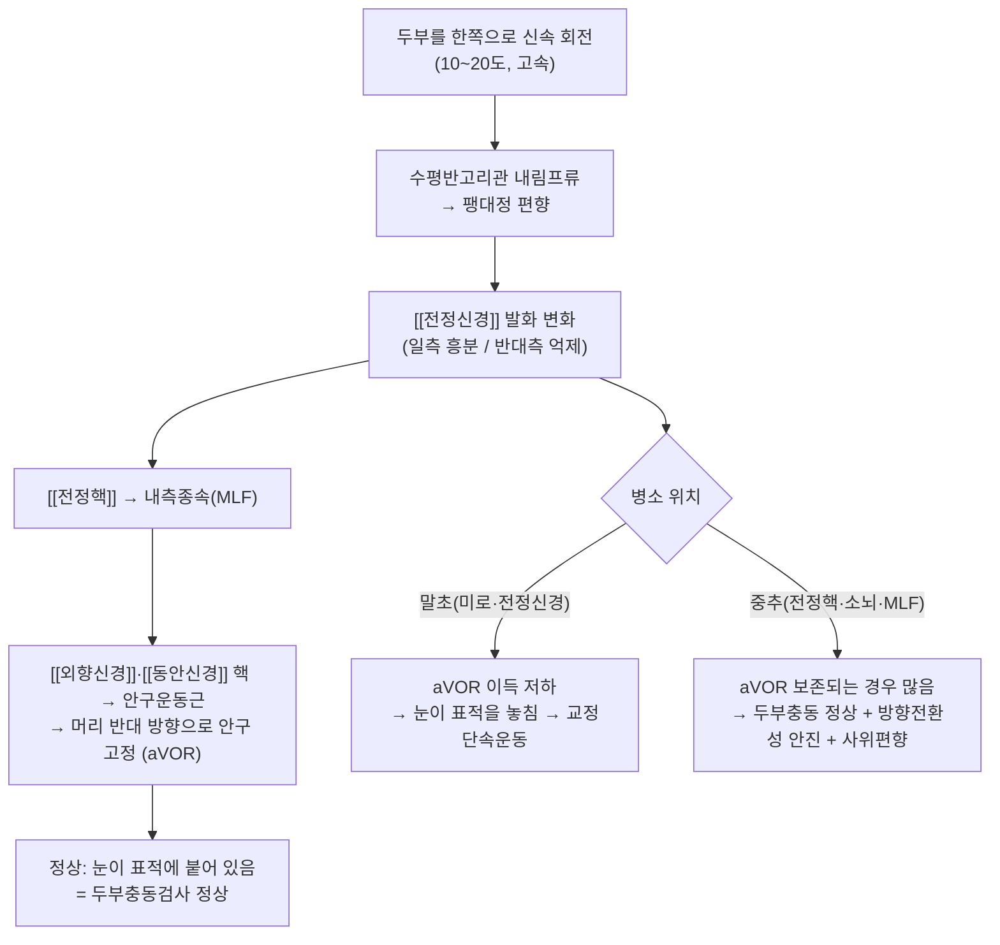
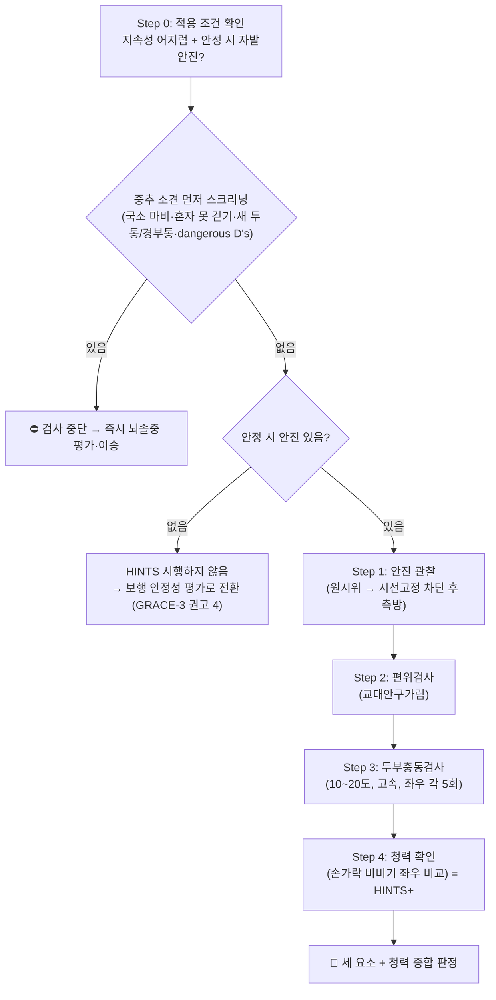

# 🩺 HINTS 검사 (Head Impulse–Nystagmus–Test of Skew / 頭部衝動·眼振·偏位檢査)

> **핵심 3줄 요약 (Key Summary)**:
> 🎯 [[급성 전정증후군]](AVS)에서 [[후순환계 뇌졸중]]과 [[전정신경염]](급성 일측성 전정병증)을 침상에서 가르는 3종 안구운동 검사 묶음이다. 타겟은 [[전정안구반사]] 회로 — [[반고리관]] → [[전정신경]] → [[전정핵]] → 내측종속(MLF) → [[외향신경]]·[[동안신경]] 핵 → 안구운동근.
> 🔍 적용 조건은 단 하나다. **수시간~수일 지속되는 어지럼 + 안정 시 자발안진**. 이 두 조건을 벗어난 환자(발작성·유발성 어지럼, 안진 없는 어지럼)에게 시행하면 결과가 무의미하고 오히려 뇌졸중을 놓친다.
> 📊 조건에 맞게 시행하면 민감도 92~95%·특이도 91~93%로 조기 MRI-DWI보다 우수하다. 그러나 구성 요소를 따로 보면 두부충동 68.8%·안진 56.8%·편위 15.0%로 전부 부족하다 — 세 개를 묶어야만 성립하는 검사다.
> ⚠️ 이 검사는 중추성 소견을 찾아내는 검사이지, "말초 패턴이니 안심"을 확인하는 검사가 아니다. 훈련 없이 흉내 내면(오적용 71~97%) 뇌졸중 오진의 직접 원인이 된다. 시행 전 반드시 중추 신경학적 소견부터 스크리닝한다.

---

## 📌 목차
1. [검사 기본 정보 & 진단 목적](#1-검사-기본-정보--진단-목적)
2. [해부학적 기전 & 생리학적 원리](#2-해부학적-기전--생리학적-원리)
3. [표준 시행 절차](#3-표준-시행-절차-step-by-step-clinical-protocol)
4. [양성 반응 판정 기준](#4-양성-반응-판정-기준-diagnostic-criteria)
5. [연관 검사군 비교 & 감별 알고리즘](#5-연관-검사군-비교--다단계-감별-알고리즘)
6. [한의 임상 연계 & 의뢰 기준](#6-한의-임상-연계--의뢰-기준)
7. [💡 진료실 핵심 필기 & 실전 팁](#7--진료실-핵심-필기--실전-임상-팁)
8. [출처 및 학술 참고 문헌](#8-출처-및-학술-참고-문헌-references)

---

## 1. 검사 기본 정보 & 진단 목적

![[HINTS 검사_0.png|520]]
> [그림 1: 수평 [[전정안구반사]] 회로 — 우측 두부 회전 시 우측 수평반고리관 흥분(적색) → [[전정신경]] → [[전정핵]] → 내측종속을 거쳐 좌측 [[외향신경]] 핵과 우측 [[동안신경]] 핵으로 전달되어, 우측 외직근과 좌측 내직근이 동시에 수축해 머리 반대 방향으로 안구가 고정된다. 편위검사는 이 회로의 상하 정렬(MLF) 이상을 본다 — 출처: Wikimedia Commons, File:Vestibulo-ocular reflex EN.svg (CC BY-SA 4.0)]

| 항목 | 상세 내용 |
| :--- | :--- |
| **검사명 (Test Name)** | HINTS examination (Head Impulse, Nystagmus, Test of Skew) / HINTS 검사. 청력 확인을 더한 변형이 HINTS+ |
| **분류 (Category)** | 신경학적 침상 검사 → 전정·안구운동 검사(중추성 감별 선별 검사) |
| **타겟 병소 (Target)** | [[전정안구반사]] 회로 — [[반고리관]], [[전정신경]], [[전정핵]], 내측종속(MLF), [[외향신경]]·[[동안신경]] 핵, 소뇌 소절(vor Flocculus) |
| **의심 질환 (Suspected Pathologies)** | [[후순환계 뇌졸중]](PICA·AICA 영역, 뇌간·소뇌 경색·출혈), [[전정신경염]], [[미로염]]. 감별: [[이석증 (BPPV)]], [[전정성 편두통]], [[메니에르병]], Wernicke 뇌병증, 다발성경화증 |
| **진단 정확도 (Diagnostic Accuracy)** | • **민감도**: 92.7~95.3% (훈련된 시행자, AVS+안진 조건) • **특이도**: 91.1~92.6% • **HINTS+**: 민감도 95.7~97.2% / 특이도 80.7~92.4%(특이도 저하는 대개 환자 선택 편향) • 시행자·적응증이 틀리면 민감도가 46.8%까지 떨어진다 |
| **시연 영상 (Video Guide)** | [🎥 Peter Johns(University of Ottawa) — The HINTS exam](https://youtu.be/1q-VTKPweuk) |

### 진단 목적 상세

급성 지속성 어지럼(AVS) 환자에서 원인의 대부분은 [[전정신경염]]과 후순환계 뇌졸중 두 가지이며, AVS의 약 25%가 중추성(대개 허혈성 뇌졸중)이다. 문제는 중추성 AVS의 최대 3분의 2에서 국소 신경학적 징후가 없거나 미미하다는 점이다. 그래서 "국소 징후가 없다"는 관찰만으로는 배제가 안 되고, 안구운동을 직접 들여다보는 검사가 필요하다.

HINTS는 이 공백을 메우기 위해 2009년 제안된 3단계 침상 검사다(Kattah 등, 2009; PMID 19762709). 목적은 두 가지로 압축된다.

1. 중추성 소견이 하나라도 있으면 즉시 신경영상·뇌졸중 평가로 전환한다.
2. 세 요소가 모두 말초 패턴이고 청력도 정상이면 전정신경염으로 보고, 다른 적응증이 없는 한 영상 없이 경과 관찰로 간다(GRACE-3 권고 2·6·7).

여기서 GRACE-3는 두 가지를 분명히 못박았다. 첫째, HINTS는 훈련받은 임상의가 안진이 있는 AVS 환자에게 시행할 때만 권고된다. 둘째, 비조영 뇌 CT는 중추성 어지럼 배제에 쓰지 않는다(높은 확실성 근거). 2023년 시점에 훈련 없이 일상적으로 시행되는 HINTS는 부정확하며 표준진료가 아니라는 것이 지침의 명시적 결론이다.

---

## 2. 해부학적 기전 & 생리학적 원리

### 1) 세 요소가 각각 무엇을 보는가

- 두부충동검사(HIT)는 말초 [[전정안구반사]]의 이득(gain)을 본다. 미로나 [[전정신경]]이 손상되면 고속 두부 회전에 대해 안구가 따라가지 못하고, 회전이 끝난 뒤 표적을 되찾기 위해 빠른 교정단속운동(catch-up saccade)이 나타난다. 즉 HIT 이상은 말초 병변의 표지다.
- 안진(N)은 중추의 속도저장(velocity storage)과 주시유지 기능을 본다. 말초 병변은 방향고정성·일방향성 수평-회선 혼합 안진을 만들고 주시로 감쇠된다. 반면 방향변환성 주시유발 안진이나 순수 수직·순수 회선 안진은 중추 병변을 시사한다.
- 편위검사(TS)는 수직 정렬을 담당하는 MLF·[[전정핵]] 경로의 이상을 본다. 수직 사위편향이 있으면 중추성이다.

### 2) 왜 "정상 두부충동"이 중추성 적신호인가

직관과 반대라서 가장 많이 혼동되는 지점이다. 말초 병변은 aVOR 반사를 끊으므로 HIT가 비정상으로 나온다. 중추 병변은 전정핵 이후 경로를 다치므로 반사 회로 자체는 살아 있어 HIT가 정상으로 나올 수 있다. 그래서 두부충동이 정상인데 어지럼이 지속되면, 그것이 바로 중추성을 의심할 신호다.

### 3) AICA 함정 — 구조적으로 피할 수 없는 사각지대

AICA(전하소뇌동맥)는 미로와 뇌간 일부를 함께 공급한다. 따라서 AICA 경색은 말초(미로·전정신경)와 중추(뇌간)를 동시에 다칠 수 있고, 그 결과 두부충동이 말초성처럼 비정상으로 나온다. Tarnutzer 등(2023, PMID 37038843)의 메타분석에서 AICA 영역 병변의 HINTS 민감도는 84.0%였고, 두부충동 단독으로는 36.0%까지 떨어졌다. 청력(손가락 비비기)을 네 번째 축으로 붙인 HINTS+에서 95.7%로 회복된다. 이 함정 때문에 HINTS를 3요소로만 끝내지 말고 청력 확인을 반드시 붙인다.

더 나아가 AICA 경색이 미로에만 국한되면 국소 신경징후도 없고 MRI-DWI에도 병변이 안 나온다(Tarnutzer 등, 2025; PMID 40722316). 즉 "MRI 정상 + 말초 패턴"이라는 조합도 완전한 면죄부가 아니다. 이 경우 추적 청력검사와 30일 내 AICA 영역 경색 발생 여부로 사후 추정한다.

---

## 3. 표준 시행 절차 (Step-by-Step Clinical Protocol)

### Step 0: 적용 조건과 사전 스크리닝

- 지속성(수시간~수일) 어지럼인지, 안정 시 자발안진이 실제로 보이는지 먼저 확인한다. 이 두 조건이 안 맞으면 검사를 시작하지 않는다. JAMA Neurology 2026 리뷰는 "가장 흔한 오류는 검사를 잘못하는 것이 아니라 엉뚱한 환자에게 하는 것"이라고 명시했다(Sars 등, PMID 42766300).
- 중추 소견을 먼저 본다 — 편측 위약·감각이상, 도움 없이 걷지 못함, 새로 생긴 심한 두통·경부통, 그리고 dangerous D's(복시·구음장애·운동실조·발성장애·연하곤란).
- 일반 신경학적 검진만으로는 중추 원인을 절반 남짓만 잡는다(민감도 46.8%·특이도 92.8%, 같은 리뷰가 인용한 메타분석). 즉 신경학적 검진 정상은 배제 근거가 아니다.

### Step 1: 안진 관찰 (Nystagmus)

![[HINTS 검사_1.jpg|520]]
> [그림 2: Step 1-① 원시위(primary gaze) 관찰 — 환자는 정면을 응시하고, 검사자는 안구의 안진 유무·방향·주시에 의한 감쇠 여부를 본다. 어지럼이 지속되는 동안 안정 상태에서 안진이 확인되어야 HINTS가 성립한다 — 출처: Peter Johns, The HINTS exam (https://youtu.be/1q-VTKPweuk) 70초]

![[HINTS 검사_2.jpg|520]]
> [그림 3: Step 1-② 시선고정 차단 후 측방 주시 — 카드(또는 손)로 한쪽 눈을 가려 고정 억제를 줄인 상태에서 좌·우 측방 주시를 시킨다. 말초성은 방향고정성 단일 방향 안진, 중추성은 주시 방향에 따라 방향이 바뀌는 방향변환성 안진을 보인다 — 출처: Peter Johns, The HINTS exam (https://youtu.be/1q-VTKPweuk) 98초]

- 환자는 앉거나 눕고, 검사자는 30 cm 정도 거리에서 환자 눈을 본다.
- 원시위에서 안진의 방향(수평·수직·회선), 방향 고정성, 주시로 억제되는지를 기록한다.
- 주시로 안진이 잘 억제되면 카드나 손으로 반대안을 가려 시선고정을 줄인 뒤 측방 주시를 다시 본다.
- 판정 포인트: 일방향성·방향고정성 수평-회선 혼합 안진은 말초성, 방향변환성 또는 순수 수직·순수 회선은 중추성이다.

### Step 2: 편위검사 (Test of Skew)

![[HINTS 검사_3.jpg|520]]
> [그림 4: Step 2-① 교대안구가림(alternate cover) — 검사자가 손바닥으로 한쪽 눈을 가린 뒤 재빨리 다른 쪽 눈으로 옮긴다. 가림을 풀었을 때 반대편 눈이 수직으로 재정렬(교정)되는 움직임이 있으면 수직 사위편향 양성이다 — 출처: Peter Johns, The HINTS exam (https://youtu.be/1q-VTKPweuk) 204초]

![[HINTS 검사_4.jpg|520]]
> [그림 5: Step 2-② 수직 사위편향 양성 소견 — 두 눈의 수평선이 어긋나 있고, 가림을 교대하면 어긋난 눈이 위아래로 교정 이동한다. 중추성(뇌간·MLF) 병변을 시사한다 — 출처: Peter Johns, The HINTS exam (https://youtu.be/1q-VTKPweuk) 214초]

- 환자는 정면의 검사자 코를 응시한다.
- 한쪽 눈을 1~2초 가렸다가 재빨리 반대쪽으로 옮기고, 가림을 푼 순간의 수직 재정렬 움직임을 본다.
- 좌·우를 모두 시행해 비교한다. 편위검사 단독 민감도는 15.0%에 불과하므로(Cochrane 2023) 이 검사 하나로 판단하지 않는다.

### Step 3: 두부충동검사 (Head Impulse)

![[HINTS 검사_5.jpg|520]]
> [그림 6: Step 3-① 시작 자세 — 검사자가 양손으로 환자의 두정부를 감싸 쥐고, 환자는 검사자의 코(또는 카메라)를 계속 응시한다. 목 근육은 이완시키고, 회전 범위를 미리 확인해 두어야 한다 — 출처: Peter Johns, The HINTS exam (https://youtu.be/1q-VTKPweuk) 294초]

![[HINTS 검사_6.jpg|520]]
> [그림 7: Step 3-② 신속 회전 — 머리를 좌우로 천천히 흔들어 이완시킨 뒤, 10~20도 범위에서 한쪽으로 빠르게(고속) 돌린다. 회전이 끝나는 순간 눈이 표적에 붙어 있는지 즉시 확인한다. 회전 속도가 느리면 위음성이 된다 — 출처: Peter Johns, The HINTS exam (https://youtu.be/1q-VTKPweuk) 297초]

![[HINTS 검사_7.jpg|520]]
> [그림 8: Step 3-③ 교정단속운동(catch-up saccade) 관찰 — 회전 후 눈이 표적을 놓쳤다가 빠르게 되돌아오는 움직임이 보이면 두부충동검사 이상(말초성 패턴)이다. 이 소견만으로 안심하지 말고 안진·편위·청력을 함께 본다 — 출처: Peter Johns, The HINTS exam (https://youtu.be/1q-VTKPweuk) 322초]

- 환자에게 "제 코를 계속 보세요"라고 지시하고, 시선을 고정시킨다.
- 머리를 좌우로 10~20도 범위에서 고속으로 회전시킨다. 좌우 각 5회 정도 반복해 재현성을 확인한다.
- 회전 직후 안구가 표적에 남아 있는지(정상), 교정단속운동이 나타나는지(이상)를 본다.
- 경추 불안정·급성 경추 골절·최근 경추 수술·추골기저동맥 부전이 의심되면 시행하지 않는다. 고령자에서는 회전 범위를 줄이고 검사자가 두부를 완전히 지지한다.

### Step 4: 청력 확인 (HINTS+)

- 손가락 비비기(finger rub), 속삭임, 음차 검사로 좌우를 비교한다. 새로 생긴 편측 난청은 중추성 소견으로 취급한다.
- J Neurol 2026 체계적 고찰(11편·770명)에서 급성 편측 난청은 50명(중추 29·말초 21)에서 확인됐고, 청력 축을 더하면 AICA 영역 민감도가 73.3%에서 91.1%로 올랐다. 다만 전체 특이도는 80.7%로 떨어졌다(Anburajan 등, PMID 41665728). 즉 HINTS+는 민감도를 사고 특이도를 지불하는 거래다.
- 청력 소견은 가능하면 순음청력검사로 확인한다.

### Step 5: 판정과 기록

- 중추 소견이 하나라도 있으면 → 신경영상(MRI-DWI/MRA) 및 뇌졸중 평가.
- 세 요소가 모두 말초 패턴이고 청력이 정상이면 → 전정신경염으로 보고, 다른 적응증이 없으면 영상 없이 경과 관찰(GRACE-3 권고).
- 안진이 없어 HINTS를 시행하지 않은 경우 → 보행 안정성(3등급 체간실조 여부)을 평가한다(GRACE-3 권고 4).

---

## 4. 양성 반응 판정 기준 (Diagnostic Criteria)

| 요소 | 말초성 패턴 (전정신경염 쪽) | 중추성 패턴 (뇌졸중 쪽) |
| :--- | :--- | :--- |
| 두부충동 (HIT) | 이상 — 교정단속운동 있음 | 정상 (AICA 경색은 예외로 이상 가능) |
| 안진 (N) | 일방향성·방향고정성, 주시로 감쇠 | 방향변환성, 순수 수직·순수 회선, 주시로 감쇠 안 됨 |
| 편위 (TS) | 없음 | 수직 사위편향 있음 |
| 청력 (+) | 정상 또는 동반 난청(미로염) | 새로 생긴 편측 난청(AICA) |
| 보행 | 불안정하나 혼자 가능 | 혼자 서거나 걷기 어려움(3등급 체간실조) |

- **중추성 판정**: 위 세 요소 중 하나라도 중추성 소견이면 중추성으로 본다. 세 개가 모두 말초 패턴일 때만 말초성으로 판정한다.
- **음성(말초 패턴)의 의미**: 전정신경염을 지지한다는 뜻이지 "뇌졸중이 아니다"라는 확정이 아니다. AICA 함정과 미로 국한 경색이 남는다.
- **가양성·가음성 요인**:
  - 안진이 없는 환자에게 시행 → 정상 두부충동이 중추성으로 오독되어 불필요한 영상 검사가 늘어난다. 실제로 안진 없는 환자에게 HINTS를 시행한 비율이 후향 연구에서 71~97%였다(PMID 42766300).
  - 두부 회전이 너무 느리거나 각도가 작으면 교정단속운동을 놓쳐 위음성이 된다.
  - 시행자 훈련도가 특이도에 직접 영향을 준다. 응급의학과 의사 단독 시행으로는 뇌졸중 배제에 불충분하다는 결론이 있다(Ohle 등, 2020; PMID 32167642).
  - 눈꺼풀 부종·안구운동 제한·치매·협조 저하 환자에서는 해석이 어렵다.

**구성 요소별 진단 정확도 (Cochrane 2023, PMID 37916744)**

| 검사 | 연구(명) | 민감도 % (95% CI) | 특이도 % (95% CI) |
| :--- | ---: | :--- | :--- |
| 임상 HINTS 3요소 | 12 (1,890) | 94.0 (82.0–98.2) | 86.9 (75.3–93.6) |
| 임상 HINTS Plus | 5 (451) | 95.3 (78.4–99.1) | 72.9 (44.4–90.1) |
| 두부충동 단독 | 9 (905) | 68.8 (42.0–87.1) | 92.5 (75.8–98.0) |
| 안진 단독 | 9 (1,128) | 56.8 (40.2–71.9) | 98.8 (96.0–99.7) |
| 편위검사 단독 | 10 (1,313) | 15.0 (6.6–30.5) | 98.7 (97.1–99.4) |

읽는 법: 개별 요소는 특이도는 높고 민감도는 낮다. 즉 하나만 양성이어도 중추성일 가능성은 크지만, 음성이라고 배제할 수는 없다. 세 요소를 묶으면 민감도가 94%로 올라간다. 이것이 HINTS를 "3개 묶음"으로만 쓰는 이유다.

**영역별·시행자별 차이**

| 조건 | 민감도 | 특이도 | 출처 |
| :--- | :--- | :--- | :--- |
| HINTS (전체) | 95.3% | 92.6% | Tarnutzer 2023, PMID 37038843 |
| HINTS+ (전체) | 97.2% | 92.4% | Tarnutzer 2023 |
| HINTS (최근 SR) | 92.7% (88.7–96.8) | 91.1% (86.3–95.8) | Anburajan 2026, PMID 41665728 |
| HINTS+ (최근 SR) | 95.7% (92.7–98.7) | 80.7% (70.6–90.7) | Anburajan 2026 |
| AICA 영역 · HINTS | 73.3% (59.0–84.0) | — | Anburajan 2026 |
| AICA 영역 · HINTS+ | 91.1% (79.3–96.5) | — | Anburajan 2026 |
| AICA 영역 · 두부충동 단독 | 36.0% | — | Tarnutzer 2023 |
| STANDING 알고리즘(훈련된 응급의) | 0.96 (0.87–1.00) | 0.88 (0.85–0.91) | Nakatsuka 2022, PMID 35511910 |

---

## 5. 연관 검사군 비교 & 다단계 감별 알고리즘

| 검사명 | 검사 수기 및 동작 | 병태생리적 원리 | 임상적 역할 |
| :--- | :--- | :--- | :--- |
| [[HINTS 검사]] (본 검사) | 안진 관찰 + 편위 + 두부충동 + 청력 | aVOR 및 중추 안구운동 경로 평가 | AVS의 중추성 감별 선별(3요소 묶음 필수) |
| [[딕스-홀파이크 검사]] | 앉은 자세에서 45도 회전 후 신속 와위 + 경추 신전 | 후반고리관 내 이석 이동 → 팽대정 편향 | 유발성 발작성 어지럼(t-EVS)의 확진 검사 |
| 앙와위 회전검사 (Supine Roll) | 앙와위에서 두부 좌우 90도 회전 | 수평반고리관 내 이석 이동 | 수평반고리관 BPPV 진단 |
| 보행·체간실조 평가 | 기립·보행 관찰, 3등급 체간실조 판정 | 전정척수로 및 소뇌 기능 | 안진이 없을 때의 대체 축(GRACE-3 권고 4) |
| 뇌 MRI-DWI / MRA | 확진 영상 | 경색·협착 평가 | HINTS 중추성 또는 애매할 때 확정(권고 7) |
| 뇌 CT | 비조영 CT | 출혈 제외 외에는 급성 허혈에 둔감 | 중추성 어지럼 배제 목적으로 쓰지 않음(권고 5) |

### 다단계 감별 알고리즘

1. 어지럼의 타이밍과 유발인자로 증후군을 먼저 분류한다 — 급성 지속성(AVS), 유발성 발작성(t-EVS), 자발성 발작성(s-EVS).
2. AVS가 아니면 HINTS를 시행하지 않는다. t-EVS면 [[딕스-홀파이크 검사]]로 간다.
3. AVS이면 중추 소견(국소 결손·보행 불가·새 두통/경부통·dangerous D's)을 먼저 스크리닝한다. 있으면 검사 없이 뇌졸중 평가.
4. 안진이 확인되면 HINTS+를 시행한다. 중추 소견이 하나라도 있으면 MRI-DWI/MRA 및 신경과 협진.
5. 세 요소 모두 말초 패턴 + 청력 정상이면 전정신경염으로 보고 경과 관찰. 단 혈관 위험인자가 많거나 증상이 비전형이면 의뢰 역치를 낮춘다.
6. 안진이 없으면 HINTS 대신 보행 안정성을 평가하고, 실신·기립성 저혈압·부정맥·대사 원인을 함께 본다.

---

## 6. 한의 임상 연계 & 의뢰 기준

### 1) 한의원에서의 위치 — 선별 후 시술

- HINTS는 한의원에서 "시술 전 배제" 도구로 쓴다. 이 검사에서 중추 소견이 나오면 침·약침·추나·한약을 시작할 문제가 아니라 이송 문제다.
- 반대로 말초 패턴이 확인된 [[전정신경염]]은 한의 치료의 좋은 적응이 된다. 다만 급성 3일 이내에는 단기 스테로이드를 환자와 공동의사결정으로 고려할 수 있으므로(GRACE-3 권고 14, 근거 확실성 매우 낮음) 양방 협진 여지를 남긴다.
- [[이석증 (BPPV)]]가 확인되면 표준 치료는 재위치술(Epley)이며, 한의 치료는 재발 관리와 동반 증상 완화를 목표로 병행한다.

### 2) 침구·전침

- 주요 혈위: 풍지(GB20), 백회(GV20), 내관(PC6 — 오심), 신문(HT7 — 불안), 태충(LR3), 족삼리(ST36), 풍륭(ST40).
- 전침: 풍지–백회 또는 내관–족삼리 배합에 2~4Hz, 15~20분. 급성기 어지럼·오심 완화를 목표로 한다(정량적 효과 크기는 근거 미확인).

### 3) 약침·추나

- 급성 어지럼기에는 와위 위주로 시술하고, 기립 시 급격한 체위 변화를 피한다.
- 경항부 약침은 풍지(GB20)·완골(SI4) 및 경항부 협척혈 부위에 0.5~1.0cc 소량. 두정부 심자극은 어지럼을 악화시킬 수 있어 피한다.
- 경추 HVLA 스러스트는 급성기·동맥박리 경고징후 동반 시 금기. 관절가동추나와 감압 견인은 안전 범위에서 적용한다.

### 4) 한약 — 변증별

| 변증 | 증상 양상 | 대표 처방 |
| :--- | :--- | :--- |
| 痰飮眩暈 | 회전성 어지럼, 오심·구토, 두중감, 설태 후니 | [[반하백출천마탕]], [[온담탕]], [[영계출감탕]] |
| 肝陽上亢 | 두통·이명, 안면 홍조, 분노 시 악화, 맥현 | [[천마구등음]], [[대정환]] |
| 氣血兩虛 | 만성 어지럼, 심계, 피로, 안색 창백 | [[귀비탕]], [[십전대보탕]], [[보중익기탕]] |
| 腎精不足 | 만성·재발성, 요슬산연, 이명 | [[육미지황환]], [[좌귀환]] |

- 급성기에는 담음·간양, 만성·재발기에는 기혈·신정 위주로 변증을 전환한다. 전정억제제(항히스타민·벤조디아제핀) 복용 환자는 진정·낙상 위험이 있어 시술 후 귀가 동반자·운전 여부를 확인한다.

### 5) 의뢰·응급 기준

| 상황 | 조치 |
| :--- | :--- |
| HINTS 중추 소견 1개 이상, 새 편측 난청, 혼자 걷지 못함, 의식 변화 | 즉시 119 이송 |
| 갑작스러운 최대 강도 어지럼 + 후두부·경부 통증 | 동맥박리 의심 — 즉시 이송, 경추 도수 금기 |
| 복시·구음장애·연하곤란·편측 위약 | 뇌간 병변 — 즉시 이송 |
| 지속성 어지럼 + 혈관 위험인자 다수, 검사 애매 | 24~48시간 내 신경과 의뢰(MRI-DWI/MRA) |
| 2회 이상 재위치술에도 지속되는 BPPV, 동측 메니에르병 동반 | 계획 의뢰(이비인후과) |

### 6) 환자 설명 멘트

- "눈을 움직여서 귀와 뇌의 연결 상태를 보는 검사입니다. 귀 쪽 문제면 눈이 머리를 따라가지 못하는 게 보이고, 뇌 쪽 문제면 눈은 정상인데 어지럼이 계속되는 식으로 나타납니다."
- "지금은 세 가지 검사가 모두 귀 쪽 패턴이라 전정신경염으로 보입니다. 다만 이 검사로 100% 다 걸러지는 건 아니라서, 말이 어눌해지거나 사물이 둘로 보이거나 한쪽 팔다리에 힘이 빠지면 치료 여부와 상관없이 바로 119를 부르셔야 합니다."

---

## 7. 💡 진료실 핵심 필기 & 실전 임상 팁

- **사용자 원문 필기 (100% 보존)**:
  - (제공된 원문 필기 없음 — 진료실 필기가 확보되면 이 위치에 원문 그대로 보존한다.)

- **진료실 실전 노하우 & 안전 가이드**:
  1. **적응증부터 통과시켜라**: 지속성 + 안진. 이 두 글자가 없으면 검사를 시작하지 않는다. 안진 없는 어지럼에 HINTS를 하면 정상 두부충동이 중추성으로 오독된다.
  2. **중추 소견이 먼저다**: HINTS보다 앞서 국소 결손·보행 불가·새 두통/경부통·dangerous D's를 본다. 이 순서를 바꾸면 검사가 오히려 오진을 만든다.
  3. **세 요소를 다 하라**: 두부충동만 보고 "말초"라고 결론내는 것이 가장 흔한 실무 오류다. 개별 민감도는 15~69%에 불과하다.
  4. **청력을 붙여라**: AICA 함정 때문에 3요소로 끝내지 않는다. 손가락 비비기 10초면 AICA 민감도가 73.3%에서 91.1%로 올라간다.
  5. **회전은 빠르게, 범위는 작게**: 10~20도 고속 회전. 느리면 교정단속운동이 안 보여 위음성이 된다.
  6. **훈련 없이 흉내 내지 말 것**: 이 검사는 시행자 숙련도에 결과가 좌우된다. 자신 없으면 HINTS 대신 보행 평가와 즉시 의뢰가 안전하다.
  7. **기록 항목 표준화**: (안진 방향·방향변화 여부) × (편위 유무·방향) × (두부충동 좌/우 정상·이상) × (청력 좌/우) × (보행 가능 여부)를 차트 템플릿으로 고정한다.
  8. **말초 패턴도 면죄부가 아니다**: AICA 경색은 미로에만 국한될 수 있고 MRI-DWI에도 안 나온다. 혈관 위험인자 다수·비전형 경과면 의뢰 역치를 낮춘다.

---

## 8. 출처 및 학술 참고 문헌 (References)

1. **Sars C, et al. (2026)**. *When to Use the HINTS Examination in Patients With Dizziness: A Review*. JAMA Neurol (online, 2026-09-21). [https://pubmed.ncbi.nlm.nih.gov/42766300/](https://pubmed.ncbi.nlm.nih.gov/42766300/) · doi:10.1001/jamaneurol.2026.2942
   - **[연구 요약]**: HINTS는 지속성 어지럼 + 안정 시 자발안진 환자에게만 시행해야 하며, 시행 전 중추 소견 스크리닝이 선행되어야 한다고 정리한 리뷰. 안진 없는 환자에게 시행된 비율이 후향 연구에서 71~97%였고, 일반 신경학적 검진의 민감도는 46.8%(특이도 92.8%)에 그친다는 메타분석을 인용했다. 본 노트의 적응증·사전 스크리닝 절(3장 Step 0)과 핵심 요약의 근거다.
2. **Edlow JA, Carpenter C, et al. (2023)**. *GRACE-3: Guidelines for Reasonable and Appropriate Care in the Emergency Department — Acute dizziness and vertigo*. Acad Emerg Med 30(5):442–486. [https://pubmed.ncbi.nlm.nih.gov/37166022/](https://pubmed.ncbi.nlm.nih.gov/37166022/)
   - **[연구 요약]**: 15개 권고. 안진이 있는 AVS에서 훈련된 임상의가 HINTS를 쓰도록 강한 권고(높은 확실성), 손가락 비비기 병용, 안진이 없으면 보행 안정성 평가, 비조영 CT 사용 금지, HINTS 가능 시 MRI 1차 검사 금지, 중추성·애매하면 MRI 확정. 훈련 없이 일상적으로 시행되는 HINTS는 부정확하며 표준진료가 아니라고 명시했다.
3. **Gottlieb M, et al. (2023)**. *Head impulse, nystagmus, and test of skew examination for diagnosing central causes of acute vestibular syndrome*. Cochrane Database Syst Rev 11:CD015089. [https://pubmed.ncbi.nlm.nih.gov/37916744/](https://pubmed.ncbi.nlm.nih.gov/37916744/)
   - **[연구 요약]**: 임상 HINTS 민감도 94.0%·특이도 86.9%, HINTS Plus 95.3%·72.9%. 구성 요소별로 두부충동 68.8%/92.5%, 안진 56.8%/98.8%, 편위검사 15.0%/98.7%로 개별 민감도가 낮음을 정량화했다. 근거 확실성은 낮음~매우 낮음.
4. **Tarnutzer AA, et al. (2023)**. *Impact of Clinician Training Background and Stroke Location on Bedside Diagnostic Test Accuracy in the Acute Vestibular Syndrome — A Meta-Analysis*. Ann Neurol 94(2):295–308. [https://pubmed.ncbi.nlm.nih.gov/37038843/](https://pubmed.ncbi.nlm.nih.gov/37038843/)
   - **[연구 요약]**: HINTS 95.3%·92.6%, HINTS+ 97.2%·92.4%. AICA 영역 병변에서 HINTS 민감도 84.0%, 두부충동 단독 36.0%로 떨어지며 HINTS+에서 95.7%로 회복됨을 보고. 조기 MRI-DWI 위음성률 15%.
5. **Anburajan G, Kattah J, Wang Z, Mantokoudis G, Newman-Toker DE, Tarnutzer AA (2026)**. *HINTS+ to diagnose AICA stroke: systematic review of the diagnostic impact of acute unilateral hearing loss in the acute vestibular syndrome*. J Neurol (2026-02-10). [https://pubmed.ncbi.nlm.nih.gov/41665728/](https://pubmed.ncbi.nlm.nih.gov/41665728/) · doi:10.1007/s00415-026-13641-3
   - **[연구 요약]**: 11편·770명. HINTS 92.7%/91.1%, HINTS+ 95.7%/80.7%. AICA 영역 민감도가 73.3%→91.1%로 상승(+17.8%p). 급성 편측 난청은 50명(중추 29·말초 21)에서 확인, 두부충동 이상이 동반된 AICA 경색에서 효과가 집중됐다.
6. **Tarnutzer AA, Lee SU, Kim JS, Kaski D (2025)**. *The Challenge of Diagnosing Labyrinthine Stroke — A Critical Review*. Brain Sci 15(7):725. [https://pubmed.ncbi.nlm.nih.gov/40722316/](https://pubmed.ncbi.nlm.nih.gov/40722316/)
   - **[연구 요약]**: AVS의 약 25%가 중추성이며, 중추성 AVS의 최대 2/3에서 국소 신경징후가 없다. AICA 경색은 미로에만 국한되면 MRI-DWI에도 병변이 나타나지 않아 말초성 난청·전정병증과 감별이 안 될 수 있다. HINTS 84.0%·HINTS+ 95.7% 수치의 원출처를 정리했다.
7. **Kattah JC, et al. (2009)**. *HINTS to diagnose stroke in the acute vestibular syndrome: three-step bedside oculomotor examination more sensitive than early MRI diffusion-weighted imaging*. Stroke 40(11):3504–3510. [https://pubmed.ncbi.nlm.nih.gov/19762709/](https://pubmed.ncbi.nlm.nih.gov/19762709/)
   - **[연구 요약]**: HINTS 3단계 검사의 원전 검증 연구. 조기 MRI-DWI보다 중추성 뇌졸중 검출에 우수함을 보였다.
8. **Ohle R, et al. (2020)**. *Can Emergency Physicians Accurately Rule Out a Central Cause of Vertigo Using the HINTS Examination? A Systematic Review and Meta-analysis*. Acad Emerg Med 27(9):887–896. [https://pubmed.ncbi.nlm.nih.gov/32167642/](https://pubmed.ncbi.nlm.nih.gov/32167642/)
   - **[연구 요약]**: 응급의학과 의사가 단독으로 시행한 HINTS는 뇌졸중 배제에 불충분하다고 결론. 시행자 훈련 배경이 정확도에 영향을 준다.
9. **Nakatsuka M, Molloy EE (2022)**. *The HINTS examination and STANDING algorithm in acute vestibular syndrome: a systematic review and meta-analysis involving frontline point-of-care emergency physicians*. PLoS One 17(5):e0266252. [https://pubmed.ncbi.nlm.nih.gov/35511910/](https://pubmed.ncbi.nlm.nih.gov/35511910/)
   - **[연구 요약]**: 훈련받은 일선 응급의가 STANDING 알고리즘을 사용할 때 민감도 0.96(0.87–1.00)·특이도 0.88(0.85–0.91). HINTS 단독에 대한 정량 자료는 확보되지 않았다.
10. **Johns P (2016)**. *The HINTS exam* [시연 영상, 8분 3초, University of Ottawa 응급의학]. [https://youtu.be/1q-VTKPweuk](https://youtu.be/1q-VTKPweuk)
   - **[연구 요약]**: 안진(원시위·측방) → 편위검사(교대안구가림) → 두부충동검사 순으로 실제 시연하며, 각 요소의 안심 소견과 위험 소견을 눈 확대 화면으로 함께 보여준다. 본 노트 그림 2~8의 스틸컷 출처. 영상은 표준 YouTube 라이선스이며 볼트 로컬 학습용으로 사용한다.
11. **Wikimedia Commons (2024)**. *File:Vestibulo-ocular reflex EN.svg* [도해, CC BY-SA 4.0]. [https://commons.wikimedia.org/wiki/File:Vestibulo-ocular_reflex_EN.svg](https://commons.wikimedia.org/wiki/File:Vestibulo-ocular_reflex_EN.svg)
   - **[연구 요약]**: 수평반고리관에서 전정핵·MLF를 거쳐 외향신경·동안신경 핵으로 이어지는 aVOR 회로와, 흥분·억제 색 구분을 보여주는 도해. 본 노트 그림 1의 출처.

> **표기 원칙 안내**: 본 노트의 진단 정확도 수치는 원 논문의 초록·본문에서 확인한 값만 실었다. 한의 치료(침·약침·추나·한약)의 효과 크기는 해당 중재를 직접 검증한 문헌을 확인하지 못해 근거 미확인으로 표기했다.

<!-- 보관 태그(1회용·링크오류, 필요시 복원): HINTS, 두부충동검사, 사위편향 -->
