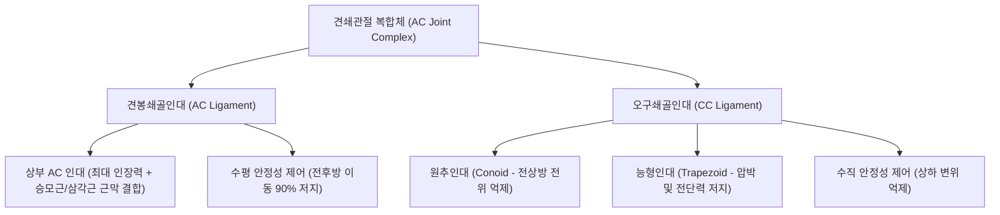

# 🦴 [[구조물/인대/견봉쇄골인대|견봉쇄골인대]] (Acromioclavicular Ligament, AC Ligament)

> **핵심 요약 (Key Summary)**:
> - 📍 **해부 & 주행**: [[견봉]] 내측연과 [[쇄골]] 외측단(원위단)을 연결하는 사각 형태의 섬유성 관절낭 보강 인대로, 상·하·전·후 4개 부위로 나뉘며 **상부 견봉쇄골인대(Superior AC ligament)**가 가장 두껍고 강인하며 [[승모근]] 및 [[삼각근]] 건막 섬유와 단단히 융합되어 있다.
> - ⚙️ **생체역학적 핵심 기능**: 견쇄관절의 **수평면 안정성(Horizontal stability - 전후방 전위 및 회전 억제)**을 담당하는 1차 억제기(Primary restraint)이다. 수직면 안정성(상하 전위 억제)을 주로 담당하는 [[오구쇄골인대]](Coracoclavicular ligament: Conoid + Trapezoid)와 상호 보완적으로 작용한다.
> - 🛠️ **임상 평가 & 치료**: 낙상이나 어깨 외측 충돌 시 호발(Rockwood Type I~VI 분류). [[수평 내전 검사]](Cross-body adduction test), Paxinos 검사, 피아노 건반 징후(Piano key sign)로 평가한다. 저등급(Type I~II)은 견우(LI15)·거골(LI16) 자침, [[약침]], 흉쇄·견쇄관절 관절가동 추나 요법으로 보존적 완치가 가능하며, 고등급(Type IV~VI)은 외과적 정복이 요구된다.

---

## 📌 목차
1. [해부학적 정밀 구조 및 주행/부착](#1-해부학적-정밀-구조-및-주행부착)
2. [생체역학·기능 (Biomechanics)](#2-생체역학기능-biomechanics)
3. [임상 평가 및 이학적 검사](#3-임상-평가-및-이학적-검사)
4. [초음파 해부학(Sonoanatomy) 및 중재 랜드마크](#4-초음파-해부학sonoanatomy-및-중재-랜드마크)
5. [⭐ 원장님 심층 임상 고찰 및 원본 필기 (Clinical Pearls)](#5--원장님-심층-임상-고찰-및-원본-필기-clinical-pearls)
6. [관련 임상 질환 및 손상](#6-관련-임상-질환-및-손상)
7. [추나·도수치료 & 침구·약침·재활 프로토콜](#7-추나도수치료--침구약침재활-프로토콜)
8. [출처 및 학술 참고 문헌 (References)](#8-출처-및-학술-참고-문헌-references)

---

## 1. 해부학적 정밀 구조 및 주행/부착

| 해부학적 항목 | 정밀 기술 내용 |
| :--- | :--- |
| **기시 (Origin)** | [[견봉]](Acromion) 전내측 연(Anteromedial border)의 관절면 변연부 |
| **정지 (Insertion)** | [[쇄골]](Clavicle) 외측단(원위단)의 관절면 변연부 |
| **인대 다발 구성** | 상·하·전·후 4개 다발. 특히 **상부 견봉쇄골인대(Superior bundle)**가 가장 두껍고 장력이 강력함 |
| **근막 연계 융합** | 상부 인대는 [[승모근]] 전방 섬유 및 [[삼각근]] 쇄골두 섬유의 부착 건막과 융합(Deltoid-Trapezius fascia overlap) |
| **신경 지배** | [[상견갑신경]](Suprascapular nerve, C5-C6) 관절지 및 외측 흉신경(Lateral pectoral nerve) 분지 |
| **혈관 공급** | 견봉흉동맥(Thoracoacromial artery)의 견봉지 및 견갑상동맥(Suprascapular artery)의 문합망 |

- **관절낭 섬유성 보강**: 견봉쇄골인대는 견쇄관절 활액낭을 사방에서 둘러싸는 관절낭 인대(Capsular ligament)로, 관절 내에는 섬유연골성 관절원판(Intra-articular meniscus/disc)이 존재하여 충격을 완충한다.
- **삼각근-승모근 건막 중첩(Deltoid-Trapezius Overlap)**: 상부 인대 표면을 덮는 삼각근과 승모근의 건막 복합체는 인대 단열 시 수평 안정성을 지지하는 핵심 동적 안정화 구조물이다.

---

## 2. 생체역학·기능 (Biomechanics)

* **1차 수평 구속물 (Primary Horizontal Restraint)**:
  * 견봉에 대해 쇄골이 전방 또는 후방으로 미끄러지는 전후방 수평 변위력의 약 **90%를 견봉쇄골인대가 단독으로 저지**한다.
  * 상부 인대는 쇄골의 후방 전위를, 하부 및 전방 인대는 전방 전위를 제어한다.
* **수직 안정성과의 역할 분담**:
  * 쇄골의 상방 전위(Superior displacement)를 억제하는 주력은 [[오구쇄골인대]](CC Ligament)이며, 견봉쇄골인대는 초기 미세 수직 변위(약 2mm 이내)에만 저항한다.
  * 따라서 견봉쇄골인대만 단독 파열된 경우(Rockwood Type II) 쇄골의 상방 돌출은 경미하거나 반탈구(Subluxation) 수준에 그치지만, 오구쇄골인대까지 동반 파열(Rockwood Type III 이상)되면 쇄골이 현저히 상방으로 치솟게 된다.
* **견갑흉곽 관절과의 운동학적 연동**:
  * 팔을 거상(Elevation)할 때 쇄골은 장축을 중심으로 후방 회전(약 30~40도)하며, 견봉쇄골인대는 이 회전 운동 중 관절면의 적합성을 유지시키는 축 역할을 수행한다.

---

## 3. 임상 평가 및 이학적 검사

* **1. 수평 내전 검사 ([[수평 내전 검사|Cross-Body Adduction Test]])**:
  * 환자의 팔을 90도 굴곡시킨 상태에서 반대측 어깨 방향으로 수평 내전시킴.
  * 견봉과 쇄골 관절면이 서로 압박되면서 AC 관절 상부에 날카로운 국소 통증이 재현되면 양성.
* **2. 팍시노스 검사 (Paxinos Test)**:
  * 검사자의 엄지손가락을 견봉 후외측에 두고, 검지와 중지를 쇄골 외측 1/3 상면에 올린 후 서로 맞물리듯 압박.
  * 견쇄관절의 국소 압통 및 전후방 미세 동요가 유발되면 양성 (민감도 79%, 특이도 80%).
* **3. 피아노 건반 징후 (Piano Key Sign)**:
  * 상방으로 돌출된 외측 쇄골단을 아래로 누르면 정복되었다가 손을 떼면 피아노 건반처럼 다시 튀어오르는 현상.
  * 견봉쇄골인대와 오구쇄골인대의 완전 파열(Rockwood Type III 이상)을 시사하는 결정적 징후.
* **4. 오브라이언 검사 ([[오브라이언 검사|O'Brien Active Compression Test]])**:
  * 상지 90도 굴곡, 10도 내전, 엄지 아래(내회전) 상태에서 하방 저항 시 통증이 발생하고, 손바닥 위(외회전) 상태에서 경감될 때, 통증 위치가 "어깨 꼭대기(AC 관절)"이면 AC 인대 병변, "어깨 깊은 곳"이면 관절와순(SLAP) 병변으로 감별.

---

## 4. 초음파 해부학(Sonoanatomy) 및 중재 랜드마크

* **초음파 스캔 랜드마크**:
  * 탐촉자를 어깨 상부 관절선에 관상면(Coronal plane) 또는 약간 사선으로 위치시켜 [[견봉]]과 [[쇄골]] 외측단의 고에코 피질골 랜드마크를 동시 확인.
  * 정상 견쇄관절낭 및 상부 견봉쇄골인대는 두 피질골 사이를 팽팽하게 잇는 약 1.5~2.5mm 두께의 고에코 섬유성 띠로 관찰됨.
* **병리적 초음파 소견**:
  * **1도 염좌 (Type I)**: 인대 비후 및 저에코성 부종, 관절강 내 미량 삼출액. 관절 간격은 정상(2~4mm).
  * **2도 손상 (Type II)**: 인대 섬유의 불연속성(Tear), 견봉-쇄골 간격 개대(>5mm), 동적 수평 내전 시 관절면 스텝오프(Step-off) 및 불안정성.
  * **3도 이상 (Type III~V)**: 인대 완전 소실 및 쇄골단의 현저한 상방 탈구(>100%).
* **중재 시술 자침 랜드마크**:
  * 견봉과 쇄골 사이의 관절강 틈새를 촉지 또는 초음파 유도 하에 확인하고, 직상방에서 수직 또는 15도 내측 경사로 진입. 피하가 얇으므로 과도한 심부 진입(견봉하강 침범)을 피하고 관절낭 내 10~15mm 깊이로 정밀 주입.

---

## 5. ⭐ 원장님 심층 임상 고찰 및 원본 필기 (Clinical Pearls)

> [!IMPORTANT]
> **진료실 감별 포인트**:
> 1. **"어깨 꼭대기가 찌릿하며 무거운 것을 들거나 안전벨트를 맬 때 아프다"**: 환자가 통증 부위를 손가락 하나로 AC 관절 꼭대기를 정확히 가리키면(Point sign), 충돌증후군이나 회전근개 파열보다 견봉쇄골인대 염좌나 견쇄관절염일 확률이 90% 이상이다.
> 2. **동통호(Painful Arc)의 각도 차이**: 회전근개 건염/충돌증후군은 외전 60~120도에서 통증이 심하고 120도 이상에서는 오히려 줄어들지만, 견쇄관절 병변은 **외전 140~180도 말기 거상 범위**에서 쇄골 회전 압박으로 통증이 극대화된다.
> 3. **골절 감별 필수**: 낙상 직후 쇄골 외측단 압통과 부종이 심할 때는 Neer Type II 원위 쇄골 골절이나 견봉 골절(Os acromiale 포함)을 단순 염좌로 오인하지 않도록 Zanca view X-ray를 통한 배제가 선행되어야 한다.

---

## 6. 관련 임상 질환 및 손상

* **견쇄관절 탈구/염좌 ([[견쇄관절 손상|Rockwood 분류]])**:
  * Type I: AC 인대 염좌, CC 인대 정상. 보존 치료.
  * Type II: AC 인대 완전 파열, CC 인대 염좌, 쇄골 경미 아탈구. 보존 치료.
  * Type III: AC 및 CC 인대 완전 파열, 쇄골 25~100% 상방 전위. 보존/수술 선별.
  * Type IV~VI: 후방, 극심한 상방(>100%), 또는 오구돌기 하방 탈구. 외과적 정복 필수.
* **외상 후 견쇄관절염 (Post-traumatic AC Osteoarthritis)**:
  * 반복적 미세 손상 또는 Type I~II 염좌 후 관절 연골 마모와 골극(Osteophyte) 형성으로 만성 통증 유발.
* **원위 쇄골 골용해증 (Distal Clavicular Osteolysis, Weightlifter's Shoulder)**:
  * 벤치프레스 등 고중량 반복 리프팅으로 쇄골 외측단 연골하 골 흡수 및 미세 골절 발생.

---

## 7. 추나·도수치료 & 침구·약침·재활 프로토콜

### 1) 한의 보존적 재활 및 추나요법
* **급성기 고정 및 감압**:
  * Type I~II 손상 시 Kenny-Howard 슬링 또는 8자 붕대로 1~2주간 쇄골 상방 부하를 차단.
* **흉쇄관절 및 견쇄관절 가동 추나요법**:
  * 쇄골의 후방 회전 및 하방 활주(Inferior glide)를 촉진하는 부드러운 수기 정복.
  * 견갑골 이상운동증(Scapular dyskinesis) 교정: 전거근 및 하부 승모근 강화, 소흉근 이완.

### 2) 침구 및 약침 치료 프로토콜
* **주요 혈위**:
  * 견우(LI15), 거골(LI16): AC 관절 전후방의 핵심 순경 혈위.
  * 견료(TE14), 노수(SI10), 천료(TE15): 견갑대 안정화 배혈.
* **약침 프로토콜**:
  * 손상된 상부 견봉쇄골인대 및 관절낭 부착부에 [[신바로약침|신바로 약침]] 또는 봉약침 0.3~0.5cc를 분할 주입하여 급성 무균성 염증 제거 및 섬유아세포 증식 촉진.

---

## 8. 출처 및 학술 참고 문헌 (References)

1. **Kurata S, et al. (2025)**. Effect of deltoid-trapezius overlap repair on acromioclavicular joint stability: a biomechanical study using fresh-frozen cadavers. *BMC Musculoskelet Disord*. 26(1):611. PMID: 40616040.
   - `[연구 요약]` 신선 동결 사체 연구를 통해 견봉쇄골인대 손상 시 삼각근-승모근 근막 중첩 수복이 견쇄관절의 수평 및 회전 안정성에 미치는 생체역학적 복원 효과를 정량적으로 입증.
2. **Skarpeti CM, et al. (2024)**. Unraveling Anatomical Variations of the Acromioclavicular Joint: A Comprehensive Inquiry Into Their Impact on Instability. *Cureus*. 16(12):e75197. PMID: 39759629.
   - `[연구 요약]` 견쇄관절의 해부학적 관절면 경사각 변이와 견봉쇄골인대 다발 배열이 외상성 탈구 및 만성 관절 불안정성 발생에 미치는 병태생리학적 상관관계 분석.
