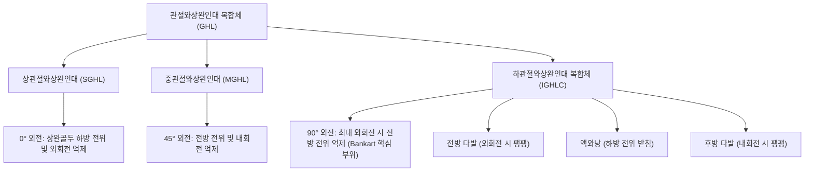

# 🦴 [[구조물/인대/관절와상완인대|관절와상완인대]] (Glenohumeral Ligaments, GHL)

> **핵심 요약 (Key Summary)**:
> - 📍 **해부 & 주행**: [[견관절]] 관절낭의 전면과 하면을 보강하는 3개의 특화된 섬유 다발로, **상관절와상완인대(SGHL)**, **중관절와상완인대(MGHL)**, **하관절와상완인대 복합체(IGHLC)**로 구성된다.
> - ⚙️ **생체역학적 핵심 기능**: 상완골두의 전방·하방 탈구를 제어하는 **1차 정적 안정화 구조물**이다. 팔의 외전 각도에 따라 주력 억제 인대가 교대되며, 특히 **외전 90도 + 외회전 위치에서는 하관절와상완인대 전방 다발(Anterior band of IGHLC)**이 해먹(Hammock)처럼 상완골두를 받쳐 전방 탈구를 최종 차단한다.
> - 🛠️ **임상 평가 & 치료**: 어깨 전방 탈구 시 [[관절와순]](Bankart 병변)과 함께 파열 호발. 불안검사([[불안 검사|Apprehension test]]) 및 재배치 검사(Relocation test)로 진단한다. 보존적 치료 시 견우(LI15)·견료(TE14) 자침과 회전근개 동적 안정성 강화 추나·운동 요법을 시행하며, 구조적 결손이 심한 재발성 탈구는 관절경적 복원술(Bankart repair)을 고려한다.

---

## 📌 목차
1. [해부학적 정밀 구조 및 주행/부착](#1-해부학적-정밀-구조-및-주행부착)
2. [생체역학·기능 (Biomechanics)](#2-생체역학기능-biomechanics)
3. [임상 평가 및 이학적 검사](#3-임상-평가-및-이학적-검사)
4. [초음파 해부학(Sonoanatomy) 및 중재 랜드마크](#4-초음파-해부학sonoanatomy-및-중재-랜드마크)
5. [⭐ 원장님 심층 임상 고찰 및 원본 필기 (Clinical Pearls)](#5--원장님-심층-임상-고찰-및-원본-필기-clinical-pearls)
6. [관련 임상 질환 및 손상](#6-관련-임상-질환-및-손상)
7. [추나·도수치료 & 침구·약침·재활 프로토콜](#7-추나도수치료--침구약침재활-프로토콜)
8. [출처 및 학술 참고 문헌 (References)](#8-출처-및-학술-참고-문헌-references)

---

## 1. 해부학적 정밀 구조 및 주행/부착

| 인대 다발 | 기시부 (Origin) | 정지부 (Insertion) | 주요 해부학적 특징 및 연계 |
| :--- | :--- | :--- | :--- |
| **상관절와상완인대 (SGHL)** | 관절와 상연 결절 및 전상부 [[관절와순]] | [[상완골]] 소결절 상연 및 결절간구 내측능 | [[오구상완인대]](CHL)와 함께 회전근개 간격(Rotator interval)을 구성, 이두근 장두건 안정화 |
| **중관절와상완인대 (MGHL)** | 관절와순 전상부 (SGHL 하방) | 상완골 소결절 전면 하부 (견갑하근 정지부 심층) | 형태학적 변이가 극심하며 약 30%에서 결손 또는 삭상 변이(Cord-like variant) 관찰 |
| **하관절와상완인대 복합체 (IGHLC)** | 관절와순 전하부 및 후하부 변연 | 상완골 해부경의 전하방 및 후하방 부착부 | 전방 다발(Anterior band), 후방 다발(Posterior band), 액와낭(Axillary pouch)의 3중 구조 |

- **해부학적 변이 (Buford Complex)**: 전상부 관절와순의 결손과 함께 굵은 코드 형태의 MGHL이 관찰되는 선천적 정상 변이로, 이를 관절와순 파열(SLAP 병변)로 오인하여 봉합하지 않도록 감별이 필수적이다.
- **신경 지배 및 혈관 공급**: [[견갑상신경]](C5-C6) 및 [[액와신경]](C5-C6)의 관절지가 관절낭에 풍부한 고유수용성 감각 신경종말(루피니·파치니 소체)을 분포시키며, 전·후상완회선동맥 분지가 혈류를 공급한다.

---

## 2. 생체역학·기능 (Biomechanics)

* **외전 각도에 따른 단계적 하중 분담 (Dynamic Load Sharing)**:
  * **외전 0도 (팔을 내린 중립위)**:
    * 상관절와상완인대(SGHL)와 오구상완인대(CHL)가 긴장하여 중력에 의한 상완골두의 **하방 전위(Inferior translation)**를 억제하는 주력 인대로 작용한다.
  * **외전 45도**:
    * 중관절와상완인대(MGHL)가 팽팽해지며 상완골두의 **전방 전위(Anterior translation)** 및 외회전을 제한한다.
  * **외전 90도 (투구·스파이크 자세)**:
    * 하관절와상완인대 복합체(IGHLC)의 전방 다발이 최대로 팽팽해지며 외회전 시 상완골두가 앞쪽으로 튀어나가지 못하도록 막는 **최종 1차 구속물(Primary stabilizer)**이 된다.
* **해먹 기전 (Hammock Concept)**:
  * IGHLC의 전방 다발과 후방 다발, 그리고 그 사이의 액와낭은 마치 해먹처럼 상완골두를 아래에서 요람처럼 감싸 안는다.
  * 외회전 시에는 전방 다발이 상완골두 밑을 받치며 비틀리고, 내회전 시에는 후방 다발이 팽팽해져 후방 탈구를 방어한다.

---

## 3. 임상 평가 및 이학적 검사

* **1. 전방 불안 검사 ([[불안 검사|Apprehension Test]])**:
  * 환자를 앙와위로 눕히고 어깨를 90도 외전 및 최대 외회전 시킨 상태에서 상완골두를 뒤에서 앞으로 살짝 밉니다.
  * 환자가 탈구될 것 같은 극심한 불안감(Apprehension)이나 통증을 호소하며 저항하면 양성 (민감도 80%, 특이도 95%).
* **2. 재배치 검사 (Jobe Relocation Test)**:
  * 불안 검사 양성 위치에서 검사자가 상완골두를 앞쪽에서 뒤쪽으로 하방 압박(Posterior directed force)했을 때 환자의 통증과 불안감이 즉각 소실되면 양성.
* **3. 구(Sulcus) 징후 (Sulcus Sign)**:
  * 환자가 앉은 상태에서 팔을 아래로 견인했을 때 견봉 아래 외측 피부에 1cm 이상의 함몰 고랑이 나타나면 SGHL 및 회전근개 간격 이완에 의한 다방향 관절 이완증(MDI)을 의미.
* **4. 하방 불안정성 및 Kim 검사**:
  * 90도 외전 상태에서 축성 압박과 상완골두 후하방 전위를 가하여 후하방 관절와순 및 IGHLC 후방 다발 손상을 감별.

---

## 4. 초음파 해부학(Sonoanatomy) 및 중재 랜드마크

* **초음파 스캔 랜드마크**:
  * **회전근개 간격(Rotator Interval) 뷰**: 견갑하근건과 극상근건 사이의 틈새를 횡단 스캔하여 상관절와상완인대(SGHL)와 상완이두근 장두건(LHBT)의 안정성을 관찰.
  * **액와 스캔(Axillary View)**: 어깨를 90도 외전시킨 상태에서 액와부에 탐촉자를 대고 하관절와상완인대(IGHLC) 액와낭의 두께(정상 2.5~4mm) 및 관절낭 비후, 삼출액을 평가.
* **병리적 초음파 소견**:
  * 전방 탈구 후 IGHLC의 상완골 부착부 단열(HAGL 병변) 시 액와낭 부위의 저에코성 혈종 및 인대 찢김 확인.
  * 유착성 관절낭염(오십견) 환자에서는 회전근개 간격 및 액와낭 관절낭의 현저한 비후(>4mm) 및 도플러 신생혈관 증식이 관찰됨.
* **중재 시술 자침 랜드마크**:
  * 견관절 후방 접근(경골돌기 하방 2cm, 관절와 후연) 또는 액와강 접근 시 초음파 유도 하에 IGHLC 관절낭 심부 공간으로 정밀 진입하여 관절강 내 주입 시행.

---

## 5. ⭐ 원장님 심층 임상 고찰 및 원본 필기 (Clinical Pearls)

> [!IMPORTANT]
> **진료실 핵심 임상 진단 통찰**:
> 1. **TUBS vs AMBRI의 명확한 감별**:
>    - **TUBS** (Traumatic, Unidirectional, Bankart, Surgery): 외상성, 일방향(전방), Bankart/IGHLC 단열 동반 → 활동적 젊은 환자는 재탈구율이 70~80%에 달하므로 수술적 복원을 조기에 고려.
>    - **AMBRI** (Atraumatic, Multidirectional, Bilateral, Rehabilitation, Inferior capsular shift): 비외상성, 양측성 다방향 이완증, 전신 관절 이완(Beighton score 고득점) → 수술보다 철저한 **회전근개 및 견갑 안정화 근육 보존 한의 재활이 1차 표준**.
> 2. **팔을 뒤로 짚고 넘어졌을 때의 감별**:
>    - 노년층은 회전근개 파열이나 상완골 외과경 골절이 우선이지만, 20~30대 젊은 층은 관절와상완인대 파열과 전방 탈구가 압도적 1순위이다.
> 3. **초기 탈구 정복 후 고정 자세**:
>    - 고전적 내회전 고정(슬링)보다 외회전 10~20도 고정이 IGHLC 전방 다발을 관절와순에 밀착시켜 치유율을 높인다는 생체역학적 근거를 숙지할 것.

---

## 6. 관련 임상 질환 및 손상

* **방카르트 병변 ([[방카르트 병변|Bankart Lesion]])**:
  * 전방 탈구 시 IGHLC 전방 다발의 견인력으로 인해 관절와순 전하부가 관절와 골 변연에서 뜯겨 나가는 손상.
* **HAGL 병변 (Humeral Avulsion of Glenohumeral Ligament)**:
  * 관절와순 쪽이 아닌 상완골 부착부에서 IGHLC가 뜯겨 나가는 손상으로, 전방 불안정성의 약 9%를 차지.
* **유착성 관절낭염 ([[오십견|Adhesive Capsulitis]])**:
  * 상관절와상완인대와 회전근개 간격, 액와낭의 만성 섬유화 및 구축으로 전 방향 가동역 제한 발생.
* **SLAP 병변 ([[SLAP 병변|Superior Labrum Anterior to Posterior]])**:
  * SGHL 기시부와 상완이두근 장두건 부착부가 복합 손상되어 상완골두 전상방 동요 유발.

---

## 7. 추나·도수치료 & 침구·약침·재활 프로토콜

### 1) 한의 보존적 재활 및 추나요법
* **동적 관절 안정화 추나**:
  * 상완골두 후하방 활주(Posterior-inferior glide) 가동술로 전방 관절낭의 인장 스트레스를 경감.
  * 견갑골 운동이상증(Scapular dyskinesis) 교정: 전거근, 능형근, 하부 승모근의 협응력 재교육.
* **회전근개 근력 강화 (동적 보상 기전)**:
  * 손상된 GHL의 정적 인장력을 보상하기 위해 [[견갑하근]](전방 안정화) 및 [[극하근]], [[소원근]](후방 안정화)의 등척성·등장성 강화 운동(외전 0도 및 45도 회전 운동) 적용.

### 2) 침구 및 약침 치료 프로토콜
* **주요 혈위**:
  * 견우(LI15), 견료(TE14): 견관절 전후방 관절낭 직상방 자침.
  * 비노(LI14), 노수(SI10), 견정(GB21): 견갑대 긴장 완화 및 고유수용성 감각 회복.
* **약침 프로토콜**:
  * 전방 관절낭 및 회전근개 간격 부위에 [[신바로약침|신바로 약침]] 또는 자하거 약침 0.5cc를 주입하여 미세 손상된 인대 부착부의 인장 강도 회복과 만성 통증 완화 촉진.

---

## 8. 출처 및 학술 참고 문헌 (References)

1. **Goetti P, et al. (2020)**. Shoulder biomechanics in normal and selected pathological conditions. *EFORT Open Rev*. 5(8):508-518. PMID: 32953136.
   - `[연구 요약]` 정상 견관절 및 전방 불안정성, 유착성 관절낭염 상태에서 관절와상완인대(SGHL, MGHL, IGHLC)의 각도별 생체역학적 장력 분포와 동적-정적 안정화 기전의 상호작용 검토.
2. **Testa EJ, et al. (2024)**. Biomechanics and Pathoanatomy of Posterior Shoulder Instability. *Clin Sports Med*. 43(4):723-735. PMID: 39232576.
   - `[연구 요약]` 하관절와상완인대 후방 다발 및 액와낭의 해부학적 구조와 후방 견관절 불안정성, 스포츠 손상 시 생체역학적 파열 기전 및 진단 지침 제시.
