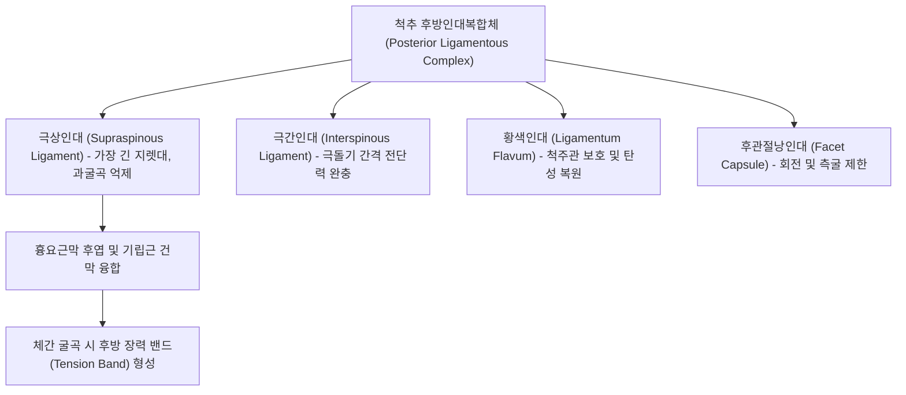

# 🦴 [[구조물/인대/극상인대|극상인대]] (Supraspinous Ligament)

> **핵심 요약 (Key Summary)**:
> - 📍 **해부 & 주행**: 제7경추(C7) 극돌기 첨단에서 시작하여 흉추 및 요추 극돌기(Spinous process)의 끝부분을 수직으로 잇고 천골 정중능선까지 주행하는 강인한 섬유성 인대이다. 경추부에서는 상방으로 확장되어 [[항인대]](Ligamentum nuchae)와 연속되며, 심층의 [[극간인대]](Interspinous ligament) 및 천층의 [[흉요근막]](Thoracolumbar fascia)과 견고히 융합된다.
> - ⚙️ **생체역학적 핵심 기능**: 척추 후방인대복합체(Posterior Ligamentous Complex, PLC)의 가장 바깥 축에 위치하여, 척추 굴곡 회전축에서 가장 먼 **최대 모멘트 암(Longest moment arm)**을 형성한다. 이를 통해 척추의 **과굴곡(Hyperflexion)과 전방 전단력을 억제**하는 1차 인장 저항 구조물로 기능한다.
> - 🛠️ **임상 평가 & 치료**: 허리를 숙일 때 극돌기 부위의 날카로운 국소 통증(극상인대 염좌), 척추 골절 시 PLC 손상 여부 판정, 경막외 마취 후 만성 인대통에서 핵심 표적이다. 한의학적으로 [[독맥]](GV) 순행로 상의 명문(GV4)·요양관(GV3) 자침, [[약침]], 화침 및 굴곡 제한 추나 요법으로 우수한 보존적 치료 효과를 거둔다.

---

## 📌 목차
1. [해부학적 정밀 구조 및 주행/부착](#1-해부학적-정밀-구조-및-주행부착)
2. [생체역학·기능 (Biomechanics)](#2-생체역학기능-biomechanics)
3. [임상 평가 및 이학적 검사](#3-임상-평가-및-이학적-검사)
4. [초음파 해부학(Sonoanatomy) 및 중재 랜드마크](#4-초음파-해부학sonoanatomy-및-중재-랜드마크)
5. [⭐ 원장님 심층 임상 고찰 및 원본 필기 (Clinical Pearls)](#5--원장님-심층-임상-고찰-및-원본-필기-clinical-pearls)
6. [관련 임상 질환 및 손상](#6-관련-임상-질환-및-손상)
7. [추나·도수치료 & 침구·약침·재활 프로토콜](#7-추나도수치료--침구약침재활-프로토콜)
8. [출처 및 학술 참고 문헌 (References)](#8-출처-및-학술-참고-문헌-references)

---

## 1. 해부학적 정밀 구조 및 주행/부착

| 항목 | 상세 해부학적 기술 |
| :--- | :--- |
| **기시 및 주행** | 제7경추(C7) 극돌기 첨단에서 기시하여 흉추(T1~T12) 및 요추(L1~L5) 극돌기의 후방 첨단부를 연결하며 하행 |
| **정지부 (Insertion)** | 천골의 정중천골능선(Median sacral crest) |
| **섬유층의 배열** | **천층 섬유**: 3~4개 척추 분절을 건너뛰며 길게 주행. **중간 섬유**: 2~3개 분절을 연결. **심층 섬유**: 인접한 극돌기 첨단 사이를 단단히 결속하며 [[극간인대]]와 이행 |
| **인접 근막 결합** | 양측 [[광배근]], [[승모근]], [[척추기립근]] 건막 및 [[흉요근막]] 후엽과 치밀하게 교차 결합 |
| **신경 및 혈관** | [[척수신경]] 후지 내측지(Medial branch of dorsal ramus) 관절지 및 분절 늑간/요동맥 후지 망 |

- **상하 연속성**: 상부 경추에서는 척추의 움직임과 두개골 지지를 위해 넓은 부채꼴 모양의 [[항인대]](Ligamentum nuchae)로 확장 이행한다.
- **요추부의 특성**: 하부 요추(L4-L5, L5-S1) 레벨에서는 개인에 따라 인대가 가늘어지거나 결손되어 퇴행성 변화 및 척추전방전위증에 취약해지는 구조적 취약점이 존재한다.

---

## 2. 생체역학·기능 (Biomechanics)

* **척추 굴곡의 1차 억제기 (Primary Restraint to Flexion)**:
  * 척추 분절 운동의 순간 회전축(Instantaneous Axis of Rotation, IAR)은 추간판 후방에 위치한다.
  * 극상인대는 척추 구조물 중 회전축에서 가장 멀리 떨어져 있으므로, **가장 긴 모멘트 암(Moment arm)**을 활용하여 척추 전굴 시 가장 효율적인 인장 저항 토크를 발휘한다.
* **장력 밴드 효과 (Tension Band Effect)**:
  * 무거운 물건을 들어 올리거나 상체를 앞으로 숙일 때, 극상인대와 흉요근막은 척추 후방에서 팽팽한 '장력 밴드' 역할을 하여 요추 전만 감소를 제어하고 추간판 내압 상승을 완충한다.
* **인장 한계와 미세 파열**:
  * 척추가 생리적 가동 범위를 넘어 급격히 굴곡될 때, PLC 중 가장 먼저 최대 긴장에 도달하므로 과굴곡 손상 시 가장 먼저 견인 파열(Avulsion or rupture)이 발생하기 쉽다.

---

## 3. 임상 평가 및 이학적 검사

* **1. 극돌기 첨단 국소 압통 (Spinous Process Tip Tenderness)**:
  * 환자를 복와위로 눕히고 요추 극돌기 첨단을 손가락 끝으로 정밀 압박.
  * 척추 기립근 긴장과 구별되는 뼈마디 바로 위 극상인대 부착부의 날카로운 국소 압통 재현 시 양성.
* **2. 척추 능동 전굴 부하 검사**:
  * 환자가 선 상태에서 무릎을 펴고 허리를 앞으로 숙일 때, 추간판 탈출증의 방사통(하지 저림)이 아닌 요추 정중선의 찢어지는 듯한 인대성 통증이 유발되고 신전 시 즉시 완화됨.
* **3. 극돌기 간격 촉진 검사 (Interspinous Gap Palpation)**:
  * 외상성 손상(낙상, 교통사고) 후 앉아서 허리를 구부린 자세에서 극돌기 사이 간격을 촉진.
  * 정상에 비해 비정상적으로 벌어져 있거나 연부조직 함요(Defect)가 만져지면 PLC 파열 및 불안정성 척추 골절을 강력 시사.
* **4. 스프링 검사 (Springing Test)**:
  * 요추 극돌기를 전방으로 탄력 압박 시 비정상적인 전방 이동성이나 통증 유발 확인.

---

## 4. 초음파 해부학(Sonoanatomy) 및 중재 랜드마크

* **초음파 스캔 랜드마크**:
  * 환자를 복와위로 눕히고 복부 밑에 베개를 받쳐 요추를 약간 굴곡시킴.
  * 고주파 선형 탐촉자를 척추 정중선에 종단(Sagittal)으로 거치하여 요추 극돌기의 고에코 음영(Acoustic shadow)을 랜드마크로 설정.
  * 극돌기 첨단 사이를 표재성으로 건너뛰는 균일한 고에코 섬유성 띠로 관찰됨.
* **초음파 병리 소견**:
  * **극상인대 염좌/파열**: 인대의 국소 저에코성 비후, 섬유의 불연속성, 극돌기 부착부의 박리 골편(Avulsion flake) 및 저에코성 부종.
  * **전단파 탄성초음파(SWE)**: 정상 인대에 비해 손상 및 퇴행성 인대에서 전단파 속도 및 탄성 계수 저하 확인.
* **중재 시술 자침 랜드마크**:
  * 극돌기 첨단 정중부(독맥 혈위)에서 직자 또는 약간 상사자하여 인대 실질 및 부착부 골막에 도달. 깊이는 피하 5~15mm 내외로 얕아 척수강 침범 위험은 없으나 정확한 인대 내 자입이 요구됨.

---

## 5. ⭐ 원장님 심층 임상 고찰 및 원본 필기 (Clinical Pearls)

> [!IMPORTANT]
> **진료실 핵심 감별 및 치료 노하우**:
> 1. **디스크 탈출증 vs 극상인대 염좌 감별**:
>    - 둘 다 "숙일 때 아프다"고 호소하지만, 극상인대 염좌는 **방사통 없이 극돌기 뼈마디 정중앙에 손가락 한마디 크기의 극심한 압통점**이 존재한다.
>    - 환자가 "허리 가운데 뼈가 튀어나온 곳이 닿기만 해도 아프다"고 하면 디스크보다 극상인대 부착부염(Enthesopathy)을 먼저 의심해야 한다.
> 2. **산후 요통 및 경막외 마취 후유증**:
>    - 제왕절개나 무통분만 시 척추 마취 바늘이 극상인대와 극간인대를 통과하는데, 이때 생긴 미세 손상이 산후 릴랙신 호르몬 분비와 맞물려 만성 섬유화 반흔을 형성하며 수개월 이상 지속되는 경우가 흔하다.
> 3. **치료 팁**:
>    - 단순 침치료보다 극돌기 첨단 부착부에 [[신바로약침|신바로 약침]]을 0.3cc 정밀 주입하거나, 만성 반흔화 부위에 온침(Warm needle) 또는 화침을 적용하면 극적인 회복을 보인다.

---

## 6. 관련 임상 질환 및 손상

* **극상인대 염좌 및 박리 손상 (Supraspinous Ligament Sprain)**:
  * 무거운 물건을 굴곡 상태에서 급격히 들거나 교통사고 채찍질 손상 시 인대 섬유 미세 단열.
* **척추 후방인대복합체(PLC) 파열**:
  * 굴곡-신연 손상(Chance fracture) 또는 압박 골절 시 PLC가 파열되면 척추 불안정성이 급증하여 외과적 융합술(Fusion)의 적응증이 됨.
* **바스트룹 병 ([[바스트룹 병|Baastrup Disease, Kissing Spine]])**:
  * 요추 과신전 및 디스크 협착으로 인해 인접 극돌기가 서로 맞닿으며 극상인대와 극간 점액낭에 만성 염증 및 골극 형성.
* **퇴행성 척추전방전위증**:
  * 하부 요추(L4-L5) 극상인대 퇴행성 결손으로 인한 굴곡 억제력 상실.

---

## 7. 추나·도수치료 & 침구·약침·재활 프로토콜

### 1) 한의 보존적 재활 및 추나요법
* **굴곡 제한 및 요추 전만 회복 추나**:
  * 급성기 요추 과굴곡 스트레스를 차단하고 요추 생리적 전만(Lordosis)을 지지하는 복대 착용 지도.
  * 요추 신전 가동술(Extension mobilization) 및 골반 전방경사-후방경사 균형 추나 적용.
* **코어 및 흉요근막 긴장 균형**:
  * [[복횡근]](TrA) 및 [[다열근]](Multifidus)의 동시 수축 훈련을 통해 극상인대에 집중되는 과도한 후방 굴곡 인장력을 능동 근육으로 분산.

### 2) 침구 및 약침 치료 프로토콜
* **주요 혈위**:
  * [[독맥]](GV): 명문(GV4), 요양관(GV3), 척중(GV6), 신주(GV12) — 극돌기 간 및 첨단 직상방 배혈.
  * [[방광경]](BL): 신수(BL23), 대장수(BL25) — 기립근 부착부 이완.
* **약침 및 특수 침 치료**:
  * 극돌기 첨단 부착부 압통점에 [[신바로약침|신바로 약침]] 0.3~0.5cc 정밀 시술.
  * 만성 반흔 및 바스트룹 병 소견 시 도침(Acupotomy)으로 유착된 극상인대 섬유를 미세 박리.

---

## 8. 출처 및 학술 참고 문헌 (References)

1. **Jokeit M, et al. (2025)**. The importance of the posterior osteoligamentous complex of the lumbar spine: dogma changing biomechanical insights. *Eur Spine J*. 34(11):5157-5165. PMID: 39912946.
   - `[연구 요약]` 요추 후방 골-인대 복합체(PLC) 중 극상인대와 극간인대가 척추 굴곡 저항력 및 분절 안정성에 미치는 생체역학적 기여도를 최신 다축 시험을 통해 재조명한 논문.
2. **Yancey M, et al. (2023)**. Ultrasound Shear Wave Elastography Quantitatively Assesses Tension Changes of Supraspinous/Interspinous Ligament Complex Under Varied Loads. *Int J Spine Surg*. 17(4):502-510. PMID: 37402508.
   - `[연구 요약]` 다양한 굴곡 하중 부하 시 극상인대 및 극간인대 복합체의 장력 및 탄성 변화를 전단파 탄성초음파(SWE)로 비침습적 정량 평가한 임상 연구.
