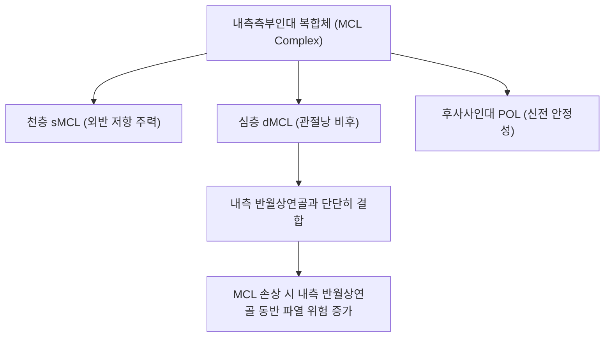

# 🦴 [[구조물/인대/내측측부인대|내측측부인대]] (Medial Collateral Ligament, MCL)

> **핵심 요약 (Key Summary)**:
> - 📍 **해부 & 주행**: [[대퇴골]] 내측상과에서 기시하여 [[경골]] 근위 내측면에 넓게 정지하는 슬관절 내측의 핵심 띠 모양 인대이다. 독립된 **천층(sMCL)**과 [[내측반월상연골]] 체부와 단단히 유착된 관절낭 비후 구조물인 **심층(dMCL)**, 그리고 후내측 관절낭을 보강하는 **후사사인대(POL)**의 3중 복합체로 구성된다.
> - ⚙️ **생체역학적 핵심 기능**: 슬관절 외반(Valgus) 스트레스에 대항하는 **1차 정적 억제기(Primary restraint)**로, 굴곡 25도에서 외반력의 약 78%를 천층 MCL이 전담한다. 활액막 외부에 위치하여 상·하내측슬동맥으로부터 풍부한 혈류를 공급받아 십자인대와 달리 **자가 치유 및 재생 잠재력이 극히 우수**하다.
> - 🛠️ **임상 평가 & 치료**: 무릎 외측 충돌(Clipping) 및 외반 염좌 시 호발(Grade I~III). 30도 굴곡 외반 스트레스 검사로 진단한다. 펠레그리니-스티다(Pellegrini-Stieda) 석회화 병변 감별이 중요하다. 곡천(LR8)·음릉천(SP9) 자침, [[약침]], 경첩형 보조기 고정 및 거위발건 강화 한의 보존 치료가 1차 표준이다.

---

## 📌 목차
1. [해부학적 정밀 구조 및 주행/부착](#1-해부학적-정밀-구조-및-주행부착)
2. [생체역학·기능 (Biomechanics)](#2-생체역학기능-biomechanics)
3. [임상 평가 및 이학적 검사](#3-임상-평가-및-이학적-검사)
4. [초음파 해부학(Sonoanatomy) 및 중재 랜드마크](#4-초음파-해부학sonoanatomy-및-중재-랜드마크)
5. [⭐ 원장님 심층 임상 고찰 및 원본 필기 (Clinical Pearls)](#5--원장님-심층-임상-고찰-및-원본-필기-clinical-pearls)
6. [관련 임상 질환 및 손상](#6-관련-임상-질환-및-손상)
7. [추나·도수치료 & 침구·약침·재활 프로토콜](#7-추나도수치료--침구약침재활-프로토콜)
8. [출처 및 학술 참고 문헌 (References)](#8-출처-및-학술-참고-문헌-references)

---

## 1. 해부학적 정밀 구조 및 주행/부착

| 층별 구분 | 기시부 (Origin) | 정지부 (Insertion) | 주요 특징 및 관절 연계 |
| :--- | :--- | :--- | :--- |
| **천층 MCL (sMCL)** | [[대퇴골]] 내측상과(Medial epicondyle) 함요부 | [[경골]] 관절선 하방 약 4~6cm 부위 내측 능선 | 길이 약 10~12cm의 넓고 강인한 섬유성 띠, [[거위발건]] 심층에 위치 |
| **심층 MCL (dMCL)** | 대퇴골 원위 관절낭 연골 경계 | 경골 관절낭 연골 경계 | 관절낭 비후 구조물로 [[내측반월상연골]] 체부와 단단히 융합(관절낭-반월상연골 인대) |
| **후사사인대 (POL)** | 대퇴 내과 결절 후방 | 경골 후내측 능선 및 반막양근건 | 후내측 관절낭 보강, 무릎 신전 시 외반 및 내회전 보조 제어 |

- **풍부한 혈관망과 치유력**: 활액막 외부에 위치하며 상내측슬동맥(Superior medial genicular artery) 및 하내측슬동맥으로부터 풍부한 혈액을 공급받아, 파열 후에도 섬유아세포 증식 및 콜라겐 합성이 왕성하여 수술 없이도 대부분 자연 유합된다.
- **신경 지배**: [[경골신경]](Tibial nerve) 분지 및 [[대퇴신경]](Femoral nerve) 유래 복재신경 관절지가 관절낭과 인대 부착부에 풍부한 기계수용기를 분포시킨다.

---

## 2. 생체역학·기능 (Biomechanics)

* **1차 외반 억제기 (Primary Restraint to Valgus Stress)**:
  * 슬관절 25도 굴곡 상태에서 가해지는 **외반력의 약 78%를 천층 MCL이 단독으로 부담**한다.
  * 완전 신전(0도) 상태에서는 후방 관절낭, 후사사인대(POL), [[전방십자인대]](ACL) 및 [[후방십자인대]](PCL)가 협력하여 MCL의 부담이 약 57%로 분산된다.
* **경골 외회전 제어**:
  * 굴곡 각도 전반에 걸쳐 경골의 과도한 외회전을 정적으로 억제한다.
* **동적 협동근 (Dynamic Stabilizers)**:
  * [[봉공근]], [[박근]], [[반건양근]](거위발건 삼총사)과 [[반막양근]]은 슬관절 내측을 능동적으로 지지하여 MCL의 인장 부하를 감압해 주는 핵심 동적 협동근이다.

---

## 3. 임상 평가 및 이학적 검사

* **1. 30도 굴곡 외반 스트레스 검사 ([[외반 스트레스 검사|Valgus Stress Test at 30°]])**:
  * 환자를 앙와위로 눕히고 슬관절을 30도 굴곡하여 후방 관절낭과 십자인대를 이완시킨 후 외반력을 가함.
  * 내측 관절선의 벌어짐과 통증을 확인하는 MCL 단독 손상의 표준 진단법.
* **2. 0도 완전 신전 외반 스트레스 검사 (Valgus Stress Test at 0°)**:
  * 완전 신전 상태에서 외반 검사 시 관절이 벌어진다면 MCL 완전 파열뿐만 아니라 [[전방십자인대]], 후방십자인대, 후사사인대의 **복합 파열(불안정 관절)**을 강력히 시사.
* **손상 등급 분류 (Grading)**:
  * **1도 (Grade I, 경도 염좌)**: 국소 압통은 있으나 관절 이완(Laxity) 없음 (벌어짐 <3mm).
  * **2도 (Grade II, 부분 파열)**: 관절 열림(3~5mm)이 관찰되나 명확한 단단한 종말감(Firm endpoint) 존재.
  * **3도 (Grade III, 완전 파열)**: 10mm 이상의 심한 관절 열림과 종말감 소실 (대부분 십자인대 손상 동반).

---

## 4. 초음파 해부학(Sonoanatomy) 및 중재 랜드마크

* **초음파 장축 스캔 (Longitudinal View)**:
  * 대퇴 내과에서 경골 근위부로 이어지는 세 겹의 층상 구조(천층 sMCL, 고에코 지방층, 심층 dMCL 및 내측 반월상연골 외연)를 관찰.
  * 손상 시 섬유의 연속성 소실, 저에코성 부종 및 인대 비후, 동적 외반 스트레스 시 관절 간격 개대 확인.
* **도플러(Power Doppler) 검사**:
  * 급성기 및 아급성기 치유 과정에서 신생 모세혈관 증식에 의한 혈류 신호 증가를 확인하여 회복 단계를 모니터링.
* **중재 시술 자침 랜드마크**:
  * 대퇴 내측상과 기시부 및 경골 관절선 하방 4~5cm 정지부를 초음파로 확인하고, 피하 혈관(대복재정맥)을 피해 인대 천층 및 심층 경계면에 약침액을 정밀 주입.

---

## 5. ⭐ 원장님 심층 임상 고찰 및 원본 필기 (Clinical Pearls)

> [!IMPORTANT]
> **진료실 핵심 감별 및 치료 노하우**:
> 1. **펠레그리니-스티다(Pellegrini-Stieda) 병변 주의**:
>    - MCL 대퇴 기시부 손상 후 치유 과정에서 칼슘이 침착되어 발생하는 **외상 후 이소성 석회화**. 무릎 내측 상단에 단단한 골성 결절이 만져지고 만성 통증과 굴곡 제한을 유발하므로 X-ray로 감별해야 한다.
> 2. **"MCL은 수술하지 않는 것이 원칙이다"**:
>    - Grade III 완전 파열이라도 단독 손상인 경우 6주간 경첩형 보조기(Hinged brace) 착용과 체중 부하 한의 보존 치료를 시행하면 수술군과 대등하거나 더 우수한 인장 강도를 회복한다 (풍부한 혈류 덕분).
> 3. **불행삼총사(O'Donoghue's Triad)의 순차적 촉진**:
>    - 외반 손상 환자가 내원했을 때 MCL 압통점만 누르고 끝내지 말고, 반드시 전방십자인대(Lachman 검사)와 내측 반월상연골(McMurray 검사)을 함께 확인하여 복합 손상을 배제해야 한다.

---

## 6. 관련 임상 질환 및 손상

* **내측측부인대 염좌 및 파열 (MCL Sprain/Tear)**:
  * 슬관절 인대 손상 중 최다 빈도(약 40%). 대퇴 기시부 파열이 경골 정지부 파열보다 빈발.
* **펠레그리니-스티다 증후군 ([[펠레그리니-스티다 병변|Pellegrini-Stieda Syndrome]])**:
  * MCL 대퇴 부착부의 외상 후 이소성 골화로 인한 지속성 동통 및 관절 강직.
* **불행삼총사 손상 (O'Donoghue's Triad)**:
  * 극심한 외반-외회전 외력에 의해 MCL, [[전방십자인대]], [[내측반월상연골]]이 동시 파열되는 치명적 복합 손상.
* **거위발건염 및 활액낭염 ([[거위발건염|Pes Anserine Bursitis]])**:
  * MCL 경골 부착부 바로 표재에 위치하여 임상적 압통 부위가 겹치므로 정밀 감별 필요.

---

## 7. 추나·도수치료 & 침구·약침·재활 프로토콜

### 1) 한의 보존적 재활 및 추나요법
* **초기 보호 및 조기 체중 부하**:
  * Grade I~II 손상 시 경첩형 보조기를 착용시켜 외반 스트레스는 차단하되, 굴신 관절 운동과 편평 지면 체중 부하를 조기에 유도하여 인대 섬유의 생리학적 정렬을 촉진.
* **슬관절 및 골반 부정렬 추나 교정**:
  * 족부 과회내(Overpronation) 및 고관절 내회전 변위를 교정하여 보행 시 무릎 내측에 가해지는 동적 외반 부하를 원천 차단.

### 2) 침구 및 약침 치료 프로토콜
* **주요 혈위**:
  * 곡천(LR8), 음릉천(SP9), 슬관(LR7): MCL 주행로 상의 주요 혈위.
  * 혈해(SP10), 족삼리(ST36), 양릉천(GB34) 배합.
* **약침 프로토콜**:
  * 대퇴 내측상과 기시부 및 경골 정지부의 손상 부위에 [[신바로약침|신바로 약침]] 또는 자하거 약침 0.3~0.5cc를 주입하여 교원섬유 합성 촉진 및 인대 인장력 회복 유도.

---

## 8. 출처 및 학술 참고 문헌 (References)

1. **Runer A, et al. (2026)**. Current concepts in isolated and combined injuries of the medial collateral ligament complex-Part I: Anatomy, biomechanics, clinical and radiological examination of the medial collateral ligament of the knee. *Knee Surg Sports Traumatol Arthrosc*. PMID: 42748362.
   - `[연구 요약]` 슬관절 내측측부인대 복합체(sMCL, dMCL, POL)의 최신 해부학적 층상 구조와 외반 제어 생체역학, 단독 및 복합 손상의 영상의학적 평가 지침 종합 리뷰.
2. **Nishioka T, et al. (2026)**. High-Grade Percutaneous Medial Collateral Ligament Pie-Crusting Is Not Associated With Clinically Meaningful Valgus Instability. *Am J Sports Med*. 54(13):3191-3198. PMID: 42865127.
   - `[연구 요약]` 내측측부인대 경피적 유리술 후의 생체역학적 안정성 분석을 통해 MCL의 뛰어난 자가 치유 잠재력과 외반 불안정성에 대한 내인성 회복 기전 검증.
