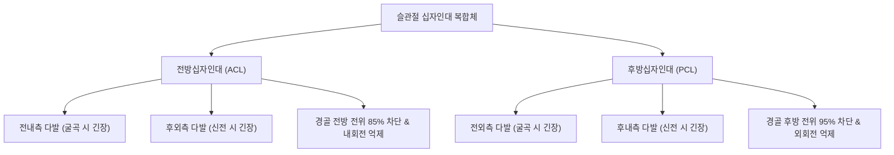

# 🦴 [[구조물/인대/십자인대|십자인대]] (Cruciate Ligaments of the Knee)

> **핵심 요약 (Key Summary)**:
> - 📍 **해부 & 주행**: 슬관절 심부의 관절낭 내(Intracapsular) 활액막 외(Extrasynovial) 공간에서 서로 'X'자 형태로 교차하는 **[[전방십자인대]](ACL)**와 **[[후방십자인대]](PCL)**로 구성된 핵심 중심 안정화 기전이다.
> - ⚙️ **생체역학적 핵심 기능**: 슬관절 전후방 전위 및 회전을 제어하는 1차 구속물이다. 대퇴골과 경골 사이의 **4절 링크 기전(Four-bar linkage system)**을 형성하여 굴곡-신전 시 생리적 활주-구름(Roll-and-Glide) 복합 운동을 안내한다. ACL은 [[슬괵근]](햄스트링)과 협동하고, PCL은 [[대퇴사두근]]과 협동한다.
> - 🛠️ **임상 평가 & 치료**: ACL은 비접촉 감속 피벗 손상, PCL은 무릎 굴곡 상태 전방 충돌(대시보드 손상)로 호발한다. [[라크만 검사]](Lachman test) 및 후방 처짐 징후(Posterior sag sign)로 감별한다. 부분 손상 및 PCL 단독 손상은 침·약침·등척성 재활 중심의 보존 치료가 우선되며, 완전 단열 및 복합 불안정성은 수술적 재건술(Reconstruction)을 고려한다.

---

## 📌 목차
1. [해부학적 정밀 구조 및 주행/부착](#1-해부학적-정밀-구조-및-주행부착)
2. [생체역학·기능 (Biomechanics)](#2-생체역학기능-biomechanics)
3. [임상 평가 및 이학적 검사](#3-임상-평가-및-이학적-검사)
4. [초음파 해부학(Sonoanatomy) 및 중재 랜드마크](#4-초음파-해부학sonoanatomy-및-중재-랜드마크)
5. [⭐ 원장님 심층 임상 고찰 및 원본 필기 (Clinical Pearls)](#5--원장님-심층-임상-고찰-및-원본-필기-clinical-pearls)
6. [관련 임상 질환 및 손상](#6-관련-임상-질환-및-손상)
7. [추나·도수치료 & 침구·약침·재활 프로토콜](#7-추나도수치료--침구약침재활-프로토콜)
8. [출처 및 학술 참고 문헌 (References)](#8-출처-및-학술-참고-문헌-references)

---

## 1. 해부학적 정밀 구조 및 주행/부착

| 구분 | 전방십자인대 (ACL) | 후방십자인대 (PCL) |
| :--- | :--- | :--- |
| **기시부 (Origin)** | [[대퇴골]] 외과(Lateral condyle) 내측면의 후상방 | 대퇴골 내과(Medial condyle) 외측면의 전상방 |
| **정지부 (Insertion)** | [[경골]] 과간융기 전방 함요부 및 내측 반월판 전각 외측 | 경골 과간융기 후방 관절면 하방 1cm 함요부 |
| **다발 구성** | 전내측 다발(AM bundle) + 후외측 다발(PL bundle) | 전외측 다발(AL bundle) + 후내측 다발(PM bundle) |
| **동반 인대** | 횡인대(Transverse ligament) | 험프리 인대(aMFL) 및 리스버그 인대(pMFL) (반월대퇴인대) |
| **신경 및 혈관** | [[경골신경]] 유래 후관절지(고유수용기 풍부) / [[중슬동맥]](Middle genicular artery) 분지망 | 경골신경 분지 / 중슬동맥 및 하내측슬동맥 |

- **활액막외 주행 특성**: 두 인대 모두 관절낭 섬유막 내부에 위치하지만, 후방에서 함입된 활액막 반사막에 싸여 있어 활액강 내부 액체와 직접 접촉하지 않는 관절낭 내 활액막 외(Intracapsular, Extrasynovial) 구조물이다.

---

## 2. 생체역학·기능 (Biomechanics)

* **4절 링크 기전 (Four-Bar Linkage System)**:
  * 대퇴골 기시부 2점과 경골 정지부 2점이 이루는 사각 링크 기전에 의해 무릎이 굴곡할 때 대퇴골두가 단순히 회전하는 것에 그치지 않고, 후방으로 구르면서(Rolling) 전방으로 미끄러지는(Gliding) 정밀한 나선 활주 운동(Screw-home mechanism)을 유도한다.
* **근육과의 길항·협동 토크 역학**:
  * **전방십자인대(ACL)**:
    * [[대퇴사두근]]은 슬개건을 통해 경골을 앞으로 당기므로 ACL의 긴장을 가중시키는 **길항근**이다.
    * [[슬괵근]](햄스트링)은 경골을 뒤로 당겨 ACL의 인장 부하를 덜어주는 핵심 **협동 보호근**이다.
  * **후방십자인대(PCL)**:
    * [[슬괵근]]은 경골을 뒤로 당겨 PCL 손상 부하를 높이는 **길항근**이다.
    * [[대퇴사두근]]은 경골을 전방 견인하여 PCL을 보호하는 핵심 **협동근**이다.

---

## 3. 임상 평가 및 이학적 검사

* **1. 라크만 검사 ([[라크만 검사|Lachman Test]]) — ACL 표준**:
  * 무릎 20~30도 굴곡 상태에서 경골 근위부를 전방 견인. 단단한 종말감(Firm endpoint)의 소실 및 무른 감각(Soft endpoint)과 함께 3mm 이상 전위 시 양성 (민감도 85%, 특이도 94%).
* **2. 후방 처짐 징후 (Posterior Sag Sign / Godfrey Test) — PCL 표준**:
  * 고관절 90도, 슬관절 90도 굴곡 상태에서 측면 관찰 시, 중력에 의해 경골 조면이 대퇴골 관절면에 비해 후방으로 푹 꺼져 있으면 PCL 파열.
* **3. 후방 전위 검사 ([[후방 전위 검사|Posterior Drawer Test]])**:
  * 슬관절 90도 굴곡 상태에서 경골을 뒤로 밀었을 때 8~10mm 이상 후방 이동 시 PCL 단열.
* **4. 피벗 시프트 검사 (Pivot-Shift Test)**:
  * ACL 결손에 의한 회전 불안정성을 평가하는 가장 특이도 높은 검사.

---

## 4. 초음파 해부학(Sonoanatomy) 및 중재 랜드마크

* **초음파 평가의 한계와 접근법**:
  * 십자인대는 슬관절 심부 과간와에 위치하여 초음파 빔의 투과 깊이 및 음향 음영 한계로 실질 전장을 직접 관찰하기 어렵다.
  * **PCL 초음파**: 슬와부 후방 종단 스캔 시 대퇴골 후과와 경골 후면 사이를 주행하는 두껍고 균일한 저에코성 밴드로 관찰이 용이함.
  * **ACL 간접 징후**: 과간와 내 혈종, 슬개상낭 내 혈관절증(Liphemarthrosis) 및 대퇴 외과 골좌상 간접 평가.
* **MRI 골드 스탠다드**:
  * ACL: 시상면에서 Blumensaat 선(과간와 천장선)과의 평행성 소실 및 미만성 고신호 강도 확인.
  * PCL: 정상 시상면에서 '하키 스틱' 모양의 굵고 연속된 저신호 강도가 단열되거나 비후된 소견 확인.

---

## 5. ⭐ 원장님 심층 임상 고찰 및 원본 필기 (Clinical Pearls)

> [!IMPORTANT]
> **진료실 핵심 감별 및 치료 노하우**:
> 1. **"가짜 전방 전위(Pseudolaxity)의 함정"**:
>    - PCL이 파열되어 경골이 이미 뒤로 쳐져 있는 환자에게 전방 전위 검사를 하면, 뒤로 빠져 있던 경골이 정상 위치로 당겨져 나오는 것을 보고 "경골이 앞으로 많이 빠진다"며 **ACL 파열로 오진**하는 경우가 매우 흔하다.
>    - 따라서 전방 전위 검사 전에 반드시 **측면에서 경골 조면의 높이(Posterior sag)를 먼저 확인하여 출발점(Starting position)이 정상인지 점검**해야 한다.
> 2. **혈관절증의 골든타임(2~4시간)**:
>    - 수상 후 2~3시간 내에 무릎이 터질 듯이 부어오르면 십자인대 파열로 인한 중슬동맥 출혈(혈관절증)이 70% 이상이다. 반월상연골 파열은 24시간에 걸쳐 서서히 붓는다.
> 3. **PCL은 대퇴사두근, ACL은 햄스트링**:
>    - 재활 시 PCL 파열 환자에게 햄스트링 컬(Curl) 운동을 시키면 파열된 PCL을 뒤에서 잡아 뜯는 치명적 실수가 된다. PCL 환자는 **대퇴사두근 Q-setting 및 레그 익스텐션**에 집중해야 한다.

---

## 6. 관련 임상 질환 및 손상

* **전방십자인대 손상 ([[전방십자인대 손상|ACL Rupture]])**:
  * 피벗, 착지, 감속 동작 중 비접촉 손상 호발. 연골 손상 및 조기 관절염 유발.
* **후방십자인대 손상 ([[후방십자인대 손상|PCL Tear]])**:
  * 교통사고 대시보드 충돌, 발을 족저굴곡한 상태에서 무릎으로 넘어지는 낙상 시 발생.
* **외상성 슬관절 탈구 (Knee Dislocation)**:
  * ACL과 PCL이 동시 파열되는 극심한 고에너지 손상으로, [[슬와동맥]](Popliteal artery) 및 [[비골신경]](Peroneal nerve) 손상 합병증에 대한 응급 혈관 평가가 필수적임.

---

## 7. 추나·도수치료 & 침구·약침·재활 프로토콜

### 1) 한의 보존적 재활 및 추나요법
* **경골 전후방 정렬 교정 추나**:
  * ACL 손상: 대퇴골 전방 활주 및 경골 후방 정복 기법 적용.
  * PCL 손상: 경골 전방 당김 및 대퇴골 후방 안정화 수기.
* **선택적 근력 강화 프로토콜**:
  * ACL 재활: 햄스트링/대퇴사두근 근력 비율(H:Q ratio > 60%) 증강, 닫힌 사슬(CKC) 스쿼트.
  * PCL 재활: 대퇴사두근 등척성(SLR, Quad setting) 훈련으로 경골 후방 전위 방어.

### 2) 침구 및 약침 치료 프로토콜
* **주요 혈위**:
  * 독비(ST35), 내슬안(EX-LE4): 관절강 전방 순경 혈위.
  * 양릉천(GB34), 음릉천(SP9), 위중(BL40), 곡천(LR8): 관절낭 주위 순환 촉진.
* **약침 프로토콜**:
  * 관절강 내 및 측부 부착부에 [[신바로약침|신바로 약침]] 또는 봉약침 0.5~1.0cc 시술하여 관절 내 염증 제어 및 미세 손상 인대의 섬유아세포 증식 자극.

---

## 8. 출처 및 학술 참고 문헌 (References)

1. **Jackson GR, et al. (2026)**. A Narrative Review of Anterior Cruciate Ligament Reconstruction Graft Choice and Its Influence on Return to Sport. *Curr Rev Musculoskelet Med*. 19(1). PMID: 42905316.
   - `[연구 요약]` 전방십자인대 재건술 시 이식건 선택 기준과 슬관절 생체역학적 기능 복원, 스포츠 복귀 후 재파열 방지 인자 분석.
2. **Vahidi Pashaki P, et al. (2026)**. Evaluating the iliotibial band as a biological internal brace in ACL repair surgery: a finite element analysis study. *Front Bioeng Biotechnol*. 14:1913327. PMID: 42877147.
   - `[연구 요약]` 전방십자인대 손상 및 수복 시 유한요소 해석(FEA)을 통해 십자인대 복합체의 전방 전위 및 회전 구속 토크의 생체역학적 거동 규명.
