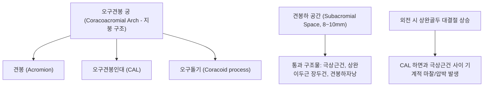

# 🦴 [[구조물/인대/오구견봉인대|오구견봉인대]] (Coracoacromial Ligament, CAL)

> **핵심 요약 (Key Summary)**:
> - 📍 **해부 & 주행**: [[오구돌기]](Coracoid process) 외측연에서 기시하여 [[견봉]](Acromion) 전하면 첨단부에 정지하는 두껍고 강인한 삼각형 섬유성 밴드이다. 견봉, 오구돌기와 함께 **오구견봉 궁(Coracoacromial Arch)**이라는 골-인대성 천장을 형성한다.
> - ⚙️ **생체역학적 핵심 기능**: 상완골두의 과도한 **상방 전위(Superior migration)를 차단하는 1차 기계적 방어벽**이다. 그러나 회전근개 부전이나 견갑골 부정렬 시, 이 인대 하방을 통과하는 [[극상근]]건 및 견봉하 활액낭이 압박되는 **[[견봉하 충돌증후군]](Subacromial Impingement Syndrome)**의 해부학적 병변 부위가 된다.
> - 🛠️ **임상 평가 & 치료**: 니어 검사([[니어 검사|Neer test]]) 및 호킨스-케네디 검사([[호킨스 검사|Hawkins-Kennedy test]])로 유발되는 60~120도 동통호(Painful arc). 오구돌기-견봉 연결부 압통. 견우(LI15)·견료(TE14) 및 견봉하강 자침, [[약침]], 소흉근 및 오구견봉인대 이완 수기, 전거근 강화를 통한 견갑골 후하방 안정화 추나 요법을 적용한다.

---

## 📌 목차
1. [해부학적 정밀 구조 및 주행/부착](#1-해부학적-정밀-구조-및-주행부착)
2. [생체역학·기능 (Biomechanics)](#2-생체역학기능-biomechanics)
3. [임상 평가 및 이학적 검사](#3-임상-평가-및-이학적-검사)
4. [초음파 해부학(Sonoanatomy) 및 중재 랜드마크](#4-초음파-해부학sonoanatomy-및-중재-랜드마크)
5. [⭐ 원장님 심층 임상 고찰 및 원본 필기 (Clinical Pearls)](#5--원장님-심층-임상-고찰-및-원본-필기-clinical-pearls)
6. [관련 임상 질환 및 손상](#6-관련-임상-질환-및-손상)
7. [추나·도수치료 & 침구·약침·재활 프로토콜](#7-추나도수치료--침구약침재활-프로토콜)
8. [출처 및 학술 참고 문헌 (References)](#8-출처-및-학술-참고-문헌-references)

---

## 1. 해부학적 정밀 구조 및 주행/부착

| 항목 | 상세 해부학적 기술 |
| :--- | :--- |
| **기시부 (Origin)** | [[오구돌기]](Coracoid process)의 수평지 외측 능선 및 기저부 전외측 |
| **정지부 (Insertion)** | [[견봉]](Acromion)의 전하면(Anteroinferior surface) 및 외측 첨단부 |
| **형태 및 다발** | 정점(오구돌기)에서 기저부(견봉)로 갈수록 넓어지는 부채꼴 삼각형 띠. 종종 Y자형의 외측 다발과 내측 다발로 분지 |
| **오구견봉 궁 형성** | 오구돌기 + 오구견봉인대 + 견봉 = **오구견봉 궁(Coracoacromial Arch)** 완성 |
| **신경 및 혈관** | [[상견갑신경]](C5-C6) 관절지 및 견봉흉동맥(Thoracoacromial artery)의 견봉 분지 |

- **상하 인접 구조물**:
  - 인대 상면: [[삼각근]] 전방 섬유 심층 및 쇄골 외측단 하부와 접함.
  - 인대 하면: 견봉하자낭(Subacromial bursa)의 천장을 이루며, 그 심층으로 [[극상근]]건이 활주함.

---

## 2. 생체역학·기능 (Biomechanics)

* **상완골두 상방 탈구의 정적 차단벽 (Superior Restraint)**:
  * 회전근개가 마비되거나 광범위 파열되어 상완골두를 관절와 중심으로 끌어내리는 짝힘(Force couple)이 상실되었을 때, 삼각근의 강한 상방 견인력에 의해 상완골두가 위로 솟구치는 것을 막아주는 최종 물리적 지붕 역할을 한다.
* **견봉하 충돌의 메커니즘 (Extrinsic Impingement)**:
  * 팔을 외전 및 굴곡할 때 정상적으로는 견봉하 공간(약 8~10mm)이 유지되어야 하나, 오구견봉인대가 두꺼워지거나 견봉 부착부에 견인 골극(Traction spur)이 형성되면 공간이 5~6mm 이하로 협소해져 극상근건 마모를 가속한다.
* **견갑골 안정화 연계**:
  * 견갑골이 전방경사(Anterior tilt)되고 하방회전(Downward rotation)될 때 오구견봉인대의 긴장도가 비정상적으로 증가하며 충돌 위험이 극대화된다.

---

## 3. 임상 평가 및 이학적 검사

* **1. 니어 검사 ([[니어 검사|Neer Impingement Test]])**:
  * 환자의 견갑골을 후방에서 고정한 상태에서 팔을 내회전시킨 채 강제로 전방 거상(Forward flexion)시킴.
  * 상완골 대결절이 오구견봉인대 전하면과 충돌하여 통증이 유발되면 양성.
* **2. 호킨스-케네디 검사 ([[호킨스 검사|Hawkins-Kennedy Test]])**:
  * 팔을 90도 전방 굴곡시킨 상태에서 내회전(Internal rotation)을 강제함.
  * 극상근건이 오구견봉 궁 하방으로 회전 진입하며 극심한 통증 유발 (민감도 80~90%).
* **3. 동통호 검사 (Painful Arc Test)**:
  * 상지를 외전할 때 60~120도 구간에서 견봉-인대 하방 압박으로 통증이 최고조에 달하고, 120도 이상 거상 시 통증이 감소함.
* **4. 국소 압진 (Focal Palpation)**:
  * 견봉 전외측 모서리에서 내하방(오구돌기 방향)으로 주행하는 인대 라인을 압박 시 예리한 압통 재현.

---

## 4. 초음파 해부학(Sonoanatomy) 및 중재 랜드마크

* **초음파 스캔 랜드마크**:
  * 탐촉자의 한쪽 끝을 견봉 전외측 첨단에, 반대쪽 끝을 오구돌기 외측연에 비스듬히 거치(사선 관상면).
  * 견봉과 오구돌기의 고에코 피질골 음영 사이를 가로지르는 균일한 고에코 섬유성 띠로 관찰됨 (정상 두께 1.0~2.0mm).
* **동적 초음파 충돌 검사 (Dynamic Sonography)**:
  * 탐촉자를 거치한 상태에서 환자에게 팔을 외전 및 내회전시키면, 극상근건이 오구견봉인대 아래로 부드럽게 미끄러져 들어가지 못하고 인대를 상방으로 밀어 올리거나 덜컥거리는 기계적 충돌 현상을 실시간 확인.
* **중재 시술 자침 랜드마크**:
  * 견봉 전외측 하방 1cm 부위에서 인대 하면의 견봉하 활액낭으로 수평 자입. 인대 자체를 관통하지 않고 활액낭 내로 정밀 주입하여 약침의 항염증 효과 극대화.

---

## 5. ⭐ 원장님 심층 임상 고찰 및 원본 필기 (Clinical Pearls)

> [!IMPORTANT]
> **진료실 핵심 감별 및 치료 노하우**:
> 1. **"갈고리형 견봉(Bigliani Type III)의 정체"**:
>    - 방사선 상에서 견봉이 아래로 갈고리처럼 굽어 보이는 소견의 상당수는 선천적 골 모양이 아니라, **오구견봉인대의 만성적인 견인 장력(Tension)에 의해 인대 부착부에 뼈가 자라난 견인 골극(Enthesophyte)**이다.
> 2. **인대 무조건 절제(Release)의 위험성**:
>    - 과거 정형외과에서 충돌증후군 수술 시 오구견봉인대를 광범위 절제했으나, 추후 회전근개 파열이 동반될 경우 상완골두가 앞뒤-위로 완전히 빠져버리는 전상방 탈구가 유발된다는 치명적 문제점이 보고되었다.
> 3. **소흉근과의 장력 연결고리**:
>    - [[소흉근]](Pectoralis minor)이 단축되면 오구돌기를 전하방으로 당기게 되고, 이는 오구견봉인대를 팽팽하게 긴장시켜 견봉하 공간을 좁힌다. 따라서 충돌증후군 치료 시 견우 혈위 자침과 함께 **반드시 소흉근 이완(중부 혈위 자침 및 라운드 숄더 추나)**을 병행해야 근본 치료가 된다.

---

## 6. 관련 임상 질환 및 손상

* **견봉하 충돌증후군 ([[견봉하 충돌증후군|Subacromial Impingement Syndrome]])**:
  * 오구견봉인대 비후 및 견봉하 공간 협소로 인한 극상근건·견봉하낭의 만성 마찰.
* **회전근개 건염 및 건증 ([[회전근개 파열|Rotator Cuff Tendinopathy]])**:
  * 인대 하면 마찰에 의한 극상근건의 점진적 퇴행성 파열.
* **오구견봉인대 견인 골극 (CAL Enthesophyte)**:
  * 만성 인장력에 의한 견봉 전하방 골극 형성으로 인한 외인성 충돌 가속.

---

## 7. 추나·도수치료 & 침구·약침·재활 프로토콜

### 1) 한의 보존적 재활 및 추나요법
* **견갑골 후인-하강(Retraction-Depression) 추나**:
  * 견갑골이 전방으로 말리는 라운드 숄더 변위를 교정하여 오구견봉 궁의 전방 경사를 바로잡고 견봉하 공간을 확보.
  * 소흉근 근막 이완술(Myofascial release)을 통해 오구돌기 견인 스트레스 해소.
* **견관절 하방 활주 가동술 (Inferior Glide)**:
  * 외전 동작 시 상완골두가 견봉-오구견봉인대에 부딪히지 않도록 하방으로 미끄러뜨리는 관절가동술.

### 2) 침구 및 약침 치료 프로토콜
* **주요 혈위**:
  * 견우(LI15), 견료(TE14): 견봉하 공간 전후방 감압.
  * 거골(LI16), 천료(TE15): 승모근 및 견갑거근 이완.
  * 중부(LU1): 소흉근 부착부 이완을 통한 오구돌기 장력 감압.
* **약침 프로토콜**:
  * 견봉하낭 및 오구견봉인대 하면에 [[신바로약침|신바로 약침]] 또는 봉약침 0.5~1.0cc 주입하여 충돌로 유발된 활액낭염 및 건 주위 무균성 염증을 신속히 제거.

---

## 8. 출처 및 학술 참고 문헌 (References)

1. **Nguyen HD, et al. (2026)**. Magnetic resonance imaging: Clinical correlation in surgically treated isolated subacromial impingement syndrome. *J Med Imaging Radiat Sci*. 57(6):102605. PMID: 42815430.
   - `[연구 요약]` 견봉하 충돌증후군 환자에서 오구견봉인대 두께, 견봉하 간격 협소도 및 MRI 소견과 임상 증상 악화 간의 상관관계를 다룬 최신 연구.
2. **Sukhorum W, et al. (2025)**. Acromioclavicular Joint Depth and Angle in the Thai Population: Implications for Clavicle Hook Plate Design. *Clin Orthop Surg*. 17(5):862-868. PMID: 41112126.
   - `[연구 요약]` 오구견봉 복합체와 견쇄관절의 3차원 해부학적 경사각 및 오구돌기-견봉 간 생체역학적 공간 분석.
