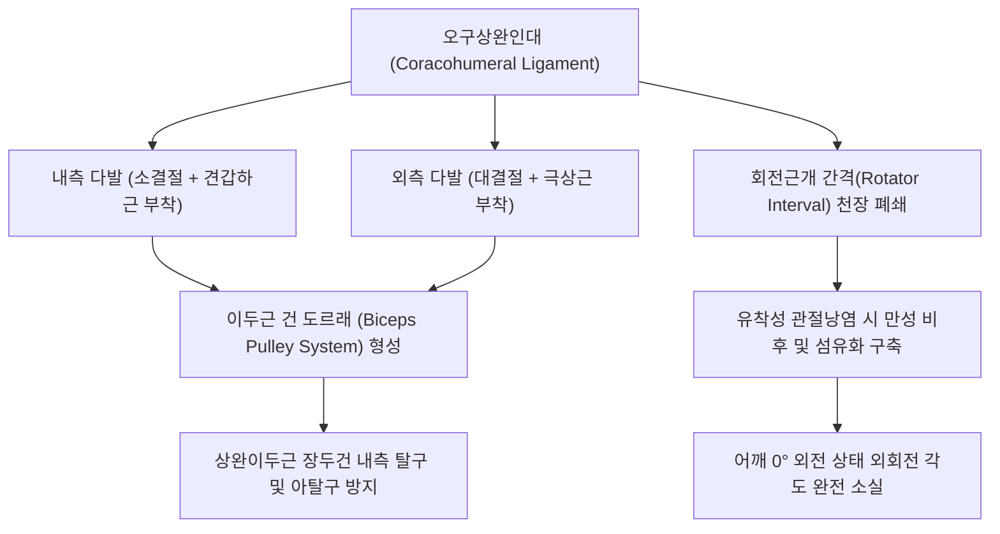

# 🦴 [[구조물/인대/오구상완인대|오구상완인대]] (Coracohumeral Ligament, CHL)

> **핵심 요약 (Key Summary)**:
> - 📍 **해부 & 주행**: [[오구돌기]](Coracoid process) 기저부 외측연에서 기시하여 외측으로 주행한 뒤, 두 다발로 갈라져 [[상완골]] 대결절과 소결절에 각각 정지하는 강력한 인대이다. 두 다발 사이로 상완이두근 장두건(LHBT)이 통과하며, [[상관절와상완인대]](SGHL)와 함께 **회전근개 간격(Rotator Interval)**을 덮고 **이두근 도르래(Biceps Pulley)** 기전을 완성한다.
> - ⚙️ **생체역학적 핵심 기능**: 팔을 내린 중립위(0도 외전)에서 중력에 의한 상완골두의 **하방 전위(Inferior translation)**를 억제하는 1차 구속물(Primary restraint)이자, 상완골의 **외회전(External rotation)을 제어하는 최종 억제기**이다.
> - 🛠️ **임상 평가 & 치료**: **[[오십견]](유착성 관절낭염, Adhesive Capsulitis)의 가장 결정적인 병리 표적**이다. 인대의 섬유화 구축으로 인해 '팔을 옆구리에 붙인 상태에서의 수동 외회전 소실'이 특징적이다. 견우(LI15)·견료(TE14) 및 오구돌기 외측 회전근개 간격 부위 자침, [[약침]], 부드러운 외회전 관절가동 추나 요법으로 구축을 해소한다.

---

## 📌 목차
1. [해부학적 정밀 구조 및 주행/부착](#1-해부학적-정밀-구조-및-주행부착)
2. [생체역학·기능 (Biomechanics)](#2-생체역학기능-biomechanics)
3. [임상 평가 및 이학적 검사](#3-임상-평가-및-이학적-검사)
4. [초음파 해부학(Sonoanatomy) 및 중재 랜드마크](#4-초음파-해부학sonoanatomy-및-중재-랜드마크)
5. [⭐ 원장님 심층 임상 고찰 및 원본 필기 (Clinical Pearls)](#5--원장님-심층-임상-고찰-및-원본-필기-clinical-pearls)
6. [관련 임상 질환 및 손상](#6-관련-임상-질환-및-손상)
7. [추나·도수치료 & 침구·약침·재활 프로토콜](#7-추나도수치료--침구약침재활-프로토콜)
8. [출처 및 학술 참고 문헌 (References)](#8-출처-및-학술-참고-문헌-references)

---

## 1. 해부학적 정밀 구조 및 주행/부착

| 해부학적 항목 | 정밀 기술 내용 |
| :--- | :--- |
| **기시부 (Origin)** | [[오구돌기]](Coracoid process) 기저부(Base)의 후외측 연 |
| **정지부 (Insertion)** | **외측 다발**: [[극상근]]건 앞쪽 섬유와 융합하며 [[상완골]] 대결절(Greater tuberosity) 전면에 정지. **내측 다발**: [[견갑하근]]건 위쪽 섬유와 융합하며 소결절(Lesser tuberosity)에 정지 |
| **회전근개 간격 (Rotator Interval)** | 극상근 전연과 견갑하근 상연 사이의 삼각형 공간을 CHL이 천장처럼 밀폐 |
| **이두근 도르래 복합체 (Biceps Pulley)** | 외측·내측 다발이 결절간구를 가로지르며 상완이두근 장두건(LHBT)을 둘러싸는 섬유성 슬링(Sling) 형성 |
| **신경 및 혈관** | [[액와신경]](C5-C6) 관절지 및 전상완회선동맥(Anterior circumflex humeral artery)의 상행지 |

---

## 2. 생체역학·기능 (Biomechanics)

* **하방 전위 억제 (0도 외전 중립위)**:
  * 팔을 자연스럽게 내리고 서 있을 때, 중력에 의해 상완골두가 아래로 처지는 것을 막는 **가장 강력한 수동 억제기**이다.
  * 이때 상관절와상완인대(SGHL)와 협동하여 관절강 내 음압(Negative intra-articular pressure)을 유지시킨다.
* **외회전 제한 (Primary Restraint to External Rotation)**:
  * 상완골을 외회전할 때 회전근개 간격과 CHL이 최대로 팽팽해지며 상완골두의 과도한 외회전을 억제한다.
  * 따라서 CHL의 구축은 어깨 질환 중 가장 두드러진 **외회전 가동역 제한(Rotational stiffness)**을 유발한다.
* **이두근 건 안정화**:
  * 결절간구(Bicipital groove) 입구에서 상완이두근 장두건이 전내측으로 튕겨 나가지 않도록 지렛대 역할을 수행한다.

---

## 3. 임상 평가 및 이학적 검사

* **1. 중립위 수동 외회전 제한 검사 (Passive External Rotation at 0° Abduction)**:
  * 환자의 팔꿈치를 90도 굽히고 상완을 몸통 옆구리에 바짝 붙인 상태에서 검사자가 수동 외회전을 시도.
  * 정상측에 비해 50% 이상(또는 30도 미만)으로 현저히 제한되고 단단한 골성 종말감(Hard/Leathery endpoint)이 느껴지면 CHL 구축(오십견)을 강력 시사.
* **2. 구(Sulcus) 검사 시 외회전 감별**:
  * 팔을 아래로 당겨 구(Sulcus)가 나타날 때, 팔을 외회전시킨 상태에서 다시 당겼을 때 고랑이 사라진다면 CHL이 정상 장력을 유지하고 있음을 의미.
* **3. 회전근개 간격 압통 검사 (Rotator Interval Tenderness)**:
  * 오구돌기 첨단에서 외측으로 1~1.5cm 지점(대결절과 소결절 사이)을 촉진 시 극심한 압통 유발.
* **4. 스피드 검사 ([[스피드 검사|Speed Test]]) 및 야가손 검사 ([[야가손 검사|Yergason Test]])**:
  * 이두근 도르래 손상에 의한 LHBT 불안정성 및 건염 동반 여부 확인.

---

## 4. 초음파 해부학(Sonoanatomy) 및 중재 랜드마크

* **초음파 스캔 랜드마크**:
  * 탐촉자를 오구돌기와 상완골 대결절 사이에 횡단/사선으로 위치시켜 회전근개 간격을 스캔.
  * 오구돌기 기저부에서 상완이두근 장두건 표면을 덮으며 대·소결절로 뻗어 나가는 고에코성 섬유성 띠로 관찰됨 (정상 두께 1.5~2.5mm).
* **유착성 관절낭염(오십견) 병리 소견**:
  * CHL의 현저한 **저에코성 비후(두께 >3.0~4.0mm)**.
  * 파워 도플러 상에서 회전근개 간격 내 풍부한 신생혈관(Neovascularization) 증식.
  * 액와낭(Axillary pouch) 관절낭 비후와 함께 오십견 진단의 **민감도 85%, 특이도 90%**를 나타내는 핵심 지표.
* **중재 시술 자침 랜드마크**:
  * 오구돌기 외측 1cm 지점에서 초음파 유도 하에 CHL 심층과 상완이두근 건 사이의 회전근개 간격으로 바늘을 진입시켜 관절낭 유착 박리 및 약침 주입 시행.

---

## 5. ⭐ 원장님 심층 임상 고찰 및 원본 필기 (Clinical Pearls)

> [!IMPORTANT]
> **진료실 핵심 감별 및 치료 노하우**:
> 1. **"오십견의 핵심 자물쇠는 오구상완인대다"**:
>    - 환자가 "뒷짐을 못 진다(내회전 제한)"고 호소하며 오더라도, 진료실에서 가장 먼저 확인해야 할 것은 **"팔을 옆구리에 붙인 채 밖으로 돌릴 수 있는가(외회전 제한)"**이다.
>    - CHL이 쪼그라들어 굳어버린 자물쇠 역할을 하기 때문에, 이 인대를 풀어주지 않고 억지로 팔을 들어 올리거나 돌리려 하면 극상근건 파열이나 견봉 충돌만 악화된다.
> 2. **회전근개 파열 vs 오십견 감별**:
>    - 회전근개 파열 환자는 아파서 능동적으로는 못 돌려도, 의사가 손으로 잡아 돌리면 밖으로 잘 돌아간다(수동 정상).
>    - 반면 CHL이 굳은 오십견 환자는 의사가 아무리 힘을 주어 돌려도 10~20도 부근에서 턱 걸리며 돌아가지 않는다(수동 제한).
> 3. **치료 순서의 원칙**:
>    - 치료 시 견우 혈위 자침과 함께 오구돌기 외측 1cm의 회전근개 간격 부위에 [[신바로약침|신바로 약침]]을 주입하여 CHL의 염증과 부종을 먼저 가라앉힌 뒤, 점진적인 수동 외회전 스트레칭을 적용해야 통증 없이 가동역이 열린다.

---

## 6. 관련 임상 질환 및 손상

* **유착성 관절낭염 ([[오십견|Adhesive Capsulitis, Frozen Shoulder]])**:
  * CHL의 만성 염증성 수축 및 섬유화로 인한 어깨 전방 관절낭 구축의 핵심 병소.
* **이두근 도르래 병변 (Biceps Pulley Lesion)**:
  * 외상이나 마모로 CHL 부착부가 찢어져 상완이두근 장두건이 소결절 내측으로 아탈구(Subluxation)되는 질환.
* **회전근개 간격 이완증 (Rotator Interval Laxity)**:
  * 선천적 또는 외상성 이완으로 상완골두 다방향 불안정성(MDI) 초래.

---

## 7. 추나·도수치료 & 침구·약침·재활 프로토콜

### 1) 한의 보존적 재활 및 추나요법
* **오구상완인대 수기 신연 추나 (CHL Manual Distraction)**:
  * 환자의 상완을 내린 상태에서 검사자의 모지두로 오구돌기 외측 CHL 주행 부위를 부드럽게 압박하며, 상완골두를 후하방으로 부드럽게 밀어 넣으면서 서서히 외회전을 유도.
* **견갑흉곽 관절 가동술**:
  * 굳어버린 견관절을 보상하느라 과긴장된 상부 승모근, 견갑거근을 이완하고 견갑골의 정상 흉곽 활주 유도.

### 2) 침구 및 약침 치료 프로토콜
* **주요 혈위**:
  * 견전(肩前 / 내견우): 오구돌기와 상완골두 사이 회전근개 간격 직상방 자침.
  * 견우(LI15), 견료(TE14): 관절낭 상외측 순경 혈위.
  * 노회(TE13), 곡지(LI11): 상지 경락 소통.
* **약침 프로토콜**:
  * 회전근개 간격 및 CHL 부착부 주변에 [[신바로약침|신바로 약침]] 또는 봉약침 0.5cc를 정밀 주입하여 만성 섬유아세포 증식 억제 및 혈류 촉진.

---

## 8. 출처 및 학술 참고 문헌 (References)

1. **Al Khayyat SG, et al. (2023)**. Adhesive capsulitis and ultrasound diagnosis, an inseparable pair: a novel review. *J Ultrasound*. 26(2):369-384. PMID: 36284048.
   - `[연구 요약]` 유착성 관절낭염(오십견) 환자에서 오구상완인대(CHL)의 비후, 회전근개 간격의 신생혈관화 및 초음파 영상의학적 진단 정확도와 가동역 제한 상관관계 종합 분석.
2. **Yadav A, et al. (2026)**. Ultrasonographic Findings in Periarthritis of the Shoulder and Their Correlation With Clinical Severity. *Cureus*. 18(5):e108787. PMID: 42291849.
   - `[연구 요약]` 견관절 주위염 및 유착성 관절낭염 환자에서 오구상완인대(CHL)와 회전근개 간격의 초음파 비후 소견과 임상적 외회전 제한 중증도 간의 유의한 상관관계 입증.
