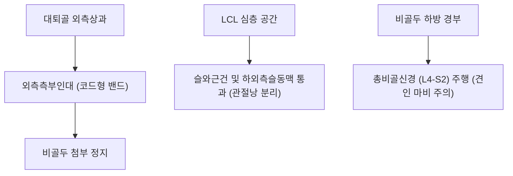

# 🦴 [[구조물/인대/외측측부인대|외측측부인대]] (Lateral Collateral Ligament, LCL / Fibular Collateral Ligament, FCL)

> **핵심 요약 (Key Summary)**:
> - 📍 **해부 & 주행**: [[대퇴골]] 외측상과에서 기시하여 [[비골두]](Head of fibula) 외측 첨부에 정지하는 길이 약 5~6cm의 둥글고 단단한 코드형(Cord-like) 독립 인대이다. 내측측부인대(MCL)와 달리 관절낭 외(Extracapsular)에 위치하여 [[외측반월상연골]]과 완전히 분리되어 있으며, 심층으로 [[슬와근]]건이 교차 통과한다.
> - ⚙️ **생체역학적 핵심 기능**: 슬관절 **내반(Varus) 스트레스에 대항하는 1차 정적 억제기(Primary restraint)**이자, 슬와비골인대(PFL), 슬와근과 함께 후외측 복합체(PLC)를 형성하여 경골 외회전 및 과신전을 차단한다.
> - 🛠️ **임상 평가 & 치료**: 무릎 전내측 충돌이나 과신전-내반 외상 시 호발한다. 30도 내반 스트레스 검사 및 다이얼 검사(Dial test)로 진단한다. 비골 경부를 감아 도는 [[총비골신경]] 손상(족하수, Drop foot) 감별이 필수적이다. 양릉천(GB34)·슬양관(GB33) 자침, [[약침]], 비골두 후방 변위 교정 추나 요법을 적용한다.

---

## 📌 목차
1. [해부학적 정밀 구조 및 주행/부착](#1-해부학적-정밀-구조-및-주행부착)
2. [생체역학·기능 (Biomechanics)](#2-생체역학기능-biomechanics)
3. [임상 평가 및 이학적 검사](#3-임상-평가-및-이학적-검사)
4. [초음파 해부학(Sonoanatomy) 및 중재 랜드마크](#4-초음파-해부학sonoanatomy-및-중재-랜드마크)
5. [⭐ 원장님 심층 임상 고찰 및 원본 필기 (Clinical Pearls)](#5--원장님-심층-임상-고찰-및-원본-필기-clinical-pearls)
6. [관련 임상 질환 및 손상](#6-관련-임상-질환-및-손상)
7. [추나·도수치료 & 침구·약침·재활 프로토콜](#7-추나도수치료--침구약침재활-프로토콜)
8. [출처 및 학술 참고 문헌 (References)](#8-출처-및-학술-참고-문헌-references)

---

## 1. 해부학적 정밀 구조 및 주행/부착

| 해부학적 항목 | 상세 기술 내용 |
| :--- | :--- |
| **대퇴 기시부 (Origin)** | [[대퇴골]] 외측상과(Lateral epicondyle) 상외측 결절 (외측 슬와구 근위 후방) |
| **비골 정지부 (Insertion)** | [[비골두]](Fibular head) 외측면의 첨부(Apex/Styloid process) |
| **형태 및 주행** | 길이 약 50~60mm, 직경 약 4~5mm의 둥근 코드형(Cord-like) 독립 밴드 구조 |
| **관절낭과의 관계** | **관절낭 외(Extracapsular) 주행**: 관절낭 및 외측 반월판과 유착되지 않고 독립되어 활주 |
| **인접 심부 구조물** | LCL 심층으로 [[슬와근]](Popliteus)건과 하외측슬동맥(Inferior lateral genicular artery)이 통과 |
| **인접 천부 구조물** | 표재부 전방으로 [[장경인대]](ITB) 후연이 덮고, 정지부 근처에서 [[대퇴이두근]]건과 합류 |
| **위험 신경 주행** | 비골두 하방 1~2cm 경부를 감아 도는 [[총비골신경]](Common peroneal nerve)과 밀접 |

---

## 2. 생체역학·기능 (Biomechanics)

* **1차 내반 억제기 (Primary Restraint to Varus Stress)**:
  * 무릎이 30도 굴곡된 상태에서 외측 관절선을 벌어지게 만드는 **내반력의 약 55~69%를 LCL이 단독으로 부담**한다.
  * 완전 신전(0도) 상태에서는 LCL 외에도 후외측 관절낭, [[전방십자인대]](ACL), [[후방십자인대]](PCL)가 함께 협력하여 내반력에 저항한다.
* **후외측 복합체(PLC)의 핵심 축**:
  * LCL은 슬와근건, 슬와비골인대(PFL)와 함께 슬관절 후외측 모서리(Posterolateral Corner)를 구성한다.
  * 경골이 대퇴골에 대해 과도하게 바깥쪽으로 돌아가는 **외회전(External rotation)과 과신전(Hyperextension)을 방어**하는 결정적 수동 구속물이다.
* **혈류 공급과 치유 특성**:
  * 천층에 풍부한 혈관망을 가진 내측측부인대(MCL)와 달리, LCL은 둥근 코드형 관절낭 외 구조여서 혈류 공급이 상대적으로 제한적이며, 완전 단열 시 자연 치유율이 MCL보다 낮아 외과적 재건이나 적극적인 한의 재생 치료가 요구된다.

---

## 3. 임상 평가 및 이학적 검사

* **1. 30도 굴곡 내반 스트레스 검사 ([[내반 스트레스 검사|Varus Stress Test at 30°]])**:
  * 환자를 앙와위로 눕히고 슬관절을 30도 굴곡시킨 상태에서 대퇴골을 고정하고 발목을 내측으로 밀어 외측 관절선의 열림과 통증을 확인.
  * LCL 단독 손상을 평가하는 가장 정확한 표준 검사.
* **2. 0도 완전 신전 내반 스트레스 검사 (Varus Stress Test at 0°)**:
  * 무릎을 완전히 편 상태에서 관절선이 벌어진다면 LCL 단독 손상을 넘어 ACL, PCL 또는 PLC 복합 파열(고도 불안정성)을 의미.
* **3. 다이얼 검사 ([[다이얼 검사|Dial Test]])**:
  * 복와위에서 무릎을 30도 및 90도 굴곡시키고 양측 발목을 외회전시켜 각도 차이를 비교.
  * **30도 굴곡에서만 10도 이상 외회전 증가**: PLC 단독 손상.
  * **30도 및 90도 굴곡 모두에서 10도 이상 증가**: PLC + PCL 동반 복합 손상.
* **4. 총비골신경 검사 (CPN Neurological Exam)**:
  * 족관절 배굴(Foot dorsiflexion) 및 제1족지 배굴 근력(L5), 족배부 감각 저하(Tinel 징후)를 즉시 확인.

---

## 4. 초음파 해부학(Sonoanatomy) 및 중재 랜드마크

* **초음파 스캔 랜드마크 (Figure-4 자세)**:
  * 환자의 검사측 발목을 반대측 정강이 위에 얹는 '4자 다리(Figure-of-4)' 자세를 취하면 LCL이 팽팽하게 긴장되어 관찰이 용이함.
  * 탐촉자를 대퇴 외측상과에서 비골두 첨부로 비스듬히 거치하여 두 피질골 사이를 팽팽히 잇는 코드형 고에코 밴드를 종단 스캔.
  * 인대 심층에서 횡단으로 지나가는 슬와근건의 저에코 원형 단면을 확인.
* **병리적 초음파 소견**:
  * 인대 실질의 저에코성 비후, 섬유 불연속성(Tear), 비골두 부착부의 박리 골편(Avulsion fracture) 및 혈종 관찰.
* **중재 시술 자침 랜드마크**:
  * 비골두 첨부 부착부 및 대퇴 외측상과 기시부를 초음파로 확인하고, 비골두 하방 경부를 감아 도는 총비골신경 주행 경로를 파워 도플러로 확인한 뒤 신경을 피해 인대 주변부로 안전하게 자입.

---

## 5. ⭐ 원장님 심층 임상 고찰 및 원본 필기 (Clinical Pearls)

> [!IMPORTANT]
> **진료실 핵심 감별 및 치료 노하우**:
> 1. **"LCL 손상은 단독으로 오지 않는다"**:
>    - 임상에서 LCL만 단독으로 찢어지는 경우는 5% 미만이다. 대부분 전방/후방 십자인대 파열이나 후외측 복합체(PLC) 파열과 함께 발생하므로, 무릎 외측이 아프다고 LCL만 치료하고 넘어가면 만성 회전 불안정성으로 관절염이 급속히 진행된다.
> 2. **총비골신경 마비(족하수)를 1초 만에 확인하는 법**:
>    - 무릎 외측 충돌 환자가 오면 눕히자마자 **"엄지발가락을 하늘 쪽으로 힘껏 들어보세요"**라고 지시한다. 발가락이 처지거나 족배 감각이 둔하다면 비골두 견열 골절이나 LCL 파열에 의한 총비골신경 견인 손상(Neuropraxia)이므로 즉시 정밀 검사와 고정이 필요하다.
> 3. **비골두 후하방 아탈구 교정 추나**:
>    - 외상 후 LCL 긴장이 지속되면 대퇴이두근의 견인력으로 비골두가 후하방으로 변위되어 무릎 외측 통증과 신경 자극을 유발한다. 무릎 굴곡 상태에서 비골두를 전상방으로 부드럽게 활주시키는 수기 교정이 통증을 즉각 경감시킨다.

---

## 6. 관련 임상 질환 및 손상

* **외측측부인대 염좌 및 파열 (LCL Tear)**:
  * 내반 스트레스 손상. 비골두 부착부 박리 파열 빈발.
* **후외측 회전 불안정성 (Posterolateral Instability, PLI)**:
  * LCL, PFL, 슬와근건 동반 손상으로 보행 시 무릎이 바깥 뒤쪽으로 어긋나는 현상.
* **총비골신경 포착 및 마비 ([[비골신경 마비|Peroneal Nerve Palsy]])**:
  * 비골두 주위 혈종, 부종, 변위로 인한 족하수(Foot drop).
* **비골두 박리 골절 (Segond 골절 / Arcuate Fracture)**:
  * 외측 인대 복합체 견인에 의한 골 결손.

---

## 7. 추나·도수치료 & 침구·약침·재활 프로토콜

### 1) 한의 보존적 재활 및 추나요법
* **비골두 전상방 관절가동 추나**:
  * 환자 무릎을 90도 굴곡하고 검사자의 수근부로 비골두 후면을 지지한 뒤 전상방(Anterosuperior)으로 부드럽게 밀어 올리는 정렬 교정.
* **보조기 고정 및 족하수 방지**:
  * Grade I~II 손상 시 경첩형 보조기로 3~4주간 내반 스트레스 차단. 신경 마비 징후 동반 시 AFO 보조기 병행.

### 2) 침구 및 약침 치료 프로토콜
* **주요 혈위**:
  * 양릉천(GB34): 비골두 전하방 요함처, LCL 정지부 및 근막 긴장 완화.
  * 슬양관(GB33): 대퇴 외측상과 LCL 기시부 직상방.
  * 현종(GB39), 족임읍(GB41): 족소양담경 순경 배혈.
* **약침 프로토콜**:
  * 대퇴 외측상과 기시부 및 비골두 부착부에 [[신바로약침|신바로 약침]] 0.3~0.5cc를 정밀 주입하여 콜라겐 섬유 합성 및 인대 장력 회복 유도.

---

## 8. 출처 및 학술 참고 문헌 (References)

1. **Augustin EJ, et al. (2026)**. Length Changes of the Lateral Knee: Fibular Collateral Ligament, Anterolateral Ligament, and Iliotibial Band Fibers. *Am J Sports Med*. 54(11):2713-2721. PMID: 42544914.
   - `[연구 요약]` 슬관절 굴곡-신전 및 내반-회전 부하 상태에서 외측측부인대(FCL/LCL), 전외측인대(ALL), 장경인대(ITB)의 동적 길이 변화와 생체역학적 장력 분담률을 정밀 계측한 최신 연구.
2. **Runer A, et al. (2026)**. Current concepts in isolated and combined injuries of the medial collateral ligament complex-Part I: Anatomy, biomechanics, clinical and radiological examination of the medial collateral ligament of the knee. *Knee Surg Sports Traumatol Arthrosc*. PMID: 42748362.
   - `[연구 요약]` 슬관절 측부인대 복합체의 생체역학적 기능, 다축성 스트레스 하중 제어 메커니즘 및 동반 손상의 감별 진단 지침 제시.
