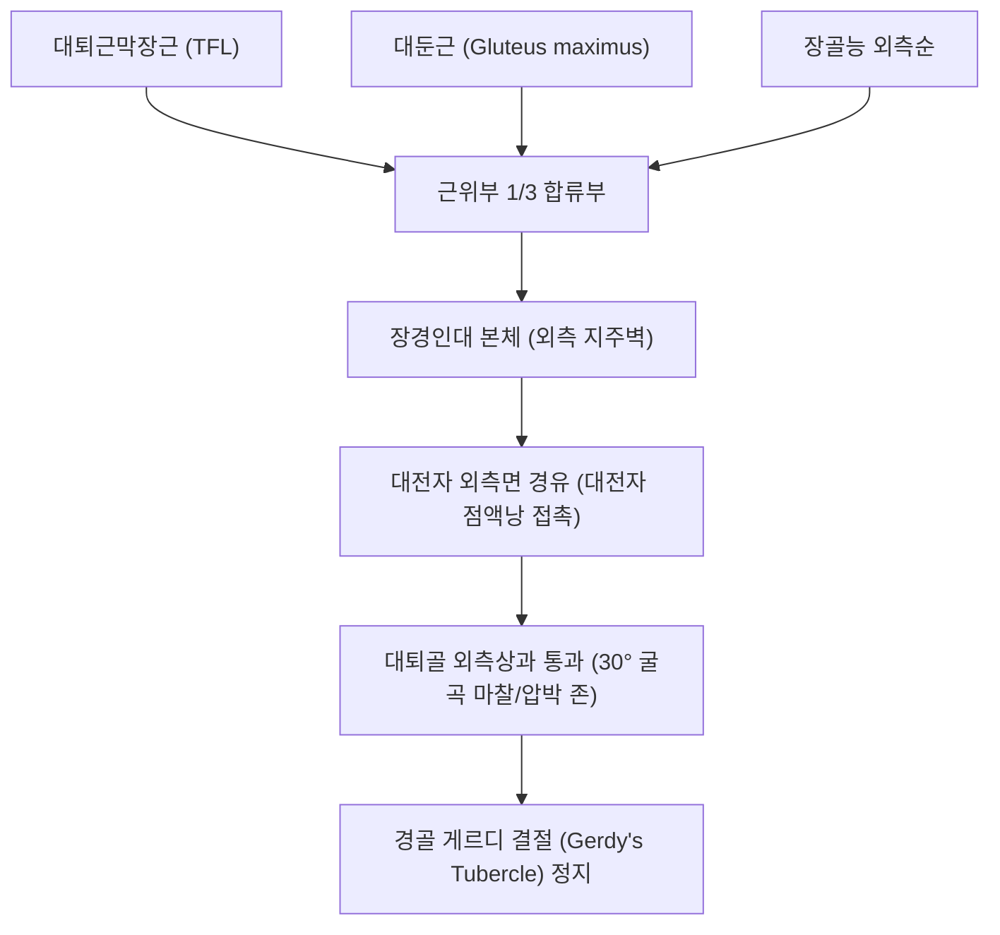

# 🦴 [[구조물/인대/장경인대|장경인대]] (Iliotibial Band, ITB / 엉덩정강근막띠)

> **핵심 요약 (Key Summary)**:
> - 📍 **해부 & 주행**: 골반 [[장골능]](Iliac crest) 외측순에서 기원하여, 근위부에서 [[대퇴근막장근]](TFL)과 [[대둔근]](Gluteus maximus)의 건막 섬유가 합류한 뒤 대퇴 외측을 따라 수직 하강하여 [[경골]] 외측의 **[[게르디 결절]](Gerdy's tubercle)**에 단단히 정지하는 대퇴근막(Fascia lata)의 두터운 섬유성 건막 띠이다.
> - ⚙️ **생체역학적 핵심 기능**: 하지 외측의 강력한 지주벽(Lateral pillar)을 형성하여 한 발 서기 및 보행 입각기 시 골반의 수평 안정을 돕는다. 슬관절 굴곡 각도에 따라 기능이 역전되어 **0~30도 신전 범위에서는 무릎 신전을 보조**하고, **30도 이상 굴곡 시에는 무릎 굴곡을 보조**하며 대퇴골 외측상과를 타고 후방 활주한다.
> - 🛠️ **임상 평가 & 치료**: 러너(Runner)와 사이클 선수에서 호발하는 **[[장경인대 증후군]](ITBS)**의 핵심 구조물이다. 노블 압박 검사([[노블 검사|Noble compression test]]) 및 오버 검사([[오버 검사|Ober test]])로 진단한다. 풍시(GB31)·슬양관(GB33) 자침, [[약침]], TFL 근막이완 및 [[중둔근]] 강화 추나 요법을 적용한다.

---

## 📌 목차
1. [해부학적 정밀 구조 및 주행/부착](#1-해부학적-정밀-구조-및-주행부착)
2. [생체역학·기능 (Biomechanics)](#2-생체역학기능-biomechanics)
3. [임상 평가 및 이학적 검사](#3-임상-평가-및-이학적-검사)
4. [초음파 해부학(Sonoanatomy) 및 중재 랜드마크](#4-초음파-해부학sonoanatomy-및-중재-랜드마크)
5. [⭐ 원장님 심층 임상 고찰 및 원본 필기 (Clinical Pearls)](#5--원장님-심층-임상-고찰-및-원본-필기-clinical-pearls)
6. [관련 임상 질환 및 손상](#6-관련-임상-질환-및-손상)
7. [추나·도수치료 & 침구·약침·재활 프로토콜](#7-추나도수치료--침구약침재활-프로토콜)
8. [출처 및 학술 참고 문헌 (References)](#8-출처-및-학술-참고-문헌-references)

---

## 1. 해부학적 정밀 구조 및 주행/부착

| 해부학적 항목 | 상세 기술 내용 |
| :--- | :--- |
| **기시부 (Origin)** | 골반 [[장골능]](Iliac crest) 외측순 결절 및 둔근막 |
| **근육 건막 합류** | **전방부**: [[대퇴근막장근]](TFL) 전면 섬유 합류. **후방부**: [[대둔근]](Gluteus maximus) 상부 표층 섬유(약 3/4) 합류 |
| **원위 정지부 (Insertion)** | [[경골]] 외측과 전외측면의 **[[게르디 결절]](Gerdy's tubercle)** |
| **보조 정지 및 확장** | 일부 섬유는 슬개골 외측 지대(Lateral retinaculum) 및 대퇴골 외측상과 상릉으로 부착 확장 |
| **신경 지배** | 합류 근육은 [[상둔신경]](TFL, L4-S1) 및 [[하둔신경]](대둔근, L5-S2) 지배 |
| **혈관 공급** | 외측대퇴회선동맥(Lateral circumflex femoral artery)의 상행지 및 하외측슬동맥 |

---

## 2. 생체역학·기능 (Biomechanics)

* **30도 굴곡 역전 현상 (Flip-Flop Phenomenon)**:
  * 무릎 0~30도 신전 범위: 장경인대가 대퇴골 외측상과의 전방에 위치하여 슬관절의 **신전(Extension)을 보조**한다.
  * 무릎 30도 이상 굴곡 범위: 장경인대가 대퇴골 외측상과를 타고 뒤쪽으로 넘어가 슬관절의 **굴곡(Flexion)을 보조**한다.
  * **충돌 구역(Impingement Zone)**: 보행 및 달리기 착지 시 무릎이 정확히 **30도 굴곡되는 순간** 장경인대 심층이 대퇴골 외측상과를 가장 강하게 압박한다.
* **하지 외측 지주벽 (Lateral Tension Band)**:
  * 보행 입각기 동안 체중에 의해 골반이 반대측으로 떨어지려는 내전 토크에 대항하여, 중둔근과 함께 장경인대의 인장 밴드가 골반 수평 안정을 정적으로 지지한다.
* **근막 사슬 연계 (Anatomy Trains)**:
  * 비골근군(Peroneals) → 장경인대 → 대퇴근막장근/대둔근 → 복사근/흉요근막으로 이어지는 **외측선(Lateral Line)**의 중심 기둥 역할을 한다.

---

## 3. 임상 평가 및 이학적 검사

* **1. 노블 압박 검사 ([[노블 검사|Noble Compression Test]])**:
  * 환자를 앙와위로 눕히고 무릎을 90도 굴곡시킨 상태에서, 검사자가 엄지손가락으로 대퇴골 외측상과(무릎 외측 관절선 상방 2~3cm)를 강하게 압박하며 무릎을 서서히 신전시킴.
  * 굴곡 약 30도 지점을 통과할 때 외측상과 부위에 날카로운 국소 통증이 재현되면 양성 (장경인대 증후군 확진 검사).
* **2. 오버 검사 ([[오버 검사|Ober Test]])**:
  * 환자를 건측으로 측와위로 눕히고 검사측 고관절을 외전·신전시킨 후 아래로 떨어뜨림.
  * 대퇴가 침대 수평면 아래로 자연스럽게 떨어지지 않고 공중에 들려 있으면 장경인대 및 대퇴근막장근의 단축·구축을 의미.
* **3. 르네 검사 (Renne Test)**:
  * 환자가 한 발로 서서 체중을 실은 채 무릎을 30~40도 굴곡할 때 외측상과 통증 재현 확인.

---

## 4. 초음파 해부학(Sonoanatomy) 및 중재 랜드마크

* **초음파 스캔 랜드마크**:
  * 환자의 무릎을 30도 굴곡시킨 상태에서 탐촉자를 대퇴골 외측상과에 종단으로 거치.
  * 외측상과 피질골 위를 덮고 지나가는 두꺼운 고에코 섬유성 띠로 관찰됨 (정상 두께 1.5~2.5mm).
  * 외측상과 골막과 장경인대 심층 사이의 혈관성 지방체(Innervated Fat Pad)와 활액낭을 확인.
* **병리적 초음파 소견**:
  * 장경인대 증후군 환자에서는 인대 원위부 두께 비후(>3.0mm), 인대 심층 지방체의 저에코성 부종 및 파워 도플러 상 신생혈관(Neovascularization) 증식 확인.
* **중재 시술 자침 랜드마크**:
  * 대퇴 외측상과 압통부에서 인대 자체를 직접 관통하기보다는, 인대 심층과 골막 사이의 활액낭 및 혈관성 지방체 틈새로 초음파 유도 하에 약침액을 주입.

---

## 5. ⭐ 원장님 심층 임상 고찰 및 원본 필기 (Clinical Pearls)

> [!IMPORTANT]
> **진료실 핵심 감별 및 치료 노하우**:
> 1. **"마찰이 아니라 압박(Compression)이다"**:
>    - 고전적으로는 인대가 뼈 위를 앞뒤로 긁는 '마찰 증후군'으로 불렸으나, 최신 해부학 연구에 따르면 장경인대는 외측상과에 섬유성 가닥으로 고정되어 있어 앞뒤로 크게 미끄러지지 않는다. 실제 통증의 원인은 **30도 굴곡 시 인대 심층의 신경-혈관성 지방체가 뼈 사이에 끼여 짓눌리는 압박성 지방체염**이다.
> 2. **무릎이 아픈데 엉덩이를 치료해야 하는 이유**:
>    - 러너들이 장경인대염에 걸리는 가장 흔한 원인은 무릎 자체의 문제가 아니라 **[[중둔근]](Gluteus medius)의 원심성 제어력 약화**이다. 중둔근이 약하면 착지 시 고관절이 과도하게 내전·내회전되면서 장경인대를 외측상과 쪽으로 강하게 잡아당겨 압박력을 배가시킨다.
> 3. **치료 프로토콜**:
>    - 슬양관(GB33) 국소 염증 약침과 함께, 반드시 장골능 아래 풍시(GB31)·거료(GB29) 혈위 자침 및 폼롤러 TFL 이완, 그리고 중둔근 클램셸(Clamshell) 강화 운동을 처방해야 재발하지 않는다.

---

## 6. 관련 임상 질환 및 손상

* **장경인대 증후군 ([[장경인대 증후군|Iliotibial Band Syndrome, ITBS]])**:
  * 장거리 달리기, 사이클 시 무릎 외측상과 부위의 찌릿한 통증.
* **전자부 점액낭염 ([[대전자 통증 증후군|Trochanteric Bursitis]])**:
  * 장경인대 근위부가 대퇴골 대전자를 통과하며 점액낭을 압박하여 고관절 외측 통증 유발.
* **게르디 결절 견인 골부착부염 (Gerdy's Tubercle Enthesopathy)**:
  * 정지부인 경골 외측 결절 부착부의 과사용 견인성 동통.

---

## 7. 추나·도수치료 & 침구·약침·재활 프로토콜

### 1) 한의 보존적 재활 및 추나요법
* **근막이완 추나요법 (Myofascial Release)**:
  * 대퇴근막장근(TFL)과 대둔근 근위부 건막에 근막 이완술을 적용하여 장경인대 본체의 기저 인장력을 감압.
* **둔근 강화 및 보행 패턴 재교육**:
  * 중둔근 및 외회전근 강화 운동(Side-lying abduction, Monster walk)을 통해 착지 시 동적 무릎 내반-내회전을 억제.

### 2) 침구 및 약침 치료 프로토콜
* **주요 혈위**:
  * 슬양관(GB33): 대퇴 외측상과 직상방 충돌점 국소 혈위.
  * 풍시(GB31), 중독(GB32): 장경인대 중간부 이완.
  * 거료(GB29), 환도(GB30): TFL 및 둔근 부착부 긴장 해소.
* **약침 프로토콜**:
  * 대퇴골 외측상과 심층 지방체 및 점액낭 부위에 [[신바로약침|신바로 약침]] 0.5cc를 정밀 주입하여 압박성 무균성 염증 및 신경인성 통증 완화.

---

## 8. 출처 및 학술 참고 문헌 (References)

1. **Senthil K, et al. (2026)**. Common Risk Factors for Knee Injuries in Runners: A Systematic Review. *Orthop J Sports Med*. 14(5):23259671261444314. PMID: 42221209.
   - `[연구 요약]` 러너들에게 발생하는 대표적인 슬관절 손상 중 장경인대 증후군(ITBS)의 생체역학적 위험 인자(고관절 내전 각도 증가, 중둔근 약화, 주행 케이던스)를 분석한 체계적 문헌고찰.
2. **Augustin EJ, et al. (2026)**. Length Changes of the Lateral Knee: Fibular Collateral Ligament, Anterolateral Ligament, and Iliotibial Band Fibers. *Am J Sports Med*. 54(11):2713-2721. PMID: 42544914.
   - `[연구 요약]` 슬관절 굴곡 각도별 장경인대(ITB) 섬유 다발의 동적 길이 변화와 대퇴골 외측상과 부착부 압박력의 생체역학적 거동 규명.
