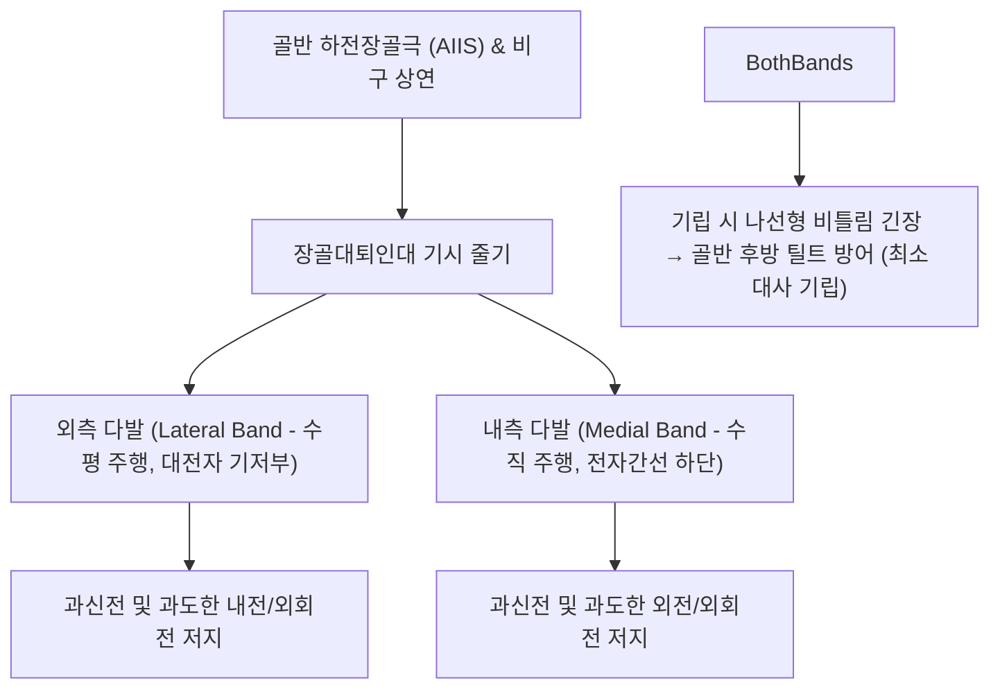

# 🦴 [[구조물/인대/장골대퇴인대|장골대퇴인대]] (Iliofemoral Ligament / Y-ligament of Bigelow)

> **핵심 요약 (Key Summary)**:
> - 📍 **해부 & 주행**: 골반의 [[하전장골극]](AIIS)과 비구 상연에서 기시하여 [[대퇴골]] 전자간선(Intertrochanteric line)을 따라 부채꼴로 정지하는 인체에서 **가장 두껍고 강인한 인대(인장 강도 약 3,500N 이상)**이다. 형태가 뒤집힌 Y자 모양을 띠어 '빅슬로우 Y-인대(Y-ligament of Bigelow)'라고도 불린다.
> - ⚙️ **생체역학적 핵심 기능**: 고관절의 **과신전(Hyperextension)과 외회전을 차단하는 1차 정적 구속물**이다. 직립 기립 자세(Upright posture)에서 골반이 대퇴골 후방으로 무너지지 않도록 체중 부하를 장력으로 지탱하여, 둔근의 지속적 수축 없이도 최소 에너지로 서 있을 수 있게 하는 핵심 지지대이다.
> - 🛠️ **임상 평가 & 치료**: 만성 좌식 생활에 따른 인대 단축 및 굴곡구축은 골반 전방경사와 요추 과전만을 유발한다. 토마스 검사([[토마스 검사|Thomas test]])로 단축을 평가한다. 비관(ST31)·거료(GB29) 자침, [[약침]], 고관절 신전 관절가동 추나 요법 및 장요근 이완을 적용한다.

---

## 📌 목차
1. [해부학적 정밀 구조 및 주행/부착](#1-해부학적-정밀-구조-및-주행부착)
2. [생체역학·기능 (Biomechanics)](#2-생체역학기능-biomechanics)
3. [임상 평가 및 이학적 검사](#3-임상-평가-및-이학적-검사)
4. [초음파 해부학(Sonoanatomy) 및 중재 랜드마크](#4-초음파-해부학sonoanatomy-및-중재-랜드마크)
5. [⭐ 원장님 심층 임상 고찰 및 원본 필기 (Clinical Pearls)](#5--원장님-심층-임상-고찰-및-원본-필기-clinical-pearls)
6. [관련 임상 질환 및 손상](#6-관련-임상-질환-및-손상)
7. [추나·도수치료 & 침구·약침·재활 프로토콜](#7-추나도수치료--침구약침재활-프로토콜)
8. [출처 및 학술 참고 문헌 (References)](#8-출처-및-학술-참고-문헌-references)

---

## 1. 해부학적 정밀 구조 및 주행/부착

| 해부학적 항목 | 정밀 기술 내용 |
| :--- | :--- |
| **기시부 (Origin)** | 골반 [[하전장골극]](Anterior Inferior Iliac Spine, AIIS) 및 비구순(Acetabular rim) 상전방부 |
| **정지부 (Insertion)** | [[대퇴골]] 전자간선(Intertrochanteric line) 전체 |
| **두 갈래 다발 구성** | **외측 다발(Lateral/Superior band)**: 거의 수평으로 주행하여 대전자 기저부 전상단에 정지. **내측 다발(Medial/Inferior band)**: 거의 수직으로 하강하여 전자간선 하단(소전자 부근)에 정지 |
| **두께 및 조직학** | 중심부 두께 약 5~8mm의 치밀 결합조직으로 고관절 관절낭 전면을 견고히 보강 |
| **신경 지배** | [[대퇴신경]](Femoral nerve, L2-L4) 유래 관절지 및 [[폐쇄신경]](Obturator nerve) 분지 |
| **혈관 공급** | 내측대퇴회선동맥 및 외측대퇴회선동맥(Ascending branch)의 관절낭 문합망 |

---

## 2. 생체역학·기능 (Biomechanics)

* **인체 최강의 인장 구속력 (Strongest Ligament in the Body)**:
  * 파열을 유발하는 데 350kg(약 3,500N) 이상의 견인력이 필요할 정도로 인체 인대 중 가장 강한 기계적 인장 강도를 자랑한다.
* **나선형 비틀림 잠금 기전 (Screw-Home Mechanism of Hip)**:
  * 고관절이 신전(Extension)될 때 장골대퇴인대는 대퇴골두를 비구 안으로 밀어 넣으며 나선형으로 강하게 꼬여 팽팽해진다.
  * 완전 신전 위치에서 대퇴골두를 비구에 밀착시켜 **고관절의 밀착 위치(Close-packed position)**를 형성한다.
* **에너지 절약형 직립 지지 (Passive Postural Restraint)**:
  * 사람이 서 있을 때 중력선은 고관절 회전축보다 약간 뒤쪽에 떨어지므로 골반은 뒤로 넘어가려는 경향을 띤다.
  * 장골대퇴인대가 이 후방 전도력을 수동적 장력으로 받쳐주므로, [[대둔근]]이나 장요근이 지속적으로 힘을 쓰지 않아도 피로 없이 직립 자세를 유지할 수 있다.

---

## 3. 임상 평가 및 이학적 검사

* **1. 토마스 검사 ([[토마스 검사|Thomas Test]])**:
  * 환자를 침대 끝에 걸터앉게 하거나 앙와위에서 건측 무릎을 가슴으로 당겨 요추 전만을 편평하게 만듦.
  * 검사측 허벅지가 침대 바닥에서 위로 들려 떠오르면 장골대퇴인대 및 [[장요근]]의 굴곡구축(Flexion contracture)을 확진.
* **2. 고관절 수동 신전 가동역 검사**:
  * 복와위에서 골반을 침대에 고정한 채 대퇴를 상방으로 거상(수동 신전).
  * 정상 신전 각도(10~15도)에 미치지 못하고 단단한 인대성 저항이 걸리면 양성.
* **3. FABER 검사 (Patrick Test)**:
  * 굴곡, 외반, 외회전 스트레스 시 서혜부 전면 깊은 곳의 인대성 통증 유발 확인.

---

## 4. 초음파 해부학(Sonoanatomy) 및 중재 랜드마크

* **초음파 스캔 랜드마크**:
  * 탐촉자를 서혜인대 하방에서 AIIS와 대퇴골두/전자간선 방향으로 사선(Oblique sagittal) 배치.
  * 대퇴골두 전면 피질골 위를 덮고 지나가는 약 5~8mm 두께의 두껍고 매끄러운 고에코 섬유성 띠로 관찰됨.
  * 인대 천층으로 [[장요근]]건 및 점액낭이 위치함.
* **병리적 초음파 소견**:
  * 비구대퇴 충돌증후군(FAI) 또는 만성 인대 긴장 시 인대 전면의 저에코성 비후, 골-인대 부착부(AIIS)의 골극 형성, 관절낭 전방 삼출액 관찰.
* **중재 시술 자침 랜드마크**:
  * AIIS 하방 1~2cm, 대퇴동맥 맥동부 외측 2cm 안전 구역을 확인하고 초음파 유도 하에 장골대퇴인대 표면 및 관절낭 전면으로 정밀 자입.

---

## 5. ⭐ 원장님 심층 임상 고찰 및 원본 필기 (Clinical Pearls)

> [!IMPORTANT]
> **진료실 핵심 감별 및 치료 노하우**:
> 1. **"스웨이백(Swayback) 자세의 숨은 공범"**:
>    - 둔근이 약화된 환자가 배를 앞으로 쑥 내밀고 서 있는 자세는, 근육 힘을 쓰지 않고 골반을 앞으로 밀어 **장골대퇴인대의 장력에 체중을 얹어 매달려 있는 형태(Hanging on the Y-ligament)**이다.
>    - 이 상태가 지속되면 장골대퇴인대 전면이 만성적으로 늘어나 이완(Laxity)되고, 보행 시 대퇴골두 접촉 압력이 비정상적으로 증가하여 고관절 전방 충돌 및 퇴행성 관절염을 초래한다.
> 2. **만성 좌식 생활과 요통의 연계**:
>    - 하루 8시간 이상 앉아 있는 사무직 환자는 장골대퇴인대가 짧아진 상태로 굳어버린다. 일어나서 걸으려 할 때 고관절이 펴지지 않으니, 그 보상으로 **허리를 과도하게 꺾어 요추 전만(Lordosis)을 만들며 요통이 발생**한다.
> 3. **치료 팁**:
>    - 허리가 아프다고 요추만 보지 말고 토마스 검사를 하여, 서혜부 비관(ST31) 혈위 자침 및 장골대퇴인대 신연 추나를 적용해 고관절 신전 각도를 회복시켜 주면 수년 된 요통이 즉각 개선된다.

---

## 6. 관련 임상 질환 및 손상

* **고관절 굴곡구축 (Hip Flexion Contracture)**:
  * 만성 좌식 생활로 인한 장골대퇴인대 및 장요근 단축.
* **비구대퇴 충돌증후군 ([[대퇴비구 충돌증후군|Femoroacetabular Impingement, FAI]])**:
  * 고관절 회전 시 장골대퇴인대 비후와 비구연 마찰로 전방 서혜부 통증 발생.
* **고관절 전방 불안정성 (Anterior Hip Microinstability)**:
  * 무용수, 체조 선수 등 과도한 외회전 동작에 의한 장골대퇴인대 이완증.
* **고관절 탈구 (Hip Dislocation)**:
  * 후방 탈구 시에는 장골대퇴인대가 손상되지 않고 유지되는 경우가 많아 Bigelow 도수정복술의 회전 지렛대 받침점으로 활용됨.

---

## 7. 추나·도수치료 & 침구·약침·재활 프로토콜

### 1) 한의 보존적 재활 및 추나요법
* **고관절 신전 가동 추나요법 (Hip Extension Mobilization)**:
  * 환자를 복와위로 눕히고 검사자가 한 손으로 천골을 안정화한 후, 대퇴 원위부를 잡고 고관절을 부드럽게 신전시켜 장골대퇴인대를 신연.
* **골반 전방경사 교정 및 둔근 활성화**:
  * 단축된 장골대퇴인대와 장요근을 이완하고, 대둔근 및 햄스트링을 강화하여 골반 중립 정렬 회복.

### 2) 침구 및 약침 치료 프로토콜
* **주요 혈위**:
  * 비관(ST31): AIIS 하방, 장골대퇴인대 기시부 직상방.
  * 거료(GB29): 대전자 전상방 인대 부착부.
  * 기충(ST30), 오추(GB27): 서혜부 인대 및 신경혈관 주위 이완.
* **약침 프로토콜**:
  * AIIS 및 대퇴골두 전면 관절낭 부착부에 [[신바로약침|신바로 약침]] 0.5~1.0cc를 정밀 주입하여 만성 인대 견인성 염증 완화 및 유착 해소.

---

## 8. 출처 및 학술 참고 문헌 (References)

1. **Mizutani S, et al. (2026)**. Influence of iliofemoral ligament laxity on hip joint contact forces during gait. *J Biomech*. 205:113442. PMID: 42398126.
   - `[연구 요약]` 보행 시 장골대퇴인대(Y-인대)의 이완 및 장력 변화가 대퇴골두와 비구 관절면 접촉 응력 분담에 미치는 생체역학적 영향 규명.
2. **Lu Y, et al. (2026)**. Capsular Contributions to Hip Joint Stability: Clinical Anatomy and Implications for Surgical Management. *Clin Anat*. PMID: 42400381.
   - `[연구 요약]` 고관절 관절낭 인대 복합체 중 장골대퇴인대의 해부학적 두께, 다발 배열 및 전방 안정성 유지 기전에 대한 최신 리뷰.
