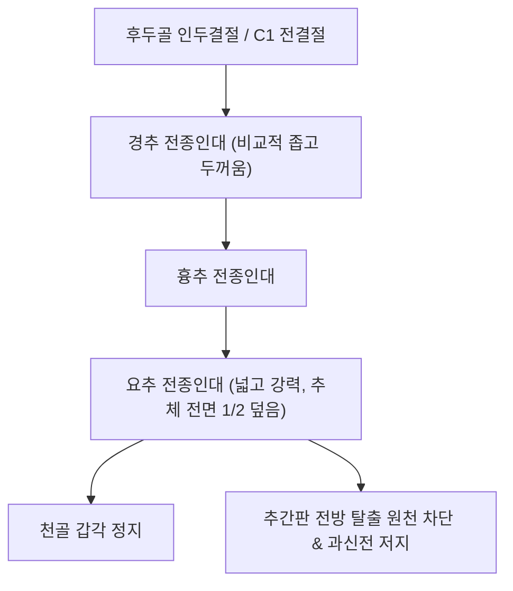

# 🦴 [[구조물/인대/전종인대|전종인대]] (Anterior Longitudinal Ligament, ALL)

> **핵심 요약 (Key Summary)**:
> - 📍 **해부 & 주행**: [[후두골]] 기저부 인두결절에서 기시하여 [[경추]], [[흉추]], [[요추]] 추체(Vertebral bodies) 및 [[추간판]] 전면을 수직으로 덮고 [[천골]] 상면까지 이어지는 척추 전면의 가장 넓고 강력한 섬유성 인대이다. [[후종인대]](PLL)와 달리 **하부 흉추와 요추로 내려갈수록 인대 폭이 넓어지고 두꺼워지는 특성**을 지닌다.
> - ⚙️ **생체역학적 핵심 기능**: 척추의 **과신전(Hyperextension)을 방어하는 유일한 1차 정적 구속물**이다. [[추간판]]의 전방 팽륜 및 탈출을 물리적으로 차단하고 척추 시상면 만곡(전만)을 안정적으로 지탱한다.
> - 🛠️ **임상 평가 & 치료**: 교통사고 채찍질 과신전 손상 및 미만성 특발성 골격 과골증([[DISH|DISH, Forestier 병]])의 핵심 표적이다. [[임맥]](CV) 천돌(CV22)·전중(CV17) 및 배부 [[독맥]](GV) 협척혈 자침, [[약침]], 흉요추 가동성 회복 [[추나요법]]을 적용한다.

---

## 📌 목차
1. [해부학적 정밀 구조 및 주행/부착](#1-해부학적-정밀-구조-및-주행부착)
2. [생체역학·기능 (Biomechanics)](#2-생체역학기능-biomechanics)
3. [임상 평가 및 이학적 검사](#3-임상-평가-및-이학적-검사)
4. [초음파 해부학(Sonoanatomy) 및 중재 랜드마크](#4-초음파-해부학sonoanatomy-및-중재-랜드마크)
5. [⭐ 원장님 심층 임상 고찰 및 원본 필기 (Clinical Pearls)](#5--원장님-심층-임상-고찰-및-원본-필기-clinical-pearls)
6. [관련 임상 질환 및 손상](#6-관련-임상-질환-및-손상)
7. [추나·도수치료 & 침구·약침·재활 프로토콜](#7-추나도수치료--침구약침재활-프로토콜)
8. [출처 및 학술 참고 문헌 (References)](#8-출처-및-학술-참고-문헌-references)

---

## 1. 해부학적 정밀 구조 및 주행/부착

| 해부학적 항목 | 정밀 기술 내용 |
| :--- | :--- |
| **상단 기시부 (Origin)** | [[후두골]] 기저부의 인두결절(Pharyngeal tubercle) 및 환추(C1) 전결절 |
| **하단 정지부 (Insertion)** | 천골(Sacrum) 제1~2천추 전면 및 천골 갑각(Promontory) |
| **주행 및 부착 특성** | 척추체 전면의 함요부에는 느슨하게 부착되며 혈관 통과 공간을 제공하고, **추체 변연부 골막 및 추간판 섬유륜 전면에는 극히 치밀하게 융합** |
| **3개 층상 구조** | **천층(Superficial)**: 3~5개 척추체를 가로지르는 긴 섬유. **중간층(Intermediate)**: 2~3개 분절 연결. **심층(Deep)**: 인접한 척추체 간 및 섬유륜 전면 단단 결속 |
| **부위별 두께 변화** | 경추부에서는 폭이 좁고 두꺼우나, **요추부로 갈수록 폭이 넓어지고 두꺼워져** 추체 전면의 약 1/2을 덮음 |
| **신경 및 혈관** | 척추동신경(Sinuvertebral nerve)의 전방 분지망 및 분절 늑간/요동맥의 전방 관통지 |

---

## 2. 생체역학·기능 (Biomechanics)

* **척추 과신전의 유일한 일차 억제기 (Sole Restraint to Hyperextension)**:
  * 척추 후방의 [[황색인대]], [[극간인대]], [[극상인대]] 등이 굴곡을 막는 것과 대조적으로, 척추 전면에서 **과도한 신전(Hyperextension)을 직접 차단하는 인대는 전종인대가 유일**하다.
  * 요추 신전 시 척추 전면이 벌어지는 인장력을 지탱하여 [[척추분리증]] 및 [[척추전방전위증]]의 진행을 억제한다.
* **추간판 전방 보호벽 (Anterior Herniation Barrier)**:
  * 인장 강도가 [[후종인대]](PLL)의 2배 이상에 달하여, 임상적으로 [[추간판]]이 전방으로 파열·탈출되는 경우는 극히 드물며 대부분 후방 또는 후외측으로 탈출되는 해부학적 이유가 된다.
* **시상면 전만 곡선 유지**:
  * [[경추]] 및 [[요추]]의 생리적 전만(Lordosis)을 형성하고 유지하는 전방 장력 띠 역할을 수행한다.

---

## 3. 임상 평가 및 이학적 검사

* **1. 척추 수동 신전 부하 검사 (Passive Extension Provocation)**:
  * 환자를 복와위로 눕히고 상체를 뒤로 젖히는 신전 부하를 가함.
  * 후관절 압박통과 구별되는 척추체 깊은 전면부의 뻐근하고 팽팽한 당김통 재현 시 양성.
* **2. 채찍질 과신전 손상 평가 (Whiplash Extension Test)**:
  * 후방 추돌 사고 후 경추 과신전 시 ALL이 신연되거나 척추체 전상단에서 박리(Avulsion)되어 발생하는 전경부 심부 압통 및 연하통 확인.
* **3. 척추 강직도 평가 (Spinal Rigidity Assessment)**:
  * 흉요추 전 방향 가동역(ROM)의 전반적 감소 및 쇼버 검사(Schober test) 제한 확인 (DISH 의심).

---

## 4. 초음파 해부학(Sonoanatomy) 및 중재 랜드마크

* **초음파 스캔 랜드마크 (경추 전면)**:
  * 환자를 앙와위로 눕히고 경부를 약간 신전시킴.
  * 탐촉자를 경추 전외측에 종단/횡단 거치하여 경동맥(Carotid artery)과 흉쇄유돌근 내측, 갑상선 외측을 통해 추체 전면으로 접근.
  * 척추체 전면 피질골 위를 매끄럽게 덮고 주행하는 고에코 선상 밴드로 관찰됨.
* **DISH의 영상의학적 특징 (X-ray / CT / 초음파)**:
  * 연속된 **최소 4개 이상의 흉요추체 전외측을 따라 '촛농이 흘러내리듯(Flowing candle wax)'** 전종인대가 두껍게 골화되어 연결된 소견. 추간판 높이는 비교적 보존됨.
* **중재 시술 자침 랜드마크**:
  * 경추 전면 접근은 대혈관(경동맥, 내경정맥) 및 식도 손상 위험이 높으므로, 한의 임상에서는 배부의 독맥(GV) 및 화타협척혈을 통한 척추 분절성 신경-근막 이완을 우선 적용함.

---

## 5. ⭐ 원장님 심층 임상 고찰 및 원본 필기 (Clinical Pearls)

> [!IMPORTANT]
> **진료실 핵심 감별 및 치료 노하우**:
> 1. **DISH vs 강직성 척추염(AS) 감별**:
>    - 둘 다 척추가 통째로 굳지만, **DISH는 60대 이상 고령 남성**에서 [[천장관절염]] 침범 없이 전종인대만 촛농처럼 굳는 반면, **[[강직성 척추염]]은 20~30대 젊은 층**에서 천장관절염과 HLA-B27 양성을 동반하며 얇은 인대 골극(Syndesmophyte)을 형성한다.
> 2. **DISH 환자의 경미한 낙상 주의 (분필 골절, Chalk-stick fracture)**:
>    - 전종인대가 완전히 뼈로 굳어 대나무처럼 변한 DISH 환자는 척추의 충격 완충력이 제로(0)에 가깝다. 가볍게 엉덩방아를 찧거나 침대에서 떨어지기만 해도 **분필이 부러지듯 척추체 전층이 부러져 치명적인 척수 마비**를 초래하므로 절대 강한 회전 [[추나요법|추나]]를 해서는 안 된다.
> 3. **경추 전종인대 골화와 연하곤란(Dysphagia)**:
>    - 목 앞쪽 척추뼈가 자라나 식도를 뒤에서 누르면 "알약을 삼킬 때 목에 걸린다"는 연하곤란을 호소한다. 이비인후과에서 이상이 없다고 하면 반드시 [[경추]] 측면 X-ray로 C3-C5 레벨의 ALL 골극을 확인해야 한다.

---

## 6. 관련 임상 질환 및 손상

* **미만성 특발성 골격 과골증 ([[DISH|DISH, Forestier Disease]])**:
  * 전종인대의 만성 이소성 석회화 및 골화로 인한 척추 강직.
* **경추 채찍질 과신전 손상 ([[경추 염좌|Whiplash Hyperextension Injury]])**:
  * 추돌 사고 시 ALL의 급격한 견인 파열 및 추체 전방 박리 골절.
* **경추성 연하곤란 (Cervical Dysphagia)**:
  * 상부 경추 ALL 거대 골극에 의한 인두·식도 기계적 압박.

---

## 7. 추나·도수치료 & 침구·약침·재활 프로토콜

### 1) 한의 보존적 재활 및 추나요법
* **과신전 금기 및 굴곡 가동성 회복 추나**:
  * ALL 손상 및 DISH 환자에게 척추 과신전 기법은 절대 금기이며, 부드러운 흉곽 확장 및 분절성 굴곡-측굴 관절가동술을 적용.
* **호흡근 및 흉요근막 이완**:
  * 횡격막, 늑간근, 사각근 이완을 통해 척추 전면에 걸리는 비정상적인 전단 인장력을 분산.

### 2) 침구 및 약침 치료 프로토콜
* **주요 혈위**:
  * 전면 순경 혈위: 임맥(CV) 천돌(CV22), 전중(CV17), 중완(CV12) — 전면 근막 긴장 완화.
  * 후면 협척 혈위: 경흉추 및 요추 화타협척혈(EX-B2), 대추(GV14), 명문(GV4).
* **약침 프로토콜**:
  * 척추 후방 협척혈 심부 및 늑간 관절부에 [[신바로약침|신바로 약침]]을 시술하여 척추 분절성 염증을 제거하고 척추 안정성을 강화.

---

## 8. 출처 및 학술 참고 문헌 (References)

1. **Chang HC, et al. (2026)**. Anterior Cervical Osteotomy: A Narrative Review and Proposal of a Mechanism-Based Decision Framework (The ACO Triad). *Global Spine J*. PMID: 42549754.
   - `[연구 요약]` 경추 변형 교정 시 전종인대(ALL)의 생체역학적 구속력과 시상면 정렬 복원을 위한 전방 절제술의 해부학적 적응증 분석.
2. **Jokeit M, et al. (2025)**. The importance of the posterior osteoligamentous complex of the lumbar spine: dogma changing biomechanical insights. *Eur Spine J*. 34(11):5157-5165. PMID: 39912946.
   - `[연구 요약]` 척추 전종인대와 후방 복합체의 상호 대립적 생체역학적 인장력 분담과 척추 안정성 유지 기전 검증.
