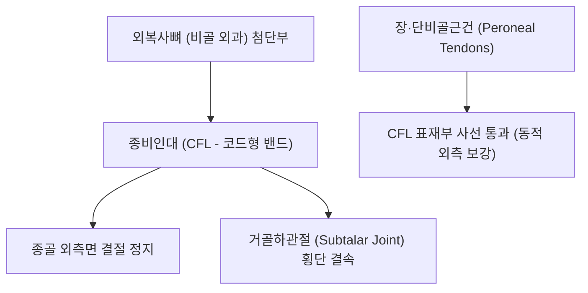

# 🦴 [[구조물/인대/종비인대|종비인대]] (Calcaneofibular Ligament, CFL)

> **핵심 요약 (Key Summary)**:
> - 📍 **해부 & 주행**: [[비골]](외복사뼈) 첨단부 전하방에서 기시하여 후하방 45도 각도로 비스듬히 주행한 뒤, [[종골]](Calcaneus) 외측면 결절에 정지하는 둥근 코드형(Cord-like) 관절낭 외 인대이다. 거퇴관절뿐 아니라 **[[거골하관절]](Subtalar joint)을 가로지르는 유일한 외측 인대**이며, 표재부로 [[단비골근]]과 [[장비골근]] 건이 주행한다.
> - ⚙️ **생체역학적 핵심 기능**: 족관절 중립위 및 **족배굴곡(Dorsiflexion) 상태에서 거골과 종골의 내번(Inversion)을 저지하는 1차 정적 억제기**이다. 족저굴곡 시 내번을 막는 [[전거비인대]](ATFL)와 상호 협력하여 발목 외측 안정성을 완성한다.
> - 🛠️ **임상 평가 & 치료**: 발목 내번 염좌 시 ATFL 손상에 이어 2차로 파열 호발(Grade II~III 손상). [[거골 경사 검사]](Talar tilt test)로 진단한다. 신맥(BL62)·구허(GB40) 자침, [[약침]], 비골근 강화 및 거골하관절 가동 추나 요법을 적용한다.

---

## 📌 목차
1. [해부학적 정밀 구조 및 주행/부착](#1-해부학적-정밀-구조-및-주행부착)
2. [생체역학·기능 (Biomechanics)](#2-생체역학기능-biomechanics)
3. [임상 평가 및 이학적 검사](#3-임상-평가-및-이학적-검사)
4. [초음파 해부학(Sonoanatomy) 및 중재 랜드마크](#4-초음파-해부학sonoanatomy-및-중재-랜드마크)
5. [⭐ 원장님 심층 임상 고찰 및 원본 필기 (Clinical Pearls)](#5--원장님-심층-임상-고찰-및-원본-필기-clinical-pearls)
6. [관련 임상 질환 및 손상](#6-관련-임상-질환-및-손상)
7. [추나·도수치료 & 침구·약침·재활 프로토콜](#7-추나도수치료--침구약침재활-프로토콜)
8. [출처 및 학술 참고 문헌 (References)](#8-출처-및-학술-참고-문헌-references)

---

## 1. 해부학적 정밀 구조 및 주행/부착

| 해부학적 항목 | 정밀 기술 내용 |
| :--- | :--- |
| **비골 기시부 (Origin)** | [[비골]] 외과(Lateral malleolus) 첨단부의 바로 전하방 변연 |
| **종골 정지부 (Insertion)** | [[종골]](Calcaneus) 외측면의 후상방 결절 (비골근 활차 후하방) |
| **형태 및 주행** | 길이 약 20~30mm, 직경 약 4~8mm의 굵고 둥근 코드형 독립 밴드로 후하방 약 30~45도 경사 주행 |
| **2개 관절 횡단 특성** | **거퇴관절(Talocrural joint)**과 **[[거골하관절]](Subtalar joint)**의 2개 관절을 동시에 가로지름 |
| **관절낭과의 관계** | 관절낭 외 인대(Extracapsular)로 관절낭 활액막과 분리되어 독립 활주 |
| **표재 교차 건** | 인대 표면 위를 [[단비골근]] 및 [[장비골근]](Peroneal tendons) 건이 사선으로 교차하여 지나감 |
| **신경 및 혈관** | [[비복신경]](Sural nerve) 관절지 및 외측족배동맥(Lateral tarsal artery) 분지 |

---

## 2. 생체역학·기능 (Biomechanics)

* **족배굴곡 및 중립위 내번 1차 억제기 (Primary Restraint to Inversion)**:
  * 발목이 족저굴곡 상태일 때는 [[전거비인대]](ATFL)가 수평으로 팽팽해지며 내번을 억제하지만, **발목이 중립위 또는 족배굴곡(Dorsiflexion)될 때는 종비인대(CFL)가 수직으로 세워지며 내번력의 약 70% 이상을 단독으로 방어**한다.
* **거골하관절(Subtalar Joint) 안정화**:
  * 종골과 거골의 과도한 외측 회전 및 내번 경사를 물리적으로 차단하여, 불규칙한 지면을 보행할 때 발뒤꿈치가 안쪽으로 꺾이지 않도록 지탱한다.
* **비골근과의 동적 협동 메커니즘**:
  * 장·단비골근은 외번(Eversion)을 일으키는 주동근으로, 발목이 안쪽으로 꺾일 때 반사적으로 수축하여 종비인대에 가해지는 인장 부하를 직접 감압한다.

---

## 3. 임상 평가 및 이학적 검사

* **1. 거골 경사 검사 ([[거골 경사 검사|Talar Tilt Test / Inversion Stress Test]])**:
  * 환자의 발목을 0도 중립위(또는 약간 배측굴곡) 상태로 유지한 후, 종골을 잡고 강하게 내번(Inversion) 스트레스를 가함.
  * 건측 대비 거골의 경사각이 10~15도 이상 벌어지거나 단단한 종말감(Firm endpoint)이 소실되면 CFL 파열을 확진.
* **2. 외과 하방 압통 검사 (Subfibular Palpation)**:
  * 외복사뼈 바로 아래에서 후하방 종골 결절 방향으로 주행하는 인대 라인을 정밀 압진하여 날카로운 통증 확인.
* **3. 발목 전방 전위 검사 동반 평가**:
  * 전방 전위(ATFL)와 거골 경사(CFL)가 모두 양성이면 3도 발목 염좌(외측 인대 복합체 완전 파열)로 판정.

---

## 4. 초음파 해부학(Sonoanatomy) 및 중재 랜드마크

* **초음파 스캔 랜드마크**:
  * 환자를 측와위로 눕히고 발목을 약간 족배굴곡 및 내번시킴.
  * 탐촉자를 외복사뼈 첨단에서 종골 후하방 방향으로 사선(Oblique coronal) 거치.
  * 표재부에서 횡단으로 관찰되는 고에코의 단비골근 및 장비골근 건 단면 심층에서, 피질골 위를 연결하는 두껍고 균일한 고에코 코드형 밴드로 관찰됨 (두께 약 2.0~3.5mm).
* **병리적 초음파 소견**:
  * 인대 섬유의 주행 단열, 저에코성 혈종, 동적 내번 스트레스 시 종골-비골 간격의 비정상적 개대 관찰.
* **중재 시술 자침 랜드마크**:
  * 외과 첨부 바로 아래 신맥(BL62) 혈위에서 초음파 유도 하에 표재 비골근건을 피해 CFL 실질 및 종골 부착부 골막으로 안전하게 자입.

---

## 5. ⭐ 원장님 심층 임상 고찰 및 원본 필기 (Clinical Pearls)

> [!IMPORTANT]
> **진료실 핵심 감별 및 치료 노하우**:
> 1. **"멍이 발꿈치까지 내려왔다면 CFL 파열이다"**:
>    - 가벼운 1도 발목 염좌(ATFL 미세손상)는 부종과 피멍이 외복사뼈 앞쪽에만 작게 머문다.
>    - 그러나 수상 1~2일 후 **외복사뼈 뒤쪽 오목한 곳과 발뒤꿈치(종골) 외측면까지 검푸른 멍(Ecchymosis)이 흘러내려 퍼져 있다면**, 이는 관절낭 외 인대인 CFL이 찢어져 비골근하 공간으로 혈종이 대량 유출된 Grade II~III 중증 손상의 명확한 증거이다.
> 2. **만성 발목 불안정증(CAI)과 비골근 반사 지연**:
>    - CFL이 파열된 환자는 고유수용성 감각 신경종말이 손상되어 발이 안쪽으로 꺾일 때 비골근이 즉각 수축하지 못하는 '반사 지연'이 발생한다.
>    - 따라서 발목 침치료 후 반드시 **한 발 서기 균형판 훈련 및 밴드 비골근 외번 강화 운동**을 병행시켜야 재발성 접질림을 막을 수 있다.

---

## 6. 관련 임상 질환 및 손상

* **외측 발목 인대 복합 손상 (Lateral Ankle Sprain Grade II~III)**:
  * ATFL 파열에 이어 CFL이 동반 파열되는 고에너지 내번 손상.
* **만성 발목 불안정증 ([[발목 불안정성|Chronic Ankle Instability, CAI]])**:
  * CFL의 기계적 이완으로 인한 거골하관절의 반복적 덜컥거림.
* **비골건 탈구 및 건초염 ([[비골근건 탈구|Peroneal Subluxation / Tendinopathy]])**:
  * CFL 상면을 지나는 상비골건지대(Superior peroneal retinaculum) 동반 파열.

---

## 7. 추나·도수치료 & 침구·약침·재활 프로토콜

### 1) 한의 보존적 재활 및 추나요법
* **거골하관절(Subtalar Joint) 외번 가동 추나**:
  * 외번 손상 후 거골하관절이 내번 위치에 고착된 관절 기능부전을 교정하여 외측 인장 스트레스를 해소.
* **비골근(Peroneal Muscles) 강화 재활**:
  * 튜빙 밴드를 이용한 능동 족외번 운동(Resisted Eversion) 및 밸런스 패드 고유수용성 감각 재훈련.

### 2) 침구 및 약침 치료 프로토콜
* **주요 혈위**:
  * 신맥(BL62): 외과 바로 아래, CFL 주행부의 대표 혈위.
  * 구허(GB40): 외과 전하방 ATFL 및 CFL 기시부.
  * 곤륜(BL60): 외과 후방 함요부, 비골근건 이완.
  * 양릉천(GB34): 비골근의 운동점 자극.
* **약침 프로토콜**:
  * 외과 첨단 및 종골 외측면 인대 부착부에 [[신바로약침|신바로 약침]] 0.3~0.5cc를 정밀 주입하여 만성 인대 이완성 통증 완화 및 섬유아세포 증식 촉진.

---

## 8. 출처 및 학술 참고 문헌 (References)

1. **Nakasa T, et al. (2026)**. Impact of Calcaneofibular Ligament Morphology on Recurrent Instability Following Arthroscopic Anterior Lateral Ankle Ligament Repair for Chronic Ankle Instability. *Foot Ankle Int*. 47(6):803-812. PMID: 41902619.
   - `[연구 요약]` 만성 발목 불안정증(CAI) 환자에서 종비인대(CFL)의 형태학적 결손 및 이완이 외측 인대 봉합술 후 재발성 관절 불안정성에 미치는 결정적 영향 분석.
2. **Koyama T, et al. (2026)**. The Superior Fascicle of the Anterior Talofibular Ligament Functions as a Restraint Against Internal Rotation: A Cadaveric Biomechanical Study. *Foot Ankle Int*. 47(10):1338-1347. PMID: 42644620.
   - `[연구 요약]` 사체 생체역학 시험을 통해 발목 외측 복합체 중 종비인대(CFL)와 전거비인대 다발의 족배굴곡 및 회전 내번 하중 분담 기전 규명.
