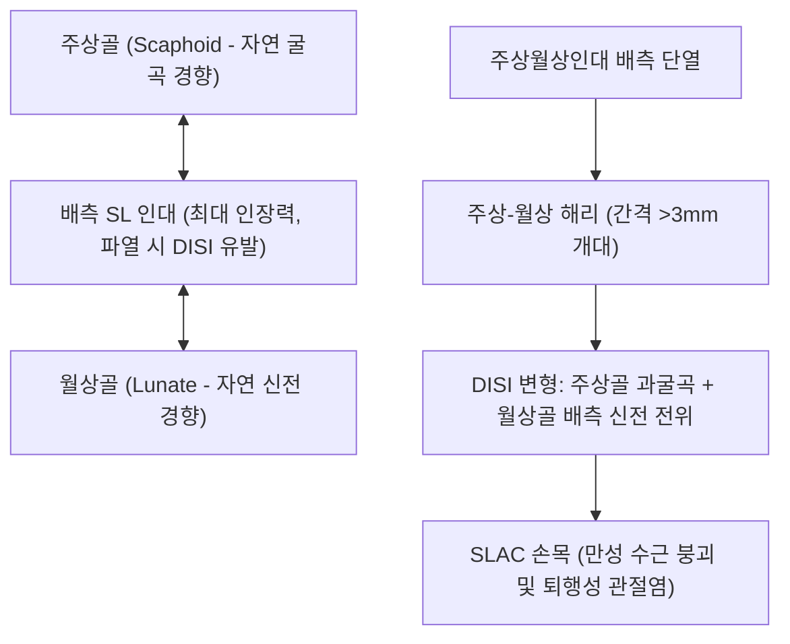

# 🦴 [[구조물/인대/주상월상인대|주상월상인대]] (Scapholunate Ligament, SL Ligament)

> **핵심 요약 (Key Summary)**:
> - 📍 **해부 & 주행**: 수근골 근위열의 [[주상골]](Scaphoid)과 [[월상골]](Lunate) 사이를 잇는 C자형 골간 인대(Interosseous ligament)이다. 배측부(Dorsal), 근위막부(Proximal membranous), 장측부(Volar)의 3개 구역으로 나뉘며, **배측 주상월상인대(Dorsal SL ligament)가 가장 두껍고 강력하여 수근부 안정성의 1차 핵심 구속물**로 작용한다.
> - ⚙️ **생체역학적 핵심 기능**: 굴곡하려는 경향의 주상골과 신전하려는 경향의 월상골을 강하게 결속하여, 손목의 굴신 및 회전 시 근위 수근열이 하나의 단위로 부드럽게 동조 활주하도록 돕는다. 파열 시 월상골이 뒤로 꺾이는 **[[DISI 변형]](Dorsal Intercalated Segment Instability)**을 초래한다.
> - 🛠️ **임상 평가 & 치료**: 손을 짚고 넘어지는 낙상(FOOSH) 시 호발한다. 왓슨 검사([[왓슨 검사|Watson scaphoid shift test]]) 및 테리 토마스 징후(Terry Thomas sign, 간격 >3mm)로 진단한다. 방치 시 SLAC 손목(Scapholunate Advanced Collapse) 관절염으로 진행한다. 양지(TE4)·양계(LI5) 자침, [[약침]], 주상골 안정화 테이핑 및 수근골 교정 추나 요법을 적용한다.

---

## 📌 목차
1. [해부학적 정밀 구조 및 주행/부착](#1-해부학적-정밀-구조-및-주행부착)
2. [생체역학·기능 (Biomechanics)](#2-생체역학기능-biomechanics)
3. [임상 평가 및 이학적 검사](#3-임상-평가-및-이학적-검사)
4. [초음파 해부학(Sonoanatomy) 및 중재 랜드마크](#4-초음파-해부학sonoanatomy-및-중재-랜드마크)
5. [⭐ 원장님 심층 임상 고찰 및 원본 필기 (Clinical Pearls)](#5--원장님-심층-임상-고찰-및-원본-필기-clinical-pearls)
6. [관련 임상 질환 및 손상](#6-관련-임상-질환-및-손상)
7. [추나·도수치료 & 침구·약침·재활 프로토콜](#7-추나도수치료--침구약침재활-프로토콜)
8. [출처 및 학술 참고 문헌 (References)](#8-출처-및-학술-참고-문헌-references)

---

## 1. 해부학적 정밀 구조 및 주행/부착

| 3대 구역 구분 | 해부학적 구조 및 조직학적 특성 | 생체역학적 기여도 |
| :--- | :--- | :--- |
| **배측부 (Dorsal Subregion)** | 두께 약 2~3mm의 순수 치밀 교원섬유 횡단 밴드. 주상골과 월상골 배측 변연을 견고 결속 | **수근 안정성의 1차 구속물 (전체 인장 강도의 약 70~80% 담당)** |
| **근위막부 (Proximal Subregion)** | 무혈관성 섬유연골 및 활액막성 조직으로 방사선관절면과 접함 | 기계적 강도 극히 미약 (파열되어도 관절 불안정성 유발 적음) |
| **장측부 (Volar Subregion)** | 두께 약 1mm의 유연한 섬유 띠로 손바닥 쪽 주상-월상 관절면 보강 | 회전 안정성 보조 및 고유수용성 감각 수용기 분포 |

- **혈관 분포의 취약점**: 인대 실질에는 혈관이 거의 없고 배측 및 장측 관절낭 부착부를 통해서만 영양을 공급받으므로, 배측부 단열 시 자연 치유 잠재력이 극히 낮아 만성 수근 해리(Scapholunate dissociation)로 직결된다.

---

## 2. 생체역학·기능 (Biomechanics)

* **손목 근위 수근열의 링 기전 (Carpal Ring Mechanism)**:
  * [[주상골]]은 손목 운동 시 손바닥 쪽으로 구부러지려는(Flexion) 내인성 토크를 가지며, [[삼각골]]과 [[월상골]]은 뒤쪽으로 펴지려는(Extension) 내인성 토크를 가진다.
  * 주상월상인대는 이 반대 방향의 회전 토크를 중간에서 묶어 평형을 이루게 함으로써, 손목 굴신 시 손바닥 뼈들과 [[유두골]]이 일사불란하게 정렬을 유지하도록 만든다.
* **배측 인대 손상 시의 DISI 붕괴**:
  * 배측 SL 인대가 단열되면 결속력을 잃은 주상골은 바닥 쪽으로 고꾸라지고(Rotatory subluxation), 월상골은 뒤쪽으로 발딱 일어서는 **배측 개재 분절 불안정성([[DISI 변형|DISI]])**이 발생한다.
* **하중 분담**:
  * 손목에 체중이 실릴 때 [[요골]]과 [[척골]]로 전달되는 하중의 약 50% 이상이 주상골을 통과하므로, SL 인대의 건전성은 수근관절 연골 보호의 핵심 전제조건이다.

---

## 3. 임상 평가 및 이학적 검사

* **1. 왓슨 검사 ([[왓슨 검사|Watson Scaphoid Shift Test]])**:
  * 검사자의 엄지손가락으로 환자의 손바닥 쪽 주상골 결절(Tubercle)을 강하게 누른 상태에서 손목을 척폐(Ulnar deviation)에서 요폐(Radial deviation)로 수동 이동시킴.
  * SL 인대가 파열된 경우 주상골이 요골 배측 모서리를 타고 덜컥거리며 넘어갔다가(Subluxation), 검사자의 엄지를 떼는 순간 툭 소리와 함께 원래 자리로 정복됨 (민감도 89%, 특이도 98%).
* **2. 주상월상 관절 배측 압통 (Dorsal SL Interval Tenderness)**:
  * 리스터 결절(Lister's tubercle)에서 원위부로 약 1cm 떨어진 배측 함요부를 촉진 시 예리한 국소 압통 재현.
* **3. 테리 토마스 징후 (Terry Thomas Sign)**:
  * 손목 전후면 X-ray(주먹 쥔 상태 방사선 촬영)에서 주상골과 월상골 사이 간격이 정상(2mm 이하)을 넘어 **3mm 이상(심하면 4~5mm) 벌어져 벌어진 앞니처럼 보이는 소견**.

---

## 4. 초음파 해부학(Sonoanatomy) 및 중재 랜드마크

* **초음파 스캔 랜드마크**:
  * 탐촉자를 손목 배측 리스터 결절 바로 원위부에 횡단(Transverse) 거치.
  * 고에코 피질골 랜드마크인 주상골과 월상골 사이의 관절 틈새를 확인.
  * 두 뼈의 배측 모서리를 V자형으로 단단히 잇는 균일한 고에코 섬유성 띠로 관찰됨 (배측 SL 인대, 정상 두께 1.5~2.5mm).
* **병리적 초음파 소견**:
  * 인대 실질의 저에코성 파열 및 결손, 관절낭 배측 헤르니아(결절종, Ganglion cyst 동반 빈발), 주먹을 쥐거나 요폐 시 관절 간격의 동적 벌어짐 실시간 확인.
* **중재 시술 자침 랜드마크**:
  * 배측 주상-월상 관절 틈새(양지 혈위와 양계 혈위 사이)를 확인하고 신전건(지신근건)을 피해 초음파 유도 하에 배측 인대 부착부로 약침액 정밀 주입.

---

## 5. ⭐ 원장님 심층 임상 고찰 및 원본 필기 (Clinical Pearls)

> [!IMPORTANT]
> **진료실 핵심 감별 및 치료 노하우**:
> 1. **"X-ray가 정상이더라도 왓슨 검사를 놓치지 말 것"**:
>    - 손을 짚고 넘어진 후 손목이 아파서 정형외과 X-ray를 찍고 [[원위 요골 골절]]이나 주상골 골절이 없다며 "뼈에는 이상이 없다(염좌다)"는 말을 듣고 한의원에 오는 환자가 많다.
>    - 초기 부분 파열은 정적 X-ray에서 간격이 벌어지지 않으므로(Occult SL tear), 리스터 결절 하방 배측 압통과 [[왓슨 검사]] 양성 여부를 촉진하지 않으면 조기 골든타임을 놓치고 만성 수근 붕괴로 이어진다.
> 2. **손목 결절종(Ganglion)과 SL 인대 손상의 숨은 상관관계**:
>    - 손목 배측 중앙에 낭종(물혹)이 반복 재발하는 환자의 50% 이상은 잠재적인 주상월상인대 미세 파열로 인한 관절액 누출이 원인이다. 결절종만 흡인(Aspiration)하지 말고 반드시 SL 인대의 불안정성을 함께 검사해야 한다.
> 3. **치료 프로토콜**:
>    - 급성기에는 4~6주간 주상골-월상골을 단단히 모아주는 스플린트 고정이 필수이며, 인대 부착부에 [[신바로약침|신바로 약침]]을 주입하여 섬유성 치유를 촉진하고 주상골의 전방 탈구를 막는 수근골 정렬 [[추나요법]]을 병행한다.

---

## 6. 관련 임상 질환 및 손상

* **주상월상 해리 및 파열 (Scapholunate Dissociation / Tear)**:
  * 수근부 인대 손상 중 최다 빈도. 손목 불안정성의 시발점.
* **배측 개재 분절 불안정성 ([[DISI 변형|DISI Deformity]])**:
  * SL 인대 파열로 월상골이 비정상적으로 배측 신전되는 수근골 정렬 붕괴.
* **SLAC 손목 ([[SLAC 손목|Scapholunate Advanced Collapse]])**:
  * 만성 SL 해리로 인해 요골-주상골 관절부터 시작되어 중수근 관절로 파급되는 파괴적 퇴행성 관절염.

---

## 7. 추나·도수치료 & 침구·약침·재활 프로토콜

### 1) 한의 보존적 재활 및 추나요법
* **주상골 후방 활주 추나 (Scaphoid Posterior Glide)**:
  * 바닥 쪽으로 고꾸라진 주상골 결절을 손바닥 쪽에서 배측(뒤쪽)으로 부드럽게 밀어 넣는 정렬 교정.
* **수근골 안정화 테이핑 및 고정**:
  * 키네시오 테이핑을 이용해 주상골과 월상골을 압박 결속하여 악력 사용 시 관절 간격 개대 방지.

### 2) 침구 및 약침 치료 프로토콜
* **주요 혈위**:
  * 양지(TE4), 양계(LI5): 손목 배측 관절선, SL 인대 직상방 배혈.
  * 대릉(PC7), 태연(LU9): 손바닥 쪽 수근부 정렬 안정화.
* **약침 프로토콜**:
  * 배측 주상월상인대 부착부 및 관절낭 부위에 [[신바로약침|신바로 약침]] 0.3cc를 정밀 주입하여 만성 인대 이완성 염증 완화 및 교원섬유 재생 유도.

---

## 8. 출처 및 학술 참고 문헌 (References)

1. **Saini J, et al. (2026)**. Semi-automated three-dimensional techniques for measuring dorsal scaphoid translation. *Clin Biomech (Bristol)*. 141:106995. PMID: 42874228.
   - `[연구 요약]` 3차원 영상 기법을 통해 주상월상인대 결손 시 주상골의 배측 전위 및 수근골 회전 불안정성을 정량적으로 계측한 생체역학 연구.
2. **Kim E, et al. (2026)**. Isolated Volar Scapholunate Ligament Tear Treated with Palmaris Longus Tenodesis. *J Wrist Surg*. 15(5):e119-e123. PMID: 42787900.
   - `[연구 요약]` 주상월상인대 파열의 해부학적 아형과 수근부 회전 동조성 유지 기전 및 인대 재건술의 임상 예후 분석.
