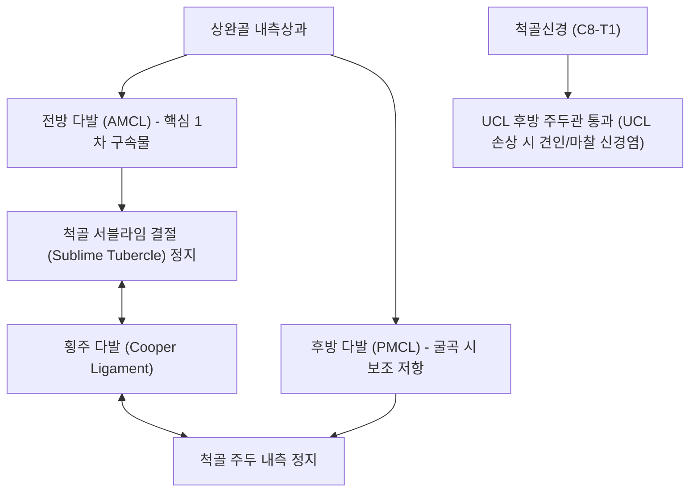

# 🦴 [[구조물/인대/척측측부인대|척측측부인대]] (Ulnar Collateral Ligament of Elbow, UCL / 자쪽곁인대)

> **핵심 요약 (Key Summary)**:
> - 📍 **해부 & 주행**: 주관절 내측을 지지하는 핵심 인대 복합체로, **전방 다발(Anterior bundle)**, 후방 다발(Posterior bundle), 횡주 다발(Transverse bundle)의 3개 섬유군으로 구성된다. 특히 **상완골 내측상과에서 척골 구상돌기 결절(Sublime tubercle)에 정지하는 전방 다발이 외반 안정성의 핵심 1차 구속물**이다. 바로 뒤쪽으로 [[척골신경]](Ulnar nerve)이 통과한다.
> - ⚙️ **생체역학적 핵심 기능**: 야구 투구 및 오버헤드 투척 동작 시 팔꿈치에 가해지는 극심한 **외반(Valgus) 스트레스와 신전 과부하를 차단하는 1차 정적 억제기**이다. 전완 굴근-회내근군(Flexor-Pronator mass)이 동적 협동근으로 작용한다.
> - 🛠️ **임상 평가 & 치료**: 투구 후기 콕킹 및 가속기 내측 팔꿈치 파열통. 이동 외반 스트레스 검사([[이동 외반 스트레스 검사|Moving valgus stress test]]) 및 밀킹 검사(Milking maneuver)로 진단한다. 파열 시 토미 존 수술(Tommy John surgery)의 표적이다. 소해(HT3)·소해(SI8) 자침, [[약침]], 굴근-회내근 강화 및 견갑-체간 운동사슬 교정 추나 요법을 적용한다.

---

## 📌 목차
1. [해부학적 정밀 구조 및 주행/부착](#1-해부학적-정밀-구조-및-주행부착)
2. [생체역학·기능 (Biomechanics)](#2-생체역학기능-biomechanics)
3. [임상 평가 및 이학적 검사](#3-임상-평가-및-이학적-검사)
4. [초음파 해부학(Sonoanatomy) 및 중재 랜드마크](#4-초음파-해부학sonoanatomy-및-중재-랜드마크)
5. [⭐ 원장님 심층 임상 고찰 및 원본 필기 (Clinical Pearls)](#5--원장님-심층-임상-고찰-및-원본-필기-clinical-pearls)
6. [관련 임상 질환 및 손상](#6-관련-임상-질환-및-손상)
7. [추나·도수치료 & 침구·약침·재활 프로토콜](#7-추나도수치료--침구약침재활-프로토콜)
8. [출처 및 학술 참고 문헌 (References)](#8-출처-및-학술-참고-문헌-references)

---

## 1. 해부학적 정밀 구조 및 주행/부착

| 인대 다발 | 기시부 (Origin) | 정지부 (Insertion) | 주요 해부학적 및 기능적 특징 |
| :--- | :--- | :--- | :--- |
| **전방 다발 (Anterior Bundle, AMCL)** | [[상완골]] 내측상과(Medial epicondyle) 전하면 | [[척골]] 구상돌기 내측 결절(**Sublime tubercle**) | **주관절 외반 저항의 주력 (약 55~70% 담당)**. 전사방/후사방 밴드로 교대 긴장 |
| **후방 다발 (Posterior Bundle)** | 상완골 내측상과 후하면 | 척골 주두(Olecranon) 내측연 | 부채꼴 형태로 주관절 90도 이상 굴곡 시 팽팽해지며 외반 보조 저항 |
| **횡주 다발 (Transverse Bundle)** | 척골 주두 내측 | 척골 구상돌기 결절 | 척골 내 부착 인대로 관절 안정성 기여는 미약 (쿠퍼 인대) |
| **인접 신경 주행** | 인대 후방 1~2mm 뒤쪽으로 주관절 주두구(Cubital tunnel)를 통과하는 **[[척골신경]](Ulnar nerve)** 주행 |

---

## 2. 생체역학·기능 (Biomechanics)

* **오버헤드 투구 시의 극단적 외반 토크 (Valgus Torque in Throwing)**:
  * 야구 투수가 공을 던질 때 콕킹 후기(Late cocking)에서 가속기(Acceleration)로 넘어가는 순간 주관절에는 약 **64~100 N·m에 달하는 극심한 외반 토크**가 집중된다.
  * 이는 UCL의 생체역학적 극한 인장 강도(약 30~35 N·m)를 초과하는 수치로, 인대 단독으로는 견딜 수 없으며 **전완 굴근-회내근군([[원회내근]], [[요측수근굴근]])의 동시 수축**이 필수적으로 뒷받침되어야 한다.
* **굴곡 각도별 하중 분담**:
  * 완전 신전(0도): 관절면 골성 맞물림과 전방 관절낭이 외반력의 50%를 지탱.
  * **20~120도 굴곡 범위**: 골성 지지가 해제되며 **전방 다발(AMCL)이 외반력의 70% 이상을 단독으로 방어**.
* **외반 확장 과부하 증후군 (Valgus Extension Overload, VEO)**:
  * UCL이 늘어나면 팔꿈치가 안쪽으로 벌어지면서 반대편 외측 구획([[요골]]두-상완골 소두)에는 압박 연골 손상이, 후방 구획(주두-주두와)에는 [[상완삼두근]] 견인과 함께 골극 충돌이 발생하는 연쇄 파탄이 초래된다.

---

## 3. 임상 평가 및 이학적 검사

* **1. 이동 외반 스트레스 검사 ([[이동 외반 스트레스 검사|Moving Valgus Stress Test]]) — 표준 진단**:
  * 환자의 어깨를 90도 외전시킨 상태에서 검사자가 일정한 외반력을 주면서 주관절을 120도 굴곡에서 30도 신전까지 빠르게 움직임.
  * **70도에서 120도 굴곡 구간(Shear angle)**에서 찢어지는 듯한 날카로운 내측 통증이 재현되면 양성 (민감도 100%, 특이도 75%).
* **2. 밀킹 검사 (Milking Maneuver)**:
  * 어깨 90도 외전, 팔꿈치 90도 굴곡 상태에서 환자의 엄지손가락을 아래에서 잡아당겨 내측에 외반력을 가할 때 통증 재현 확인.
* **3. 25도 굴곡 외반 스트레스 검사 (Valgus Stress Test at 25°)**:
  * 주관절을 25도 굴곡하여 골성 주두 잠금을 해제한 후 외반 스트레스 시 내측 관절선 개대(Laxity) 및 종말감 확인.
* **4. 척골신경 기능 및 [[골프엘보]](내측상과염) 감별**:
  * 4, 5지 저림, 골간근 위축, 주두관 틴넬 징후(Tinel sign) 동반 여부 및 수근 굴근 저항 검사와 감별.

---

## 4. 초음파 해부학(Sonoanatomy) 및 중재 랜드마크

* **초음파 스캔 랜드마크**:
  * 탐촉자를 주관절 내측상과와 척골 서블라임 결절을 잇는 종단(Longitudinal)으로 거치.
  * 상완골 도르래와 척골 관절면 위를 가로지르는 두께 약 4~6mm의 균일한 고에코 섬유성 띠(전방 다발)를 관찰.
  * 표재부의 전완 굴근-회내근군 총건 부착부와 구별.
* **동적 초음파 외반 스트레스 검사 (Dynamic Valgus Ultrasound)**:
  * 초음파를 보면서 팔꿈치에 외반력을 가했을 때 상완-척골 관절 간격이 **건측 대비 1.0mm 이상(또는 절대값 3.0mm 이상) 벌어지면** UCL 기능 부전 및 부분/완전 파열로 진단.
  * **T-징후 (T-Sign)**: 조영제 또는 혈종이 척골 부착부(Sublime tubercle) 박리 틈새로 T자 형태로 스며드는 소견.
* **중재 시술 자침 랜드마크**:
  * 내측상과 전하방에서 서블라임 결절 부착부를 향해 초음파 유도 하에 진입. 바로 뒤를 지나는 척골신경을 반드시 피해 인대 실질 부착부로 약침액 주입.

---

## 5. ⭐ 원장님 심층 임상 고찰 및 원본 필기 (Clinical Pearls)

> [!IMPORTANT]
> **진료실 핵심 감별 및 치료 노하우**:
> 1. **"골프엘보(내측상과염)로 오진하지 말 것"**:
>    - 야구, 배드민턴, 테니스를 치는 환자가 내측 팔꿈치 통증으로 오면 80% 이상이 '골프엘보' 진단을 받고 온다.
>    - 그러나 손목을 아래로 굽힐 때 아프면 내측상과염(근건 병변)이지만, **공을 던질 때 콕킹/릴리즈 순간 팔꿈치가 빠질 듯이 아프다면 십중팔구 UCL 파열**이다. 이동 외반 검사(Moving valgus) 한 번으로 즉시 갈라낼 수 있다.
> 2. **척골신경염의 뿌리는 인대 불안정성**:
>    - 4, 5지가 저리다고 주두관 증후군 신경 수술만 고려하지 말고, UCL이 늘어나서 팔꿈치가 외반될 때마다 척골신경이 활시위처럼 팽팽하게 당겨지는(Traction neuritis) 인대 이완성 신경통인지 감별해야 한다.
> 3. **치료와 투구 메커니즘 교정**:
>    - 인대 부착부 [[신바로약침|신바로 약침]]과 함께, 투구 시 골반 회전과 견갑대 안정성이 떨어져 팔로만 던지는 '암 슬로잉(Arm throwing)'을 교정하지 않으면 치료 후 재투구 시 100% 재파열된다.

---

## 6. 관련 임상 질환 및 손상

* **척측측부인대 파열 ([[토미 존 수술|UCL Tear / Rupture]])**:
  * 투수의 반복 투구에 의한 만성 마모 및 급성 파열.
* **외반 확장 과부하 증후군 (Valgus Extension Overload, VEO)**:
  * 외반 불안정성에 따른 후방 주두 골극 충돌 및 외측 소두 연골 연화증(OCD).
* **척골신경병증 ([[주관절 터널 증후군|Cubital Tunnel Syndrome]])**:
  * UCL 불안정성으로 인한 신경 견인 및 마찰성 신경염.

---

## 7. 추나·도수치료 & 침구·약침·재활 프로토콜

### 1) 한의 보존적 재활 및 추나요법
* **전완 굴근-회내근군 동적 강화 (Dynamic Sling Training)**:
  * UCL의 인장력을 덜어주기 위해 척측수근굴근, 요측수근굴근, 원회내근의 편심성 강화 훈련 시행.
* **주관절 및 견갑골 운동사슬 교정 추나**:
  * 주두의 후방 아탈구를 교정하고, 흉추 회전 가동성 및 견갑골 후인력을 회복하여 투구 시 팔꿈치 외반 토크를 경감.

### 2) 침구 및 약침 치료 프로토콜
* **주요 혈위**:
  * 소해(HT3): 내측상과와 주두 사이, UCL 전방 다발 부착부 직상방.
  * 소해(SI8): 주두와 내측상과 사이 주두관, 척골신경 안정화.
  * 곡택(PC3), 수삼리(LI10): 전완 굴근군 긴장 완화.
* **약침 프로토콜**:
  * 상완골 내측상과 전하면 및 척골 서블라임 결절 인대 부착부에 [[신바로약침|신바로 약침]] 또는 봉약침 0.3~0.5cc를 정밀 주입하여 콜라겐 섬유 재형성 및 미세 혈종 흡수 촉진.

---

## 8. 출처 및 학술 참고 문헌 (References)

1. **Fleisig GS, et al. (2026)**. Baseball has an elbow injury problem: biomechanics may have the solution. *Sports Biomech*. 25(8):1137-1155. PMID: 42312376.
   - `[연구 요약]` 야구 투수에서 척측측부인대(UCL) 손상을 유발하는 투구 동작별 외반 토크의 생체역학적 기전과 부상 예방을 위한 운동역학적 해법 종합 분석.
2. **Fleisig GS, et al. (2025)**. Risk Factors for an Ulnar Collateral Ligament Injury Resulting in Surgery: A Prospective Longitudinal Study of 305 Professional Baseball Pitchers. *Orthop J Sports Med*. 13(7):23259671251351339. PMID: 40620726.
   - `[연구 요약]` 프로 야구 투수 305명을 대상으로 척측측부인대 파열 및 수술적 재건(토미 존 수술)을 초래하는 피치 속도, 피로도 및 외반 하중 위험 인자 전향적 코호트 연구.
