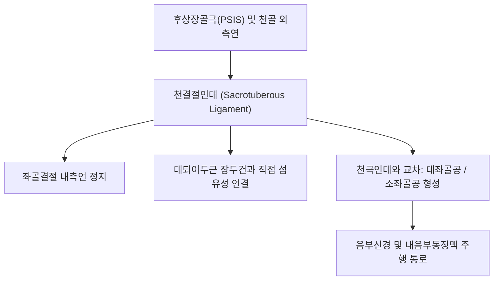

# 🦴 [[구조물/인대/천결절인대|천결절인대]] (Sacrotuberous Ligament / 엉치결절인대)

> **핵심 요약 (Key Summary)**:
> - 📍 **해부 & 주행**: [[후상장골극]](PSIS), [[천골]](Sacrum) 외측연, 미골에서 기시하여 외하방으로 비스듬히 주행한 뒤 [[좌골결절]](Ischial tuberosity) 내측연에 정지하는 넓고 강인한 부채꼴 골반 인대이다. [[천극인대]](Sacrospinous ligament)와 교차하여 **대좌골공과 소좌골공을 형성**하며, 천층으로 [[대둔근]]이 기시하고 원위부에서 **[[대퇴이두근]] 장두건과 직접 섬유성으로 연속**된다.
> - ⚙️ **생체역학적 핵심 기능**: 체중 부하 시 천골이 전하방으로 기울어지는 **천골 뉴테이션(Nutation, 끄덕임)을 제어하는 1차 정적 구속물**이다. [[흉요근막]]—[[천장관절]]—천결절인대—[[대퇴이두근]]으로 이어지는 후방 나선형 근막 사슬(Superficial Back Line)의 핵심 결속점이다.
> - 🛠️ **임상 평가 & 치료**: 천장관절 증후군, 좌골결절 부착부염, [[음부신경 포착 증후군]](Alcock 관 증후군)에서 핵심 병변 부위이다. 좌골결절 압통 및 패트릭 검사([[패트릭 검사|Patrick FABER test]])로 진단한다. 질변(BL54)·포황(BL53)·승부(BL36) 자침, [[약침]], 천골 변위 교정 추나 요법을 적용한다.

---

## 📌 목차
1. [해부학적 정밀 구조 및 주행/부착](#1-해부학적-정밀-구조-및-주행부착)
2. [생체역학·기능 (Biomechanics)](#2-생체역학기능-biomechanics)
3. [임상 평가 및 이학적 검사](#3-임상-평가-및-이학적-검사)
4. [초음파 해부학(Sonoanatomy) 및 중재 랜드마크](#4-초음파-해부학sonoanatomy-및-중재-랜드마크)
5. [⭐ 원장님 심층 임상 고찰 및 원본 필기 (Clinical Pearls)](#5--원장님-심층-임상-고찰-및-원본-필기-clinical-pearls)
6. [관련 임상 질환 및 손상](#6-관련-임상-질환-및-손상)
7. [추나·도수치료 & 침구·약침·재활 프로토콜](#7-추나도수치료--침구약침재활-프로토콜)
8. [출처 및 학술 참고 문헌 (References)](#8-출처-및-학술-참고-문헌-references)

---

## 1. 해부학적 정밀 구조 및 주행/부착

| 해부학적 항목 | 정밀 기술 내용 |
| :--- | :--- |
| **기시부 (Origin)** | 골반 [[후상장골극]](PSIS), 후하장골극(PIIS), 제3~5[[천골]] 외측연 및 미골(Coccyx) 외측 |
| **정지부 (Insertion)** | [[좌골결절]](Ischial tuberosity)의 내측연 및 좌골지(Ischial ramus) |
| **겸상돌기 (Falciform Process)** | 인대 섬유 일부가 좌골지를 따라 전내측으로 뻗어 나가 음부신경관(Alcock's canal)의 하벽을 형성 |
| **근막 및 건 연계** | **표재면**: [[대둔근]] 하부 섬유의 기시 건막과 융합. **원위단**: [[대퇴이두근]](Biceps femoris) 장두건과 섬유성 연속(Direct continuity) |
| **신경 및 혈관 통과** | 천결절인대와 천극인대 사이로 **[[음부신경]](Pudendal nerve)**, 내음부동정맥이 주행 |

---

## 2. 생체역학·기능 (Biomechanics)

* **천골 뉴테이션의 1차 억제기 (Primary Restraint to Sacral Nutation)**:
  * 서 있거나 걸을 때 상체의 체중이 요추를 거쳐 천골 기저부(Sacral base)로 전달되면 천골은 앞·아래로 고꾸라지려는 **뉴테이션(Nutation) 회전 토크**를 받는다.
  * 천결절인대는 천골 첨부가 뒤로 들리는 것을 밑에서 강하게 잡아당겨 저지함으로써, 천장관절의 **형태 폐쇄(Form closure) 및 힘 폐쇄(Force closure)**를 완성한다.
* **표재 후방선의 장력 전달 통로 (Kinetic Chain Transmission)**:
  * 토마스 마이어스(Myers)의 근막경선 이론에 따르면, 척추기립근과 흉요근막의 장력은 천골과 천결절인대를 거쳐 **대퇴이두근 → 비골두 → 전경골근**으로 직접 이어진다.
  * 햄스트링의 단축이나 과긴장은 천결절인대를 팽팽하게 당겨 천장관절 전단력을 가중시킨다.

---

## 3. 임상 평가 및 이학적 검사

* **1. 천결절인대 국소 압통 검사 (Ligamentous Palpation)**:
  * 환자를 복와위로 눕히고 좌골결절 내측연에서 천골 외측 하단을 향해 엄지손가락으로 45도 상내측 방향으로 압박.
  * 천장관절염 환자에서 날카로운 국소 압통 및 둔부 방사통 재현 시 양성.
* **2. 패트릭 검사 ([[패트릭 검사|Patrick FABER Test]])**:
  * 굴곡, 외전, 외회전 스트레스 시 후방 천장관절 및 천결절인대 부위의 통증 유발 확인.
* **3. 골반 비틀림 및 다리 길이 검사**:
  * 천골 카운터-뉴테이션(후방 변위) 시 천결절인대가 팽팽해지며 환측 기능적 장족/단족 변위 유발.
* **4. 음부신경 압박 검사**:
  * 좌골결절 내측 겸상돌기 부위를 압박했을 때 회음부, 항문 주위의 찌릿한 방사통 재현 여부 확인.

---

## 4. 초음파 해부학(Sonoanatomy) 및 중재 랜드마크

* **초음파 스캔 랜드마크**:
  * 환자를 복와위로 눕히고 탐촉자를 좌골결절에서 천골 외측연으로 사선(Oblique sagittal) 거치.
  * 좌골결절 피질골에서 천골 하단으로 비스듬히 뻗어 올라가는 두껍고 균일한 고에코 섬유성 띠로 관찰됨 (두께 약 3~5mm).
  * 표재부의 두꺼운 대둔근 근육층과 구별.
* **병리적 초음파 소견**:
  * 좌골결절 부착부의 저에코성 비후, 부착부 골극(Enthesophyte), 석회화 침착 및 음부신경 주행부 부종 관찰.
* **중재 시술 자침 랜드마크**:
  * 좌골결절 내측연에서 천골 방향으로 초음파 유도 하에 대둔근을 관통하여 천결절인대 실질 및 심층 공간으로 정밀 자입.

---

## 5. ⭐ 원장님 심층 임상 고찰 및 원본 필기 (Clinical Pearls)

> [!IMPORTANT]
> **진료실 핵심 감별 및 치료 노하우**:
> 1. **"햄스트링이 안 늘어나는 진짜 범인은 천결절인대다"**:
>    - 좌전굴(앞으로 굽히기)이 안 되고 햄스트링 스트레칭을 아무리 해도 통증이 지속되는 환자는, 근육 자체가 아니라 **천결절인대와 대퇴이두근 건막의 유착**이 원인인 경우가 많다.
>    - 좌골결절 바로 안쪽의 천결절인대 부착부를 풀어주면 즉각적으로 고관절 굴곡 각도가 10~20도 이상 증가한다.
> 2. **원인 모를 꼬리뼈 통증과 회음부 불쾌감 (음부신경통)**:
>    - 산후 여성이나 만성 골반통 환자가 "의자에 앉으면 꼬리뼈와 회음부, 엉덩이 깊은 곳이 찌릿하게 저리다"고 호소하면 치질이나 비뇨기과 질환이 아닌 **천결절인대-천극인대 사이의 음부신경 포착**을 1순위로 의심해야 한다.
> 3. **치료 프로토콜**:
>    - 방광경의 포황(BL53), 질변(BL54) 및 승부(BL36) 혈위에 심자하여 천결절인대 장력을 이완시키고, 좌골결절 부착부에 [[신바로약침|신바로 약침]]을 주입하면 만성 골반통과 좌골신경통이 신속히 완화된다.

---

## 6. 관련 임상 질환 및 손상

* **천장관절 증후군 ([[천장관절 증후군|Sacroiliac Joint Dysfunction]])**:
  * 골반 변위로 인한 천결절인대의 만성 신연 및 이완성 동통.
* **음부신경 포착 증후군 ([[음부신경 포착 증후군|Pudendal Nerve Entrapment]])**:
  * 천결절인대 겸상돌기와 천극인대 사이에서 음부신경이 눌려 발생하는 회음부 통증.
* **좌골결절 건인대염 (Ischial Tuberosity Enthesopathy)**:
  * 햄스트링 기시부와 천결절인대 정지부의 만성 과사용 염증.

---

## 7. 추나·도수치료 & 침구·약침·재활 프로토콜

### 1) 한의 보존적 재활 및 추나요법
* **천장관절 교정 추나 (Sacroiliac Joint Mobilization)**:
  * 천골 후방 변위를 교정하여 천결절인대의 과도한 긴장을 감압.
  * 장골 후하방/전상방 회전 변위를 바로잡는 골반 드롭(Drop) 및 수기 교정.
* **햄스트링-천결절인대 근막 이완술**:
  * 좌골결절 내외측 건-인대 이행부에 심부 횡마찰 마사지(Cross-friction) 적용.

### 2) 침구 및 약침 치료 프로토콜
* **주요 혈위**:
  * 포황(BL53), 질변(BL54): 천골 외측연 천결절인대 기시부.
  * 승부(BL36): 둔근하 주름 중앙, 햄스트링 및 인대 부착부.
  * 환도(GB30): 좌골신경 주행로 감압.
* **약침 프로토콜**:
  * 좌골결절 내측 인대 부착부 및 천골 외측연에 [[신바로약침|신바로 약침]] 0.5~1.0cc를 정밀 주입하여 만성 인대 견인성 염증을 완화하고 골반 인대 결합력을 강화.

---

## 8. 출처 및 학술 참고 문헌 (References)

1. **Eşkin Tanrıverdi MD, et al. (2026)**. Applied surgical anatomical approach to pudendal nerve: Step-by-step key neurovascular structures for pelvic nerve surgery. *Int J Gynaecol Obstet*. 175(2):715-723. PMID: 42104845.
   - `[연구 요약]` 골반 신경 수술 시 천결절인대(STL)와 천극인대(SSL) 사이를 통과하는 음부신경 및 주요 신경혈관 구조의 정밀 해부학적 랜드마크 제시.
2. **Shams RK, et al. (2024)**. A Rare Case of Partially Ossified Sacrospinous Ligament Causing Sciatic Nerve Compression. *Mymensingh Med J*. 33(4):1288-1290. PMID: 39351755.
   - `[연구 요약]` 골반 인대 복합체(천결절인대 및 천극인대)의 병리적 비후 및 골화가 좌골신경과 음부신경 포착에 미치는 임상적 영향 고찰.
