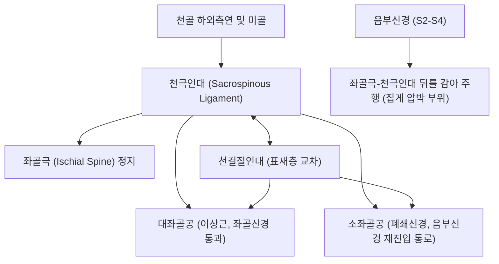

# 🦴 [[구조물/인대/천극인대|천극인대]] (Sacrospinous Ligament / 엉치가시인대)

> **핵심 요약 (Key Summary)**:
> - 📍 **해부 & 주행**: [[천골]](Sacrum) 하부 외측연 및 미골에서 기시하여 외측으로 주행한 뒤 **[[좌골극]](Ischial spine)**에 정지하는 얇고 강인한 삼각형 인대이다. 천결절인대 심층에 위치하며 [[미골근]](Coccygeus muscle)과 밀접히 융합된다. 대좌골공(Greater sciatic foramen)과 소좌골공(Lesser sciatic foramen)을 나누는 경계 구조물이다.
> - ⚙️ **생체역학적 핵심 기능**: [[천결절인대]](STL)와 협동하여 천골의 과도한 뉴테이션(끄덕임 회전)을 제어하고 골반저(Pelvic floor)의 후방 지지력을 완성한다. 특히 **[[음부신경]](Pudendal nerve)과 내음부혈관이 이 인대의 첨단(좌골극 뒤쪽)을 감아 돌며 주행**하므로 신경 포착의 해부학적 병목 지점이 된다.
> - 🛠️ **임상 평가 & 치료**: **[[음부신경 포착 증후군]](Pudendal neuralgia, 만성 골반통증)** 및 자전거 안장통의 핵심 병변 부위이다. 좌골극 압통 및 착석 시 회음부 작열통으로 진단한다. 차료(BL32)·중료(BL33)·회음(CV1) 자침, [[약침]], 좌골극 주변 심부 근막이완 및 골반저 이완 추나 요법을 적용한다.

---

## 📌 목차
1. [해부학적 정밀 구조 및 주행/부착](#1-해부학적-정밀-구조-및-주행부착)
2. [생체역학·기능 (Biomechanics)](#2-생체역학기능-biomechanics)
3. [임상 평가 및 이학적 검사](#3-임상-평가-및-이학적-검사)
4. [초음파 해부학(Sonoanatomy) 및 중재 랜드마크](#4-초음파-해부학sonoanatomy-및-중재-랜드마크)
5. [⭐ 원장님 심층 임상 고찰 및 원본 필기 (Clinical Pearls)](#5--원장님-심층-임상-고찰-및-원본-필기-clinical-pearls)
6. [관련 임상 질환 및 손상](#6-관련-임상-질환-및-손상)
7. [추나·도수치료 & 침구·약침·재활 프로토콜](#7-추나도수치료--침구약침재활-프로토콜)
8. [출처 및 학술 참고 문헌 (References)](#8-출처-및-학술-참고-문헌-references)

---

## 1. 해부학적 정밀 구조 및 주행/부착

| 해부학적 항목 | 정밀 기술 내용 |
| :--- | :--- |
| **기시부 (Origin)** | 제2~4[[천골]](Sacrum) 하외측연 및 미골(Coccyx) 외측면 |
| **정지부 (Insertion)** | 골반 **[[좌골극]](Ischial spine)**의 첨단부(Apex) |
| **형태 및 층위** | 기저부(천골)에서 정점(좌골극)으로 모이는 삼각형 형태. [[천결절인대]]의 전내측(심층)에 위치 |
| **근육과의 융합** | 인대 전면(골반강 쪽)이 [[미골근]](Coccygeus muscle) 근섬유와 치밀하게 융합되어 주행 |
| **골반 구멍 구획** | 좌골절흔을 **대좌골공(상방 통로)**과 **소좌골공(하방 통로)**으로 양분하는 결정적 랜드마크 |
| **핵심 신경혈관 주행** | **[[음부신경]](Pudendal nerve)** 및 내음부동정맥이 대좌골공을 나와 천극인대 표면(좌골극 뒤)을 감아 돈 뒤 소좌골공으로 진입 |

---

## 2. 생체역학·기능 (Biomechanics)

* **골반 환(Pelvic Ring) 안정화 및 회전 제어**:
  * 천골 하단이 후상방으로 들리는 것을 억제하여 천장관절의 회전 불안정성을 차단한다.
* **골반저(Pelvic Floor) 현수 지지 구조**:
  * 미골근 및 항문거근과 함께 골반강 내부 장기(방광, 자궁, 직장)를 아래에서 떠받치는 기계적 기저판 역할을 한다.
  * 부인과 영역에서 자궁탈출증 치료를 위한 '천극인대 고정술(Sacrospinous ligament fixation)'의 외과적 닻(Anchor) 역할을 담당할 정도로 강인한 인장 강도를 지닌다.
* **음부신경 집게(Pincer) 메커니즘**:
  * 천극인대와 표재부의 천결절인대는 가위(Scissor)처럼 서로 교차하며 그 사이로 음부신경을 통과시킨다.
  * 골반의 뒤틀림이나 장시간 착석 압박 시 두 인대가 신경을 집게처럼 짓누르는 생체역학적 포착을 유발한다.

---

## 3. 임상 평가 및 이학적 검사

* **1. 좌골극 압통 검사 (Ischial Spine Palpation)**:
  * 둔부 후방 접근 또는 질/직장 수지 검사를 통해 좌골극을 촉진하고 천극인대 부착부를 압박.
  * 회음부 및 생식기로 뻗치는 극심한 날카로운 압통 및 방사통(Tinel sign) 재현 시 양성.
* **2. 낭트(Nantes) 진단 기준 (음부신경 포착증 표준)**:
  * ① 음부신경 분포 부위(항문-회음부-생식기) 통증.
  * ② **의자에 앉으면 통증 악화**.
  * ③ 밤에 자는 동안에는 통증으로 깨지 않음.
  * ④ 객관적 감각 결손(마비)은 없음.
  * ⑤ 진단적 신경 차단(약침/국소마취) 시 즉각 통증 소실.
* **3. 둔부 피하 롤링 검사**:
  * 천골 주변 피부와 피하조직을 집어 올릴 때 극심한 압통 유발 확인.

---

## 4. 초음파 해부학(Sonoanatomy) 및 중재 랜드마크

* **초음파 스캔 랜드마크 (좌골극 레벨)**:
  * 환자를 복와위로 눕히고 탐촉자를 대전자와 천골 중간 지점에 횡단/사선 거치.
  * 둔근 심층에서 고에코 삼각형 골성 돌출부로 나타나는 **[[좌골극]](Ischial spine)**을 확인.
  * 좌골극에서 천골 외측으로 뻗어나가는 얇은 고에코 선상 밴드(천극인대)를 관찰.
  * 컬러 도플러로 좌골극 바로 내측을 감아 도는 **내음부동맥(Internal pudendal artery)**의 맥동 신호를 확인 (음부신경은 동맥 바로 내측에 주행).
* **중재 시술 자침 랜드마크**:
  * 초음파 유도 하에 내음부동맥 맥동을 실시간 감시하면서, 혈관 손상을 피해 좌골극 첨단 천극인대 주변부로 바늘을 정밀 진입하여 신경 주위 약침술 시행.

---

## 5. ⭐ 원장님 심층 임상 고찰 및 원본 필기 (Clinical Pearls)

> [!IMPORTANT]
> **진료실 핵심 감별 및 치료 노하우**:
> 1. **"도넛 방석 환자의 90%는 천극인대 병변이다"**:
>    - 푹신한 소파나 단단한 의자에 앉기만 하면 꼬리뼈와 엉덩이 깊은 곳, 사타구니가 타는 듯이 아파서 도넛 방석을 끼고 다니는 만성 골반통 환자는 척추 디스크나 전립선염이 아닌 **천극인대 부위의 음부신경 포착증**이다.
>    - 환자에게 **"변기 시트에 앉을 때는 통증이 덜합니까?"**라고 물어보았을 때 "그렇다"고 대답하면(가운데가 뚫려 좌골극 압박이 줄어들기 때문) 낭트 기준에 부합하는 결정적 단서가 된다.
> 2. **사이클 라이더의 '안장 마비(Saddle Anesthesia)'**:
>    - 자전거 안장에 회음부가 지속적으로 눌리며 천극인대가 비후된 라이더는 성기 감각 저하와 발기부전을 호소한다. 이 경우 안장 세팅 교정과 함께 천극인대 부착부 이완이 필수적이다.
> 3. **침구 치료의 핵심 혈위**:
>    - 방광경의 차료(BL32), 중료(BL33) 및 천골공 심자, 그리고 좌골극을 향해 진입하는 질변(BL54) 심자 침치료가 천극인대 연축을 푸는 핵심 열쇠이다. 여기에 [[신바로약침|신바로 약침]]을 주입하면 수년 된 만성 회음부 통증이 극적으로 호전된다.

---

## 6. 관련 임상 질환 및 손상

* **음부신경 포착 증후군 ([[음부신경 포착 증후군|Pudendal Neuralgia, Alcock Canal Syndrome]])**:
  * 천극인대와 천결절인대 사이 집게 포착으로 인한 난치성 회음부 통증.
* **만성 골반통증 증후군 ([[만성 골반통증 증후군|Chronic Pelvic Pain Syndrome, CPPS]])**:
  * 비세균성 전립선통, 여성 만성 외음부통증의 근골격계적 원인.
* **미골통 ([[미골통|Coccydynia]])**:
  * 미골과 천골 외측 인대 부착부의 만성 견인성 염증.

---

## 7. 추나·도수치료 & 침구·약침·재활 프로토콜

### 1) 한의 보존적 재활 및 추나요법
* **골반저근 및 이상근 이완 추나**:
  * 좌골극 주변 골반저 연부조직의 과긴장을 완화하기 위해 이상근, 내폐쇄근의 수기 이완술(MET/PIR) 적용.
* **천골-장골 뉴테이션 교정**:
  * 천골의 비대칭적 비틀림 변위를 바로잡아 천극인대에 걸리는 편측성 과장력을 해소.

### 2) 침구 및 약침 치료 프로토콜
* **주요 혈위**:
  * 차료(BL32), 중료(BL33): 제2~3천골공, 음부신경 기원부 순경 혈위.
  * 질변(BL54): 좌골극 및 천극인대 외측단 심부 자침.
  * 회음(CV1): 회음부 신경 종말 긴장 완화.
* **약침 프로토콜**:
  * 좌골극 외측 및 천극인대 부착부 주변에 [[신바로약침|신바로 약침]] 또는 자하거 약침 0.5cc를 정밀 주입하여 신경 주위 무균성 염증을 제거하고 신경막 부종을 완화.

---

## 8. 출처 및 학술 참고 문헌 (References)

1. **Eşkin Tanrıverdi MD, et al. (2026)**. Applied surgical anatomical approach to pudendal nerve: Step-by-step key neurovascular structures for pelvic nerve surgery. *Int J Gynaecol Obstet*. 175(2):715-723. PMID: 42104845.
   - `[연구 요약]` 골반 신경 수술 시 천극인대(SSL)와 좌골극을 감아 도는 음부신경의 해부학적 랜드마크 및 집게형 신경 포착 기전 분석.
2. **Shams RK, et al. (2024)**. A Rare Case of Partially Ossified Sacrospinous Ligament Causing Sciatic Nerve Compression. *Mymensingh Med J*. 33(4):1288-1290. PMID: 39351755.
   - `[연구 요약]` 천극인대의 비후 및 골화가 좌골신경 및 음부신경 주행로 압박에 미치는 병태생리학적 증례 연구.
