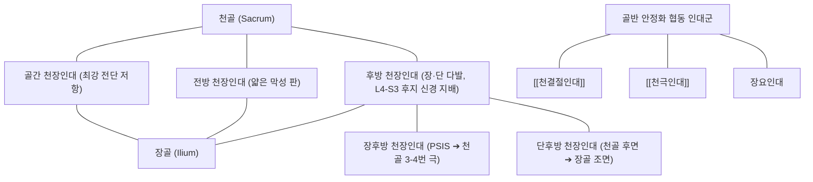

# [[천장인대]] (Sacroiliac Ligament)

> **핵심 요약 (Key Summary)**:
> 천골과 장골을 결합하는 강력한 인대 복합체로 전방 천장인대, 골간 천장인대, 후방 천장인대(장·단 다발)로 구성되어 골반환의 전단 하중을 분담하고 [[천장관절]] 안정성을 유지.
> 후방 천장인대는 관절외 통증의 가장 핵심적인 병소로 지목되며, L4~S3 척수신경 후지의 풍부한 신경 지배를 받아 둔부 및 대퇴 후면으로의 방사통을 유발.
> 릴랙신 등 호르몬성 인대 이완에 따른 골반대 통증 증후군 및 회전 전단 외상 시 이완증의 주 표적으로 초음파 유도 재생 치료와 골반대 폐쇄력 강화 재활의 핵심 표적.

---

## 📌 목차
1. [해부학적 정밀 구조 및 주행/부착](#1-해부학적-정밀-구조-및-주행부착)
2. [생체역학·기능 (Biomechanics)](#2-생체역학기능-biomechanics)
3. [임상 평가 및 이학적 검사](#3-임상-평가-및-이학적-검사)
4. [초음파 해부학(Sonoanatomy) 및 중재 랜드마크](#4-초음파-해부학sonoanatomy-및-중재-랜드마크)
5. [⭐ 원장님 심층 임상 고찰 및 원본 필기 (Clinical Pearls)](#5--원장님-심층-임상-고찰-및-원본-필기-clinical-pearls)
6. [관련 임상 질환 및 손상](#6-관련-임상-질환-및-손상)
7. [추나·도수치료 & 침구·약침·재활 프로토콜](#7-추나도수치료--침구약침재활-프로토콜)
8. [출처 및 학술 참고 문헌 (References)](#8-출처-및-학술-참고-문헌-references)

---

## 1. 해부학적 정밀 구조 및 주행/부착

* **전방 천장인대 (Anterior Sacroiliac Ligament)**:
  * [[장골]]의 이개면 전하방 경계에서 [[천골]] 골반면 전외측으로 이어지는 얇은 섬유막성 인대.
  * 상대적으로 두께가 얇아 전방 벌림 스트레스에는 비교적 취약하나, 골반강 내부 장기를 보호하는 전벽 안정화에 기여.
* **골간 천장인대 (Interosseous Sacroiliac Ligament)**:
  * 천골 조면(Sacral tuberosity)과 장골 조면(Iliac tuberosity) 사이의 깊은 홈을 가득 채우는 인체에서 가장 두껍고 강력한 인대 섬유 다발.
  * 천골과 장골 사이의 미세 이동(Nutation 및 Counter-nutation) 시 발생하는 강력한 수직 압박 및 전단 하중(Shear force)을 일차적으로 흡수.
* **후방 천장인대 (Posterior Sacroiliac Ligament)**:
  * **장후방 천장인대 (Long Posterior Sacroiliac Ligament, LPSL)**: [[후상장골극]](PSIS) 내측에서 기시하여 하방으로 주행, 제3~4 천골 극돌기 외측 및 [[천결절인대]]의 근위 섬유와 직접 융합. 카운터뉴테이션(Counter-nutation, 천골 후굴) 시 팽팽하게 긴장.
  * **단후방 천장인대 (Short Posterior Sacroiliac Ligament, SPSL)**: 천골 후면 상부와 장골 조면 내측을 비스듬하게 연결하는 짧고 두터운 다발로, 천골의 전굴(Nutation)을 제동.
* **신경 지배 및 감각 수용기**:
  * L4, L5 신경근 및 S1~S3 척수신경 후지 외측 분지(Lateral branches of dorsal rami)의 풍부한 자유 신경 종말 및 루피니 소체가 분포하여 요배통 및 둔부 연관통의 주요 통각 수용기로 기능.

---

## 2. 생체역학·기능 (Biomechanics)

* **형태 폐쇄(Form Closure)와 힘 폐쇄(Force Closure)의 결합**:
  * **형태 폐쇄력 (Form Closure)**: 천골 이개면의 쐐기형(Wedge) 형태, 거친 관절 연골의 융기 및 골간 천장인대의 강력한 결합 장력에 의한 수동적 골성 맞물림.
  * **힘 폐쇄력 (Force Closure)**: [[대둔근]], [[이상근]], [[광배근]]의 흉요근막 연계, [[복횡근]], 골반저근의 수축 장력이 후방 천장인대와 결합하여 보행 주기 시 단단한 압박 안정성(Joint compression) 형성.
* **천골의 가동역학 제어**:
  * **뉴테이션 (Nutation, 천골 전굴)**: 보행 시 충격 흡수 위치로, 단후방 천장인대, 천결절인대, 천극인대가 팽팽해져 안정성이 극대화됨.
  * **카운터뉴테이션 (Counter-nutation, 천골 후굴)**: 장후방 천장인대(LPSL)가 인장 부하를 독점적으로 감당하므로, 골반 후방 회전 변위 시 LPSL의 만성 긴장 및 미세 손상이 호발함.
* **호르몬성 인대 이완 (Relaxin Mechanism)**:
  * 임신 및 수유기 중 분비되는 [[릴랙신]] 호르몬은 천장인대 복합체의 콜라겐 가교 결합을 이완시켜 산도를 확보하나, 출산 후 골반 전단 불안정성 및 [[골반대 통증]]을 유발하는 생체역학적 취약 요인이 됨.

---

## 3. 임상 평가 및 이학적 검사

* **3대 이상 양성 복합 유발 검사 (van der Wurff & Laslett 배터리)**:
  * 단일 검사의 진단율 한계를 극복하기 위해 5~6개 도발 검사 중 **3개 이상 양성**일 때 천장관절 병변 진단(민감도 91%, 특이도 87%):
  1. **패트릭 검사 (FABER Test)**: 환측 고관절 굴곡·외전·외회전 후 무릎을 지긋이 누를 때 천골 후방 인대부 국소 통증 유발.
  2. **건슬렌 검사 (Gaenslen's Test)**: 검사대 끝에서 환측 하지를 신전시키고 건측 무릎을 가슴으로 당길 때 전단 응력에 의한 후방 통증 재현.
  3. **압박 검사 (Compression Test)**: 측와위에서 장골능을 바닥 방향으로 수직 압박하여 후방 천장인대 복합체를 신장시킴.
  4. **이개 검사 (Distraction Test)**: 앙와위에서 양측 ASIS를 후외측으로 벌려 전방 인대를 신장하고 후방 관절면을 압박.
  5. **대퇴 전단 검사 (Thigh Thrust Test / P4 Test)**: 고관절 90도 굴곡 상태에서 대퇴골 장축을 따라 후방으로 체중 부하를 가함.
* **장후방 천장인대(LPSL) 국소 촉진 검사**:
  * PSIS의 바로 하내측 1cm 부위에서 천골 외측 연을 따라 LPSL을 직접 촉진할 때 극심한 날카로운 압통(Finger sign 양성) 확인.
* **감별 진단**:
  * 요추 추간판 탈출증([[요추 추간판 탈출증]]) 및 신경근병증: [[SLR test]] 음성 및 신경학적 결손 부재 확인.
  * 후관절 증후군: Kemp 검사 시 천골보다 상부 요추 후관절 국소 압통 확인.
  * [[이상근 증후군]]: FAIR 검사 시 좌골신경 주행 부위 저림 동반 여부 감별.

---

## 4. 초음파 해부학(Sonoanatomy) 및 중재 랜드마크

* **초음파 탐촉자 위치 및 랜드마크**:
  * 고주파 선형 또는 볼록형 탐촉자를 PSIS 상에 횡단(Transverse)으로 거치한 후 천골 방향(내하방)으로 스캔.
  * **PSIS의 고에코 골격 랜드마크**와 **천골 외측 능선(Sacral crest)** 사이를 연결하는 두터운 섬유성 고음영 띠로 관찰되는 후방 천장인대(LPSL) 확인.
* **후방 천장인대 중재술 표적**:
  * 천장관절 후방 관절낭 입구 및 LPSL 부착부의 심부 결합 조직.
  * In-plane 접근법으로 외측에서 내측으로 자입하여 인대-골 부착부(Enthesis)에 바늘 끝이 정확히 접촉하도록 유도.
* **혈관 및 신경 위험 구조 회피**:
  * 제1~3 천골공(Sacral foramen)에서 빠져나오는 천골 신경 후지 및 상둔동맥(Superior gluteal artery) 분지의 박동성 혈류를 도플러로 확인하고 안전 마진 확보.

---

## 5. ⭐ 원장님 심층 임상 고찰 및 원본 필기 (Clinical Pearls)

* **관절내(Intra-articular)보다 인대 부착부(Enthesis)가 주범이다**:
  * 임상에서 천장관절 통증을 호소하는 환자의 대다수는 관절 연골 자체의 마모보다는 후방 천장인대(LPSL) 및 골간 인대의 만성 견인성 이완증(Laxity)과 부착부 미세 파열이 원인입니다. 관절강 내 주사보다 인대 부착부 약침/프롤로 치료가 반응이 훨씬 신속한 이유입니다.
* **PSIS 하단 압통점 촉진의 실전 팁**:
  * 환자를 복와위로 눕히고 엄지손가락으로 PSIS의 '아래쪽 턱'을 걸어 올리듯이 내측 사선 방향으로 지긋이 누르면, 만성 요통 환자에서 펄쩍 뛸 정도의 극심한 압통점이 나타납니다. 환자가 "선생님, 바로 거기가 묵직하고 아픈 지점이에요"라고 호소하는 정확한 병소입니다.
* **보행 시 앉았다 일어설 때의 '잠김' 증상**:
  * "의자에 오래 앉아 있다가 일어설 때 허리와 엉치가 굳어서 바로 펴지 못하고 엉거주춤 걷는다"는 호소는 전형적인 천장인대 이완성 불안정성 패턴입니다. 일어서서 몇 걸음 걸으면 천골이 형태 폐쇄 위치로 복귀하면서 증상이 다소 완화됩니다.
* **대둔근-광배근 후방 사선 사슬(POS)과의 치료적 통합**:
  * 후방 천장인대만 치료해서는 재발을 막을 수 없습니다. 대측 광배근과 동측 대둔근을 잇는 후방 사선 사슬(Posterior Oblique Sling)을 함께 강화해야만 인대에 가해지는 전단력이 지속적으로 분산됩니다.

---

## 6. 관련 임상 질환 및 손상

| 질환 및 손상 유형 | 주요 병태생리 기전 | 전형적 임상 증상 및 징후 |
| :--- | :--- | :--- |
| [[천장관절 증후군]] | 후방 천장인대 및 골간 인대의 만성 견인성 미세 파열 | PSIS 부위 둔통, 장시간 좌위 또는 기립 시 통증 악화 |
| [[골반대 통증]] | 임신·출산기 릴랙신 분비로 인한 인대 이완 및 골반 비틀림 | 치골결합부 및 둔부 통증, 뒤척임 및 한 발 서기 제한 |
| 천장인대 급성 염좌 | 낙상, 교통사고, 발을 헛디딤에 의한 수직 전단 외상 | 수상 직후 극심한 체중 부하 불능, PSIS 주위 급성 부종 |
| 강직성 척추염 천장관절염 | 인대-골 부착부(Enthesis)의 자가면역성 무균 염증 및 골화 | 조조강직 >30분, 휴식 시 악화되고 활동 시 호전되는 야간 둔부통 |
| 골반 환 손상 (APC Type II) | 고에너지 외상으로 인한 전방 치골결합 및 전방 천장인대 파열 | 골반 개폐성(Open-book) 불안정성, 골반환 내 대량 출혈 위험 |

---

## 7. 추나·도수치료 & 침구·약침·재활 프로토콜

### 1) 추나 및 관절가동술 (Manual Therapy)
* **장골 후방 회전 교정 추나 (Anterior Innominate Thrust)**:
  * 장골이 후하방으로 변위되어 LPSL이 과도하게 팽팽해진 환자에게 측와위에서 ASIS와 좌골결절을 지지점으로 하여 장골을 전상방으로 회전 교정.
* **천골 가동술 (Sacral Wobble Technique)**:
  * 복와위에서 호흡 주기에 맞추어 흡기 시 천골 기저부를 복측으로, 호기 시 천골첨을 압박하여 관절 내 뇌척수액 순환과 인대 장력 균형 회복.
* **근에너지기법 (MET)**:
  * 고관절 굴곡근과 신근의 등척성 상호 억제를 유도하여 골반환의 비틀림을 스스로 바로잡도록 유도.

### 2) 침구 및 약침 복합 치료
* **핵심 혈위 자침**:
  * 차료(BL32), 중료(BL33), 방광유(BL28), 백환유(BL30): 천골공 주변 및 천장관절 후방 인대 심부로 2.5~3치 호침을 자입하여 국소 허혈 개선.
  * 질변(BL54), 환도(GB30): 천장관절 통증으로 2차 경직된 대둔근 및 이상근 이완.
* **약침 처방 (Prolotherapy 원리 접목)**:
  * **신바로 약침 / 자하거 약침**: PSIS 하단 및 LPSL 부착부 4~6개 지점에 각 0.3~0.5cc씩 골막 접촉 후 분주하여 인대 콜라겐 섬유 신생 촉진.
  * **봉독 약침 (BV)**: 만성 염증 및 부착부염(Enthesopathy)이 동반된 경우 희석 봉독을 주입하여 강력한 혈류 개선 및 항염 작용 유도.

### 3) 단계별 재활 및 코어 안정화
* **1단계 (급성기/통증 조절)**:
  * 천장관절 안정화 벨트(Sacroiliac Belt) 착용으로 인대 전단력 물리적 차단.
* **2단계 (골반 폐쇄력 재활)**:
  * [[복횡근]] 수축을 동반한 브릿지(Glute bridge), 클램쉘(Clamshell), 버드독(Bird-dog) 운동 적용.
* **3단계 (기능적 사슬 강화)**:
  * 런지 및 싱글 레그 데드리프트를 통해 보행 시 한 발 지지 안정성 회복.

---

## 8. 출처 및 학술 참고 문헌 (References)

1. **McCormick ZL, et al. (2025)**. Consensus practice guidelines on sacroiliac joint complex pain from a multispecialty, international working group. *Pain Med*. 26(12):817-917. PMID: 41318933.
   - `[연구 요약]` 천장관절 복합체 통증의 해부학적 신경 지배(L4-S3 후지 분지)와 관절외 인대 구조물(후방 천장인대)의 주된 병인학적 기여를 정립하고 다학제 진단 및 중재 가이드라인 제시.
2. **Casaroli G, et al. (2020)**. What do we know about the biomechanics of the sacroiliac joint and of sacropelvic fixation? A literature review. *Med Eng Phys*. 76():1-12. PMID: 31866118.
   - `[연구 요약]` 천장관절의 형태 폐쇄 및 힘 폐쇄 메커니즘, 골간 천장인대 및 후방 천장인대의 3차원 전단 하중 전달 역학 분석.
3. **Jordan MC, et al. (2024)**. Do we need another screw? Sacroiliac screw fixation in open-book pelvic ring injuries (APC type II). *EFORT Open Rev*. 9(8):827-836. PMID: 39087500.
   - `[연구 요약]` 골반환 손상에서 전방 및 후방 천장인대 복합체의 파열 양상과 천장관절 나사 고정술 시 인대 안정성 회복 분석.
